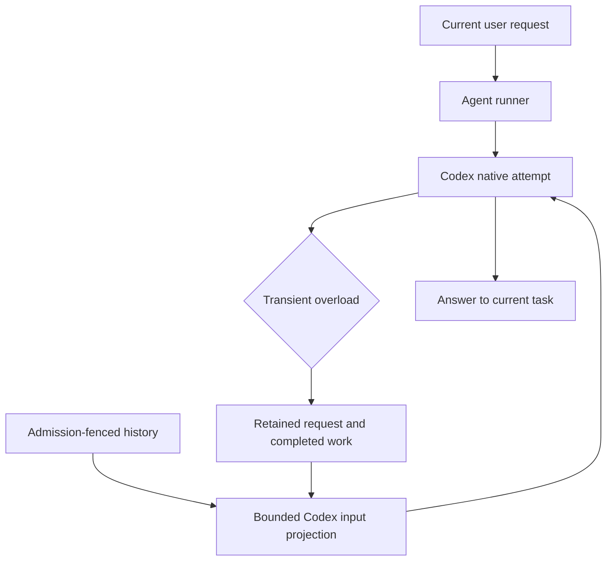

Codex review: needs maintainer review before merge. _Reviewed October 7, 2026, 10:19 PM ET / October 8, 2026, 02:19 UTC (Revision 2)._

# ClawSweeper review

## What this changes

The branch carries the current request and completed work into Codex retries and preserves that work through a later plugin refresh.

**Example:** Submit Task B after Task A completes and encounter an overload after a file read.
- **Before:** The rebuilt retry omits Task B and the read receipt, then answers Task A.
- **After:** The retry retains Task B and the receipt, answers Task B, and performs exactly one read.

## Review scores

| Measure | Result | What it means |
|---|---|---|
| **Overall readiness** | 🦞 diamond lobster **(5/6)** | A focused, owner-supported repair with production-boundary before/after proof, meaningful negative controls, and no actionable finding. |
| **Proof confidence** | 🦞 diamond lobster **(5/6)** | Sufficient (live_output): The supplied before/after results exercise shared recovery through an isolated production Gateway and real native Codex transport with injected overloads before work and after a real read; fixed retries retain Task B and completed evidence with one read. The merge refresh preserves the tested retry implementation, with additional exact-head regression results. No stored-data contract changes. |
| **Patch quality** | 🦞 diamond lobster **(5/6)** | No actionable review findings were identified. |

## Product

**Kind:** Bug fix · **Worth it:** Yes · **Fix scope:** Complete
**User problem:** After a temporary overload, Codex can answer an older task while leaving the user’s current request unanswered.
**Reason:** The change repairs an observed wrong-task response through the existing recovery owner. The area owner’s proposal explicitly accepts the optional harness extension and documents its compatibility behavior.

## Merge readiness

✅ **Ready for maintainer review**

This PR remains useful: current main still lacks the retry context carrier, the supplied production proof exercises the defect, and no blocking patch finding remains.

**Priority:** P1
**Reviewed head:** `97b78087ce082f31789da22586f63356414408d5`

## Before merge

None.

## Findings

None.

<strong>Agent review details</strong>

### How this fits together

OpenClaw’s agent runner coordinates retries and passes prepared work to the Codex plugin, which builds input for the native Codex app-server. The changed path restores current-turn context that the historical transcript intentionally excludes.

### Technical review

Best possible solution:

Keep current-turn recovery context with the shared runner and let Codex consume it through the existing bounded projection without replaying completed actions.

Do we have a high-confidence way to reproduce the issue?

Yes: the admission-fenced read excludes the current turn while baseline recovery substitutes a generic prompt, and the supplied Gateway/native-Codex fault injection demonstrates the resulting Task A answer. This read-only review did not execute a reproduction.

Is this the best way to solve the issue?

Yes: the shared runner retains current-turn facts and the existing Codex projection consumes them, preserving the admission fence, legacy harness behavior, and completed-action handling.

AGENTS.md: found and applied where relevant.

Codex review notes: model internal, reasoning medium; reviewed against [3ac5189b9446](https://github.com/openclaw/openclaw/commit/3ac5189b94461aac254aae9ee638e769204314ab).

### Provenance checked

- `src/agents/embedded-agent-runner/run/attempt-recovery.ts and run/session-prompt-state.ts` keeps the original intent (https://github.com/openclaw/openclaw/pull/139397: Continue after temporary provider limits against recorded work without appending the original user request again.)
- `src/agents/embedded-agent-runner/run/session-prompt-state.ts raw-model guard` keeps the original intent (https://github.com/openclaw/openclaw/pull/160803: Raw model runs have no transcript history, so retries must retain the original prompt.)
- `extensions/codex/src/app-server/run-attempt-prompt.ts and run-attempt.ts` keeps the original intent (https://github.com/openclaw/openclaw/pull/145917: Preserve admitted input and completed native work through managed Codex replacement using the existing continuation and projection owners.)
- `src/agents/embedded-agent-runner/plugin-runtime-refresh.ts, run/run-attempt-dispatch.ts, and run/types.ts` keeps the original intent (https://github.com/openclaw/openclaw/pull/145648: Keep one continuation owner across plugin generations and retain completed work without repeating effects.)

### Testing

Proof path: shipped entry point. Added test files: 4.

### Security

None.

### Evidence

What I checked:

- **Pinned introduced delta:** Reviewed the merge-base-to-head delta rather than treating current-main drift or the stale test merge as PR edits. ([97b78087ce08](https://github.com/openclaw/openclaw/commit/97b78087ce082f31789da22586f63356414408d5))
- **Current-main necessity and base compatibility:** None of the introduced paths changed between the pinned base and fetched main. Main retains transcript-only continuation without this branch’s request-and-snapshot carrier. ([`src/agents/embedded-agent-runner/run/session-prompt-state.ts:279`](https://github.com/openclaw/openclaw/blob/3ac5189b94461aac254aae9ee638e769204314ab/src/agents/embedded-agent-runner/run/session-prompt-state.ts#L279), [3ac5189b9446](https://github.com/openclaw/openclaw/commit/3ac5189b94461aac254aae9ee638e769204314ab))
- **Production recovery owner:** Transient recovery supplies the attempt snapshot; session prompt state retains the original request and accumulates snapshots while preserving the raw-model guard and model-only continuation instruction. ([`src/agents/embedded-agent-runner/run/session-prompt-state.ts:284`](https://github.com/openclaw/openclaw/blob/97b78087ce082f31789da22586f63356414408d5/src/agents/embedded-agent-runner/run/session-prompt-state.ts#L284), [97b78087ce08](https://github.com/openclaw/openclaw/commit/97b78087ce082f31789da22586f63356414408d5))
- **Bounded, non-authorizing Codex consumption:** Codex appends retained work through its existing bounded projection, preserves tool results with existing redaction, and keeps live host and connection assertions. The carrier does not mint execution authority or persist a new user turn. ([`extensions/codex/src/app-server/run-attempt-prompt.ts:168`](https://github.com/openclaw/openclaw/blob/97b78087ce082f31789da22586f63356414408d5/extensions/codex/src/app-server/run-attempt-prompt.ts#L168), [97b78087ce08](https://github.com/openclaw/openclaw/commit/97b78087ce082f31789da22586f63356414408d5))
- **Production fault-injection proof:** The supplied PR body, captured at source revision a631455156e36c8b57ced64f083f23e146508311bd5719b473d42b34243ae5a9, records fresh AWS runs through an isolated Gateway and real native Codex client against a loopback provider. Before-work and after-read overloads fail on baseline and retain Task B after the fix; the after-read case records exactly one read. This proves transport and recovery behavior, not real-model semantics. ([b9f716812899](https://github.com/openclaw/openclaw/commit/b9f71681289994c55721a2e5f25e9c22eacfa139))
- **Regression coverage and merge refresh:** The new Codex suite uses an actual SQLite admission receipt and verifies that fenced history excludes Task B before checking native turn input. The body reports four production-reverted negative controls and the overload-to-refresh negative control, followed by 112 passing tests and affected type checks on the refreshed head. Tests were inspected, not executed during this review. ([`extensions/codex/src/app-server/run-attempt.retry-continuation.test.ts:30`](https://github.com/openclaw/openclaw/blob/97b78087ce082f31789da22586f63356414408d5/extensions/codex/src/app-server/run-attempt.retry-continuation.test.ts#L30), [97b78087ce08](https://github.com/openclaw/openclaw/commit/97b78087ce082f31789da22586f63356414408d5))

Likely related people:

- **steipete:** Suggested for follow-up; no historical authorship or introduction is verified. (role: unverified routing candidate; confidence: low)
- **changeroa:** Suggested for follow-up; no historical authorship or introduction is verified. (role: unverified routing candidate; confidence: low)

### PR surface

Source +46, Tests +232, Docs +16. Total +294 across 13 files.

View PR surface stats

| Area | Files | Added | Removed | Net |
|---|---:|---:|---:|---:|
| Source | 7 | 69 | 23 | +46 |
| Tests | 5 | 232 | 0 | +232 |
| Docs | 1 | 16 | 0 | +16 |
| Config | 0 | 0 | 0 | 0 |
| Generated | 0 | 0 | 0 | 0 |
| Other | 0 | 0 | 0 | 0 |
| **Total** | **13** | **317** | **23** | **+294** |

### Review metrics

| Metric | Value | Why it matters |
|---|---|---|
| **Harness contract extension** | 1 optional parameter; 0 new configuration options | The documented carrier repairs fenced retries while keeping harnesses that ignore it source-compatible. |

### Root-cause cluster

Relationship: `fixed_by_candidate`
Canonical: https://github.com/openclaw/openclaw/issues/165463
Summary: This PR is the proven candidate repair for the reported fenced-history retry defect and builds on the earlier request-preservation proposal.

Members:
- `canonical`: https://github.com/openclaw/openclaw/issues/165463 - The open report defines the two sequential-task overload scenarios addressed by this branch.
- `same_root_cause`: https://github.com/openclaw/openclaw/pull/165593 - The open earlier proposal targets the same missing current request; this branch credits it and also retains completed-work snapshots.

Proposal only: this assessment does not dispatch repair, suppress jobs, mutate sibling items, close, or merge anything.

### Labels

Label changes:

- add `rating: 🦞 diamond lobster`: Overall readiness is 🦞 diamond lobster; proof is 🦞 diamond lobster and patch quality is 🦞 diamond lobster.
- remove `rating: 🐚 platinum hermit`: Current PR rating is `rating: 🦞 diamond lobster`, so this older rating label is no longer current.

Label justifications:

- `P1`: Observed overload retries can deliver a successful-looking answer to a previous task instead of the current request.
- `merge-risk: 🚨 compatibility`: The harness API gains an optional context carrier; the accepted design documents legacy behavior and retains the raw-model exception.
- `rating: 🦞 diamond lobster`: Overall readiness is 🦞 diamond lobster; proof is 🦞 diamond lobster and patch quality is 🦞 diamond lobster.
- `status: 👀 ready for maintainer look`: ClawSweeper has no concrete contributor-facing blocker left for this PR.
- `proof: sufficient`: Contributor real behavior proof is sufficient.

### Rating scale

6/6 🦀 challenger crab · 5/6 🦞 diamond lobster · 4/6 🐚 platinum hermit · 3/6 🦐 gold shrimp · 2/6 🦪 silver shellfish · 1/6 🧂 unranked krab. Overall follows the weaker of proof and patch quality; ✨ marks media proof (a screenshot, video, or linked artifact) that directly shows the changed behavior.

### Workflow

ClawSweeper edits this one comment on every review. Comment `@clawsweeper re-review` for a fresh review only; repair and merge need explicit maintainer commands such as `@clawsweeper autofix` or `@clawsweeper automerge`.

### History

Review history (1 earlier review cycle)

<!-- clawsweeper-review-history v=1 total=1 -->
- reviewed 2026-10-08T01:41:19.889Z sha b9f71681289994c55721a2e5f25e9c22eacfa139 :: needs maintainer review before merge. :: none

<!-- clawsweeper-verdict:needs-human item=166868 sha=97b78087ce082f31789da22586f63356414408d5 confidence=high updated_at=2026-10-08T02:14:34Z reviewed_at=2026-10-08T02:19:16.999Z lease_owner=github-run-37716824061-1 lease_comment_id=6050783639 source_revision=a631455156e36c8b57ced64f083f23e146508311bd5719b473d42b34243ae5a9 live_verification=absent -->
<!-- clawsweeper-review-state:ready item=166868 sha=97b78087ce082f31789da22586f63356414408d5 v=1 -->

<!-- clawsweeper-review-version item=166868 reviewed_at=2026-10-08T02:19:16.999Z sha=97b78087ce082f31789da22586f63356414408d5 source_revision=a631455156e36c8b57ced64f083f23e146508311bd5719b473d42b34243ae5a9 lease_owner=github-run-37716824061-1 lease_comment_id=6050783639 v=1 -->

<!-- clawsweeper-review item=166868 -->