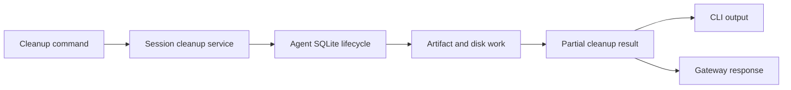

Codex review: needs maintainer review before merge. _Reviewed August 30, 2026, 6:22 AM ET / 10:22 UTC._

# ClawSweeper review

## What this changes

The PR retains successful per-agent cleanup summaries and reports the failing store plus its commit state when a later multi-store cleanup step fails.

## Merge readiness

⚠️ **Ready for maintainer review - 2 items remain**

Keep open: current main still loses completed cleanup summaries when a later store throws, while this branch carries a typed partial outcome from the cleanup owner through the CLI and Gateway. No blocking correctness defect was found in the proposed repair.

**Priority:** P1
**Reviewed head:** `61e1fab88e5f8eece325ee4bf93c77848582d2e7`

## Review scores

| Measure | Result | What it means |
|---|---|---|
| **Overall readiness** | 🐚 platinum hermit **(4/6)** | A focused owner-level SQLite fault proof and targeted caller coverage support a coherent repair, with the substantial but explained production growth keeping the rating at the normal good tier. |
| **Proof confidence** | 🦞 diamond lobster **(5/6)** | Sufficient (terminal): The PR body provides an exact-head terminal trace for the real cleanup owner using two SQLite agent stores and injected second-store lifecycle/artifact faults; the observed result preserves the committed first-store summary and distinguishes pre- from post-commit failure. Targeted CLI and Gateway tests supplement that owner-boundary proof. |
| **Patch quality** | 🐚 platinum hermit **(4/6)** | No actionable review findings were identified. |

## Verification

| Check | Result | Evidence |
|---|---|---|
| **Real behavior** | Verified | Sufficient (terminal): The PR body provides an exact-head terminal trace for the real cleanup owner using two SQLite agent stores and injected second-store lifecycle/artifact faults; the observed result preserves the committed first-store summary and distinguishes pre- from post-commit failure. Targeted CLI and Gateway tests supplement that owner-boundary proof. |
| **Evidence reviewed** | 6 items | Current-main behavior: Current main builds summaries inside the per-target loop and returns them only after every target completes; a later rejection therefore exits before the accumulated result is returned. Owner-boundary repair: The PR catches failures around the sequential apply loop, preserves earlier summaries, and records whether the failing target's SQLite lifecycle committed. Commit-state observation: The lifecycle accessor invokes the callback immediately after the prepared SQLite write returns, before later artifact publication can fail. |
| **Findings** | None | None. |
| **Security** | None | None. |

## How this fits together

Session cleanup applies maintenance sequentially to agent SQLite stores. The cleanup service supplies results to the local CLI and Gateway, which surface completed work and failures to operators and automation.

## Before merge

- [ ] **Resolve merge risk (P1)** - Production code grows by a net 216 lines in session-maintenance failure handling; the new partial-result contract and lifecycle-commit signal justify the added behavior, but this remains a compatibility-sensitive error path to inspect with exact-head CI.
- [ ] **Complete next step (P2)** - The open PR already owns the bounded repair; it needs normal exact-head maintainer and CI handling rather than a parallel fix job.

<strong>Agent review details</strong>

### Security

None.

### PR surface

Source +224, Tests +312, Other 0. Total +536 across 12 files.

View PR surface stats

| Area | Files | Added | Removed | Net |
|---|---:|---:|---:|---:|
| Source | 7 | 399 | 175 | +224 |
| Tests | 4 | 331 | 19 | +312 |
| Docs | 0 | 0 | 0 | 0 |
| Config | 0 | 0 | 0 | 0 |
| Generated | 0 | 0 | 0 | 0 |
| Other | 1 | 1 | 1 | 0 |
| **Total** | **12** | **731** | **195** | **+536** |

### Review metrics

| Metric | Value | Why it matters |
|---|---|---|
| **Production vs test delta** | production +389/-173 (net +216); tests/support +341/-21 (net +320) | The production growth implements the partial-result and commit-state contract; the focused tests cover real SQLite failure ordering plus CLI and Gateway mapping. |

### Root-cause cluster

Relationship: `fixed_by_candidate`
Canonical: https://github.com/openclaw/openclaw/issues/127583
Summary: This PR is the explicit candidate fix for the linked issue's same multi-store cleanup reporting defect.

Members:
- `canonical`: https://github.com/openclaw/openclaw/issues/127583 - Its current-main SQLite reproduction and requested partial-result contract match the behavior implemented here.

Proposal only: this assessment does not dispatch repair, suppress jobs, mutate sibling items, close, or merge anything.

### Merge-risk options

**Maintainer options:**
1. **Decide the mitigation before merge**  
   Keep one cleanup-owner partial-result contract, preserving only completed stores and the failing target’s lifecycle state, then let the CLI and Gateway present that result without attempting cross-store rollback.
2. **Pause or close**  
   Do not merge this PR until maintainers decide whether the risk is worth taking.

### Technical review

Best possible solution:

Keep one cleanup-owner partial-result contract, preserving only completed stores and the failing target’s lifecycle state, then let the CLI and Gateway present that result without attempting cross-store rollback.

Do we have a high-confidence way to reproduce the issue?

Yes. The supplied exact-head evidence runs the cleanup owner against two real SQLite stores and injects a second-store failure after the first has committed; current-main source confirms it previously returned no partial outcome.

Is this the best way to solve the issue?

Yes. Returning a typed partial result from the sequential cleanup owner is the narrowest durable fix; downstream-only CLI handling could not recover summaries discarded by the owner.

AGENTS.md: found and applied where relevant.

Codex review notes: model internal, reasoning high; reviewed against [6549b0a7c534](https://github.com/openclaw/openclaw/commit/6549b0a7c534750d9d6cbef305233b162704b291).

### Labels

Label justifications:

- `P1`: A failed multi-store cleanup currently hides already committed session-store maintenance from operators and automation.
- `rating: 🐚 platinum hermit`: Overall readiness is 🐚 platinum hermit; proof is 🦞 diamond lobster and patch quality is 🐚 platinum hermit.
- `status: 👀 ready for maintainer look`: ClawSweeper has no concrete contributor-facing blocker left for this PR. Sufficient (terminal): The PR body provides an exact-head terminal trace for the real cleanup owner using two SQLite agent stores and injected second-store lifecycle/artifact faults; the observed result preserves the committed first-store summary and distinguishes pre- from post-commit failure. Targeted CLI and Gateway tests supplement that owner-boundary proof.
- `proof: sufficient`: Contributor real behavior proof is sufficient. The PR body provides an exact-head terminal trace for the real cleanup owner using two SQLite agent stores and injected second-store lifecycle/artifact faults; the observed result preserves the committed first-store summary and distinguishes pre- from post-commit failure. Targeted CLI and Gateway tests supplement that owner-boundary proof.

### Evidence

What I checked:

- **Current-main behavior:** Current main builds summaries inside the per-target loop and returns them only after every target completes; a later rejection therefore exits before the accumulated result is returned. ([`src/config/sessions/cleanup-service.ts:568`](https://github.com/openclaw/openclaw/blob/6549b0a7c534/src/config/sessions/cleanup-service.ts#L568), [6549b0a7c534](https://github.com/openclaw/openclaw/commit/6549b0a7c534))
- **Owner-boundary repair:** The PR catches failures around the sequential apply loop, preserves earlier summaries, and records whether the failing target's SQLite lifecycle committed. ([`src/config/sessions/cleanup-service.ts:661`](https://github.com/openclaw/openclaw/blob/61e1fab88e5f/src/config/sessions/cleanup-service.ts#L661), [61e1fab88e5f](https://github.com/openclaw/openclaw/commit/61e1fab88e5f))
- **Commit-state observation:** The lifecycle accessor invokes the callback immediately after the prepared SQLite write returns, before later artifact publication can fail. ([`src/config/sessions/session-accessor.sqlite-projection.ts:318`](https://github.com/openclaw/openclaw/blob/61e1fab88e5f/src/config/sessions/session-accessor.sqlite-projection.ts#L318), [61e1fab88e5f](https://github.com/openclaw/openclaw/commit/61e1fab88e5f))
- **Caller coverage:** The CLI recognizes only a validated partial Gateway error result, renders it, and sets a nonzero exit status; the Gateway returns that partial result in error details and emits invalidation for a committed failing lifecycle. ([`src/commands/sessions-cleanup.ts:279`](https://github.com/openclaw/openclaw/blob/61e1fab88e5f/src/commands/sessions-cleanup.ts#L279), [61e1fab88e5f](https://github.com/openclaw/openclaw/commit/61e1fab88e5f))
- **Regression coverage and supplied behavior proof:** The added service test uses two real SQLite agent stores, injects both pre- and post-commit faults in the second, and verifies the first summary survives with the correct commit classification; focused CLI and Gateway tests cover presentation and rejection details. ([`src/config/sessions/cleanup-service.applied-summary.test.ts:131`](https://github.com/openclaw/openclaw/blob/61e1fab88e5f/src/config/sessions/cleanup-service.applied-summary.test.ts#L131), [61e1fab88e5f](https://github.com/openclaw/openclaw/commit/61e1fab88e5f))
- **History and release status:** The exact head consists of the two partial-cleanup commits, is not contained in a local release tag, and is not on the fetched current main; the fix remains an open PR rather than implemented work. ([`src/config/sessions/cleanup-service.ts:661`](https://github.com/openclaw/openclaw/blob/61e1fab88e5f/src/config/sessions/cleanup-service.ts#L661), [61e1fab88e5f](https://github.com/openclaw/openclaw/commit/61e1fab88e5f))

Likely related people:

- **steipete:** Suggested for follow-up; no historical authorship or introduction is verified. (role: unverified routing candidate; confidence: low)
- **Ayaan Zaidi:** Suggested for follow-up; no historical authorship or introduction is verified. (role: unverified routing candidate; confidence: low)

### Rating scale

| Score | Internal tier | Crab rank | Meaning |
|---:|:---:|---|---|
| **6/6** | S | 🦀 challenger crab | Exceptional readiness |
| **5/6** | A | 🦞 diamond lobster | Very strong readiness |
| **4/6** | B | 🐚 platinum hermit | Good normal PR; ordinary maintainer review |
| **3/6** | C | 🦐 gold shrimp | Useful, but confidence is limited |
| **2/6** | D | 🦪 silver shellfish | Proof or implementation needs work |
| **1/6** | F | 🧂 unranked krab | Not merge-ready |
| N/A | NA | 🌊 off-meta tidepool | Rating does not apply |

Overall follows the weaker of proof and patch quality.
Shiny media proof means a screenshot, video, or linked artifact directly shows the changed behavior. Runtime, network, CSP, and security claims still need visible diagnostics.

### Workflow

- ClawSweeper keeps one durable marker-backed review comment per issue or PR.
- Re-runs edit this comment so the latest verdict, findings, and automation markers stay together instead of adding duplicate bot comments.
- A fresh review can be triggered by eligible `@clawsweeper re-review` comments, exact-item GitHub events, scheduled/background review runs, or manual workflow dispatch.
- PR/issue authors and users with repository write access can comment `@clawsweeper re-review` or `@clawsweeper re-run` on an open PR or issue to request a fresh review only.
- Maintainers can also comment `@clawsweeper review` to request a fresh review only.
- Fresh-review commands do not start repair, autofix, rebase, CI repair, or automerge.
- Maintainer-only repair and merge flows require explicit commands such as `@clawsweeper autofix`, `@clawsweeper automerge`, `@clawsweeper fix ci`, or `@clawsweeper address review`.
- Maintainers can comment `@clawsweeper explain` to ask for more context, or `@clawsweeper stop` to stop active automation.

### History

Review history (28 earlier review cycles; latest 8 shown)

<!-- clawsweeper-review-history v=1 total=28 -->
- reviewed 2026-08-29T16:26:02.224Z sha def16fa726e1c025f60e5e7b86bc8b9de8b69e2d :: needs changes before merge. :: [P1] Propagate prior local-store summaries | [P1] Restore the mocked partial-error export
- reviewed 2026-08-29T16:39:49.731Z sha 8818407c76ad540338bd198bb89cab9a9ce114ce :: needs changes before merge. :: [P1] Restore the cleanup-result serializer import | [P1] Propagate prior local-store summaries
- reviewed 2026-08-29T16:53:31.071Z sha 1540b946dbe35087dc46d620bcc3013cda012544 :: needs changes before merge. :: [P1] Restore the cleanup-result serializer import | [P1] Aggregate prior local-store summaries before rethrowing
- reviewed 2026-08-29T17:50:28.559Z sha 958d379792de3039b149c13ae7ffde934d74db26 :: needs changes before merge. :: [P1] Preserve single-store result semantics on partial failure | [P2] Validate Gateway partial-failure details before rendering
- reviewed 2026-08-29T18:07:26.228Z sha 618872825330406e5a03e03271b9105b7584abf2 :: needs real behavior proof before merge. :: [P1] Retain earlier local-store summaries before rethrowing | [P1] Preserve the single-store JSON shape on partial failure | [P2] Validate Gateway partial details before rendering
- reviewed 2026-08-29T19:17:17.956Z sha 386d705575595554776e0eacac33bafb51c1436f :: needs changes before merge. :: [P1] Preserve failure state for one-store Gateway responses | [P1] Use the current artifact-summary shape in the runtime test | [P1] Pass the required cause to the partial-error fixture | [P2] Reject non-object partial errors before dereferencing
- reviewed 2026-08-29T20:43:36.236Z sha c84baf4b2d480e1043238a0a0ee61590b4494e61 :: needs changes before merge. :: [P1] Require a partial-error marker before unwrapping rejected RPC details | [P1] Preserve one-target scope when no completed summary exists
- reviewed 2026-08-29T22:10:12.317Z sha e0e2beb9505876f1b7123ba52cc69e16e303d18f :: needs maintainer review before merge. :: none

<!-- clawsweeper-verdict:needs-human item=128905 sha=61e1fab88e5f8eece325ee4bf93c77848582d2e7 confidence=high updated_at=2026-08-30T10:18:54Z reviewed_at=2026-08-30T10:22:13.827Z lease_owner=github-run-33306121856-1 lease_comment_id=5468099555 source_revision=a7edecc407b3a3278a40369568c7efc144a2e8f164dfc4ae7c65f73d52ec17e2 live_verification=absent -->

<!-- clawsweeper-review-version item=128905 reviewed_at=2026-08-30T10:22:13.827Z sha=61e1fab88e5f8eece325ee4bf93c77848582d2e7 source_revision=a7edecc407b3a3278a40369568c7efc144a2e8f164dfc4ae7c65f73d52ec17e2 lease_owner=github-run-33306121856-1 lease_comment_id=5468099555 v=1 -->

<!-- clawsweeper-review item=128905 -->