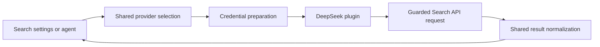

Codex review: needs changes before merge.

## What this changes

Adds DeepSeek’s standalone Search API to the official DeepSeek plugin, including discovery, setup, credential fallback, documentation, and coverage.

**Example:** Search for "OpenClaw site:docs.openclaw.ai" with count 3 and the installed DeepSeek plugin.
- **Before:** DeepSeek cannot serve managed web_search requests.
- **After:** Selecting DeepSeek returns source URLs and summaries through the standalone Search API.

## Review scores

| Measure | Result | What it means |
|---|---|---|
| **Overall readiness** | 🦞 diamond lobster **(5/6)** | A focused plugin integration with shipped-entry-point evidence, recorded stable-state preservation, and no remaining code findings. |
| **Proof confidence** | 🦞 diamond lobster **(5/6)** | Sufficient (live_output): Inspected before/after screenshots and the linked execution report establish Chromium → isolated compiled Gateway → installed candidate → authenticated DeepSeek search, including returned sources and persisted selection; source and compiled-provider live output support the same adapter, whose production inputs remain unchanged by the latest commit. |
| **Patch quality** | 🦞 diamond lobster **(5/6)** | No actionable review findings were identified. |

## Product

**Kind:** Feature · **Worth it:** Yes · **Fix scope:** Complete
**User problem:** DeepSeek users cannot select its standalone Search API for managed web_search with their chosen model.
**Reason:** Maintainer-authored direction approves the capability and optional credential setting; implementation stays within the existing official plugin and preserves explicit search choices.

## Merge readiness

⛔ **Needs changes before merge - 1 item remains**

This PR adds a useful, maintainer-directed search capability through the existing plugin boundary; no actionable correctness or security findings remain in the reviewed head.

**Priority:** P2
**Reviewed head:** `28bd4f9136fff5a713ddfe8c3ee051b716be5cf1`

## Before merge

- [ ] **Complete next step** - Resolve the reported merge conflict with main, preserve the reviewed behavior, and complete affected checks and CI for the resulting head.

## Findings

None.

<strong>Agent review details</strong>

### How this fits together

Managed web_search selects an enabled provider and prepares credentials; the DeepSeek plugin sends a guarded HTTP request and returns results through the shared untrusted-content normalization boundary.

### Technical review

Best possible solution:

Land the existing plugin-owned Search adapter with shared credential, transport, cache, and normalization owners.

Do we have a high-confidence way to reproduce the issue?

Current-main source confirms the missing DeepSeek search capability; the supplied browser and authenticated API evidence demonstrates the added path, and no target code was executed during this review.

Is this the best way to solve the issue?

The change fits the existing vendor plugin and public search contract, while the shared setup adjustment fixes fallback recognition at its owner without introducing another credential store or execution path.

AGENTS.md: found and applied where relevant.

Codex review notes: model internal, reasoning medium; reviewed against [cbca502786b2](https://github.com/openclaw/openclaw/commit/cbca502786b2724a0ce881ff76ebbba3a2eb1f28).

### Provenance checked

- `DeepSeek plugin ownership` keeps the original intent (9f2330363e2aca8a316013d540d2763b5e3a3461: The original integration established a self-contained DeepSeek provider using standard plugin authentication and catalog contracts, as explained in https://github.com/openclaw/openclaw/pull/48762.)
- `Configured-key recognition during setup` changes intended behavior with a stated reason (23aded30d89374ab6d5315ded8aac85788668bf2: Provider/search flow contributions centralized credential recognition; the earlier implementation checked only the dedicated configured key.)
- `Official external install catalog` keeps the original intent (21728777dfa06ced1d74b96cca78cd2a0aa8c87c: Official provider externalization made install-catalog metadata responsible for discovery before package installation; the new descriptor retains that distribution model.)
- `Generated config documentation baseline` keeps the original intent (38f411fbe793e749680aedbe53a9cfbd2afca5e3: The preceding generated baseline accounted for existing configuration; the documented regeneration adds only the two entries introduced by this plugin configuration.)

### Testing

Proof path: shipped entry point.

### Security

None.

### Evidence

What I checked:

- **Pinned introduction and latest repair:** The introduced diff adds the provider through existing public SDK contracts; comparison with the previously reviewed head confirms the latest commit changes generated baselines, test typing, and E2E inventories without changing production behavior. ([`extensions/deepseek/web-search-provider.ts:16`](https://github.com/openclaw/openclaw/blob/28bd4f9136fff5a713ddfe8c3ee051b716be5cf1/extensions/deepseek/web-search-provider.ts#L16), [28bd4f9136ff](https://github.com/openclaw/openclaw/commit/28bd4f9136fff5a713ddfe8c3ee051b716be5cf1))
- **Current main still lacks the capability:** Fetched main registers DeepSeek model support but declares no webSearchProviders contract or search registration, so this PR still provides distinct functionality. ([`extensions/deepseek/index.ts:14`](https://github.com/openclaw/openclaw/blob/cbca502786b2724a0ce881ff76ebbba3a2eb1f28/extensions/deepseek/index.ts#L14), [cbca502786b2](https://github.com/openclaw/openclaw/commit/cbca502786b2724a0ce881ff76ebbba3a2eb1f28))
- **Earlier setup finding resolved:** hasExistingKey now checks the provider-declared fallback while leaving credential values and SecretRefs at their existing owner; six setup cases cover interactive, quickstart, and reference modes. ([`src/flows/search-setup.ts:147`](https://github.com/openclaw/openclaw/blob/28bd4f9136fff5a713ddfe8c3ee051b716be5cf1/src/flows/search-setup.ts#L147), [28bd4f9136ff](https://github.com/openclaw/openclaw/commit/28bd4f9136fff5a713ddfe8c3ee051b716be5cf1))
- **Inspected shipped-entry-point proof:** Inspected both downloaded screenshots linked from https://github.com/openclaw/openclaw/pull/175729#issuecomment-6238658524: search is initially disabled, then enabled with DeepSeek, Search succeeded, and returned sources. The accompanying report identifies Chromium, an isolated compiled Gateway, an ordinarily installed candidate package, authenticated API calls, persistence after reload, and served-asset verification. ([`ui/src/e2e/deepseek-search.real-gateway.e2e.test.ts:80`](https://github.com/openclaw/openclaw/blob/af2cd07b25d90a7318a4746714e79fc945f3e38c/ui/src/e2e/deepseek-search.real-gateway.e2e.test.ts#L80), [af2cd07b25d9](https://github.com/openclaw/openclaw/commit/af2cd07b25d90a7318a4746714e79fc945f3e38c))
- **Upgrade preservation and accepted selection behavior:** The complete PR body records v2026.10.4-produced state passing candidate Doctor and separate CLI readback with explicit provider selection, disabled search, credentials, SecretRefs, and sibling settings preserved. It also explicitly accepts installed-plugin auto-detection at order 80; this maintainer-authored direction requires no second product approval. ([`extensions/deepseek/web-search-provider.ts:27`](https://github.com/openclaw/openclaw/blob/28bd4f9136fff5a713ddfe8c3ee051b716be5cf1/extensions/deepseek/web-search-provider.ts#L27), [28bd4f9136ff](https://github.com/openclaw/openclaw/commit/28bd4f9136fff5a713ddfe8c3ee051b716be5cf1))
- **Existing final-effect authority retained:** The adapter uses shared guarded HTTP: runWebSearch installs request authority and fetch-guard checks it immediately before network initiation; disabled-plugin composition coverage also verifies no HTTP request. ([`src/infra/net/fetch-guard.ts:697`](https://github.com/openclaw/openclaw/blob/28bd4f9136fff5a713ddfe8c3ee051b716be5cf1/src/infra/net/fetch-guard.ts#L697), [28bd4f9136ff](https://github.com/openclaw/openclaw/commit/28bd4f9136fff5a713ddfe8c3ee051b716be5cf1))

Likely related people:

- **Peter Steinberger:** Raw commit 23aded30d89374ab6d5315ded8aac85788668bf2 adds src/flows/search-setup.ts:172 relative to its recorded parents. This identifies author metadata, not feature responsibility or a PR merger. (role: source-line author; confidence: high; commits: [23aded30d893](https://github.com/openclaw/openclaw/commit/23aded30d89374ab6d5315ded8aac85788668bf2); files: `src/flows/search-setup.ts`)
- **Jason (Json):** Raw commit 55cf9523e015b91dda3770dd2070acc4faae5563 adds extensions/deepseek/index.ts:43 relative to its recorded parents. This identifies author metadata, not feature responsibility or a PR merger. (role: source-line author; confidence: medium; commits: [55cf9523e015](https://github.com/openclaw/openclaw/commit/55cf9523e015b91dda3770dd2070acc4faae5563); files: `extensions/deepseek/index.ts`)

### PR surface

Source +258, Tests +993, Docs +78, Generated 0, Other +24. Total +1353 across 23 files. Added test files: 4.

View PR surface stats

| Area | Files | Added | Removed | Net |
|---|---:|---:|---:|---:|
| Source | 6 | 263 | 5 | +258 |
| Tests | 10 | 994 | 1 | +993 |
| Docs | 4 | 82 | 4 | +78 |
| Config | 0 | 0 | 0 | 0 |
| Generated | 2 | 3 | 3 | 0 |
| Other | 1 | 24 | 0 | +24 |
| **Total** | **23** | **1366** | **13** | **+1353** |

### Review metrics

| Metric | Value | Why it matters |
|---|---|---|
| **Optional plugin configuration** | 1 new credential setting; plugin schema budget 4711 → 4713 | The generated increase matches the webSearch object and apiKey leaf; core and channel budgets remain unchanged. |

### Labels

Label changes:

- add `status: ⏳ waiting on author`: ClawSweeper has contributor-facing work open and is waiting for author action.
- remove `status: 👀 ready for maintainer look`: Current PR status label is `status: ⏳ waiting on author`.
- remove `proof: 📸 screenshot`: Current real behavior proof evidence kind is live_output.

Label justifications:

- `P2`: Useful optional provider integration with limited impact on installations that do not enable the plugin.
- `rating: 🦞 diamond lobster`: Overall readiness is 🦞 diamond lobster; proof is 🦞 diamond lobster and patch quality is 🦞 diamond lobster.
- `status: ⏳ waiting on author`: ClawSweeper has contributor-facing work open and is waiting for author action.
- `proof: sufficient`: Contributor real behavior proof is sufficient.

### Rating scale

6/6 🦀 challenger crab · 5/6 🦞 diamond lobster · 4/6 🐚 platinum hermit · 3/6 🦐 gold shrimp · 2/6 🦪 silver shellfish · 1/6 🧂 unranked krab. Overall follows the weaker of proof and patch quality; ✨ marks media proof (a screenshot, video, or linked artifact) that directly shows the changed behavior.

### Workflow

ClawSweeper edits this one comment on every review. Comment `@clawsweeper re-review` for a fresh review only. Repair and merge execution lanes are retired.

### History

Review history (3 earlier review cycles)

<!-- clawsweeper-review-history v=1 total=3 -->
- reviewed 2026-10-17T18:15:59.440Z sha af2cd07b25d90a7318a4746714e79fc945f3e38c :: blocked before merge. :: none
- reviewed 2026-10-17T19:10:35.567Z sha baf7345c357ab31808acec35717da46ebec0641b :: needs changes before merge. :: [P2] Honor model-provider credentials during DeepSeek search setup
- reviewed 2026-10-17T19:26:51.916Z sha ba741ae3760949580aac92fbea604a94755da46b :: needs maintainer review before merge. :: none

_Reviewed October 17, 2026, 4:23 PM ET / 20:23 UTC (Revision 4)._

<!-- clawsweeper-verdict:needs-changes item=175729 sha=28bd4f9136fff5a713ddfe8c3ee051b716be5cf1 confidence=high updated_at=2026-10-17T20:18:46Z reviewed_at=2026-10-17T20:23:06.028Z lease_owner=github-run-39066139344-1 lease_comment_id=6240350094 source_revision=3384584829aface835b98e55e55566d874ed3df997f9aeefb7f35a6304d38430 -->
<!-- clawsweeper-review-state:needs-changes item=175729 sha=28bd4f9136fff5a713ddfe8c3ee051b716be5cf1 v=1 -->

<!-- clawsweeper-review-version item=175729 reviewed_at=2026-10-17T20:23:06.028Z sha=28bd4f9136fff5a713ddfe8c3ee051b716be5cf1 source_revision=3384584829aface835b98e55e55566d874ed3df997f9aeefb7f35a6304d38430 lease_owner=github-run-39066139344-1 lease_comment_id=6240350094 v=1 -->

<!-- clawsweeper-review item=175729 -->