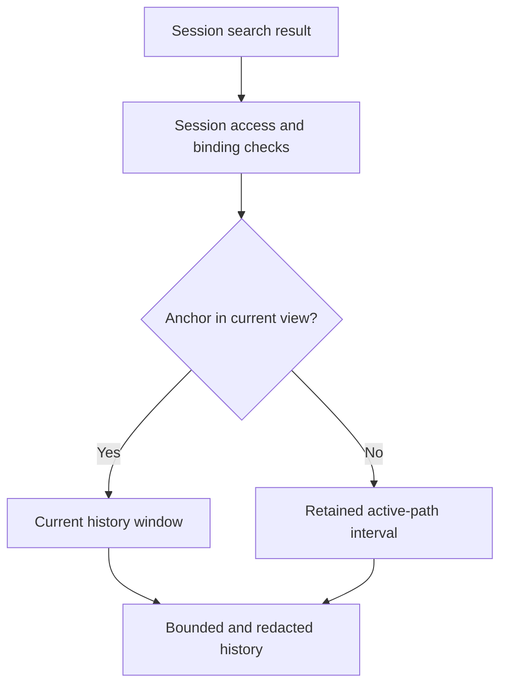

Codex review: needs maintainer review before merge. _Reviewed September 7, 2026, 3:02 PM ET / 19:02 UTC._

# ClawSweeper review

## What this changes

The PR lets session-history lookups reopen retained search results from before a reset, with bounded original context, regression coverage, and clarified documentation.

## Merge readiness

✅ **Ready for maintainer review**

The fix remains necessary on current main. The updated documentation resolves the prior finding, and inspection found no remaining actionable patch defects.

**Priority:** P2
**Reviewed head:** `e5da4b00cf7e75a31669b83dfc20306714e0009c`

## Review scores

| Measure | Result | What it means |
|---|---|---|
| **Overall readiness** | 🐚 platinum hermit **(4/6)** | A focused owner-level repair with useful regression coverage and the prior documentation concern resolved. |
| **Proof confidence** | 🌊 off-meta tidepool | Not applicable: The MEMBER-authored PR is exempt from the external-contributor proof gate. Reported embedded SQLite search-to-history regressions exercise the changed reader and show historical recovery; they are supplemental evidence, not a live Gateway run. |
| **Patch quality** | 🐚 platinum hermit **(4/6)** | No actionable review findings were identified. |

## Verification

| Check | Result | Evidence |
|---|---|---|
| **Real behavior** | Not applicable | Not applicable: The MEMBER-authored PR is exempt from the external-contributor proof gate. Reported embedded SQLite search-to-history regressions exercise the changed reader and show historical recovery; they are supplemental evidence, not a live Gateway run. |
| **Evidence reviewed** | 7 items | Current main still has the reported miss: The fetched main reader returns found:false and empty events when an anchor is outside the current visible projection; it has no historical-interval fallback. Fallback stays within the selected active path: Historical selection joins active events, identities, and payloads for the resolved physical session, then bounds records between adjacent reset positions. Current-view lookup remains the first choice. Prior documentation finding resolved: Both documentation passages now distinguish retained current-view anchors from historical fallback. Git tree inspection confirmed identical production blobs at the previous reviewed head and current head, consistent with the author's follow-up comment. |
| **Findings** | None | None. |
| **Security** | None | None. |

## How this fits together

Session search returns message and session identifiers that history readers resolve into conversation excerpts. The SQLite history reader selects those records before Gateway and agent tools apply display filtering, redaction, and response limits.

## Before merge

None.

<strong>Agent review details</strong>

### Security

None.

### PR surface

Source +262, Tests +237, Docs +4, Other -1. Total +502 across 10 files.

View PR surface stats

| Area | Files | Added | Removed | Net |
|---|---:|---:|---:|---:|
| Source | 3 | 273 | 11 | +262 |
| Tests | 4 | 245 | 8 | +237 |
| Docs | 2 | 9 | 5 | +4 |
| Config | 0 | 0 | 0 | 0 |
| Generated | 0 | 0 | 0 | 0 |
| Other | 1 | 0 | 1 | -1 |
| **Total** | **10** | **527** | **25** | **+502** |

### Review metrics

| Metric | Value | Why it matters |
|---|---|---|
| **Production and test growth** | production +262 net lines; tests +237 net lines | Production growth implements bounded historical interval selection without adding schema, configuration, or protocol fields. |

### Technical review

Best possible solution:

Keep historical-anchor recovery in the shared SQLite reader while preserving current-view reads, session access checks, and response limits.

Do we have a high-confidence way to reproduce the issue?

Yes, from source: search can retain an active-path message before a reset while current main's anchored reader searches only the current view. The supplied regression demonstrates that sequence; this review did not execute it.

Is this the best way to solve the issue?

Yes. The fallback repairs the shared history owner using existing stored records and preserves the established current-view path without a migration or parallel API.

AGENTS.md: found and applied where relevant.

Codex review notes: model internal, reasoning medium; reviewed against [69c961ff0bc4](https://github.com/openclaw/openclaw/commit/69c961ff0bc467e523fae6773ff7bcfb08595e95).

### Labels

Label justifications:

- `P2`: Repairs a bounded session-recall failure when search results survive a logical reset.
- `rating: 🐚 platinum hermit`: Overall readiness is 🐚 platinum hermit; proof is 🌊 off-meta tidepool and patch quality is 🐚 platinum hermit.
- `status: 👀 ready for maintainer look`: ClawSweeper has no concrete contributor-facing blocker left for this PR. Not applicable: The MEMBER-authored PR is exempt from the external-contributor proof gate. Reported embedded SQLite search-to-history regressions exercise the changed reader and show historical recovery; they are supplemental evidence, not a live Gateway run.

### Evidence

What I checked:

- **Current main still has the reported miss:** The fetched main reader returns found:false and empty events when an anchor is outside the current visible projection; it has no historical-interval fallback. ([`src/config/sessions/session-accessor.sqlite-history-events.ts:605`](https://github.com/openclaw/openclaw/blob/69c961ff0bc467e523fae6773ff7bcfb08595e95/src/config/sessions/session-accessor.sqlite-history-events.ts#L605), [69c961ff0bc4](https://github.com/openclaw/openclaw/commit/69c961ff0bc467e523fae6773ff7bcfb08595e95))
- **Fallback stays within the selected active path:** Historical selection joins active events, identities, and payloads for the resolved physical session, then bounds records between adjacent reset positions. Current-view lookup remains the first choice. ([`src/config/sessions/session-accessor.sqlite-history-interval.ts:40`](https://github.com/openclaw/openclaw/blob/e5da4b00cf7e75a31669b83dfc20306714e0009c/src/config/sessions/session-accessor.sqlite-history-interval.ts#L40), [e5da4b00cf7e](https://github.com/openclaw/openclaw/commit/e5da4b00cf7e75a31669b83dfc20306714e0009c))
- **Prior documentation finding resolved:** Both documentation passages now distinguish retained current-view anchors from historical fallback. Git tree inspection confirmed identical production blobs at the previous reviewed head and current head, consistent with the author's follow-up comment. Public docs: [`docs/concepts/session-search.md`](https://docs.openclaw.ai/concepts/session-search). ([`docs/concepts/session-search.md:15`](https://docs.openclaw.ai/concepts/session-search), [e5da4b00cf7e](https://github.com/openclaw/openclaw/commit/e5da4b00cf7e75a31669b83dfc20306714e0009c))
- **Regression coverage protects distinct history views:** The marker fixtures cover retained current-view rows, repeated resets, compactions, and historical lookup while preserving current membership, counts, and ordinary paging. Separate accessor and embedded-tool regressions cover inactive branches and search-to-history recovery. ([`src/gateway/session-transcript-readers.markers.test.ts:175`](https://github.com/openclaw/openclaw/blob/e5da4b00cf7e75a31669b83dfc20306714e0009c/src/gateway/session-transcript-readers.markers.test.ts#L175), [e5da4b00cf7e](https://github.com/openclaw/openclaw/commit/e5da4b00cf7e75a31669b83dfc20306714e0009c))
- **Existing access and output controls remain:** The unchanged history tool checks session visibility and scoped access before requesting history, then strips tools when requested, sanitizes content, and enforces byte caps. Embedded history also validates the physical-session binding before reading. ([`src/agents/tools/sessions-history-tool.ts:544`](https://github.com/openclaw/openclaw/blob/e5da4b00cf7e75a31669b83dfc20306714e0009c/src/agents/tools/sessions-history-tool.ts#L544), [e5da4b00cf7e](https://github.com/openclaw/openclaw/commit/e5da4b00cf7e75a31669b83dfc20306714e0009c))
- **Relevant merged history for routing:** Current-main history repeatedly identifies Peter Steinberger on transcript-reader maintenance. Commit ba5d23b1b9f660453cb2261923a934e4f98b74e4 records the earlier embedded-anchor repair associated with https://github.com/openclaw/openclaw/pull/136657; this supports routing, not causal attribution for this defect. ([`src/agents/tools/embedded-gateway-stub.history.test.ts`](https://github.com/openclaw/openclaw/blob/ba5d23b1b9f660453cb2261923a934e4f98b74e4/src/agents/tools/embedded-gateway-stub.history.test.ts), [ba5d23b1b9f6](https://github.com/openclaw/openclaw/commit/ba5d23b1b9f660453cb2261923a934e4f98b74e4))

Likely related people:

- **Peter Steinberger:** Suggested for follow-up; no historical authorship or introduction is verified. (role: unverified routing candidate; confidence: low)

### Rating scale

| Score | Internal tier | Crab rank | Meaning |
|---:|:---:|---|---|
| **6/6** | S | 🦀 challenger crab | Exceptional readiness |
| **5/6** | A | 🦞 diamond lobster | Very strong readiness |
| **4/6** | B | 🐚 platinum hermit | Good normal PR; ordinary maintainer review |
| **3/6** | C | 🦐 gold shrimp | Useful, but confidence is limited |
| **2/6** | D | 🦪 silver shellfish | Proof or implementation needs work |
| **1/6** | F | 🧂 unranked krab | Not merge-ready |
| N/A | NA | 🌊 off-meta tidepool | Rating does not apply |

Overall follows the weaker of proof and patch quality.
Shiny media proof means a screenshot, video, or linked artifact directly shows the changed behavior. Runtime, network, CSP, and security claims still need visible diagnostics.

### Workflow

- ClawSweeper keeps one durable marker-backed review comment per issue or PR.
- Re-runs edit this comment so the latest verdict, findings, and automation markers stay together instead of adding duplicate bot comments.
- A fresh review can be triggered by eligible `@clawsweeper re-review` comments, exact-item GitHub events, scheduled/background review runs, or manual workflow dispatch.
- PR/issue authors and users with repository write access can comment `@clawsweeper re-review` or `@clawsweeper re-run` on an open PR or issue to request a fresh review only.
- Maintainers can also comment `@clawsweeper review` to request a fresh review only.
- Fresh-review commands do not start repair, autofix, rebase, CI repair, or automerge.
- Maintainer-only repair and merge flows require explicit commands such as `@clawsweeper autofix`, `@clawsweeper automerge`, `@clawsweeper fix ci`, or `@clawsweeper address review`.
- Maintainers can comment `@clawsweeper explain` to ask for more context, or `@clawsweeper stop` to stop active automation.

### History

Review history (2 earlier review cycles)

<!-- clawsweeper-review-history v=1 total=2 -->
- reviewed 2026-09-07T18:21:41.710Z sha f081c2c95d314ff13fffda828517e72100b7d448 :: needs changes before merge. :: [P3] Qualify interval reopening for anchors outside the current view
- reviewed 2026-09-07T18:42:39.515Z sha f081c2c95d314ff13fffda828517e72100b7d448 :: needs changes before merge. :: [P3] Qualify interval reopening for anchors outside the current view

<!-- clawsweeper-verdict:needs-human item=141437 sha=e5da4b00cf7e75a31669b83dfc20306714e0009c confidence=high updated_at=2026-09-07T19:00:18Z reviewed_at=2026-09-07T19:02:55.778Z lease_owner=github-run-34153701751-1 lease_comment_id=5574677390 source_revision=7d5563d241d8eb43d4756517e6221050801df382c4fd7fa32b1984abb6d24c11 live_verification=absent -->
<!-- clawsweeper-review-state:ready item=141437 sha=e5da4b00cf7e75a31669b83dfc20306714e0009c v=1 -->

<!-- clawsweeper-review-version item=141437 reviewed_at=2026-09-07T19:02:55.778Z sha=e5da4b00cf7e75a31669b83dfc20306714e0009c source_revision=7d5563d241d8eb43d4756517e6221050801df382c4fd7fa32b1984abb6d24c11 lease_owner=github-run-34153701751-1 lease_comment_id=5574677390 v=1 -->

<!-- clawsweeper-review item=141437 -->