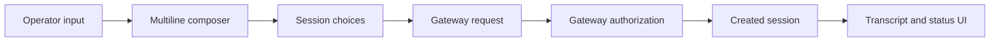

Codex review: needs real behavior proof before merge. _Reviewed August 25, 2026, 6:59 PM ET / 22:59 UTC._

# ClawSweeper review

## What this changes

The PR replaces Control UI chat and new-session composers with a shared multiline surface, including updated draft, permission, dictation, progress, queue, and responsive interaction behavior.

## Merge readiness

⛔ **Blocked until stronger real behavior proof is added - 5 items remain**

Keep open. This maintainer-authored PR remains a substantial Control UI change; the exact head has no blocking code defect identified, but permission selection changes an authority-bearing session-creation input without exact-head real Gateway final-effect proof.

**Priority:** P2
**Reviewed head:** `afbc7928c3ca4b6d5fc5158cd5441d91b8e55633`
**Owner decision:** Required. See [Decision needed](#decision-needed).

## Review scores

| Measure | Result | What it means |
|---|---|---|
| **Overall readiness** | 🦪 silver shellfish **(2/6)** | The patch has substantial targeted coverage, but the required exact-head final authorization proof is still absent. |
| **Proof confidence** | 🦪 silver shellfish **(2/6)** | Needs stronger real behavior proof before merge: Authority-chain proof required: prepared Mantis media predates the later permission changes, and exact-head proof only uses a mocked Gateway; add redacted isolated-Gateway evidence for allowed and downgraded session creation before merge. After adding proof, update the PR body; ClawSweeper should re-review automatically. If it does not, the PR author or someone with repository write access can comment `@clawsweeper re-review`. |
| **Patch quality** | 🦐 gold shrimp **(3/6)** | Security review found an item that needs attention. |

## Verification

| Check | Result | Evidence |
|---|---|---|
| **Real behavior** | Needs proof | Needs stronger real behavior proof before merge: Authority-chain proof required: prepared Mantis media predates the later permission changes, and exact-head proof only uses a mocked Gateway; add redacted isolated-Gateway evidence for allowed and downgraded session creation before merge. After adding proof, update the PR body; ClawSweeper should re-review automatically. If it does not, the PR author or someone with repository write access can comment `@clawsweeper re-review`. |
| **Evidence reviewed** | 5 items | Authority-bearing change: The new-session submission flow includes the UI-selected permission mode in the `sessions.create` request.<br>Gateway final authorization: The Gateway's session-create owner rejects `full` permission mode when the connected client lacks `operator.admin`; this is the final server-side boundary.<br>Exact-head UI coverage: The PR adds mocked-browser coverage for an allowed Full session and a scope downgrade that prevents a create request, but it does not exercise the final Gateway authorization owner. |
| **Findings** | None | None. |
| **Security** | Needs attention | Prove permission rejection at the final Gateway effect: The branch adds a Control UI path that sends `permissionMode` to session creation; the available proof uses a mock Gateway, so it does not demonstrate that a downgraded operator is rejected before a real session is created. |

## How this fits together

The Control UI composer gathers message text and session choices, sends creation or chat requests through the Gateway, and renders transcript, queue, and recovery state. The new-session path carries a selected permission mode into `sessions.create`, where the Gateway owns the final authorization decision.



## Decision needed

| Question | Recommendation |
|---|---|
| Should this PR wait for exact-head final-effect proof that the real Gateway rejects Full session creation for a write-only operator before creating a session? | **Require Gateway final-effect proof:** Add an isolated exact-head Gateway run proving allowed creation and forbidden creation with zero created sessions. |

Why: The UI test verifies client behavior, while the security-relevant final decision is made by the Gateway and needs end-to-end evidence on this branch.

## Before merge

- [ ] **Add real behavior proof** - Needs stronger real behavior proof before merge: Authority-chain proof required: prepared Mantis media predates the later permission changes, and exact-head proof only uses a mocked Gateway; add redacted isolated-Gateway evidence for allowed and downgraded session creation before merge. After adding proof, update the PR body; ClawSweeper should re-review automatically. If it does not, the PR author or someone with repository write access can comment `@clawsweeper re-review`.
- [ ] **Resolve security concern: Prove permission rejection at the final Gateway effect** - The branch adds a Control UI path that sends `permissionMode` to session creation; the available proof uses a mock Gateway, so it does not demonstrate that a downgraded operator is rejected before a real session is created.
- [ ] **Resolve merge risk (P1)** - A mocked Gateway can show that the UI suppresses a downgraded selection, but it does not prove that the exact PR head reaches the real Gateway authorization owner and rejects the nearest unauthorized principal before session creation.
- [ ] **Complete next step (P2)** - A maintainer or PR author must provide final-effect Gateway proof; this is not a safe autonomous repair task.

## Findings

- [medium] Prove permission rejection at the final Gateway effect — `ui/src/pages/new-session/draft-submission-flow.ts:243`


<details>
<summary><strong>Agent review details</strong></summary>

### Security

Needs attention: No concrete authorization bypass was found, but the changed permission-selection authority path lacks exact-head final-effect evidence at the real Gateway boundary.

### Review metrics

| Metric | Value | Why it matters |
|---|---|---|
| **Production versus test delta** | production +3,256 net; tests/support +1,489 net | This is a broad UI rewrite with substantial production growth, so exact-head behavior proof is especially important. |
| **Permission-mode request surface** | 1 existing session-create parameter newly selected and persisted by the Control UI | The new UI pathway can change the authorization mode requested for a created session. |

### Stored data model

Persistent data-model change detected: `serialized state: ui/src/components/session-progress-card.test.ts`, `serialized state: ui/src/components/session-progress-card.ts`, `serialized state: ui/src/e2e/chat-flow.navigation-presentation.e2e.test.ts`, `serialized state: ui/src/e2e/session-ownership.e2e.test.ts`, `serialized state: ui/src/pages/new-session/session-placement-recovery-state.test.ts`, `unknown-data-model-change: ui/src/components/session-progress-card.test.ts`, and 4 more. Confirm migration or upgrade compatibility proof before merge.

### Mantis proof suggestion

Mantis could provide supplementary web-chat proof for the composer flow, though it cannot replace the required Gateway authorization trace. A maintainer can ask Mantis to capture proof by posting this exact PR comment:

```text
@openclaw-mantis web UI chat proof: verify a multiline composer sends a message and renders the final reply on this PR head; return redacted evidence.
```

### Merge-risk options

**Maintainer options:**
1. **Prove the final Gateway boundary (recommended)**  
   Run an exact-head isolated Gateway scenario that confirms a write-only operator cannot create a Full session and that no session side effect occurs.
2. **Accept the split-boundary evidence**  
   Maintainers may accept the existing UI mock and server-owner coverage while documenting that no integrated final-effect run was supplied.

<details>
<summary>Copy recommended automerge instruction</summary>

```text
@clawsweeper automerge

Special instructions:
Add exact-head isolated-Gateway proof for allowed Full session creation and rejected write-only creation with zero sessions created.
```

</details>

### Technical review

Best possible solution:

Add exact-head isolated-Gateway proof showing an admin can create a Full session and a write-only client is rejected by the Gateway before any session is created, then retain the existing UI and server-side checks as one authority chain.

Do we have a high-confidence way to reproduce the issue?

Yes for the authority path: source and exact-head mocked-browser coverage show permission selection reaching `sessions.create`, but no exact-head real-Gateway final-effect run is supplied.

Is this the best way to solve the issue?

Unclear: the shared composer direction is coherent, but the current proof does not yet establish the final authorization outcome through the real Gateway.

AGENTS.md: found and applied where relevant.

Codex review notes: model internal, reasoning high; reviewed against [df9b7a5fbe9b](https://github.com/openclaw/openclaw/commit/df9b7a5fbe9b94b0ab25dc404db7784797feadca).

### Labels

Label changes:

- add `proof: 📸 screenshot`: Contributor real behavior proof includes screenshot evidence. Authority-chain proof required: prepared Mantis media predates the later permission changes, and exact-head proof only uses a mocked Gateway; add redacted isolated-Gateway evidence for allowed and downgraded session creation before merge.

Label justifications:

- `P2`: The PR materially changes a broad Control UI workflow without evidence of an emergency production outage.
- `merge-risk: 🚨 security-boundary`: The branch newly carries a UI-selected permission mode into session creation, requiring proof at the Gateway final-effect boundary.
- `merge-risk: 🚨 compatibility`: The composer and new-session workflow restructure changes existing operator interaction and persisted draft recovery behavior.
- `rating: 🦪 silver shellfish`: Overall readiness is 🦪 silver shellfish; proof is 🦪 silver shellfish and patch quality is 🦐 gold shrimp.
- `status: 📣 needs proof`: The PR needs real behavior proof before ClawSweeper can clear the contributor ask. Needs stronger real behavior proof before merge: Authority-chain proof required: prepared Mantis media predates the later permission changes, and exact-head proof only uses a mocked Gateway; add redacted isolated-Gateway evidence for allowed and downgraded session creation before merge. After adding proof, update the PR body; ClawSweeper should re-review automatically. If it does not, the PR author or someone with repository write access can comment `@clawsweeper re-review`.
- `proof: 📸 screenshot`: Contributor real behavior proof includes screenshot evidence. Authority-chain proof required: prepared Mantis media predates the later permission changes, and exact-head proof only uses a mocked Gateway; add redacted isolated-Gateway evidence for allowed and downgraded session creation before merge.

### Evidence

Security concerns:

- [medium] Prove permission rejection at the final Gateway effect — `ui/src/pages/new-session/draft-submission-flow.ts:243`
  The branch adds a Control UI path that sends `permissionMode` to session creation; the available proof uses a mock Gateway, so it does not demonstrate that a downgraded operator is rejected before a real session is created.
  Confidence: 0.91

What I checked:

- **Authority-bearing change:** The new-session submission flow includes the UI-selected permission mode in the `sessions.create` request. ([`ui/src/pages/new-session/draft-submission-flow.ts:243`](https://github.com/openclaw/openclaw/blob/afbc7928c3ca/ui/src/pages/new-session/draft-submission-flow.ts#L243), [afbc7928c3ca](https://github.com/openclaw/openclaw/commit/afbc7928c3ca))
- **Gateway final authorization:** The Gateway's session-create owner rejects `full` permission mode when the connected client lacks `operator.admin`; this is the final server-side boundary. ([`src/gateway/server-methods/sessions-create.ts:181`](https://github.com/openclaw/openclaw/blob/afbc7928c3ca/src/gateway/server-methods/sessions-create.ts#L181), [afbc7928c3ca](https://github.com/openclaw/openclaw/commit/afbc7928c3ca))
- **Exact-head UI coverage:** The PR adds mocked-browser coverage for an allowed Full session and a scope downgrade that prevents a create request, but it does not exercise the final Gateway authorization owner. ([`ui/src/e2e/new-session-page.operator-scopes.e2e.test.ts:106`](https://github.com/openclaw/openclaw/blob/afbc7928c3ca/ui/src/e2e/new-session-page.operator-scopes.e2e.test.ts#L106), [afbc7928c3ca](https://github.com/openclaw/openclaw/commit/afbc7928c3ca))
- **Prepared media:** The prepared Mantis screenshot demonstrates a chat interaction, but its recorded candidate is an earlier head and cannot prove the later permission/session-creation behavior.
- **Current-head provenance:** The current PR head is a follow-up test commit by Peter Steinberger; it updates accessibility expectation only. ([`ui/src/components/session-progress-card.test.ts:1`](https://github.com/openclaw/openclaw/blob/afbc7928c3ca/ui/src/components/session-progress-card.test.ts#L1), [afbc7928c3ca](https://github.com/openclaw/openclaw/commit/afbc7928c3ca))

Likely related people:

- **steipete:** Recent PR-head commits repaired the composer progress, permission-final-effect browser coverage, and CI routing. (role: recent area contributor; confidence: high; commits: [83ab242a3d39](https://github.com/openclaw/openclaw/commit/83ab242a3d39e3ac604d83e0ea099b72ef7e3cc5), [9cbfeb6f3ff8](https://github.com/openclaw/openclaw/commit/9cbfeb6f3ff89af29b8e9c0e6f8c9dbc402950a2), [afbc7928c3ca](https://github.com/openclaw/openclaw/commit/afbc7928c3ca4b6d5fc5158cd5441d91b8e55633); files: `ui/src/components/session-progress-card.ts`, `ui/src/e2e/new-session-page.operator-scopes.e2e.test.ts`, `ui/src/pages/new-session/draft-submission-flow.ts`)

### Rank-up moves

Optional improvements that raise the rating; they are not merge blockers.

- Add a redacted isolated-Gateway run proving Full creation for an admin and zero creation for a write-only operator.
- Update the PR body with the exact-head trace or recording; a fresh ClawSweeper review should then reassess the gate.

### Rating scale

| Score | Internal tier | Crab rank | Meaning |
|---:|:---:|---|---|
| **6/6** | S | 🦀 challenger crab | Exceptional readiness |
| **5/6** | A | 🦞 diamond lobster | Very strong readiness |
| **4/6** | B | 🐚 platinum hermit | Good normal PR; ordinary maintainer review |
| **3/6** | C | 🦐 gold shrimp | Useful, but confidence is limited |
| **2/6** | D | 🦪 silver shellfish | Proof or implementation needs work |
| **1/6** | F | 🧂 unranked krab | Not merge-ready |
| N/A | NA | 🌊 off-meta tidepool | Rating does not apply |

Overall follows the weaker of proof and patch quality.
Shiny media proof means a screenshot, video, or linked artifact directly shows the changed behavior. Runtime, network, CSP, and security claims still need visible diagnostics.

### Workflow

- ClawSweeper keeps one durable marker-backed review comment per issue or PR.
- Re-runs edit this comment so the latest verdict, findings, and automation markers stay together instead of adding duplicate bot comments.
- A fresh review can be triggered by eligible `@clawsweeper re-review` comments, exact-item GitHub events, scheduled/background review runs, or manual workflow dispatch.
- PR/issue authors and users with repository write access can comment `@clawsweeper re-review` or `@clawsweeper re-run` on an open PR or issue to request a fresh review only.
- Maintainers can also comment `@clawsweeper review` to request a fresh review only.
- Fresh-review commands do not start repair, autofix, rebase, CI repair, or automerge.
- Maintainer-only repair and merge flows require explicit commands such as `@clawsweeper autofix`, `@clawsweeper automerge`, `@clawsweeper fix ci`, or `@clawsweeper address review`.
- Maintainers can comment `@clawsweeper explain` to ask for more context, or `@clawsweeper stop` to stop active automation.

### History

<details>
<summary>Review history (57 earlier review cycles; latest 8 shown)</summary>

<!-- clawsweeper-review-history v=1 total=57 -->
- reviewed 2026-08-24T01:04:19.994Z sha 00321d37503d11bce1c429d48c5ad8bc13745e6d :: needs real behavior proof before merge. :: [P1] Restore redaction for pairing setup failures
- reviewed 2026-08-24T04:52:40.200Z sha 00321d37503d11bce1c429d48c5ad8bc13745e6d :: needs real behavior proof before merge. :: [P1] Restore redaction for pairing setup failures
- reviewed 2026-08-24T19:20:02.242Z sha 00321d37503d11bce1c429d48c5ad8bc13745e6d :: needs real behavior proof before merge. :: [P1] Restore redaction for pairing setup failures
- reviewed 2026-08-25T12:23:08.982Z sha d834bf7dd88468957360565e01ea46c2d0e0fd72 :: needs real behavior proof before merge. :: [P1] Keep pairing setup errors redacted
- reviewed 2026-08-25T15:05:56.974Z sha 35ff8d8728fa76dce9d7741e41e3f3cfa6c72fbe :: needs real behavior proof before merge. :: [P1] Wait for dictation finalization before starting
- reviewed 2026-08-25T15:46:57.748Z sha d3396c4d3b48bcfa0b890a59550dd08608a62e43 :: needs real behavior proof before merge. :: [P2] Anchor the task-popover height to its real composer position
- reviewed 2026-08-25T19:51:40.191Z sha d90c0f2b395497e211ebca5280dbdf01415e4742 :: needs real behavior proof before merge. :: none
- reviewed 2026-08-25T21:00:50.475Z sha d90c0f2b395497e211ebca5280dbdf01415e4742 :: needs real behavior proof before merge. :: none

</details>

</details>

<!-- clawsweeper-security:security-sensitive item=124301 sha=afbc7928c3ca4b6d5fc5158cd5441d91b8e55633 confidence=high updated_at=2026-08-25T22:57:41Z reviewed_at=2026-08-25T22:59:19.035Z lease_owner=github-run-32908495502-1 lease_comment_id=5418017861 source_revision=a4787ea579c2b1bda788256defcf985a60a5af3582cdff507a06d2ebc86060ae -->
<!-- clawsweeper-verdict:needs-human item=124301 sha=afbc7928c3ca4b6d5fc5158cd5441d91b8e55633 confidence=high updated_at=2026-08-25T22:57:41Z reviewed_at=2026-08-25T22:59:19.035Z lease_owner=github-run-32908495502-1 lease_comment_id=5418017861 source_revision=a4787ea579c2b1bda788256defcf985a60a5af3582cdff507a06d2ebc86060ae -->

<!-- clawsweeper-review-version item=124301 reviewed_at=2026-08-25T22:59:19.035Z sha=afbc7928c3ca4b6d5fc5158cd5441d91b8e55633 source_revision=a4787ea579c2b1bda788256defcf985a60a5af3582cdff507a06d2ebc86060ae lease_owner=github-run-32908495502-1 lease_comment_id=5418017861 v=1 -->

<!-- clawsweeper-review item=124301 -->