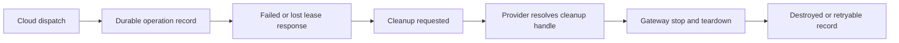

Codex review: needs maintainer review before merge. _Reviewed August 29, 2026, 2:48 PM ET / 18:48 UTC._

# ClawSweeper review

## What this changes

The PR prevents failed cloud-worker cleanup from re-running provisioning by adding an operation-owned allocation resolver to worker providers, and makes Vitest profile capture finish before worker teardown.

## Regression provenance

Possible regression — probable (reproduction; reviewed change). No predecessor PR is attributed.

## Merge readiness

⚠️ **Ready for maintainer review - 4 items remain**

Keep open. Current main still replays provisioning for null-lease cleanup, while this maintainer-owned PR replaces that path with allocation-only resolution and retains canonical teardown; no introduced correctness defect was established.

**Priority:** P1
**Reviewed head:** `842f8783535927f891e30bf2249f5e2f98ffc834`
**Owner decision:** Required. See [Decision needed](#decision-needed).

## Review scores

| Measure | Result | What it means |
|---|---|---|
| **Overall readiness** | 🐚 platinum hermit **(4/6)** | The patch has a coherent owner-boundary repair and focused coverage, with a remaining maintainer decision on the beta plugin contract. |
| **Proof confidence** | 🌊 off-meta tidepool | Not applicable: Repository state identifies this as a MEMBER-authored PR, so the external-contributor proof gate does not apply; the supplied body excerpts nevertheless describe matching-package fault-injection and exact-head validation. |
| **Patch quality** | 🐚 platinum hermit **(4/6)** | No actionable review findings were identified. |

## Verification

| Check | Result | Evidence |
|---|---|---|
| **Real behavior** | Not applicable | Not applicable: Repository state identifies this as a MEMBER-authored PR, so the external-contributor proof gate does not apply; the supplied body excerpts nevertheless describe matching-package fault-injection and exact-head validation. |
| **Evidence reviewed** | 6 items | Current-main bug remains: Current main has no allocation resolver in the WorkerProvider contract and both null-lease cleanup paths call resumeProvision, which can invoke provider provisioning before destroy. Proposed lifecycle owner: The branch validates the allocation result, publishes only leaseId and sharedHost, and reuses the existing provider destroy path without manufacturing transport or enrollment state. Provider contract and sibling adoption: The required resolver is documented in the public WorkerProvider type, validated at registry registration, and implemented by the Crabbox, paired-device, and static-SSH providers. |
| **Findings** | None | None. |
| **Security** | None | None. |

## How this fits together

Cloud-worker dispatch persists an operation before a provider returns its lease; cancellation and restart cleanup consume that persisted state. The Gateway now asks the provider for a cleanup handle, then sends it through the existing stop and destroy lifecycle instead of restarting setup or enrollment.

## Decision needed

| Question | Recommendation |
|---|---|
| Should OpenClaw accept resolveAllocation as a required beta WorkerProvider API, intentionally rejecting installed beta providers that have not migrated? | **Confirm the beta cutover:** Keep resolveAllocation required, preserve the no-provisioning teardown invariant, and communicate that beta worker providers must implement it. |

Why: The repair needs a resolver to avoid unsafe provisioning fallback, but making a public beta plugin contract mandatory deliberately changes registration behavior for third-party beta providers.

## Before merge

- [ ] **Resolve merge risk (P1)** - The required public WorkerProvider resolver will reject external beta plugins that have not adopted it; maintainers should explicitly affirm the intended beta cutover and operator communication before merge.
- [ ] **Resolve merge risk (P1)** - The profiler path relies on Vitest runner behavior; this read-only sparse checkout has no installed Vitest dependency source to independently inspect that contract, although the supplied exact-head CI and subprocess evidence claims cover it.
- [ ] **Complete next step (P2)** - A maintainer must confirm the deliberate beta plugin-contract compatibility boundary; there is no narrow mechanical repair finding to dispatch.

<strong>Agent review details</strong>

### Security

None.

### PR surface

Source +9, Tests +1233, Docs +21, Other +183. Total +1446 across 43 files.

View PR surface stats

| Area | Files | Added | Removed | Net |
|---|---:|---:|---:|---:|
| Source | 15 | 153 | 144 | +9 |
| Tests | 19 | 1584 | 351 | +1233 |
| Docs | 5 | 29 | 8 | +21 |
| Config | 0 | 0 | 0 | 0 |
| Generated | 0 | 0 | 0 | 0 |
| Other | 4 | 252 | 69 | +183 |
| **Total** | **43** | **2018** | **572** | **+1446** |

### Review metrics

| Metric | Value | Why it matters |
|---|---|---|
| **Implementation and validation delta** | application −7 net, profiling tooling +183 net, tests/support +1249 net, docs +21 net | The worker repair is net-negative, while the larger tooling addition introduces a new profiler lifecycle that merits the separate automation-risk review. |

### Stored data model

Persistent data-model change detected: `durable storage schema: src/gateway/worker-environments/device-provider.ts`, `durable storage schema: src/gateway/worker-environments/service-validation.ts`, `durable storage schema: src/gateway/worker-environments/service.test-support.ts`, `durable storage schema: src/gateway/worker-environments/workspace-quiescence.ts`, `durable storage schema: src/worker/worker-fault-injection.test-support.ts`, `serialized state: scripts/lib/vitest-profiler.mts`, and 2 more. Confirm migration or upgrade compatibility proof before merge.

### Root-cause cluster

Relationship: `fixed_by_candidate`
Canonical: https://github.com/openclaw/openclaw/issues/132126
Summary: This PR is the active candidate fix for the documented null-lease cleanup replay bug.

Members:
- `canonical`: https://github.com/openclaw/openclaw/issues/132126 - The PR explicitly targets that issue’s failed-dispatch cleanup behavior, and current main source still exhibits the stated null-lease provisioning replay.

Proposal only: this assessment does not dispatch repair, suppress jobs, mutate sibling items, close, or merge anything.

### Merge-risk options

**Maintainer options:**
1. **Confirm strict beta provider migration (recommended)**  
   Accept the required resolver only with an explicit maintainer decision that beta worker providers without it must fail registration.
2. **Hold for a revised contract transition**  
   Pause the PR if the project wants external beta providers to remain usable without immediate migration.

### Technical review

Best possible solution:

Retain the allocation-only cleanup design and merge only after the responsible maintainer confirms that strict beta WorkerProvider registration is the intended compatibility boundary.

Do we have a high-confidence way to reproduce the issue?

Yes, source-reproducible: current main’s null-lease reconciliation and explicit destroy paths invoke resumeProvision before teardown. This review did not execute the failing cloud-provider sequence locally.

Is this the best way to solve the issue?

Yes for the cleanup defect: resolving an operation-owned handle and reusing canonical teardown removes the provisioning replay instead of adding a downstream skip. The mandatory public beta API cutover still requires maintainer acceptance.

AGENTS.md: found and applied where relevant.

Codex review notes: model internal, reasoning high; reviewed against [2df7c2543add](https://github.com/openclaw/openclaw/commit/2df7c2543addd1a926d221da9af0eccf1d875da5).

### Labels

Label changes:

- add `P1`: A failed cloud dispatch can replay provisioning during cleanup and affect active worker teardown or incur unwanted allocation work.
- remove `P2`: Current review triage priority is P1, so this older priority label is no longer current.

Label justifications:

- `P1`: A failed cloud dispatch can replay provisioning during cleanup and affect active worker teardown or incur unwanted allocation work.
- `merge-risk: 🚨 compatibility`: Registration now requires a new WorkerProvider method, so installed beta providers without it will become unavailable.
- `merge-risk: 🚨 automation`: The PR changes the repository’s Vitest profiling launcher and worker teardown behavior.
- `rating: 🐚 platinum hermit`: Overall readiness is 🐚 platinum hermit; proof is 🌊 off-meta tidepool and patch quality is 🐚 platinum hermit.
- `status: 👀 ready for maintainer look`: ClawSweeper has no concrete contributor-facing blocker left for this PR. Not applicable: Repository state identifies this as a MEMBER-authored PR, so the external-contributor proof gate does not apply; the supplied body excerpts nevertheless describe matching-package fault-injection and exact-head validation.

### Evidence

What I checked:

- **Current-main bug remains:** Current main has no allocation resolver in the WorkerProvider contract and both null-lease cleanup paths call resumeProvision, which can invoke provider provisioning before destroy. ([`src/gateway/worker-environments/provider-lifecycle.ts:440`](https://github.com/openclaw/openclaw/blob/2df7c2543add/src/gateway/worker-environments/provider-lifecycle.ts#L440), [2df7c2543add](https://github.com/openclaw/openclaw/commit/2df7c2543add))
- **Proposed lifecycle owner:** The branch validates the allocation result, publishes only leaseId and sharedHost, and reuses the existing provider destroy path without manufacturing transport or enrollment state. ([`src/gateway/worker-environments/provider-lifecycle.ts:383`](https://github.com/openclaw/openclaw/blob/842f87835359/src/gateway/worker-environments/provider-lifecycle.ts#L383), [842f87835359](https://github.com/openclaw/openclaw/commit/842f87835359))
- **Provider contract and sibling adoption:** The required resolver is documented in the public WorkerProvider type, validated at registry registration, and implemented by the Crabbox, paired-device, and static-SSH providers. ([`src/plugins/capability-provider.types.ts:204`](https://github.com/openclaw/openclaw/blob/842f87835359/src/plugins/capability-provider.types.ts#L204), [842f87835359](https://github.com/openclaw/openclaw/commit/842f87835359))
- **Regression coverage:** The branch’s lifecycle tests cover restart after a lost allocation response, mutable preflight failures, teardown retry, no setup/enrollment replay, and owner closure during cleanup. ([`src/gateway/worker-environments/provider-crabbox-runtime-preflight.test.ts:172`](https://github.com/openclaw/openclaw/blob/842f87835359/src/gateway/worker-environments/provider-crabbox-runtime-preflight.test.ts#L172), [842f87835359](https://github.com/openclaw/openclaw/commit/842f87835359))
- **History and release boundary:** The branch’s worker repair commits are authored by Peter Steinberger; the supplied repository state identifies the latest stable as v2026.7.1-2 and current main remains separate from this unmerged fix. ([`src/gateway/worker-environments/provider-lifecycle.ts:383`](https://github.com/openclaw/openclaw/blob/842f87835359/src/gateway/worker-environments/provider-lifecycle.ts#L383), [842f87835359](https://github.com/openclaw/openclaw/commit/842f87835359))
- **Security and scope pass:** The introduced diff changes lifecycle, plugin-contract, documentation, test, and profiling-tooling code; it adds no dependency, lockfile, workflow permission, or secret-handling change. ([`scripts/lib/vitest-profiler.mts:1`](https://github.com/openclaw/openclaw/blob/842f87835359/scripts/lib/vitest-profiler.mts#L1), [842f87835359](https://github.com/openclaw/openclaw/commit/842f87835359))

Likely related people:

- **steipete:** Peter Steinberger authored the branch’s lifecycle and provider commits and the related merged fixed-ID Crabbox work cited in the PR context. (role: worker lifecycle and Crabbox feature-history owner; confidence: high; commits: [05cd389cac01](https://github.com/openclaw/openclaw/commit/05cd389cac01467065f890dcec52062383d64f3d), [b89c80318eac](https://github.com/openclaw/openclaw/commit/b89c80318eac5c51aeb91e689cdc0957c19e7439), [d316f7246c72](https://github.com/openclaw/openclaw/commit/d316f7246c72e948ccbb20e509d4ceaf47ef0da5); files: `src/gateway/worker-environments/provider-lifecycle.ts`, `extensions/crabbox/src/crabbox-worker-provider.ts`, `src/plugins/capability-provider.types.ts`)

### Rank-up moves

Optional improvements that raise the rating; they are not merge blockers.

- Confirm the required beta WorkerProvider cutover and its operator-facing upgrade communication before merge.

### Rating scale

| Score | Internal tier | Crab rank | Meaning |
|---:|:---:|---|---|
| **6/6** | S | 🦀 challenger crab | Exceptional readiness |
| **5/6** | A | 🦞 diamond lobster | Very strong readiness |
| **4/6** | B | 🐚 platinum hermit | Good normal PR; ordinary maintainer review |
| **3/6** | C | 🦐 gold shrimp | Useful, but confidence is limited |
| **2/6** | D | 🦪 silver shellfish | Proof or implementation needs work |
| **1/6** | F | 🧂 unranked krab | Not merge-ready |
| N/A | NA | 🌊 off-meta tidepool | Rating does not apply |

Overall follows the weaker of proof and patch quality.
Shiny media proof means a screenshot, video, or linked artifact directly shows the changed behavior. Runtime, network, CSP, and security claims still need visible diagnostics.

### Workflow

- ClawSweeper keeps one durable marker-backed review comment per issue or PR.
- Re-runs edit this comment so the latest verdict, findings, and automation markers stay together instead of adding duplicate bot comments.
- A fresh review can be triggered by eligible `@clawsweeper re-review` comments, exact-item GitHub events, scheduled/background review runs, or manual workflow dispatch.
- PR/issue authors and users with repository write access can comment `@clawsweeper re-review` or `@clawsweeper re-run` on an open PR or issue to request a fresh review only.
- Maintainers can also comment `@clawsweeper review` to request a fresh review only.
- Fresh-review commands do not start repair, autofix, rebase, CI repair, or automerge.
- Maintainer-only repair and merge flows require explicit commands such as `@clawsweeper autofix`, `@clawsweeper automerge`, `@clawsweeper fix ci`, or `@clawsweeper address review`.
- Maintainers can comment `@clawsweeper explain` to ask for more context, or `@clawsweeper stop` to stop active automation.

### History

Review history (18 earlier review cycles; latest 8 shown)

<!-- clawsweeper-review-history v=1 total=18 -->
- reviewed 2026-08-29T10:25:46.406Z sha 3093ea7cb73c0dfcda65f64150f28ac21782fe83 :: needs changes before merge. :: [P1] Terminalize permanently unsupported cleanup identities
- reviewed 2026-08-29T11:01:10.891Z sha 3093ea7cb73c0dfcda65f64150f28ac21782fe83 :: needs changes before merge. :: [P1] Terminalize permanently unsupported cleanup identities
- reviewed 2026-08-29T13:09:58.219Z sha 39a219ced153a9ea489552593a686f567ce5e13d :: needs maintainer review before merge. :: none
- reviewed 2026-08-29T13:53:10.151Z sha 39a219ced153a9ea489552593a686f567ce5e13d :: needs maintainer review before merge. :: none
- reviewed 2026-08-29T17:01:01.285Z sha 15f1a6d0c45c1e388f40eb3719081b989409f704 :: needs maintainer review before merge. :: none
- reviewed 2026-08-29T17:35:51.884Z sha 8ee4fb77a8f4e9637ba8384a39c98945ea3e67b5 :: needs maintainer review before merge. :: none
- reviewed 2026-08-29T17:54:22.281Z sha 8ee4fb77a8f4e9637ba8384a39c98945ea3e67b5 :: needs maintainer review before merge. :: none
- reviewed 2026-08-29T18:29:47.213Z sha 842f8783535927f891e30bf2249f5e2f98ffc834 :: needs maintainer review before merge. :: none

<!-- clawsweeper-verdict:needs-human item=132224 sha=842f8783535927f891e30bf2249f5e2f98ffc834 confidence=high updated_at=2026-08-29T18:44:56Z reviewed_at=2026-08-29T18:48:11.171Z lease_owner=github-run-33269032115-1 lease_comment_id=5464195556 source_revision=20f658c5b176c6a9d220d762c123268f301bc1e58252663b031313f365cf13fa live_verification=absent -->

<!-- clawsweeper-review-version item=132224 reviewed_at=2026-08-29T18:48:11.171Z sha=842f8783535927f891e30bf2249f5e2f98ffc834 source_revision=20f658c5b176c6a9d220d762c123268f301bc1e58252663b031313f365cf13fa lease_owner=github-run-33269032115-1 lease_comment_id=5464195556 v=1 -->

<!-- clawsweeper-review item=132224 -->