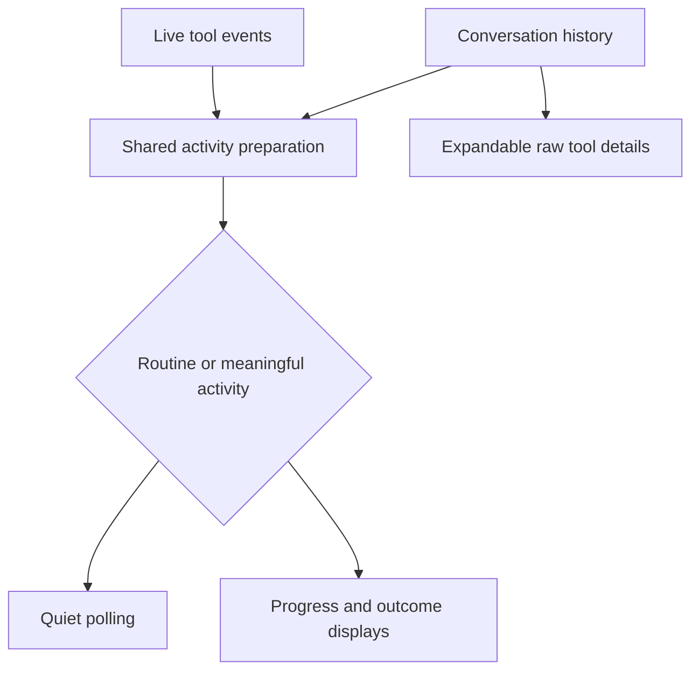

Codex review: blocked before merge. _Reviewed September 18, 2026, 5:34 AM ET / 09:34 UTC (Revision 6)._

# ClawSweeper review

## What this changes

Centralizes activity presentation across channels and chat clients so routine polling stays quiet while tool outcomes and raw details remain available.

## Merge readiness

⛔ **Blocked before merge - 2 items remain**

This remains useful work not supplied by current main. The earlier correctness findings are addressed, and the recorded native-verification waiver resolves the previous review blocker. No new blocking defect was found.

**Priority:** P2
**Reviewed head:** `e9a99492bcaf61fbb8a5293b4ff0d741f0f0b60e`

## Review scores

| Measure | Result | What it means |
|---|---|---|
| **Overall readiness** | 🐚 platinum hermit **(4/6)** | Useful, coherent work with observed Telegram behavior, focused regressions, and the earlier correctness blockers resolved. |
| **Proof confidence** | 🐚 platinum hermit **(4/6)** ✨ media proof bonus | Sufficient (screenshot): Inspected Telegram before/after captures demonstrate the shared progress path keeping routine polls quiet while retaining commentary and the final result. The body records browser outcome verification and explicitly waives native manual/screenshot proof; the web after-image could not be independently inspected here. |
| **Patch quality** | 🐚 platinum hermit **(4/6)** | No actionable review findings were identified. |

## Verification

| Check | Result | Evidence |
|---|---|---|
| **Real behavior** | Verified | Sufficient (screenshot): Inspected Telegram before/after captures demonstrate the shared progress path keeping routine polls quiet while retaining commentary and the final result. The body records browser outcome verification and explicitly waives native manual/screenshot proof; the web after-image could not be independently inspected here. |
| **Evidence reviewed** | 11 items | Introduced source and review identity: Inspected the local merge-base-to-head delta rather than treating current-main drift as PR changes. The supplied test merge is stale and was not used to claim removal of main-branch behavior. Earlier plugin compatibility finding addressed: Prepared-item rendering is opt-in. Legacy raw callbacks retain arguments, detail mode, custom builders, and terminal command/patch rendering. The package consumer fixture exercises those contracts, and the captured body reports running unchanged consumer bytes against released and candidate packages. Earlier history and outcome findings addressed: Historical unmatched calls are projected as terminal with unknown outcomes. Web cards consume prepared failed, blocked, completed, and unknown states without rewriting raw execution fields; focused outcome and history tests cover this distinction. |
| **Findings** | None | None. |
| **Security** | None | None. |

## How this fits together

Agent runtimes produce tool events and stored conversation history. Shared activity preparation turns those inputs into presentation facts consumed by channel progress drafts, web chat, terminal chat, and native apps.

## Before merge

- [ ] **Review config compatibility** - Confirm compatibility and upgrade impact for the changed config or default surface before merge.
- [ ] **Add data-model compatibility proof** - Confirm migration or upgrade compatibility proof before merge.

<strong>Agent review details</strong>

### Security

None.

### PR surface

PR surface statistics unavailable: the file list is incomplete.

### Review metrics

| Metric | Value | Why it matters |
|---|---|---|
| **Production versus test growth** | Production/tooling net +889 lines; tests/support net +3,097 lines; docs/generated metadata excluded. | The stated justification is shared activity preparation and consumer cutover, with most growth devoted to regression coverage. |

### Stored data model

Persistent data-model change detected: `unknown-truncated-pull-files`. Confirm migration or upgrade compatibility proof before merge.

### Technical review

Best possible solution:

Keep one shared activity projection, preserve raw diagnostic results and shipped plugin callbacks, and let clients render the prepared outcomes.

Do we have a high-confidence way to reproduce the issue?

Yes: repeated process polls and unmatched historical calls have identifiable presentation paths, supported by the supplied before images and focused regressions. No local runtime reproduction was executed.

Is this the best way to solve the issue?

Yes: shared preparation removes competing client decisions while retaining diagnostic data and the shipped plugin callback contract.

AGENTS.md: found and applied where relevant.

Codex review notes: model internal, reasoning medium; reviewed against [f6850eaa6c06](https://github.com/openclaw/openclaw/commit/f6850eaa6c0600f0fccb5f48017b2f25c955f2ce).

### Labels

Label changes:

- add `proof: sufficient`: Contributor real behavior proof is sufficient. Inspected Telegram before/after captures demonstrate the shared progress path keeping routine polls quiet while retaining commentary and the final result. The body records browser outcome verification and explicitly waives native manual/screenshot proof; the web after-image could not be independently inspected here.
- add `proof: 📸 screenshot`: Contributor real behavior proof includes screenshot evidence. Inspected Telegram before/after captures demonstrate the shared progress path keeping routine polls quiet while retaining commentary and the final result. The body records browser outcome verification and explicitly waives native manual/screenshot proof; the web after-image could not be independently inspected here.
- add `rating: 🐚 platinum hermit`: Overall readiness is 🐚 platinum hermit; proof is 🐚 platinum hermit and patch quality is 🐚 platinum hermit.
- remove `rating: 🦐 gold shrimp`: Current PR rating is `rating: 🐚 platinum hermit`, so this older rating label is no longer current.

Label justifications:

- `P2`: Improves progress clarity and outcome accuracy without evidence of an urgent core-runtime outage.
- `rating: 🐚 platinum hermit`: Overall readiness is 🐚 platinum hermit; proof is 🐚 platinum hermit and patch quality is 🐚 platinum hermit.
- `status: 👀 ready for maintainer look`: ClawSweeper has no concrete contributor-facing blocker left for this PR. Sufficient (screenshot): Inspected Telegram before/after captures demonstrate the shared progress path keeping routine polls quiet while retaining commentary and the final result. The body records browser outcome verification and explicitly waives native manual/screenshot proof; the web after-image could not be independently inspected here.
- `proof: sufficient`: Contributor real behavior proof is sufficient. Inspected Telegram before/after captures demonstrate the shared progress path keeping routine polls quiet while retaining commentary and the final result. The body records browser outcome verification and explicitly waives native manual/screenshot proof; the web after-image could not be independently inspected here.
- `proof: 📸 screenshot`: Contributor real behavior proof includes screenshot evidence. Inspected Telegram before/after captures demonstrate the shared progress path keeping routine polls quiet while retaining commentary and the final result. The body records browser outcome verification and explicitly waives native manual/screenshot proof; the web after-image could not be independently inspected here.
- `proof: telegram-e2e`: This PR needs Telegram Test Server proof with the repository E2E skill. Changes visible Telegram progress rows and commentary; supplied Telegram captures demonstrate that surface.

### Evidence

What I checked:

- **Introduced source and review identity:** Inspected the local merge-base-to-head delta rather than treating current-main drift as PR changes. The supplied test merge is stale and was not used to claim removal of main-branch behavior. ([e9a99492bcaf](https://github.com/openclaw/openclaw/commit/e9a99492bcaf61fbb8a5293b4ff0d741f0f0b60e))
- **Earlier plugin compatibility finding addressed:** Prepared-item rendering is opt-in. Legacy raw callbacks retain arguments, detail mode, custom builders, and terminal command/patch rendering. The package consumer fixture exercises those contracts, and the captured body reports running unchanged consumer bytes against released and candidate packages. ([`src/channels/progress-draft-events.ts:49`](https://github.com/openclaw/openclaw/blob/e9a99492bcaf61fbb8a5293b4ff0d741f0f0b60e/src/channels/progress-draft-events.ts#L49), [e9a99492bcaf](https://github.com/openclaw/openclaw/commit/e9a99492bcaf61fbb8a5293b4ff0d741f0f0b60e))
- **Earlier history and outcome findings addressed:** Historical unmatched calls are projected as terminal with unknown outcomes. Web cards consume prepared failed, blocked, completed, and unknown states without rewriting raw execution fields; focused outcome and history tests cover this distinction. ([`ui/src/lib/chat/tool-cards.ts:143`](https://github.com/openclaw/openclaw/blob/e9a99492bcaf61fbb8a5293b4ff0d741f0f0b60e/ui/src/lib/chat/tool-cards.ts#L143), [e9a99492bcaf](https://github.com/openclaw/openclaw/commit/e9a99492bcaf61fbb8a5293b4ff0d741f0f0b60e))
- **Current-main necessity:** The fetched main revision retains the earlier activity event definitions and lacks this shared tool/history projection. The supplied merged reconnect PR addresses navigation freezing, not polling presentation. ([`src/infra/agent-activity-events.ts:1`](https://github.com/openclaw/openclaw/blob/f6850eaa6c0600f0fccb5f48017b2f25c955f2ce/src/infra/agent-activity-events.ts#L1), [f6850eaa6c06](https://github.com/openclaw/openclaw/commit/f6850eaa6c0600f0fccb5f48017b2f25c955f2ce))
- **Latest-release comparison:** The latest supplied release also contains the earlier activity implementation; it does not establish that this PR's central change has shipped. ([`src/infra/agent-activity-events.ts:1`](https://github.com/openclaw/openclaw/blob/3a9d69db306cd7f081e06254cb89c4bcc14a7107/src/infra/agent-activity-events.ts#L1), [3a9d69db306c](https://github.com/openclaw/openclaw/commit/3a9d69db306cd7f081e06254cb89c4bcc14a7107))
- **Inspected behavior proof and prior-review disposition:** Inspected prepared images 1–3: Telegram before shows repeated process rows, after shows commentary and plan progress without those rows, and the final reply reports eight checksums and zero duplicates. Captured sourceRevision 4bbcbc662312c8fbc98003f6396bd122fbb046d9cf164cdd4ca2f0864f9514da reports nine quiet polls, browser red/green verification, approved SDK exports, and an explicit waiver of native screenshots/manual UI verification while retaining hosted native tests. Image 4 shows the earlier web false-completion state. The linked web after-image was absent from the prepared manifest and browser retrieval returned a cache miss; its visual result was not independently inspected.

Likely related people:

- **Peter Steinberger:** Suggested for follow-up; no historical authorship or introduction is verified. (role: unverified routing candidate; confidence: low)
- **Ayaan Zaidi:** Suggested for follow-up; no historical authorship or introduction is verified. (role: unverified routing candidate; confidence: low)
- **Vincent Koc:** Suggested for follow-up; no historical authorship or introduction is verified. (role: unverified routing candidate; confidence: low)

### Rating scale

| Score | Internal tier | Crab rank | Meaning |
|---:|:---:|---|---|
| **6/6** | S | 🦀 challenger crab | Exceptional readiness |
| **5/6** | A | 🦞 diamond lobster | Very strong readiness |
| **4/6** | B | 🐚 platinum hermit | Good normal PR; ordinary maintainer review |
| **3/6** | C | 🦐 gold shrimp | Useful, but confidence is limited |
| **2/6** | D | 🦪 silver shellfish | Proof or implementation needs work |
| **1/6** | F | 🧂 unranked krab | Not merge-ready |
| N/A | NA | 🌊 off-meta tidepool | Rating does not apply |

Overall follows the weaker of proof and patch quality.
Shiny media proof means a screenshot, video, or linked artifact directly shows the changed behavior. Runtime, network, CSP, and security claims still need visible diagnostics.

### Workflow

- ClawSweeper keeps one durable marker-backed review comment per issue or PR.
- Re-runs edit this comment so the latest verdict, findings, and automation markers stay together instead of adding duplicate bot comments.
- A fresh review can be triggered by eligible `@clawsweeper re-review` comments, exact-item GitHub events, scheduled/background review runs, or manual workflow dispatch.
- PR/issue authors and users with repository write access can comment `@clawsweeper re-review` or `@clawsweeper re-run` on an open PR or issue to request a fresh review only.
- Maintainers can also comment `@clawsweeper review` to request a fresh review only.
- Fresh-review commands do not start repair, autofix, rebase, CI repair, or automerge.
- Maintainer-only repair and merge flows require explicit commands such as `@clawsweeper autofix`, `@clawsweeper automerge`, `@clawsweeper fix ci`, or `@clawsweeper address review`.
- Maintainers can comment `@clawsweeper explain` to ask for more context, or `@clawsweeper stop` to stop active automation.

### History

Review history (5 earlier review cycles)

<!-- clawsweeper-review-history v=1 total=5 -->
- reviewed 2026-09-18T06:23:55.300Z sha b5b3ce098f1c9c5b17fbd6efde975a6e8ab21aa5 :: blocked before merge. :: [P1] Preserve rendering for the shipped compositor methods | [P2] Avoid marking unmatched historical calls as running
- reviewed 2026-09-18T06:53:11.028Z sha 2ed49a73e0a99e52e6271497d054f44c8b4dca6d :: blocked before merge. :: [P1] Preserve rendering for the shipped compositor methods | [P2] Avoid marking unmatched historical calls as running
- reviewed 2026-09-18T08:05:58.940Z sha afdd8bcc9f5f9fe4cf928cda794eb0e001e89b1f :: blocked before merge. :: [P2] Separate terminal activity from successful tool results
- reviewed 2026-09-18T08:41:38.645Z sha dd163db5d26472d79f3d0501a74e3e7dcd4a4574 :: blocked before merge. :: [P2] Separate terminal activity from successful tool results
- reviewed 2026-09-18T09:09:37.701Z sha 3bffe762d7cdd969ef6d5f3015b388da6e938f69 :: blocked before merge. :: none

<!-- clawsweeper-verdict:needs-human item=151456 sha=e9a99492bcaf61fbb8a5293b4ff0d741f0f0b60e confidence=high updated_at=2026-09-18T09:30:59Z reviewed_at=2026-09-18T09:34:44.289Z lease_owner=github-run-35329687263-1 lease_comment_id=5728080343 source_revision=4bbcbc662312c8fbc98003f6396bd122fbb046d9cf164cdd4ca2f0864f9514da live_verification=absent -->
<!-- clawsweeper-review-state:blocked item=151456 sha=e9a99492bcaf61fbb8a5293b4ff0d741f0f0b60e v=1 -->

<!-- clawsweeper-review-version item=151456 reviewed_at=2026-09-18T09:34:44.289Z sha=e9a99492bcaf61fbb8a5293b4ff0d741f0f0b60e source_revision=4bbcbc662312c8fbc98003f6396bd122fbb046d9cf164cdd4ca2f0864f9514da lease_owner=github-run-35329687263-1 lease_comment_id=5728080343 v=1 -->

<!-- clawsweeper-review item=151456 -->