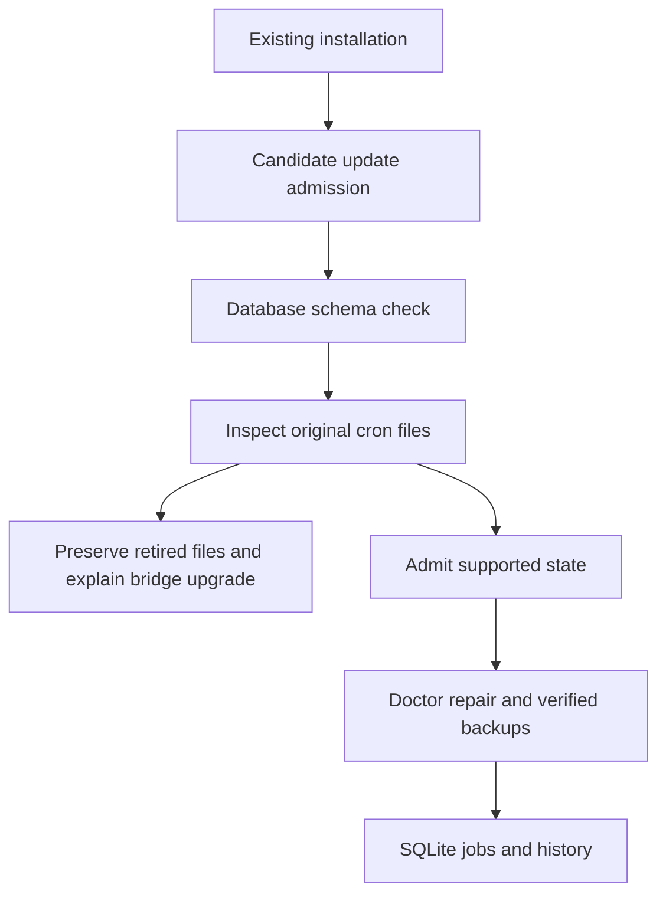

Codex review: blocked before merge. _Reviewed October 2, 2026, 8:01 AM ET / 12:01 UTC (Revision 10)._

# ClawSweeper review

## What this changes

Removes historical cron JSON job and JSONL history importers, preserves retired files with bridge-upgrade guidance, and moves retained fixtures to SQLite.

> [!WARNING]
> **SQLite table change**
>
> This PR modifies persisted SQLite tables in `src/commands/doctor/cron/migration-ledger.ts`. Prefer a design that avoids changing persisted SQLite tables. If the change is necessary, verify migration and upgrade compatibility against an existing database before merge.

## Merge readiness

⛔ **Blocked before merge - 3 items remain**

This remains useful, distinct cleanup. No blocking patch defect was found, but the required upgrade compatibility evidence remains incomplete.

**Priority:** P2
**Reviewed head:** `b07d40de19aa820fd5d2352e17a4c92d62c9810b`

## Review scores

| Measure | Result | What it means |
|---|---|---|
| **Overall readiness** | 🦐 gold shrimp **(3/6)** | The implementation is coherent and earlier fixture defects are resolved, but incomplete upgrade evidence limits merge readiness. |
| **Proof confidence** | 🦐 gold shrimp **(3/6)** | Not applicable: Real behavior proof is not required for maintainer- or bot-authored pull requests. |
| **Patch quality** | 🐚 platinum hermit **(4/6)** | No actionable review findings were identified. |

## Verification

| Check | Result | Evidence |
|---|---|---|
| **Real behavior** | Not applicable | Not applicable: Real behavior proof is not required for maintainer- or bot-authored pull requests. |
| **Evidence reviewed** | 9 items | Pinned introduction and clean checkout: Reviewed the introduced delta from 79810b9480ac27daf07592d976a2e07528cb5ada to b07d40de19aa820fd5d2352e17a4c92d62c9810b. Whitespace inspection passed and the checkout remained clean. The supplied test merge is stale and was not used to infer removal of current-main behavior. Original-state update refusal: Candidate admission checks schemas before resolving the original cron locator and inspecting retired inputs; inspection and retirement errors become structured retired-state-format refusals. Supported repair boundary remains: Doctor rejects retired files before loading quarantine. Supported SQLite normalization retains snapshot checks, verified backups, transaction admission, and quarantine archival; the extracted archive preserves source-hash and rehearsal protections. |
| **Findings** | None | None. |
| **Security** | None | None. |

## How this fits together

Cron stores scheduled jobs and execution history in SQLite. Doctor repairs supported historical data, while candidate update admission checks existing installation state before activation.

## Before merge

- [ ] **Resolve merge risk (P1)** - Installations retaining cron JSON or JSONL now require a bridge upgrade. Published-2026.9.7 proof has not yet established supported SQLite/quarantine upgrade success or retired-input refusal preserving source/config bytes, durable rows, the installed package, and the running Gateway.
- [ ] **Complete next step (P2)** - Establish both candidate-bound published-2026.9.7 upgrade outcomes: supported SQLite/quarantine success and retired-input refusal preserving original state, installed package, and running Gateway identity/readiness. Post redacted terminal output or logs in the PR body; updating it triggers re-review.
- [ ] **Add data-model compatibility proof** - Confirm migration or upgrade compatibility proof before merge.

<strong>Agent review details</strong>

### Security

None.

### PR surface

Source -741, Tests -690, Docs +14, Other +11. Total -1406 across 41 files.

View PR surface stats

| Area | Files | Added | Removed | Net |
|---|---:|---:|---:|---:|
| Source | 15 | 388 | 1129 | -741 |
| Tests | 14 | 515 | 1205 | -690 |
| Docs | 5 | 99 | 85 | +14 |
| Config | 0 | 0 | 0 | 0 |
| Generated | 0 | 0 | 0 | 0 |
| Other | 7 | 101 | 90 | +11 |
| **Total** | **41** | **1103** | **2509** | **-1406** |

### Review metrics

None.

### Stored data model

Persistent data-model change detected: `migration/backfill/repair: config/assertion-safety-baseline.txt`, `migration/backfill/repair: scripts/check-kysely-guardrails.mts`, `migration/backfill/repair: scripts/e2e/lib/upgrade-survivor/run.sh`, `migration/backfill/repair: scripts/e2e/lib/upgrade-survivor/sqlite-volume.mjs`, `migration/backfill/repair: scripts/lib/type-assertion-guard-scope.mjs`, `migration/backfill/repair: src/commands/doctor/cron/index.ts`, and 20 more. Confirm migration or upgrade compatibility proof before merge.

### Merge-risk options

**Maintainer options:**
1. **Complete the missing upgrade evidence (recommended)**  
   Resolve the recorded fixture prerequisites using the existing owners and establish both published-driver outcomes against the candidate before landing.

### Technical review

Best possible solution:

Supported SQLite and quarantine installations should upgrade normally, while retired inputs remain intact behind a tested bridge-upgrade refusal.

Do we have a high-confidence way to reproduce the issue?

Not applicable to a reported bug; this retires historical import paths. Source inspection establishes the changed admission behavior, but no runtime execution occurred during this review.

Is this the best way to solve the issue?

Yes structurally: the change keeps retirement checks and supported repairs with the existing Doctor and update owners, following the established retention policy.

AGENTS.md: found and applied where relevant.

Codex review notes: model internal, reasoning medium; reviewed against [baa26a6ad512](https://github.com/openclaw/openclaw/commit/baa26a6ad51207047f05b14d5bf4a5caea3757d3).

### Labels

Label changes:

No label changes.

Label justifications:

- `P2`: This is bounded migration cleanup with existing-state compatibility work, rather than a demonstrated urgent runtime regression.
- `merge-risk: 🚨 compatibility`: Direct import becomes an explicit bridge-upgrade requirement, and preservation through the shipped updater remains unproven.
- `rating: 🦐 gold shrimp`: Overall readiness is 🦐 gold shrimp; proof is 🦐 gold shrimp and patch quality is 🐚 platinum hermit.
- `status: 👀 ready for maintainer look`: ClawSweeper has no concrete contributor-facing blocker left for this PR. Not applicable: Real behavior proof is not required for maintainer- or bot-authored pull requests.

### Evidence

What I checked:

- **Pinned introduction and clean checkout:** Reviewed the introduced delta from 79810b9480ac27daf07592d976a2e07528cb5ada to b07d40de19aa820fd5d2352e17a4c92d62c9810b. Whitespace inspection passed and the checkout remained clean. The supplied test merge is stale and was not used to infer removal of current-main behavior. ([b07d40de19aa](https://github.com/openclaw/openclaw/commit/b07d40de19aa820fd5d2352e17a4c92d62c9810b))
- **Original-state update refusal:** Candidate admission checks schemas before resolving the original cron locator and inspecting retired inputs; inspection and retirement errors become structured retired-state-format refusals. ([`src/cli/update-cli/update-command-admit.ts:155`](https://github.com/openclaw/openclaw/blob/b07d40de19aa820fd5d2352e17a4c92d62c9810b/src/cli/update-cli/update-command-admit.ts#L155), [b07d40de19aa](https://github.com/openclaw/openclaw/commit/b07d40de19aa820fd5d2352e17a4c92d62c9810b))
- **Supported repair boundary remains:** Doctor rejects retired files before loading quarantine. Supported SQLite normalization retains snapshot checks, verified backups, transaction admission, and quarantine archival; the extracted archive preserves source-hash and rehearsal protections. ([`src/commands/doctor/cron/legacy-repair.ts:122`](https://github.com/openclaw/openclaw/blob/b07d40de19aa820fd5d2352e17a4c92d62c9810b/src/commands/doctor/cron/legacy-repair.ts#L122), [b07d40de19aa](https://github.com/openclaw/openclaw/commit/b07d40de19aa820fd5d2352e17a4c92d62c9810b))
- **Current main has not retired these importers:** Fetched main still detects and imports legacy cron stores and run logs. The latest release's candidate admission also lacks this cron-file refusal, so the central cleanup is neither implemented nor superseded by the merged runtime-identity change. ([`src/commands/doctor/cron/legacy-repair.ts:145`](https://github.com/openclaw/openclaw/blob/baa26a6ad51207047f05b14d5bf4a5caea3757d3/src/commands/doctor/cron/legacy-repair.ts#L145), [baa26a6ad512](https://github.com/openclaw/openclaw/commit/baa26a6ad51207047f05b14d5bf4a5caea3757d3))
- **Existing retention direction:** Current main permits retirement of formats last written before July 1 only with explicit intermediate-release guidance and preservation of persisted data. The PR retains supported quarantine, owner, and delivery repairs under that direction. Public docs: [`docs/gateway/doctor/config-migrations.md`](https://docs.openclaw.ai/gateway/doctor/config-migrations). ([`docs/gateway/doctor/config-migrations.md:31`](https://docs.openclaw.ai/gateway/doctor/config-migrations), [baa26a6ad512](https://github.com/openclaw/openclaw/commit/baa26a6ad51207047f05b14d5bf4a5caea3757d3))
- **Captured upgrade evidence remains incomplete:** The captured body at sourceRevision ea05821b57b0273c8d388ab789e5cfac58f9da4e477c21568cb116187ecea4df reports final-head focused validation and packaging, but explicitly leaves both custom published-2026.9.7 cells unproven. The supported-state attempt reached candidate Doctor and refused a retired session provider field; the refusal attempt stopped at baseline session migration before invoking the candidate. Neither establishes the required upgrade outcome. ([b07d40de19aa](https://github.com/openclaw/openclaw/commit/b07d40de19aa820fd5d2352e17a4c92d62c9810b))

Likely related people:

- **steipete:** Suggested for follow-up; no historical authorship or introduction is verified. (role: unverified routing candidate; confidence: low)

### Rank-up moves

Optional improvements that raise the rating; they are not merge blockers.

- Reuse the upstream session-fixture correction and record candidate-bound published-2026.9.7 supported-state and retired-input refusal results, including preserved-state observations.

### Rating scale

| Score | Internal tier | Crab rank | Meaning |
|---:|:---:|---|---|
| **6/6** | S | 🦀 challenger crab | Exceptional readiness |
| **5/6** | A | 🦞 diamond lobster | Very strong readiness |
| **4/6** | B | 🐚 platinum hermit | Good normal PR; ordinary maintainer review |
| **3/6** | C | 🦐 gold shrimp | Useful, but confidence is limited |
| **2/6** | D | 🦪 silver shellfish | Proof or implementation needs work |
| **1/6** | F | 🧂 unranked krab | Not merge-ready |
| N/A | NA | 🌊 off-meta tidepool | Rating does not apply |

Overall follows the weaker of proof and patch quality.
Shiny media proof means a screenshot, video, or linked artifact directly shows the changed behavior. Runtime, network, CSP, and security claims still need visible diagnostics.

### Workflow

- ClawSweeper keeps one durable marker-backed review comment per issue or PR.
- Re-runs edit this comment so the latest verdict, findings, and automation markers stay together instead of adding duplicate bot comments.
- A fresh review can be triggered by eligible `@clawsweeper re-review` comments, exact-item GitHub events, scheduled/background review runs, or manual workflow dispatch.
- PR/issue authors and users with repository write access can comment `@clawsweeper re-review` or `@clawsweeper re-run` on an open PR or issue to request a fresh review only.
- Maintainers can also comment `@clawsweeper review` to request a fresh review only.
- Fresh-review commands do not start repair, autofix, rebase, CI repair, or automerge.
- Maintainer-only repair and merge flows require explicit commands such as `@clawsweeper autofix`, `@clawsweeper automerge`, `@clawsweeper fix ci`, or `@clawsweeper address review`.
- Maintainers can comment `@clawsweeper explain` to ask for more context, or `@clawsweeper stop` to stop active automation.

### History

Review history (9 earlier review cycles; latest 8 shown)

<!-- clawsweeper-review-history v=1 total=9 -->
- reviewed 2026-10-02T04:10:01.207Z sha 0320c6f5159096f83d366b691f65db648f548681 :: blocked before merge. :: none
- reviewed 2026-10-02T04:37:33.465Z sha 9c52bed401960b468f6d213354c173eab9048bc2 :: blocked before merge. :: none
- reviewed 2026-10-02T05:03:15.921Z sha 9c52bed401960b468f6d213354c173eab9048bc2 :: blocked before merge. :: none
- reviewed 2026-10-02T05:50:22.119Z sha 45d6032f70078b4c067239b76f2b7109bc85993d :: blocked before merge. :: none
- reviewed 2026-10-02T06:50:01.784Z sha 45d6032f70078b4c067239b76f2b7109bc85993d :: blocked before merge. :: [P2] Adapt the baseline-order fixture to the published SDK seed | [P2] Migrate the retained-owner fixture to supported SQLite state
- reviewed 2026-10-02T07:33:34.393Z sha af44f24ed53dadcfc6c2621087e0fda0534ee025 :: blocked before merge. :: none
- reviewed 2026-10-02T08:00:37.535Z sha b07d40de19aa820fd5d2352e17a4c92d62c9810b :: blocked before merge. :: none
- reviewed 2026-10-02T08:18:59.890Z sha b07d40de19aa820fd5d2352e17a4c92d62c9810b :: blocked before merge. :: none

<!-- clawsweeper-verdict:needs-human item=163221 sha=b07d40de19aa820fd5d2352e17a4c92d62c9810b confidence=high updated_at=2026-10-02T11:56:59Z reviewed_at=2026-10-02T12:01:02.134Z lease_owner=github-run-37003742745-1 lease_comment_id=5951838103 source_revision=ea05821b57b0273c8d388ab789e5cfac58f9da4e477c21568cb116187ecea4df live_verification=absent -->
<!-- clawsweeper-review-state:blocked item=163221 sha=b07d40de19aa820fd5d2352e17a4c92d62c9810b v=1 -->

<!-- clawsweeper-review-version item=163221 reviewed_at=2026-10-02T12:01:02.134Z sha=b07d40de19aa820fd5d2352e17a4c92d62c9810b source_revision=ea05821b57b0273c8d388ab789e5cfac58f9da4e477c21568cb116187ecea4df lease_owner=github-run-37003742745-1 lease_comment_id=5951838103 v=1 -->

<!-- clawsweeper-review item=163221 -->