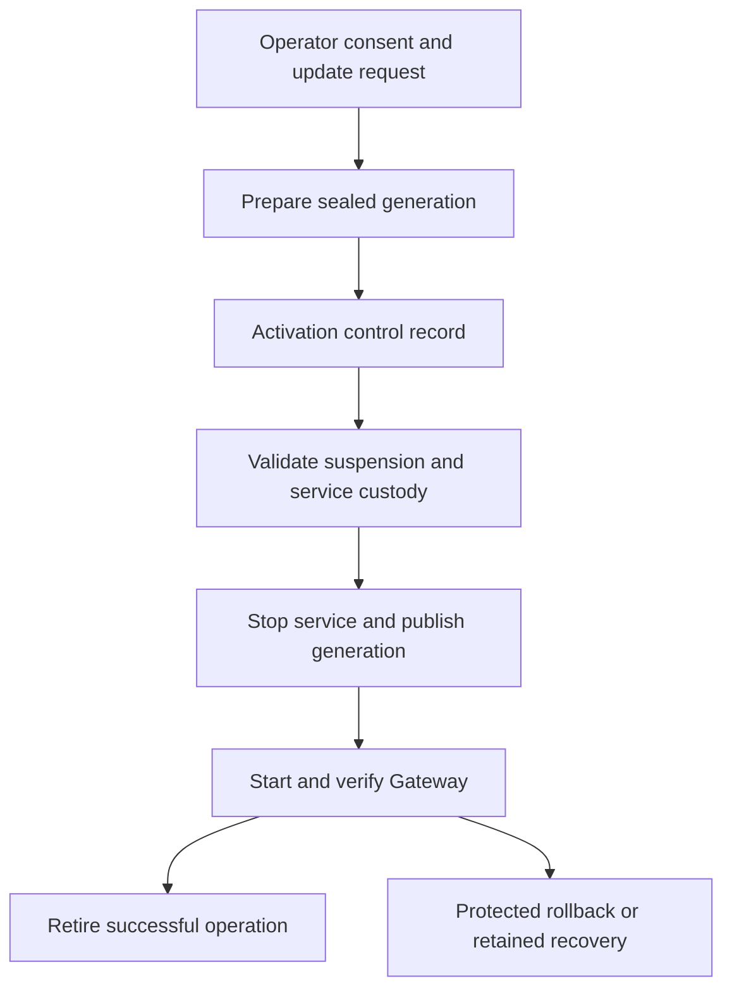

Codex review: needs real behavior proof before merge. _Reviewed October 3, 2026, 12:53 PM ET / 16:53 UTC (Revision 2)._

# ClawSweeper review

## What this changes

Adds explicitly enabled activation and recovery for sealed Linux installations, including service handoff, generation switching, readiness verification, protected rollback, and CLI status reporting.

## Merge readiness

⛔ **Blocked before merge - 4 items remain**

Current main remains preparation-only, so this PR is still necessary. The earlier failed-recovery-start finding is resolved, and launcher proof has improved; final native authority proof remains incomplete.

**Priority:** P2
**Reviewed head:** `eb93441299262d6a5fc724477f885e6cd3dcd4b1`

## Review scores

| Measure | Result | What it means |
|---|---|---|
| **Overall readiness** | 🦐 gold shrimp **(3/6)** | The recovery correction and direct launcher evidence improve confidence, but the material native authority boundary remains incompletely proven. |
| **Proof confidence** | 🦐 gold shrimp **(3/6)** | Needs stronger real behavior proof before merge: Authority-chain proof required: real-root launcher runs establish admission fencing and v1 upgrade behavior, while published-driver Docker output establishes package-update compatibility. The changed suspension-to-systemd authority transfer is covered by synthetic transports, leaving allowed cutover and stale-custody rejection before native I/O unproven. Existing-record compatibility is supported separately by real SQLite upgrade coverage and reported focused runs. After adding proof, update the PR body; ClawSweeper should re-review automatically. If it does not, the PR author or someone with repository write access can comment `@clawsweeper re-review`. |
| **Patch quality** | 🦐 gold shrimp **(3/6)** | No actionable review findings were identified. |

## Verification

| Check | Result | Evidence |
|---|---|---|
| **Real behavior** | Needs proof | Needs stronger real behavior proof before merge: Authority-chain proof required: real-root launcher runs establish admission fencing and v1 upgrade behavior, while published-driver Docker output establishes package-update compatibility. The changed suspension-to-systemd authority transfer is covered by synthetic transports, leaving allowed cutover and stale-custody rejection before native I/O unproven. Existing-record compatibility is supported separately by real SQLite upgrade coverage and reported focused runs. After adding proof, update the PR body; ClawSweeper should re-review automatically. If it does not, the PR author or someone with repository write access can comment `@clawsweeper re-review`. |
| **Evidence reviewed** | 10 items | Pinned introduction and merge composition: Reviewed the merge-base-to-head introduction. The test merge records the pinned main parent followed by the exact PR head; its finalization change preserves main's surrounding behavior. Still necessary on main: Pinned main explicitly reports immutable activation as unavailable. The merged preparation prerequisite, https://github.com/openclaw/openclaw/pull/163799, does not implement this activation/recovery slice. The immutable command file is absent from the latest release tag v2026.9.8. Earlier recovery finding resolved: Recovery now calls the same candidate-start owner as initial activation. That owner rolls back definite readiness failures and thrown starts confirmed stopped; regression cases distinguish those outcomes from still-starting and unverified results. |
| **Findings** | None | None. |
| **Security** | None | None. |

## How this fits together

The immutable updater prepares sealed releases while the Gateway serves, then coordinates suspension and systemd lifecycle operations to select and verify a generation. Its SQLite control record retains activation and recovery facts across interruptions.

## Before merge

- [ ] **Add real behavior proof** - Needs stronger real behavior proof before merge: Authority-chain proof required: real-root launcher runs establish admission fencing and v1 upgrade behavior, while published-driver Docker output establishes package-update compatibility. The changed suspension-to-systemd authority transfer is covered by synthetic transports, leaving allowed cutover and stale-custody rejection before native I/O unproven. Existing-record compatibility is supported separately by real SQLite upgrade coverage and reported focused runs. After adding proof, update the PR body; ClawSweeper should re-review automatically. If it does not, the PR author or someone with repository write access can comment `@clawsweeper re-review`.
- [ ] **Resolve merge risk (P1)** - The privileged suspension-to-service handoff lacks final-effect evidence through real native transport for expired/resumed suspension and revoked executor custody; the synthetic composition harness cannot establish those rejection boundaries.
- [ ] **Complete next step (P2)** - Supply redacted final-effect evidence through real Gateway and native systemd owners for an allowed cutover and stale suspension or executor rejection before I/O; an isolated setup is sufficient, without a Team deployment.
- [ ] **Review config compatibility** - Confirm compatibility and upgrade impact for the changed config or default surface before merge.

<strong>Agent review details</strong>

### Security

None.

### PR surface

PR surface statistics unavailable: the file list is incomplete.

### Review metrics

| Metric | Value | Why it matters |
|---|---|---|
| **Production versus test growth** | production/tooling net +3,665; tests/support/fixtures net +5,284 | The PR body justifies production growth with durable activation, independent recovery, and shutdown fencing. |
| **Operator controls** | 2 new flags and 1 recovery subcommand | Explicit activation consent and a separate drain budget define the operator-facing cutover contract. |

### Stored data model

Persistent data-model change detected: `migration/backfill/repair: src/infra/update-immutable-generation.ts`, `unknown-truncated-pull-files`. Migration or upgrade compatibility proof is recorded; maintainers should verify it before merge.

### Merge-risk options

**Maintainer options:**
1. **Complete scoped native authority proof (recommended)**  
   Provide redacted evidence using the real Gateway and native service owners that permits an authorized cutover and rejects stale suspension or executor custody before I/O; an isolated setup is sufficient.

### Technical review

Best possible solution:

Keep activation opt-in and preserve the bridge and independent-recovery contracts, with verified rejection of stale custody before privileged service effects.

Do we have a high-confidence way to reproduce the issue?

Not applicable to the new activation capability. The earlier recovery defect was checked against current source and its regression cases; no target code was executed during this read-only review.

Is this the best way to solve the issue?

Yes in design: explicit activation consent reuses existing suspension, native lifecycle, readiness, and SQLite owners while preserving preparation-only installations. Scoped native authority evidence is still needed before merge.

AGENTS.md: found and applied where relevant.

Codex review notes: model internal, reasoning medium; reviewed against [4ab382220e2c](https://github.com/openclaw/openclaw/commit/4ab382220e2cca1deedb2c2549982f91c0fb5c64).

### Labels

Label changes:

- add `P2`: This is an opt-in update capability for a bounded Linux installation surface, without evidence of an urgent shipped regression.
- add `merge-risk: 🚨 security-boundary`: The patch transfers suspension custody into privileged native service effects, whose stale-authority rejection remains unverified through real transport.
- add `rating: 🦐 gold shrimp`: Overall readiness is 🦐 gold shrimp; proof is 🦐 gold shrimp and patch quality is 🦐 gold shrimp.
- add `status: 📣 needs proof`: The PR needs real behavior proof before ClawSweeper can clear the contributor ask. Needs stronger real behavior proof before merge: Authority-chain proof required: real-root launcher runs establish admission fencing and v1 upgrade behavior, while published-driver Docker output establishes package-update compatibility. The changed suspension-to-systemd authority transfer is covered by synthetic transports, leaving allowed cutover and stale-custody rejection before native I/O unproven. Existing-record compatibility is supported separately by real SQLite upgrade coverage and reported focused runs. After adding proof, update the PR body; ClawSweeper should re-review automatically. If it does not, the PR author or someone with repository write access can comment `@clawsweeper re-review`.

Label justifications:

- `P2`: This is an opt-in update capability for a bounded Linux installation surface, without evidence of an urgent shipped regression.
- `merge-risk: 🚨 security-boundary`: The patch transfers suspension custody into privileged native service effects, whose stale-authority rejection remains unverified through real transport.
- `rating: 🦐 gold shrimp`: Overall readiness is 🦐 gold shrimp; proof is 🦐 gold shrimp and patch quality is 🦐 gold shrimp.
- `status: 📣 needs proof`: The PR needs real behavior proof before ClawSweeper can clear the contributor ask. Needs stronger real behavior proof before merge: Authority-chain proof required: real-root launcher runs establish admission fencing and v1 upgrade behavior, while published-driver Docker output establishes package-update compatibility. The changed suspension-to-systemd authority transfer is covered by synthetic transports, leaving allowed cutover and stale-custody rejection before native I/O unproven. Existing-record compatibility is supported separately by real SQLite upgrade coverage and reported focused runs. After adding proof, update the PR body; ClawSweeper should re-review automatically. If it does not, the PR author or someone with repository write access can comment `@clawsweeper re-review`.

### Evidence

What I checked:

- **Pinned introduction and merge composition:** Reviewed the merge-base-to-head introduction. The test merge records the pinned main parent followed by the exact PR head; its finalization change preserves main's surrounding behavior. ([01b3d6172bb5](https://github.com/openclaw/openclaw/commit/01b3d6172bb5cf4959eb3ce41ea52ddf0fc86b5c))
- **Still necessary on main:** Pinned main explicitly reports immutable activation as unavailable. The merged preparation prerequisite, https://github.com/openclaw/openclaw/pull/163799, does not implement this activation/recovery slice. The immutable command file is absent from the latest release tag v2026.9.8. ([`src/cli/update-cli/update-command-immutable.ts:11`](https://github.com/openclaw/openclaw/blob/4ab382220e2cca1deedb2c2549982f91c0fb5c64/src/cli/update-cli/update-command-immutable.ts#L11), [4ab382220e2c](https://github.com/openclaw/openclaw/commit/4ab382220e2cca1deedb2c2549982f91c0fb5c64))
- **Earlier recovery finding resolved:** Recovery now calls the same candidate-start owner as initial activation. That owner rolls back definite readiness failures and thrown starts confirmed stopped; regression cases distinguish those outcomes from still-starting and unverified results. ([`src/infra/update-immutable-activation.ts:518`](https://github.com/openclaw/openclaw/blob/eb93441299262d6a5fc724477f885e6cd3dcd4b1/src/infra/update-immutable-activation.ts#L518), [eb9344129926](https://github.com/openclaw/openclaw/commit/eb93441299262d6a5fc724477f885e6cd3dcd4b1))
- **Complete captured proof body inspected:** The full GitHub body was read and its SHA-256 matched the captured snapshot: 2c8649f7a480f22006cf0881729ed74ade030035252c897bc12000eba6babc35. It reports nine real-root launcher passes, including execve, blocked supervisor replacement, hot-journal preservation, and exact-v1 backup/upgrade. These directly exercise launcher admission; they do not exercise native systemd activation. ([`src/infra/update-immutable-launcher.test.ts:261`](https://github.com/openclaw/openclaw/blob/eb93441299262d6a5fc724477f885e6cd3dcd4b1/src/infra/update-immutable-launcher.test.ts#L261), [eb9344129926](https://github.com/openclaw/openclaw/commit/eb93441299262d6a5fc724477f885e6cd3dcd4b1))
- **Native final-effect coverage gap:** The native composition harness replaces Gateway RPC, the systemd broker, systemctl, and process observations. Its expiry/resume, write-custody, replacement-process, and lost-reply cases are useful supplemental regressions, but cannot establish rejection before real native I/O. ([`src/cli/update-cli/update-command-service-drain.native.test.ts:48`](https://github.com/openclaw/openclaw/blob/eb93441299262d6a5fc724477f885e6cd3dcd4b1/src/cli/update-cli/update-command-service-drain.native.test.ts#L48), [eb9344129926](https://github.com/openclaw/openclaw/commit/eb93441299262d6a5fc724477f885e6cd3dcd4b1))
- **Changed privileged dispatch boundary:** Committed suspension transfers authority into one-way host shutdown, while the native broker invokes the new effect guard immediately before sd-bus dispatch. This material authority transfer makes allowed and stale-custody final-effect evidence relevant. ([`src/daemon/systemd-peer-native.ts:366`](https://github.com/openclaw/openclaw/blob/eb93441299262d6a5fc724477f885e6cd3dcd4b1/src/daemon/systemd-peer-native.ts#L366), [eb9344129926](https://github.com/openclaw/openclaw/commit/eb93441299262d6a5fc724477f885e6cd3dcd4b1))

Likely related people:

- **steipete:** Suggested for follow-up; no historical authorship or introduction is verified. (role: unverified routing candidate; confidence: low)
- **Sebastien Tardif:** Suggested for follow-up; no historical authorship or introduction is verified. (role: unverified routing candidate; confidence: low)

### Rank-up moves

Optional improvements that raise the rating; they are not merge blockers.

- Add final-effect evidence for an authorized native cutover and rejection of expired/resumed suspension or revoked executor custody before I/O. Redact private details; updating the PR body should trigger re-review, or a maintainer can request @clawsweeper re-review.

### Rating scale

| Score | Internal tier | Crab rank | Meaning |
|---:|:---:|---|---|
| **6/6** | S | 🦀 challenger crab | Exceptional readiness |
| **5/6** | A | 🦞 diamond lobster | Very strong readiness |
| **4/6** | B | 🐚 platinum hermit | Good normal PR; ordinary maintainer review |
| **3/6** | C | 🦐 gold shrimp | Useful, but confidence is limited |
| **2/6** | D | 🦪 silver shellfish | Proof or implementation needs work |
| **1/6** | F | 🧂 unranked krab | Not merge-ready |
| N/A | NA | 🌊 off-meta tidepool | Rating does not apply |

Overall follows the weaker of proof and patch quality.
Shiny media proof means a screenshot, video, or linked artifact directly shows the changed behavior. Runtime, network, CSP, and security claims still need visible diagnostics.

### Workflow

- ClawSweeper keeps one durable marker-backed review comment per issue or PR.
- Re-runs edit this comment so the latest verdict, findings, and automation markers stay together instead of adding duplicate bot comments.
- A fresh review can be triggered by eligible `@clawsweeper re-review` comments, exact-item GitHub events, scheduled/background review runs, or manual workflow dispatch.
- PR/issue authors and users with repository write access can comment `@clawsweeper re-review` or `@clawsweeper re-run` on an open PR or issue to request a fresh review only.
- Maintainers can also comment `@clawsweeper review` to request a fresh review only.
- Fresh-review commands do not start repair, autofix, rebase, CI repair, or automerge.
- Maintainer-only repair and merge flows require explicit commands such as `@clawsweeper autofix`, `@clawsweeper automerge`, `@clawsweeper fix ci`, or `@clawsweeper address review`.
- Maintainers can comment `@clawsweeper explain` to ask for more context, or `@clawsweeper stop` to stop active automation.

### History

Review history (1 earlier review cycle)

<!-- clawsweeper-review-history v=1 total=1 -->
- reviewed 2026-10-03T12:55:24.062Z sha 7fa4259ccf2aff9e12796e4b0a6b092232f62eea :: needs real behavior proof before merge. :: [P1] Roll back a definitively failed recovery start

<!-- clawsweeper-verdict:needs-human item=164306 sha=eb93441299262d6a5fc724477f885e6cd3dcd4b1 confidence=high updated_at=2026-10-03T16:48:44Z reviewed_at=2026-10-03T16:53:05.979Z lease_owner=github-run-37138178281-1 lease_comment_id=5971253045 source_revision=16db897f5e03aef0841f7bf5d8279e6c4c1d92da78175712420d42ac3bd1ec17 live_verification=absent -->
<!-- clawsweeper-review-state:blocked item=164306 sha=eb93441299262d6a5fc724477f885e6cd3dcd4b1 v=1 -->

<!-- clawsweeper-review-version item=164306 reviewed_at=2026-10-03T16:53:05.979Z sha=eb93441299262d6a5fc724477f885e6cd3dcd4b1 source_revision=16db897f5e03aef0841f7bf5d8279e6c4c1d92da78175712420d42ac3bd1ec17 lease_owner=github-run-37138178281-1 lease_comment_id=5971253045 v=1 -->

<!-- clawsweeper-review item=164306 -->