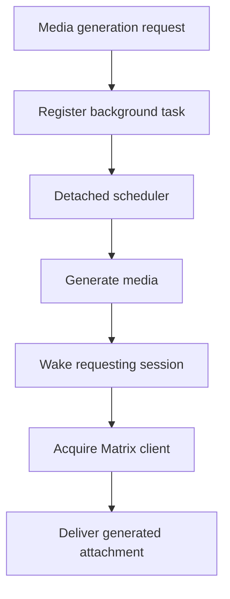

Codex review: needs maintainer review before merge. _Reviewed September 11, 2026, 8:41 AM ET / 12:41 UTC (Revision 3)._

# ClawSweeper review

## What this changes

Run background image, video, and music generation outside the initiating request’s async context so Matrix completion delivery can survive that request ending.

## Merge readiness

✅ **Ready for maintainer review**

The revised patch resolves the prior cancellation finding and remains useful: inspected main and the latest release still inherit request context when scheduling detached media work. No blocking defect was found.

**Priority:** P1
**Reviewed head:** `945988034699a299c1ece0c137c44484eb4de569`

## Review scores

| Measure | Result | What it means |
|---|---|---|
| **Overall readiness** | 🐚 platinum hermit **(4/6)** | A focused owner-boundary repair with meaningful regression coverage and no remaining blocking finding. |
| **Proof confidence** | 🌊 off-meta tidepool | Not applicable: The MEMBER-authored PR is exempt from the external-contributor proof gate. Reported real Gateway/homeserver results support generated-image completion on an equivalent backport; exact-head runtime behavior was not independently exercised. |
| **Patch quality** | 🐚 platinum hermit **(4/6)** | No actionable review findings were identified. |

## Verification

| Check | Result | Evidence |
|---|---|---|
| **Real behavior** | Not applicable | Not applicable: The MEMBER-authored PR is exempt from the external-contributor proof gate. Reported real Gateway/homeserver results support generated-image completion on an equivalent backport; exact-head runtime behavior was not independently exercised. |
| **Evidence reviewed** | 8 items | Verified introduced boundary: The pinned merge-base comparison changes only the media scheduler and its regression test; no Matrix acquisition or send-wrapper changes remain. The host-verified test merge reports the same two-file delta against its main parent. Still necessary on main and release: Fetched main retains the direct queueMicrotask scheduler, as does v2026.9.4. Neither inspected version contains the detached AsyncResource boundary. Prior finding resolved: Ordinary acquisition still combines the monitor-task signal with caller cancellation and rejects aborted acquisition. Existing monitor-task tests cover late acquisition during monitor release and account stop. The previous wrapper-specific proof request is superseded by removing that wrapper change; this review does not claim those scenarios were rerun live. |
| **Findings** | None | None. |
| **Security** | None | None. |

## How this fits together

Media-generation tools register background tasks and later wake the requesting session with generated attachments. Matrix client acquisition normally inherits cancellation from its inbound monitor task.

## Before merge

None.

<strong>Agent review details</strong>

### Security

None.

### PR surface

Source +6, Tests +27. Total +33 across 2 files.

View PR surface stats

| Area | Files | Added | Removed | Net |
|---|---:|---:|---:|---:|
| Source | 1 | 9 | 3 | +6 |
| Tests | 1 | 27 | 0 | +27 |
| Docs | 0 | 0 | 0 | 0 |
| Config | 0 | 0 | 0 | 0 |
| Generated | 0 | 0 | 0 | 0 |
| Other | 0 | 0 | 0 | 0 |
| **Total** | **2** | **36** | **3** | **+33** |

### Review metrics

None.

### Technical review

Best possible solution:

Keep detachment at the shared background-media scheduler while preserving monitor cancellation and explicit provider-resource ownership.

Do we have a high-confidence way to reproduce the issue?

Yes, from source: delayed media completion inherits the monitor task’s signal, which is aborted when the inbound task settles; subsequent Matrix acquisition rejects it. This review did not execute that path.

Is this the best way to solve the issue?

Yes. Repairing the scheduler addresses the lifetime mismatch at its producer without exempting ordinary Matrix sends from cancellation.

AGENTS.md: found and applied where relevant.

Codex review notes: model internal, reasoning medium; reviewed against [4407ed19ac63](https://github.com/openclaw/openclaw/commit/4407ed19ac63b1c1c84a0cfe6eb4bbeca9c2322c).

### Labels

Label changes:

- add `rating: 🐚 platinum hermit`: Overall readiness is 🐚 platinum hermit; proof is 🌊 off-meta tidepool and patch quality is 🐚 platinum hermit.
- add `status: 👀 ready for maintainer look`: ClawSweeper has no concrete contributor-facing blocker left for this PR. Not applicable: The MEMBER-authored PR is exempt from the external-contributor proof gate. Reported real Gateway/homeserver results support generated-image completion on an equivalent backport; exact-head runtime behavior was not independently exercised.
- remove `rating: 🦐 gold shrimp`: Current PR rating is `rating: 🐚 platinum hermit`, so this older rating label is no longer current.
- remove `merge-risk: 🚨 availability`: Current PR review selected no merge-risk labels.
- remove `status: ⏳ waiting on author`: Current PR status label is `status: 👀 ready for maintainer look`.

Label justifications:

- `P1`: Repairs failed generated-media completion delivery in an existing Matrix agent workflow.
- `rating: 🐚 platinum hermit`: Overall readiness is 🐚 platinum hermit; proof is 🌊 off-meta tidepool and patch quality is 🐚 platinum hermit.
- `status: 👀 ready for maintainer look`: ClawSweeper has no concrete contributor-facing blocker left for this PR. Not applicable: The MEMBER-authored PR is exempt from the external-contributor proof gate. Reported real Gateway/homeserver results support generated-image completion on an equivalent backport; exact-head runtime behavior was not independently exercised.

### Evidence

What I checked:

- **Verified introduced boundary:** The pinned merge-base comparison changes only the media scheduler and its regression test; no Matrix acquisition or send-wrapper changes remain. The host-verified test merge reports the same two-file delta against its main parent. ([`src/agents/tools/media-generate-background-shared.ts:382`](https://github.com/openclaw/openclaw/blob/945988034699a299c1ece0c137c44484eb4de569/src/agents/tools/media-generate-background-shared.ts#L382), [945988034699](https://github.com/openclaw/openclaw/commit/945988034699a299c1ece0c137c44484eb4de569))
- **Still necessary on main and release:** Fetched main retains the direct queueMicrotask scheduler, as does v2026.9.4. Neither inspected version contains the detached AsyncResource boundary. ([`src/agents/tools/media-generate-background-shared.ts:378`](https://github.com/openclaw/openclaw/blob/3a9d69db306cd7f081e06254cb89c4bcc14a7107/src/agents/tools/media-generate-background-shared.ts#L378), [3a9d69db306c](https://github.com/openclaw/openclaw/commit/3a9d69db306cd7f081e06254cb89c4bcc14a7107))
- **Prior finding resolved:** Ordinary acquisition still combines the monitor-task signal with caller cancellation and rejects aborted acquisition. Existing monitor-task tests cover late acquisition during monitor release and account stop. The previous wrapper-specific proof request is superseded by removing that wrapper change; this review does not claim those scenarios were rerun live. ([`extensions/matrix/src/matrix/client/shared.ts:552`](https://github.com/openclaw/openclaw/blob/945988034699a299c1ece0c137c44484eb4de569/extensions/matrix/src/matrix/client/shared.ts#L552), [945988034699](https://github.com/openclaw/openclaw/commit/945988034699a299c1ece0c137c44484eb4de569))
- **Existing detached-task contract:** The task facade schedules background work only after task registration and detachment eligibility. Provider resources remain explicitly retained and scoped through their existing owner; completion routing uses the recorded requester context. Image-generation documentation promises asynchronous completion delivery. ([`src/agents/tools/media-generate-background.ts:96`](https://github.com/openclaw/openclaw/blob/945988034699a299c1ece0c137c44484eb4de569/src/agents/tools/media-generate-background.ts#L96), [945988034699](https://github.com/openclaw/openclaw/commit/945988034699a299c1ece0c137c44484eb4de569))
- **Focused regression coverage:** The new test invokes the production default scheduler inside AsyncLocalStorage and checks that background work observes no request store. Existing tests separately cover transcript-owner disposal, completion ordering, blocked delivery, requester routing, and abandonment. Tests were inspected, not executed. ([`src/agents/tools/media-generate-background-shared.test.ts:60`](https://github.com/openclaw/openclaw/blob/945988034699a299c1ece0c137c44484eb4de569/src/agents/tools/media-generate-background-shared.test.ts#L60), [945988034699](https://github.com/openclaw/openclaw/commit/945988034699a299c1ece0c137c44484eb4de569))
- **Reported real Matrix evidence:** The captured body and https://github.com/openclaw/openclaw/pull/144907#issuecomment-5634533715 report a disposable homeserver and real Gateway on an equivalent 7.33 backport: seven scenarios, 11/11 checks, and generated-image delivery in 1.5 seconds. This is positive supporting evidence, not independently inspected exact-head runtime output. Captured context sourceRevision: 7d6fc578a46c0f750c2f6fdf26c8793a6d6c40216943bc4e3f27eb93bbfd93e5.

Likely related people:

- **unknown:** The claimed source-line change could not be verified from bounded local history. (role: source history unknown; confidence: low)
- **unknown:** The claimed source-line change could not be verified from bounded local history. (role: source history unknown; confidence: low)

### Rating scale

| Score | Internal tier | Crab rank | Meaning |
|---:|:---:|---|---|
| **6/6** | S | 🦀 challenger crab | Exceptional readiness |
| **5/6** | A | 🦞 diamond lobster | Very strong readiness |
| **4/6** | B | 🐚 platinum hermit | Good normal PR; ordinary maintainer review |
| **3/6** | C | 🦐 gold shrimp | Useful, but confidence is limited |
| **2/6** | D | 🦪 silver shellfish | Proof or implementation needs work |
| **1/6** | F | 🧂 unranked krab | Not merge-ready |
| N/A | NA | 🌊 off-meta tidepool | Rating does not apply |

Overall follows the weaker of proof and patch quality.
Shiny media proof means a screenshot, video, or linked artifact directly shows the changed behavior. Runtime, network, CSP, and security claims still need visible diagnostics.

### Workflow

- ClawSweeper keeps one durable marker-backed review comment per issue or PR.
- Re-runs edit this comment so the latest verdict, findings, and automation markers stay together instead of adding duplicate bot comments.
- A fresh review can be triggered by eligible `@clawsweeper re-review` comments, exact-item GitHub events, scheduled/background review runs, or manual workflow dispatch.
- PR/issue authors and users with repository write access can comment `@clawsweeper re-review` or `@clawsweeper re-run` on an open PR or issue to request a fresh review only.
- Maintainers can also comment `@clawsweeper review` to request a fresh review only.
- Fresh-review commands do not start repair, autofix, rebase, CI repair, or automerge.
- Maintainer-only repair and merge flows require explicit commands such as `@clawsweeper autofix`, `@clawsweeper automerge`, `@clawsweeper fix ci`, or `@clawsweeper address review`.
- Maintainers can comment `@clawsweeper explain` to ask for more context, or `@clawsweeper stop` to stop active automation.

### History

Review history (2 earlier review cycles)

<!-- clawsweeper-review-history v=1 total=2 -->
- reviewed 2026-09-11T12:17:36.884Z sha 4f216a594e6980897223f464456b89a3e9e9ee10 :: blocked before merge. :: [P1] [P1] Preserve cancellation for sends awaited by monitor tasks
- reviewed 2026-09-11T12:22:45.194Z sha 4f216a594e6980897223f464456b89a3e9e9ee10 :: blocked before merge. :: [P1] [P1] Preserve cancellation for sends awaited by monitor tasks

<!-- clawsweeper-verdict:needs-human item=144907 sha=945988034699a299c1ece0c137c44484eb4de569 confidence=high updated_at=2026-09-11T12:38:38Z reviewed_at=2026-09-11T12:41:26.633Z lease_owner=github-run-34599865499-1 lease_comment_id=5634550166 source_revision=7d6fc578a46c0f750c2f6fdf26c8793a6d6c40216943bc4e3f27eb93bbfd93e5 live_verification=absent -->
<!-- clawsweeper-review-state:ready item=144907 sha=945988034699a299c1ece0c137c44484eb4de569 v=1 -->

<!-- clawsweeper-review-version item=144907 reviewed_at=2026-09-11T12:41:26.633Z sha=945988034699a299c1ece0c137c44484eb4de569 source_revision=7d6fc578a46c0f750c2f6fdf26c8793a6d6c40216943bc4e3f27eb93bbfd93e5 lease_owner=github-run-34599865499-1 lease_comment_id=5634550166 v=1 -->

<!-- clawsweeper-review item=144907 -->