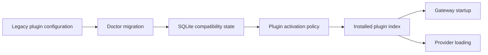

Codex review: needs changes before merge. _Reviewed August 31, 2026, 12:16 AM ET / 04:16 UTC._

# ClawSweeper review

## What this changes

This PR updates bundled plugin activation and index invalidation so migrated compatibility mode preserves bundled provider defaults under restrictive plugin allowlists.

## Regression provenance

Possible regression — probable (reviewed change; known regression link). No predecessor PR is attributed.

## Merge readiness

⚠️ **Needs maintainer review before merge - 5 items remain**

Keep open: the PR repairs a real current-main regression but introduces two P1 policy leaks that can activate unlisted meeting tools or evaluate compatibility state from the wrong environment.

**Priority:** P1
**Reviewed head:** `7f926d25cd8aca765f7d4768e5ba0c8598dd2742`

## Review scores

| Measure | Result | What it means |
|---|---|---|
| **Overall readiness** | 🦐 gold shrimp **(3/6)** | The PR has credible real-path evidence for the original regression but needs two bounded policy corrections before it is merge-ready. |
| **Proof confidence** | 🐚 platinum hermit **(4/6)** | Sufficient (live_output): The captured PR body ties the changed activation owner to an isolated Doctor migration, source Gateway startup, and plugins.list comparison on the exact head, with strict-mode and explicit-deny controls; it sufficiently proves the central repair but not the identified regressions. |
| **Patch quality** | 🦐 gold shrimp **(3/6)** | 2 actionable review findings remain. |

## Verification

| Check | Result | Evidence |
|---|---|---|
| **Real behavior** | Verified | Sufficient (live_output): The captured PR body ties the changed activation owner to an isolated Doctor migration, source Gateway startup, and plugins.list comparison on the exact head, with strict-mode and explicit-deny controls; it sufficiently proves the central repair but not the identified regressions. |
| **Evidence reviewed** | 7 items | Current main still has the regression: Current main uses generic activation for runtime providers and does not apply the PR's bundled-provider compatibility transform.<br>Introduced tool activation widening: The new provider-compat predicate treats any bundled transcript-source owner as eligible; index construction then applies the compatibility transform to it.<br>Bundled meeting plugins contradict the provider-only boundary: Google Meet, Zoom Meetings, and Teams Meetings are default-enabled command/tool plugins whose only matching compatibility contract is transcriptSourceProviders. |
| **Findings** | 2 actionable findings | [P1] Restrict compatibility to actual provider owners<br>[P1] Forward the scoped environment through enablement rechecks |
| **Security** | None | None. |

## How this fits together

Doctor stores legacy bundled-discovery mode in SQLite; plugin discovery, the installed index, Gateway startup, and provider loading use it to decide which plugins activate. The compatibility path must preserve provider defaults without widening channel, tool, or command activation.



## Before merge

- [ ] **Restrict compatibility to actual provider owners (P1)** - `transcriptSourceProviders` also marks Google Meet, Zoom Meetings, and Teams Meetings—default-enabled tool/command plugins—as compatibility providers. The index then adds their IDs to `plugins.allow`, so they activate despite being omitted. This was visible on the prior reviewed head and was missed; exclude mixed tool/command owners and add a restrictive-allowlist regression.
- [ ] **Forward the scoped environment through enablement rechecks (P1)** - The new compatibility branch consults its optional `env`, but explicit-environment consumers such as setup backend lookup, plugin inspection, and provider-auth evidence omit it after building metadata with that same env. They fall back to `process.env` and can report a compat-enabled bundled provider as disabled; propagate the resolved environment and cover two roots.
- [ ] **Resolve merge risk (P1)** - Under a restrictive allowlist, default-enabled Google Meet, Zoom Meetings, and Teams Meetings can become enabled because their transcript-source contract is treated as provider eligibility.
- [ ] **Resolve merge risk (P1)** - Explicit-environment setup, inspection, registry, and provider-auth paths can re-evaluate a correctly scoped index against process.env and hide compatibility-enabled providers.
- [ ] **Resolve merge risk (P1)** - Production code grows by 234 net lines for a bug fix; the repair should consolidate the compatibility classification and state-root propagation at their canonical owners.

## Findings

- [P1] Restrict compatibility to actual provider owners — `src/plugins/bundled-provider-compat.ts:38-40`
- [P1] Forward the scoped environment through enablement rechecks — `src/plugins/installed-plugin-index.ts:182-193`


<details>
<summary><strong>Agent review details</strong></summary>

### Security

None.

### PR surface

Source +250, Tests +508. Total +758 across 34 files.

<details>
<summary>View PR surface stats</summary>

| Area | Files | Added | Removed | Net |
|---|---:|---:|---:|---:|
| Source | 25 | 289 | 39 | +250 |
| Tests | 9 | 593 | 85 | +508 |
| Docs | 0 | 0 | 0 | 0 |
| Config | 0 | 0 | 0 | 0 |
| Generated | 0 | 0 | 0 | 0 |
| Other | 0 | 0 | 0 | 0 |
| **Total** | **34** | **882** | **124** | **+758** |

</details>

### Review metrics

| Metric | Value | Why it matters |
|---|---|---|
| **Production versus test LOC** | production +234 net; tests/test support +524 net | This regression repair substantially expands activation-policy code, making owner-boundary regression coverage essential. |

### Stored data model

Persistent data-model change detected: `persistent cache schema: src/plugins/manifest-contract-eligibility.ts`, `serialized state: src/plugins/installed-plugin-index-store-write.ts`, `unknown-data-model-change: src/plugins/current-plugin-metadata-snapshot.ts`, `unknown-data-model-change: src/plugins/installed-plugin-index-store-write.ts`, `vector/embedding metadata: src/plugins/bundled-discovery-state.ts`, `vector/embedding metadata: src/plugins/management-service.ts`, and 1 more. Confirm migration or upgrade compatibility proof before merge.

### Root-cause cluster

Relationship: `fixed_by_candidate`
Canonical: https://github.com/openclaw/openclaw/issues/123297
Summary: This PR is the candidate repair for the linked bundled-discovery allowlist regression, but it remains incomplete.

Members:
- `canonical`: https://github.com/openclaw/openclaw/issues/123297 - The linked issue describes the same migrated allowlist compatibility failure that the PR targets.

Proposal only: this assessment does not dispatch repair, suppress jobs, mutate sibling items, close, or merge anything.

### Merge-risk options

**Maintainer options:**
1. **Repair the compatibility boundary (recommended)**  
   Exclude mixed transcript/tool plugins from provider compatibility and forward the resolved environment through all enablement rechecks before merge.

<details>
<summary>Copy recommended automerge instruction</summary>

```text
@clawsweeper automerge

Special instructions:
Restrict bundled-provider compatibility to actual provider owners, forward the resolved environment through all enablement rechecks, and add focused two-root and mixed-capability regressions.
```

</details>

### Technical review

Best possible solution:

Restrict compatibility to actual provider owners, preserve strict activation for mixed tool/command plugins, and thread the resolved environment through every dynamic enablement recheck with two-root regression coverage.

Do we have a high-confidence way to reproduce the issue?

Yes: current source deterministically adds each qualifying plugin to the allowlist, and activation then enables bundled default plugins; the captured isolated Gateway comparison corroborates the central regression.

Is this the best way to solve the issue?

No: classifying every transcript-source contract as a provider owner violates the PR's stated provider-only boundary, and optional environment propagation cannot preserve scoped machine-state semantics.

Full review comments:

- [P1] Restrict compatibility to actual provider owners — `src/plugins/bundled-provider-compat.ts:38-40`
  `transcriptSourceProviders` also marks Google Meet, Zoom Meetings, and Teams Meetings—default-enabled tool/command plugins—as compatibility providers. The index then adds their IDs to `plugins.allow`, so they activate despite being omitted. This was visible on the prior reviewed head and was missed; exclude mixed tool/command owners and add a restrictive-allowlist regression.
  Confidence: 0.99
  Late finding: first raised on code an earlier review cycle already covered.
- [P1] Forward the scoped environment through enablement rechecks — `src/plugins/installed-plugin-index.ts:182-193`
  The new compatibility branch consults its optional `env`, but explicit-environment consumers such as setup backend lookup, plugin inspection, and provider-auth evidence omit it after building metadata with that same env. They fall back to `process.env` and can report a compat-enabled bundled provider as disabled; propagate the resolved environment and cover two roots.
  Confidence: 0.97

Overall correctness: patch is incorrect
Overall confidence: 0.98

AGENTS.md: found and applied where relevant.

Codex review notes: model internal, reasoning high; reviewed against [ee3ee255d8d9](https://github.com/openclaw/openclaw/commit/ee3ee255d8d922eda4958fbfd4311d2c71da8d25).

### Labels

Label justifications:

- `P1`: The introduced policy can unexpectedly enable unlisted tools and make default provider availability inconsistent across scoped execution environments.
- `merge-risk: 🚨 compatibility`: The PR changes existing allowlist and migrated-state behavior, including activation of plugins users did not list.
- `merge-risk: 🚨 auth-provider`: The state-root propagation bug can hide bundled provider and authentication availability in scoped flows.
- `rating: 🦐 gold shrimp`: Overall readiness is 🦐 gold shrimp; proof is 🐚 platinum hermit and patch quality is 🦐 gold shrimp.
- `status: ⏳ waiting on author`: ClawSweeper has contributor-facing work open and is waiting for author action. Sufficient (live_output): The captured PR body ties the changed activation owner to an isolated Doctor migration, source Gateway startup, and plugins.list comparison on the exact head, with strict-mode and explicit-deny controls; it sufficiently proves the central repair but not the identified regressions.
- `proof: sufficient`: Contributor real behavior proof is sufficient. The captured PR body ties the changed activation owner to an isolated Doctor migration, source Gateway startup, and plugins.list comparison on the exact head, with strict-mode and explicit-deny controls; it sufficiently proves the central repair but not the identified regressions.

### Evidence

Acceptance criteria:

- [P1] pnpm test src/plugins/installed-plugin-index.compat.test.ts.
- [P1] pnpm test src/plugins/manifest-contract-eligibility.test.ts.
- [P1] pnpm test src/plugins/capability-provider-runtime.test.ts.
- [P1] pnpm check:changed -- src/plugins/bundled-provider-compat.ts src/plugins/installed-plugin-index.ts src/plugins/setup-registry.runtime.ts src/plugins/management-service.ts src/secrets/provider-env-vars.ts.

What I checked:

- **Current main still has the regression:** Current main uses generic activation for runtime providers and does not apply the PR's bundled-provider compatibility transform. ([`src/plugins/providers.runtime.ts:248`](https://github.com/openclaw/openclaw/blob/ee3ee255d8d9/src/plugins/providers.runtime.ts#L248), [ee3ee255d8d9](https://github.com/openclaw/openclaw/commit/ee3ee255d8d9))
- **Introduced tool activation widening:** The new provider-compat predicate treats any bundled transcript-source owner as eligible; index construction then applies the compatibility transform to it. ([`src/plugins/bundled-provider-compat.ts:38`](https://github.com/openclaw/openclaw/blob/7f926d25cd8a/src/plugins/bundled-provider-compat.ts#L38), [7f926d25cd8a](https://github.com/openclaw/openclaw/commit/7f926d25cd8a))
- **Bundled meeting plugins contradict the provider-only boundary:** Google Meet, Zoom Meetings, and Teams Meetings are default-enabled command/tool plugins whose only matching compatibility contract is transcriptSourceProviders. ([`extensions/google-meet/openclaw.plugin.json:16`](https://github.com/openclaw/openclaw/blob/ee3ee255d8d9/extensions/google-meet/openclaw.plugin.json#L16), [ee3ee255d8d9](https://github.com/openclaw/openclaw/commit/ee3ee255d8d9))
- **Allowlist result enables the widened plugin set:** After the transform adds an ID to plugins.allow, activation passes the allowlist and enables a default-enabled bundled plugin. ([`src/plugins/config-activation-shared.ts:196`](https://github.com/openclaw/openclaw/blob/7f926d25cd8a/src/plugins/config-activation-shared.ts#L196), [7f926d25cd8a](https://github.com/openclaw/openclaw/commit/7f926d25cd8a))
- **Scoped environment is dropped by existing enablement consumers:** The introduced recheck accepts env, but setup and plugin inspection build metadata with an explicit env then omit it when re-evaluating enabled state. ([`src/plugins/installed-plugin-index.ts:182`](https://github.com/openclaw/openclaw/blob/7f926d25cd8a/src/plugins/installed-plugin-index.ts#L182), [7f926d25cd8a](https://github.com/openclaw/openclaw/commit/7f926d25cd8a))
- **Submitted real-path proof:** The captured PR body records isolated Doctor migration, source Gateway startup, and plugins.list results for exact head 7f926d25, including strict and explicit-deny controls; it does not cover the two newly identified leaks. ([7f926d25cd8a](https://github.com/openclaw/openclaw/commit/7f926d25cd8a))

Likely related people:

- **Peter Steinberger:** Suggested for follow-up; no historical authorship or introduction is verified. (role: unverified routing candidate; confidence: low)

### Rank-up moves

Optional improvements that raise the rating; they are not merge blockers.

- Restrict the compatibility classifier so transcript-only meeting tool plugins stay behind the allowlist.
- Propagate the resolved environment through setup, inspection, registry, and provider-auth enablement rechecks, with a two-root regression.

### Rating scale

| Score | Internal tier | Crab rank | Meaning |
|---:|:---:|---|---|
| **6/6** | S | 🦀 challenger crab | Exceptional readiness |
| **5/6** | A | 🦞 diamond lobster | Very strong readiness |
| **4/6** | B | 🐚 platinum hermit | Good normal PR; ordinary maintainer review |
| **3/6** | C | 🦐 gold shrimp | Useful, but confidence is limited |
| **2/6** | D | 🦪 silver shellfish | Proof or implementation needs work |
| **1/6** | F | 🧂 unranked krab | Not merge-ready |
| N/A | NA | 🌊 off-meta tidepool | Rating does not apply |

Overall follows the weaker of proof and patch quality.
Shiny media proof means a screenshot, video, or linked artifact directly shows the changed behavior. Runtime, network, CSP, and security claims still need visible diagnostics.

### Workflow

- ClawSweeper keeps one durable marker-backed review comment per issue or PR.
- Re-runs edit this comment so the latest verdict, findings, and automation markers stay together instead of adding duplicate bot comments.
- A fresh review can be triggered by eligible `@clawsweeper re-review` comments, exact-item GitHub events, scheduled/background review runs, or manual workflow dispatch.
- PR/issue authors and users with repository write access can comment `@clawsweeper re-review` or `@clawsweeper re-run` on an open PR or issue to request a fresh review only.
- Maintainers can also comment `@clawsweeper review` to request a fresh review only.
- Fresh-review commands do not start repair, autofix, rebase, CI repair, or automerge.
- Maintainer-only repair and merge flows require explicit commands such as `@clawsweeper autofix`, `@clawsweeper automerge`, `@clawsweeper fix ci`, or `@clawsweeper address review`.
- Maintainers can comment `@clawsweeper explain` to ask for more context, or `@clawsweeper stop` to stop active automation.

### History

<details>
<summary>Review history (25 earlier review cycles; latest 8 shown)</summary>

<!-- clawsweeper-review-history v=1 total=25 -->
- reviewed 2026-08-30T15:50:37.013Z sha 0e5abd309d13b8a3afd07f2bfe1d73bbc2dcce45 :: needs changes before merge. :: [P2] Forward scoped env through manifest availability
- reviewed 2026-08-30T16:32:54.009Z sha a6ece51e73cf53db95f16bcf0250b80932f43d44 :: needs maintainer review before merge. :: none
- reviewed 2026-08-30T16:52:48.023Z sha d83609f81623d7762398ca4653a7388b10a82b5e :: needs real behavior proof before merge. :: [P1] Include contract-only bundled providers in the compat index
- reviewed 2026-08-30T17:03:49.970Z sha 1999698e4f691196c9581002714e89be1e9f5eba :: needs real behavior proof before merge. :: [P1] Include contract-only bundled providers in the compat index
- reviewed 2026-08-30T17:20:06.196Z sha b224331a52df00124180641ae27fcf90679b2bbe :: needs maintainer review before merge. :: none
- reviewed 2026-08-31T02:30:18.111Z sha 4b07fed39782e1206367aaef6b6b26f11ff39e5f :: needs changes before merge. :: [P1] Restrict compat to declared provider owners | [P2] Close cached SQLite handles before deleting state roots
- reviewed 2026-08-31T03:31:58.843Z sha 89a86f7cf94dd66ab53ee3a9b73e0b7bfb5434d1 :: needs changes before merge. :: [P1] Forward the resolved environment to manifest registry construction | [P2] Close cached state databases before removing test roots
- reviewed 2026-08-31T03:44:10.487Z sha e9baedc9c515d9dc05e5bc83dcad541074c4a5dc :: needs changes before merge. :: [P1] Pass the scoped environment to manifest construction | [P2] Close the test database before removing its state root

</details>

</details>

<!-- clawsweeper-verdict:needs-human item=123416 sha=7f926d25cd8aca765f7d4768e5ba0c8598dd2742 confidence=high updated_at=2026-08-31T04:11:49Z reviewed_at=2026-08-31T04:16:30.202Z lease_owner=github-run-33356143732-1 lease_comment_id=5473594798 source_revision=4f52b8edd9f699b342f5d14001c304745e9c137edaf46c6b6bf0a7f5a515fc20 live_verification=absent -->

<!-- clawsweeper-review-version item=123416 reviewed_at=2026-08-31T04:16:30.202Z sha=7f926d25cd8aca765f7d4768e5ba0c8598dd2742 source_revision=4f52b8edd9f699b342f5d14001c304745e9c137edaf46c6b6bf0a7f5a515fc20 lease_owner=github-run-33356143732-1 lease_comment_id=5473594798 v=1 -->

<!-- clawsweeper-review item=123416 -->