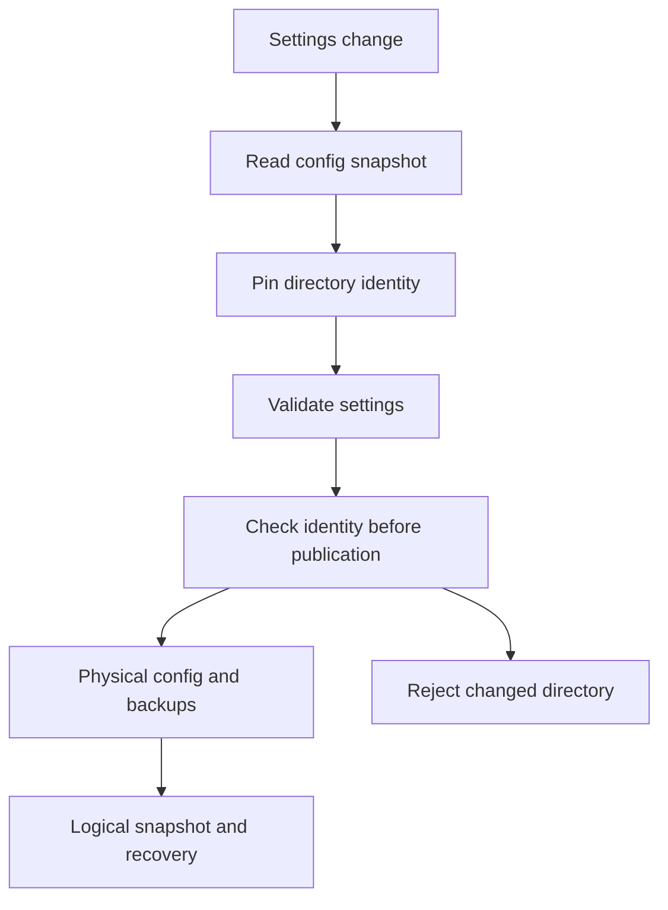

Codex review: needs changes before merge. _Reviewed October 7, 2026, 12:37 AM ET / 04:37 UTC (Revision 5)._

# ClawSweeper review

## What this changes

The PR writes config through a pinned physical state directory while preserving the configured symlink path, rotating backups, and rollback safeguards.

## Merge readiness

⛔ **Needs changes before merge - 1 item remains**

This PR still addresses a concrete config-write failure present on current main and the latest release. No introduced correctness defect was found, and the standalone runtime evidence is sufficient; the branch currently has merge conflicts.

**Priority:** P2
**Reviewed head:** `9f6189c1cf5858f4c8f709d1f9626e38dc6f7450`

## Review scores

| Measure | Result | What it means |
|---|---|---|
| **Overall readiness** | 🐚 platinum hermit **(4/6)** | A focused repair with convincing real filesystem proof and useful recovery coverage; merge conflicts remain an integration task. |
| **Proof confidence** | 🦞 diamond lobster **(5/6)** | Sufficient (terminal): The captured standalone macOS Node run exercises public createConfigIO through the changed config publication owner on a real symlinked directory, showing two successful writes, preserved logical identity, and backup rotation. Boundary regressions supplement that evidence. No stored-data format changes require migration. |
| **Patch quality** | 🐚 platinum hermit **(4/6)** | No actionable review findings were identified. |

## Verification

| Check | Result | Evidence |
|---|---|---|
| **Real behavior** | Verified | Sufficient (terminal): The captured standalone macOS Node run exercises public createConfigIO through the changed config publication owner on a real symlinked directory, showing two successful writes, preserved logical identity, and backup rotation. Boundary regressions supplement that evidence. No stored-data format changes require migration. |
| **Evidence reviewed** | 10 items | Verified introduced patch: The pinned merge-base-to-head diff introduces directory capture in snapshot preparation and write admission, then uses the physical publication path for guarded writes and compensation. Base-branch changes were excluded from patch attribution. Directory and recovery safeguards: The helper resolves an immediate directory symlink and reuses the existing path proof; ordinary directories retain identity checks. Publication and rollback receive that proof, while snapshots and audit records retain logical config identity. Current main still reaches the rejecting boundary: Current main passes configPath directly into atomic publication with dirMode enabled. Its production backup owner directly imports @openclaw/fs-safe/atomic, establishing the affirmative dependency signal; package.json pins version 0.24.1. |
| **Findings** | None | None. |
| **Security** | None | None. |

## How this fits together

OpenClaw’s config writer receives settings changes from CLI and runtime callers, validates them, and publishes the config with recovery backups. Directory identity checks keep publication and rollback bound to the intended filesystem location.

## Before merge

- [ ] **Complete next step (P2)** - Resolve the merge conflicts using main’s current atomic mutation guard, then validate the reconciled config-write and recovery paths.

<strong>Agent review details</strong>

### Security

None.

### PR surface

Source +54, Tests +184. Total +238 across 4 files.

View PR surface stats

| Area | Files | Added | Removed | Net |
|---|---:|---:|---:|---:|
| Source | 3 | 60 | 6 | +54 |
| Tests | 1 | 184 | 0 | +184 |
| Docs | 0 | 0 | 0 | 0 |
| Config | 0 | 0 | 0 | 0 |
| Generated | 0 | 0 | 0 | 0 |
| Other | 0 | 0 | 0 | 0 |
| **Total** | **4** | **244** | **6** | **+238** |

### Review metrics

| Metric | Value | Why it matters |
|---|---|---|
| **Production versus regression coverage** | Production net +54 lines; tests +184 lines | Production growth implements directory identity capture and physical publication; the larger test delta covers observable write and recovery boundaries. |

### Technical review

Best possible solution:

Keep logical config identity while publishing and recovering through a pinned physical parent using main’s existing atomic mutation guard.

Do we have a high-confidence way to reproduce the issue?

Yes: current main sends the symlinked immediate parent to the pinned atomic publisher, whose source explicitly rejects it. The contributor also records the original failure and an after-fix standalone run; this review did not execute target code.

Is this the best way to solve the issue?

Yes: separating logical config identity from a pinned physical publication target repairs the failing boundary while preserving backup and recovery ownership. Integration should retain main’s newer atomic guard.

AGENTS.md: found and applied where relevant.

Codex review notes: model internal, reasoning medium; reviewed against [d9813e348976](https://github.com/openclaw/openclaw/commit/d9813e3489766284c105907f30065a83ff798a11).

### Labels

Label changes:

No label changes.

Label justifications:

- `P2`: The fix restores config writes for a bounded symlinked-state layout without evidence of a wider urgent regression.
- `rating: 🐚 platinum hermit`: Overall readiness is 🐚 platinum hermit; proof is 🦞 diamond lobster and patch quality is 🐚 platinum hermit.
- `status: 👀 ready for maintainer look`: ClawSweeper has no concrete contributor-facing blocker left for this PR. Sufficient (terminal): The captured standalone macOS Node run exercises public createConfigIO through the changed config publication owner on a real symlinked directory, showing two successful writes, preserved logical identity, and backup rotation. Boundary regressions supplement that evidence. No stored-data format changes require migration.
- `proof: sufficient`: Contributor real behavior proof is sufficient. The captured standalone macOS Node run exercises public createConfigIO through the changed config publication owner on a real symlinked directory, showing two successful writes, preserved logical identity, and backup rotation. Boundary regressions supplement that evidence. No stored-data format changes require migration.

### Evidence

What I checked:

- **Verified introduced patch:** The pinned merge-base-to-head diff introduces directory capture in snapshot preparation and write admission, then uses the physical publication path for guarded writes and compensation. Base-branch changes were excluded from patch attribution. ([`src/config/io.write.ts:129`](https://github.com/openclaw/openclaw/blob/9f6189c1cf5858f4c8f709d1f9626e38dc6f7450/src/config/io.write.ts#L129), [9f6189c1cf58](https://github.com/openclaw/openclaw/commit/9f6189c1cf5858f4c8f709d1f9626e38dc6f7450))
- **Directory and recovery safeguards:** The helper resolves an immediate directory symlink and reuses the existing path proof; ordinary directories retain identity checks. Publication and rollback receive that proof, while snapshots and audit records retain logical config identity. ([`src/config/io.write-safety.ts:112`](https://github.com/openclaw/openclaw/blob/9f6189c1cf5858f4c8f709d1f9626e38dc6f7450/src/config/io.write-safety.ts#L112), [9f6189c1cf58](https://github.com/openclaw/openclaw/commit/9f6189c1cf5858f4c8f709d1f9626e38dc6f7450))
- **Current main still reaches the rejecting boundary:** Current main passes configPath directly into atomic publication with dirMode enabled. Its production backup owner directly imports @openclaw/fs-safe/atomic, establishing the affirmative dependency signal; package.json pins version 0.24.1. ([`src/config/backup-rotation.ts:65`](https://github.com/openclaw/openclaw/blob/d9813e3489766284c105907f30065a83ff798a11/src/config/backup-rotation.ts#L65), [d9813e348976](https://github.com/openclaw/openclaw/commit/d9813e3489766284c105907f30065a83ff798a11))
- **Verified dependency failure contract:** The dependency repository endpoint and package metadata verify openclaw/fs-safe ownership and version 0.24.1 at this revision. assertDirectory rejects a symbolic-link immediate parent with the reported error before applying directory mode. ([`src/replace-file-descriptor.ts:42`](https://github.com/openclaw/fs-safe/blob/b749881fd7a66886acd7b403487e87204b822955/src/replace-file-descriptor.ts#L42), [b749881fd7a6](https://github.com/openclaw/fs-safe/commit/b749881fd7a66886acd7b403487e87204b822955))
- **Latest release retains the affected publication path:** The supplied latest release, v2026.9.8, likewise passes the logical configPath directly into atomic replacement with directory-mode admission. This does not support an implemented-on-main or shipped-fix close. ([`src/config/backup-rotation.ts:65`](https://github.com/openclaw/openclaw/blob/fc23bc864e4553c2d215e479eeec47b67a0bf943/src/config/backup-rotation.ts#L65), [fc23bc864e45](https://github.com/openclaw/openclaw/commit/fc23bc864e4553c2d215e479eeec47b67a0bf943))
- **Standalone after-fix behavior proof:** The captured PR body records a standalone Node v26.7.0 process invoking public createConfigIO on macOS with real filesystem symlinks and OPENCLAW_STATE_DIR. Two writes changed the physical config, preserved the directory link and logical snapshot path, and verified both backup generations. The embedded script was inspected as evidence and was not executed. ([9f6189c1cf58](https://github.com/openclaw/openclaw/commit/9f6189c1cf5858f4c8f709d1f9626e38dc6f7450))

Likely related people:

- **steipete:** Suggested for follow-up; no historical authorship or introduction is verified. (role: unverified routing candidate; confidence: low)
- **obviyus:** Suggested for follow-up; no historical authorship or introduction is verified. (role: unverified routing candidate; confidence: low)
- **vincentkoc:** Suggested for follow-up; no historical authorship or introduction is verified. (role: unverified routing candidate; confidence: low)

### Rating scale

| Score | Internal tier | Crab rank | Meaning |
|---:|:---:|---|---|
| **6/6** | S | 🦀 challenger crab | Exceptional readiness |
| **5/6** | A | 🦞 diamond lobster | Very strong readiness |
| **4/6** | B | 🐚 platinum hermit | Good normal PR; ordinary maintainer review |
| **3/6** | C | 🦐 gold shrimp | Useful, but confidence is limited |
| **2/6** | D | 🦪 silver shellfish | Proof or implementation needs work |
| **1/6** | F | 🧂 unranked krab | Not merge-ready |
| N/A | NA | 🌊 off-meta tidepool | Rating does not apply |

Overall follows the weaker of proof and patch quality.
Shiny media proof means a screenshot, video, or linked artifact directly shows the changed behavior. Runtime, network, CSP, and security claims still need visible diagnostics.

### Workflow

- ClawSweeper keeps one durable marker-backed review comment per issue or PR.
- Re-runs edit this comment so the latest verdict, findings, and automation markers stay together instead of adding duplicate bot comments.
- A fresh review can be triggered by eligible `@clawsweeper re-review` comments, exact-item GitHub events, scheduled/background review runs, or manual workflow dispatch.
- PR/issue authors and users with repository write access can comment `@clawsweeper re-review` or `@clawsweeper re-run` on an open PR or issue to request a fresh review only.
- Maintainers can also comment `@clawsweeper review` to request a fresh review only.
- Fresh-review commands do not start repair, autofix, rebase, CI repair, or automerge.
- Maintainer-only repair and merge flows require explicit commands such as `@clawsweeper autofix`, `@clawsweeper automerge`, `@clawsweeper fix ci`, or `@clawsweeper address review`.
- Maintainers can comment `@clawsweeper explain` to ask for more context, or `@clawsweeper stop` to stop active automation.

### History

Review history (4 earlier review cycles)

<!-- clawsweeper-review-history v=1 total=4 -->
- reviewed 2026-09-22T06:59:40.452Z sha 9f6189c1cf5858f4c8f709d1f9626e38dc6f7450 :: needs real behavior proof before merge. :: none
- reviewed 2026-09-22T07:21:50.875Z sha 9f6189c1cf5858f4c8f709d1f9626e38dc6f7450 :: needs maintainer review before merge. :: none
- reviewed September 25, 2026, 7:34 PM ET / 23:34 UTC (Revision 3) sha unknown :: needs maintainer review before merge. :: none
- reviewed 2026-09-26T23:00:49.357Z sha 9f6189c1cf5858f4c8f709d1f9626e38dc6f7450 :: needs maintainer review before merge. :: none

<!-- clawsweeper-verdict:needs-human item=155538 sha=9f6189c1cf5858f4c8f709d1f9626e38dc6f7450 confidence=high updated_at=2026-10-07T04:33:26Z reviewed_at=2026-10-07T04:37:53.288Z lease_owner=github-run-37571935682-1 lease_comment_id=6030987211 source_revision=fd6d83517e10536bdfa845028ca23450ff81efd2c75e05a4bf2b88568c7b65bd live_verification=absent -->
<!-- clawsweeper-review-state:needs-changes item=155538 sha=9f6189c1cf5858f4c8f709d1f9626e38dc6f7450 v=1 -->

<!-- clawsweeper-review-version item=155538 reviewed_at=2026-10-07T04:37:53.288Z sha=9f6189c1cf5858f4c8f709d1f9626e38dc6f7450 source_revision=fd6d83517e10536bdfa845028ca23450ff81efd2c75e05a4bf2b88568c7b65bd lease_owner=github-run-37571935682-1 lease_comment_id=6030987211 v=1 -->

<!-- clawsweeper-review item=155538 -->