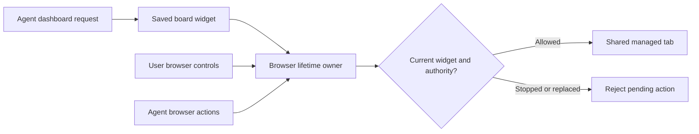

Codex review: blocked before merge. _Reviewed September 13, 2026, 3:11 AM ET / 07:11 UTC (Revision 7)._

# ClawSweeper review

## What this changes

Adds browser dashboards where users and agents share one managed browser tab, with persistent Stop/Resume controls and cleanup tied to the saved widget.

## Merge readiness

⛔ **Blocked before merge - 2 items remain**

Keep open as a useful, maintainer-sponsored feature. Earlier findings are resolved, the latest fixture change preserves existing assertions, and the supplied compatibility and authority-revocation evidence supports a clean technical review.

**Priority:** P2
**Reviewed head:** `da841079788409cf20c2b618a4614c90a7bbe72e`

## Review scores

| Measure | Result | What it means |
|---|---|---|
| **Overall readiness** | 🐚 platinum hermit **(4/6)** | A coherent implementation with strong real-flow and revocation evidence, preserved upgrade behavior, and no remaining actionable findings. |
| **Proof confidence** | 🦞 diamond lobster **(5/6)** | Sufficient (live_output): Real Gateway/Chromium observations exercise the Browser lifetime owner through shared user/agent interaction and stale batch/navigation rejection after Stop or replacement, including zero forbidden effects while the old page remains responsive. Inspected screenshots support the UI claims; the latest commit is test-only and preserves that production proof. |
| **Patch quality** | 🐚 platinum hermit **(4/6)** | No actionable review findings were identified. |

## Verification

| Check | Result | Evidence |
|---|---|---|
| **Real behavior** | Verified | Sufficient (live_output): Real Gateway/Chromium observations exercise the Browser lifetime owner through shared user/agent interaction and stale batch/navigation rejection after Stop or replacement, including zero forbidden effects while the old page remains responsive. Inspected screenshots support the UI claims; the latest commit is test-only and preserves that production proof. |
| **Evidence reviewed** | 9 items | Exact re-review delta: The entire change since the previous reviewed head is twelve added fixture lines. No Browser, board, or UI production code changed. Fixture preserves the routing contract: The fixture copies the canonical preload and records actual process arguments. The existing routing case still checks successful rows, exact central commands, and the selected boundary command set. Fetched main invokes the aggregate checker through this preload. Configuration concern resolved: The only config.ts change exports the existing local-managed-profile predicate without changing its implementation, defaults, or configuration keys. |
| **Findings** | None | None. |
| **Security** | None | None. |

## How this fits together

The dashboard stores the widget definition, while the Browser plugin owns its managed tab and lifetime. Agent browser actions and the Control UI viewport resolve that same tab through the Gateway.

## Before merge

- [ ] **Review config compatibility** - Confirm compatibility and upgrade impact for the changed config or default surface before merge.
- [ ] **Add data-model compatibility proof** - Confirm migration or upgrade compatibility proof before merge.

<strong>Agent review details</strong>

### Security

None.

### PR surface

PR surface statistics unavailable: the file list is incomplete.

### Review metrics

| Metric | Value | Why it matters |
|---|---|---|
| **Production versus regression coverage** | production net +2374; tests/support net +2933 | Production growth implements the accepted shared-tab lifecycle and UI, with substantial coverage for persistence, concurrency, and revoked authority. |
| **Configuration impact** | 0 new configuration keys; 0 changed existing defaults | The config-file touch is an export-only change and does not require operator migration. |

### Stored data model

Persistent data-model change detected: `serialized state: src/boards/sqlite-board-codec.ts`, `unknown-data-model-change: src/boards/sqlite-board-codec.ts`, `unknown-truncated-pull-files`. Confirm migration or upgrade compatibility proof before merge.

### Root-cause cluster

Relationship: `fixed_by_candidate`
Canonical: https://github.com/openclaw/openclaw/issues/146577
Summary: This PR implements the accepted shared-browser dashboard request; the earlier Website widget is an adjacent capability.

Members:
- `canonical`: https://github.com/openclaw/openclaw/issues/146577 - The open issue defines the shared-page requirement and accepted ownership design.
- `adjacent_distinct`: https://github.com/openclaw/openclaw/pull/146312 - The merged Website widget displays an iframe but does not share the agent's managed browser state.

Proposal only: this assessment does not dispatch repair, suppress jobs, mutate sibling items, close, or merge anything.

### Technical review

Best possible solution:

Keep board definitions and Browser lifetime under their existing owners, with both user and agent actions resolving the same currently authorized managed tab.

Do we have a high-confidence way to reproduce the issue?

Not applicable as a feature request. The shared-page workflow has concrete real Gateway/Chromium evidence, and the earlier defect scenarios have corresponding source repairs and reported regression proof.

Is this the best way to solve the issue?

Yes. Reusing the Browser panel, browser tool, board storage, and existing cleanup owner matches the accepted direction; an iframe Website widget cannot provide the same managed page state.

AGENTS.md: found and applied where relevant.

Codex review notes: model internal, reasoning medium; reviewed against [908e90a46231](https://github.com/openclaw/openclaw/commit/908e90a46231cb7d28a4ca8a20c9ad56d3adc753).

### Labels

Label justifications:

- `P2`: This is a bounded, maintainer-requested improvement to shared browser interaction rather than an urgent regression.
- `rating: 🐚 platinum hermit`: Overall readiness is 🐚 platinum hermit; proof is 🦞 diamond lobster and patch quality is 🐚 platinum hermit.
- `feature: ✨ showcase`: ClawSweeper spotlight: unusually compelling feature idea for maintainer attention. Sharing one live page lets users and agents collaborate on existing or agent-created web apps without separate state or site-specific tools.
- `status: 👀 ready for maintainer look`: ClawSweeper has no concrete contributor-facing blocker left for this PR. Sufficient (live_output): Real Gateway/Chromium observations exercise the Browser lifetime owner through shared user/agent interaction and stale batch/navigation rejection after Stop or replacement, including zero forbidden effects while the old page remains responsive. Inspected screenshots support the UI claims; the latest commit is test-only and preserves that production proof.
- `proof: sufficient`: Contributor real behavior proof is sufficient. Real Gateway/Chromium observations exercise the Browser lifetime owner through shared user/agent interaction and stale batch/navigation rejection after Stop or replacement, including zero forbidden effects while the old page remains responsive. Inspected screenshots support the UI claims; the latest commit is test-only and preserves that production proof.

### Evidence

What I checked:

- **Exact re-review delta:** The entire change since the previous reviewed head is twelve added fixture lines. No Browser, board, or UI production code changed. ([`test/scripts/ci-workflow-guards.test.ts:1755`](https://github.com/openclaw/openclaw/blob/da841079788409cf20c2b618a4614c90a7bbe72e/test/scripts/ci-workflow-guards.test.ts#L1755), [da8410797884](https://github.com/openclaw/openclaw/commit/da841079788409cf20c2b618a4614c90a7bbe72e))
- **Fixture preserves the routing contract:** The fixture copies the canonical preload and records actual process arguments. The existing routing case still checks successful rows, exact central commands, and the selected boundary command set. Fetched main invokes the aggregate checker through this preload. ([`test/scripts/ci-workflow-guards.test.ts:11172`](https://github.com/openclaw/openclaw/blob/da841079788409cf20c2b618a4614c90a7bbe72e/test/scripts/ci-workflow-guards.test.ts#L11172), [da8410797884](https://github.com/openclaw/openclaw/commit/da841079788409cf20c2b618a4614c90a7bbe72e))
- **Configuration concern resolved:** The only config.ts change exports the existing local-managed-profile predicate without changing its implementation, defaults, or configuration keys. ([`extensions/browser/src/browser/config.ts:226`](https://github.com/openclaw/openclaw/blob/da841079788409cf20c2b618a4614c90a7bbe72e/extensions/browser/src/browser/config.ts#L226), [da8410797884](https://github.com/openclaw/openclaw/commit/da841079788409cf20c2b618a4614c90a7bbe72e))
- **Persisted identity compatibility:** Native widget identities use existing manifest storage. The real-SQLite regression covers reopening legacy rows without read-time mutation, preserving layout and props, adopting identity on content put, and rotating identity after removal. The captured PR body reports 42 passing SQLite cases and preserved document grants. ([`src/boards/board-store.native.test.ts:119`](https://github.com/openclaw/openclaw/blob/da841079788409cf20c2b618a4614c90a7bbe72e/src/boards/board-store.native.test.ts#L119), [da8410797884](https://github.com/openclaw/openclaw/commit/da841079788409cf20c2b618a4614c90a7bbe72e))
- **Earlier findings addressed:** Cold Stop persists in the Browser store; nested batches propagate authority errors even when stopOnError is false; standalone navigation carries the owner assertion into the existing navigation guard immediately before goto. ([`extensions/browser/src/browser/pw-tools-core.snapshot.ts:553`](https://github.com/openclaw/openclaw/blob/da841079788409cf20c2b618a4614c90a7bbe72e/extensions/browser/src/browser/pw-tools-core.snapshot.ts#L553), [da8410797884](https://github.com/openclaw/openclaw/commit/da841079788409cf20c2b618a4614c90a7bbe72e))
- **Real behavior and forbidden-effect proof:** The supplied body at context revision c7c0ee0f10e9b72891d766232202ea8c9b5a28a3771b7a4c4a16039105ebb631 records real Gateway/Chromium shared-page interaction and Stop/replacement fault injection. With physical closure unavailable, stale batches produced zero forbidden clicks; held navigation preparation produced zero forbidden CDP navigations or HTTP requests while allowed controls remained responsive. Comments https://github.com/openclaw/openclaw/pull/146702#issuecomment-5651527531 and https://github.com/openclaw/openclaw/pull/146702#issuecomment-5651747625 describe successful replays. Four prepared screenshots were inspected and show user-entered state, agent-edited state, navigation, and mobile presentation. ([8deb4328990d](https://github.com/openclaw/openclaw/commit/8deb4328990d75fb6fba0d2298d6bd10e73be9bd))

Likely related people:

- **steipete:** Suggested for follow-up; no historical authorship or introduction is verified. (role: unverified routing candidate; confidence: low)
- **Patrick Erichsen:** Suggested for follow-up; no historical authorship or introduction is verified. (role: unverified routing candidate; confidence: low)

### Rating scale

| Score | Internal tier | Crab rank | Meaning |
|---:|:---:|---|---|
| **6/6** | S | 🦀 challenger crab | Exceptional readiness |
| **5/6** | A | 🦞 diamond lobster | Very strong readiness |
| **4/6** | B | 🐚 platinum hermit | Good normal PR; ordinary maintainer review |
| **3/6** | C | 🦐 gold shrimp | Useful, but confidence is limited |
| **2/6** | D | 🦪 silver shellfish | Proof or implementation needs work |
| **1/6** | F | 🧂 unranked krab | Not merge-ready |
| N/A | NA | 🌊 off-meta tidepool | Rating does not apply |

Overall follows the weaker of proof and patch quality.
Shiny media proof means a screenshot, video, or linked artifact directly shows the changed behavior. Runtime, network, CSP, and security claims still need visible diagnostics.

### Workflow

- ClawSweeper keeps one durable marker-backed review comment per issue or PR.
- Re-runs edit this comment so the latest verdict, findings, and automation markers stay together instead of adding duplicate bot comments.
- A fresh review can be triggered by eligible `@clawsweeper re-review` comments, exact-item GitHub events, scheduled/background review runs, or manual workflow dispatch.
- PR/issue authors and users with repository write access can comment `@clawsweeper re-review` or `@clawsweeper re-run` on an open PR or issue to request a fresh review only.
- Maintainers can also comment `@clawsweeper review` to request a fresh review only.
- Fresh-review commands do not start repair, autofix, rebase, CI repair, or automerge.
- Maintainer-only repair and merge flows require explicit commands such as `@clawsweeper autofix`, `@clawsweeper automerge`, `@clawsweeper fix ci`, or `@clawsweeper address review`.
- Maintainers can comment `@clawsweeper explain` to ask for more context, or `@clawsweeper stop` to stop active automation.

### History

Review history (6 earlier review cycles)

<!-- clawsweeper-review-history v=1 total=6 -->
- reviewed 2026-09-13T03:39:22.831Z sha eea933134cd7e6eede2ad09722816fbb9cef91c1 :: needs real behavior proof before merge. :: [P2] [P2] Persist Stop before the first tab is materialized | [P2] [P2] Revalidate dashboard ownership between batch actions
- reviewed 2026-09-13T03:48:34.964Z sha ccb7f67f47ae20d43c8672695b276d820aaec45a :: needs real behavior proof before merge. :: [P2] [P2] Persist Stop before the first tab is materialized | [P2] [P2] Revalidate dashboard ownership between batch actions
- reviewed 2026-09-13T04:57:00.135Z sha ae14d6de21c9393d3ca7f211a1f32ef527750d79 :: needs real behavior proof before merge. :: [P2] Revalidate dashboard ownership immediately before standalone navigation
- reviewed 2026-09-13T06:06:06.346Z sha 9b44d944251df34d80e0eef4bfab0a9fcd36adbf :: blocked before merge. :: none
- reviewed 2026-09-13T06:17:52.658Z sha 9b44d944251df34d80e0eef4bfab0a9fcd36adbf :: blocked before merge. :: none
- reviewed 2026-09-13T06:52:23.753Z sha 8deb4328990d75fb6fba0d2298d6bd10e73be9bd :: blocked before merge. :: none

<!-- clawsweeper-verdict:needs-human item=146702 sha=da841079788409cf20c2b618a4614c90a7bbe72e confidence=high updated_at=2026-09-13T07:08:18Z reviewed_at=2026-09-13T07:11:09.884Z lease_owner=github-run-34744323605-1 lease_comment_id=5651853092 source_revision=c7c0ee0f10e9b72891d766232202ea8c9b5a28a3771b7a4c4a16039105ebb631 live_verification=absent -->
<!-- clawsweeper-review-state:blocked item=146702 sha=da841079788409cf20c2b618a4614c90a7bbe72e v=1 -->

<!-- clawsweeper-review-version item=146702 reviewed_at=2026-09-13T07:11:09.884Z sha=da841079788409cf20c2b618a4614c90a7bbe72e source_revision=c7c0ee0f10e9b72891d766232202ea8c9b5a28a3771b7a4c4a16039105ebb631 lease_owner=github-run-34744323605-1 lease_comment_id=5651853092 v=1 -->

<!-- clawsweeper-review item=146702 -->