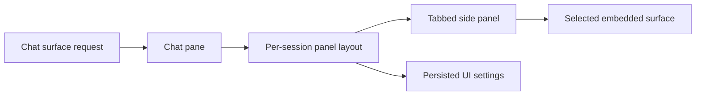

Codex review: needs maintainer review before merge. _Reviewed August 15, 2026, 9:44 PM ET / August 16, 2026, 01:44 UTC._

# ClawSweeper review

## What this changes

The PR replaces Chat’s separate side rails with one resizable, per-session tabbed panel and updates its migration, embedded surface handling, tests, and Control UI documentation.

## Merge readiness

⚠️ **Ready for maintainer review - 4 items remain**

Keep open. This is a protected maintainer-owned implementation candidate for the linked unified-panel proposal; supplied recordings show the UI behavior, but the final head is unavailable in this checkout for a complete independent source review.

**Priority:** P2
**Reviewed head:** `7043c8903f5bfac1bde1cf5802c879cb3b4e2560`
**Owner decision:** Required. See [Decision needed](#decision-needed).

## Review scores

| Measure | Result | What it means |
|---|---|---|
| **Overall readiness** | 🐚 platinum hermit **(4/6)** | Strong user-visible proof and targeted validation are supplied, while exact-head source availability prevents a fully independent final-patch assessment. |
| **Proof confidence** | 🦞 diamond lobster **(5/6)** ✨ media proof bonus | Sufficient (recording): The PR includes after-fix Control UI screenshots and a before/after recording; the final reported change is test-clock stabilization rather than visible behavior. |
| **Patch quality** | 🐚 platinum hermit **(4/6)** | No actionable review findings were identified. |

## Verification

| Check | Result | Evidence |
|---|---|---|
| **Real behavior** | Verified | Sufficient (recording): The PR includes after-fix Control UI screenshots and a before/after recording; the final reported change is test-clock stabilization rather than visible behavior. |
| **Evidence reviewed** | 6 items | Current main behavior: Current main still creates a separate sidebar column for each opened slot, so the central product change is not already implemented on main. Persisted-state owner: The Chat page normalizes and persists sidebar layouts per session, making the proposed migration compatibility-sensitive. Current documentation: Current docs describe standalone Terminal and Browser docks, consistent with the pre-unification implementation. |
| **Findings** | None | None. |
| **Security** | None | None. |

## How this fits together

Chat routes optional surfaces such as Terminal, Browser, Files, and Tasks through a persisted sidebar layout. The proposed panel centralizes those requests into one tab strip, then renders the selected embedded surface.

## Decision needed

| Question | Recommendation |
|---|---|
| Should Chat adopt the unified per-session tabbed panel as the replacement for independent side rails after exact-head CI is green? | **Sponsor the unified panel:** Treat the single tabbed panel and its one-time legacy visibility migration as the intended Control UI direction after exact-head validation. |

Why: This is a user-facing navigation and persisted-layout policy change, so its acceptance cannot be resolved from code correctness alone.

## Before merge

- [ ] **Resolve merge risk (P1)** - The final PR head is absent from this checkout, so the claim that the last change is test-only cannot be independently source-verified here.
- [ ] **Resolve merge risk (P1)** - The change migrates persisted sidebar layouts from independent columns to a single per-session panel; exact-head CI and human upgrade-path review remain necessary before merge.
- [ ] **Complete next step (P2)** - No concrete repair is established; this protected maintainer PR needs human product acceptance and exact-head CI/source review.

<strong>Agent review details</strong>

### Security

None.

### Review metrics

| Metric | Value | Why it matters |
|---|---|---|
| **Production versus test delta** | Exact split unavailable locally; PR aggregate is +5,533/-4,593 | The final head is absent from this checkout, so maintainers should confirm the broad UI refactor’s production/test balance from the exact merge ref. |

### Stored data model

Persistent data-model change detected: `migration/backfill/repair: ui/src/components/terminal/terminal-pending-actions.ts`, `migration/backfill/repair: ui/src/pages/chat/sidebar-layout-legacy-migration.test.ts`, `migration/backfill/repair: ui/src/pages/chat/sidebar-layout-legacy-migration.ts`, `serialized state: ui/src/components/session-panel-toggle-buffer.test.ts`, `serialized state: ui/src/components/session-panel-toggle-buffer.ts`, `serialized state: ui/src/components/terminal/terminal-panel.test.ts`, and 10 more. Migration or upgrade compatibility proof is recorded; maintainers should verify it before merge.

### Root-cause cluster

Relationship: `fixed_by_candidate`
Canonical: https://github.com/openclaw/openclaw/issues/123286
Summary: This PR is the linked implementation candidate for the canonical unified-panel proposal.

Members:
- `canonical`: https://github.com/openclaw/openclaw/issues/123286 - The PR body explicitly identifies this proposal as the problem it implements.

Proposal only: this assessment does not dispatch repair, suppress jobs, mutate sibling items, close, or merge anything.

### Merge-risk options

**Maintainer options:**
1. **Verify upgrade migration on the exact head (recommended)**  
   Before merge, confirm an existing per-session layout stays authoritative while legacy open and explicit closed Browser/Desktop records behave as covered by the migration tests.
2. **Accept a deliberate layout reset**  
   Maintainers may instead explicitly accept loss of legacy global dock visibility, but that would change existing operator expectations.

### Technical review

Best possible solution:

Review the exact final head and its merge ref, require exact-head CI to pass, then merge only if maintainers accept the per-session layout migration as the new Control UI contract.

Do we have a high-confidence way to reproduce the issue?

Not applicable: this is a proposed Control UI navigation model, not a report of a currently failing behavior.

Is this the best way to solve the issue?

Unclear: the shared panel addresses the documented multi-rail UX problem, but the final source revision is unavailable here for an independent best-fix assessment.

AGENTS.md: found and applied where relevant.

Codex review notes: model internal, reasoning high; reviewed against [9c6539c97533](https://github.com/openclaw/openclaw/commit/9c6539c97533ebfa46765701ba36ff9a317ebc46).

### Labels

Label changes:

- add `rating: 🐚 platinum hermit`: Overall readiness is 🐚 platinum hermit; proof is 🦞 diamond lobster and patch quality is 🐚 platinum hermit.
- remove `rating: 🦐 gold shrimp`: Current PR rating is `rating: 🐚 platinum hermit`, so this older rating label is no longer current.

Label justifications:

- `P2`: This is a substantial but non-urgent Control UI navigation and layout change.
- `merge-risk: 🚨 compatibility`: Existing standalone dock preferences and documented controls move to a different per-session layout model.
- `merge-risk: 🚨 session-state`: The patch changes persisted tab order, active tab, visibility, geometry, and restoration behavior for Chat sessions.
- `rating: 🐚 platinum hermit`: Overall readiness is 🐚 platinum hermit; proof is 🦞 diamond lobster and patch quality is 🐚 platinum hermit.
- `status: 👀 ready for maintainer look`: ClawSweeper has no concrete contributor-facing blocker left for this PR. Sufficient (recording): The PR includes after-fix Control UI screenshots and a before/after recording; the final reported change is test-clock stabilization rather than visible behavior.
- `proof: sufficient`: Contributor real behavior proof is sufficient. The PR includes after-fix Control UI screenshots and a before/after recording; the final reported change is test-clock stabilization rather than visible behavior.
- `proof: 🎥 video`: Contributor real behavior proof includes video or recording evidence. The PR includes after-fix Control UI screenshots and a before/after recording; the final reported change is test-clock stabilization rather than visible behavior.

### Evidence

What I checked:

- **Current main behavior:** Current main still creates a separate sidebar column for each opened slot, so the central product change is not already implemented on main. ([`ui/src/pages/chat/sidebar-layout.ts:101`](https://github.com/openclaw/openclaw/blob/9c6539c97533/ui/src/pages/chat/sidebar-layout.ts#L101), [9c6539c97533](https://github.com/openclaw/openclaw/commit/9c6539c97533))
- **Persisted-state owner:** The Chat page normalizes and persists sidebar layouts per session, making the proposed migration compatibility-sensitive. ([`ui/src/pages/chat/chat-state-page.ts:344`](https://github.com/openclaw/openclaw/blob/9c6539c97533/ui/src/pages/chat/chat-state-page.ts#L344), [9c6539c97533](https://github.com/openclaw/openclaw/commit/9c6539c97533))
- **Current documentation:** Current docs describe standalone Terminal and Browser docks, consistent with the pre-unification implementation. Public docs: [`docs/web/control-ui.md`](https://docs.openclaw.ai/web/control-ui). ([`docs/web/control-ui.md:427`](https://docs.openclaw.ai/web/control-ui), [9c6539c97533](https://github.com/openclaw/openclaw/commit/9c6539c97533))
- **Feature-history provenance:** Available shallow-history blame attributes the current independent-column opening logic to commit eeabc2cf69; this is routing evidence, not regression attribution. ([`ui/src/pages/chat/sidebar-layout.ts:101`](https://github.com/openclaw/openclaw/blob/eeabc2cf69a0/ui/src/pages/chat/sidebar-layout.ts#L101), [eeabc2cf69a0](https://github.com/openclaw/openclaw/commit/eeabc2cf69a0))
- **After-fix behavior proof:** The PR body supplies populated light/dark/mobile screenshots, and the follow-up comment supplies a before/after Control UI recording; the reported final update is test-clock stabilization only. ([7043c8903f5b](https://github.com/openclaw/openclaw/commit/7043c8903f5b))
- **Exact-head source gap:** The checked-out partial clone does not contain the final PR object, so the final clock-only change could not be independently inspected locally.

Likely related people:

- **Peter Steinberger:** Available blame identifies the current sidebar opening behavior with this author; the local history is shallow. (role: current-line author in available history; confidence: low; commits: [eeabc2cf69a0](https://github.com/openclaw/openclaw/commit/eeabc2cf69a0fbe1036e37542151db8e2b82add0); files: `ui/src/pages/chat/sidebar-layout.ts`)
- **fuller-stack-dev:** Recent PR commits repaired the migration, embedded-panel lifecycle, documentation, and final test stabilization. (role: recent repair contributor; confidence: high; commits: [d0e1b43e724b](https://github.com/openclaw/openclaw/commit/d0e1b43e724b6887a4444577f7559ae1c2495571), [17e9de5bb96d](https://github.com/openclaw/openclaw/commit/17e9de5bb96d0c17d3e849162ac32d58e8952c53), [7043c8903f5b](https://github.com/openclaw/openclaw/commit/7043c8903f5bfac1bde1cf5802c879cb3b4e2560); files: `ui/src/pages/chat`, `ui/src/e2e/claude-sessions.e2e.test.ts`, `docs/web/control-ui.md`)

### Rank-up moves

Optional improvements that raise the rating; they are not merge blockers.

- Let exact-head CI complete successfully.
- Review the final merge ref’s clock-only diff and persisted-layout migration before landing.

### Rating scale

| Score | Internal tier | Crab rank | Meaning |
|---:|:---:|---|---|
| **6/6** | S | 🦀 challenger crab | Exceptional readiness |
| **5/6** | A | 🦞 diamond lobster | Very strong readiness |
| **4/6** | B | 🐚 platinum hermit | Good normal PR; ordinary maintainer review |
| **3/6** | C | 🦐 gold shrimp | Useful, but confidence is limited |
| **2/6** | D | 🦪 silver shellfish | Proof or implementation needs work |
| **1/6** | F | 🧂 unranked krab | Not merge-ready |
| N/A | NA | 🌊 off-meta tidepool | Rating does not apply |

Overall follows the weaker of proof and patch quality.
Shiny media proof means a screenshot, video, or linked artifact directly shows the changed behavior. Runtime, network, CSP, and security claims still need visible diagnostics.

### Workflow

- ClawSweeper keeps one durable marker-backed review comment per issue or PR.
- Re-runs edit this comment so the latest verdict, findings, and automation markers stay together instead of adding duplicate bot comments.
- A fresh review can be triggered by eligible `@clawsweeper re-review` comments, exact-item GitHub events, scheduled/background review runs, or manual workflow dispatch.
- PR/issue authors and users with repository write access can comment `@clawsweeper re-review` or `@clawsweeper re-run` on an open PR or issue to request a fresh review only.
- Maintainers can also comment `@clawsweeper review` to request a fresh review only.
- Fresh-review commands do not start repair, autofix, rebase, CI repair, or automerge.
- Maintainer-only repair and merge flows require explicit commands such as `@clawsweeper autofix`, `@clawsweeper automerge`, `@clawsweeper fix ci`, or `@clawsweeper address review`.
- Maintainers can comment `@clawsweeper explain` to ask for more context, or `@clawsweeper stop` to stop active automation.

### History

Review history (19 earlier review cycles; latest 8 shown)

<!-- clawsweeper-review-history v=1 total=19 -->
- reviewed 2026-08-15T18:21:03.418Z sha 58856d64de6fa39bea412846f89de2ed6de284f0 :: found issues before merge. :: [P1] Migrate standalone dock visibility into panel state
- reviewed 2026-08-15T18:48:45.948Z sha d8148625db749f8a4879591da9026e5be96a9622 :: found issues before merge. :: [P1] Migrate legacy dock visibility before removing the hosts
- reviewed 2026-08-15T19:02:47.828Z sha 700d6eae929fd82971fe8e0751e2b84ba05794fb :: found issues before merge. :: [P1] Migrate dock visibility before hiding standalone hosts
- reviewed 2026-08-15T23:26:59.861Z sha 3db8b6978e791bbf98bf7ea69513f11913e5b21b :: needs changes before merge. :: [P2] Document the unified chat side panel
- reviewed 2026-08-16T00:22:58.123Z sha 17e9de5bb96d0c17d3e849162ac32d58e8952c53 :: found issues before merge. :: [P2] Document the unified chat side panel
- reviewed 2026-08-16T00:37:03.446Z sha 4c64ff63f1cca424d462c106e39c491a27482831 :: needs changes before merge. :: [P2] Document the unified chat side panel
- reviewed 2026-08-16T00:57:08.733Z sha 12cd5c3be63e947138228b3719a53773dee322e2 :: found issues before merge. :: [P2] Document the unified chat side panel
- reviewed 2026-08-16T01:20:38.848Z sha c1a61cc60cd1446573c89014638d64775cce8dcc :: needs maintainer review before merge. :: none

<!-- clawsweeper-verdict:needs-human item=123874 sha=7043c8903f5bfac1bde1cf5802c879cb3b4e2560 confidence=high updated_at=2026-08-16T01:42:01Z reviewed_at=2026-08-16T01:44:29.797Z lease_owner=github-run-31920115180-1 lease_comment_id=5305181244 source_revision=bda022e14bf4f4cce4bc220f24f3daf14c2cd34669b1e4895718efcd9994dd16 -->

<!-- clawsweeper-review-version item=123874 reviewed_at=2026-08-16T01:44:29.797Z sha=7043c8903f5bfac1bde1cf5802c879cb3b4e2560 source_revision=bda022e14bf4f4cce4bc220f24f3daf14c2cd34669b1e4895718efcd9994dd16 lease_owner=github-run-31920115180-1 lease_comment_id=5305181244 v=1 -->

<!-- clawsweeper-review item=123874 -->