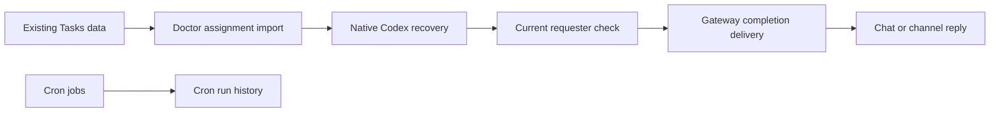

Codex review: needs real behavior proof before merge. _Reviewed September 27, 2026, 1:37 PM ET / 17:37 UTC (Revision 6)._

# ClawSweeper review

## What this changes

The branch removes the Tasks and TaskFlow runtime, CLI and SDK surfaces, and chat panels while moving retained history, completion, and legacy Codex recovery to Cron, session, and native owners.

## Merge readiness

⛔ **Blocked before merge - 9 items remain**

Current main and the latest release still contain the Tasks runtime, so this final retirement remains useful. A maintainer has accepted the intentional SDK break, while native upgrade and requester-authority proof remain incomplete on a head that currently conflicts with main.

**Priority:** P2
**Reviewed head:** `d545e65f41cbb4da63134e0f144149176386b5db`

## Review scores

| Measure | Result | What it means |
|---|---|---|
| **Overall readiness** | 🦐 gold shrimp **(3/6)** | The cutover has substantial scoped validation and inspected UI evidence, with material native upgrade and final-effect proof still missing. |
| **Proof confidence** | 🦐 gold shrimp **(3/6)** | Needs stronger real behavior proof before merge: Authority-chain proof required: The Codex assignment inventory and completion SDK carry stored requester facts into Gateway delivery. Published 9.4 proof reaches import but not post-import native completion or rollback; the reassignment test invokes final-dispatch checks through a mocked send adapter, and older private completion proof does not establish the forbidden-requester outcome. Existing-state compatibility remains insufficient. After adding proof, update the PR body; ClawSweeper should re-review automatically. If it does not, the PR author or someone with repository write access can comment `@clawsweeper re-review`. |
| **Patch quality** | 🦐 gold shrimp **(3/6)** | Security review found an item that needs attention. |

## Verification

| Check | Result | Evidence |
|---|---|---|
| **Real behavior** | Needs proof | Needs stronger real behavior proof before merge: Authority-chain proof required: The Codex assignment inventory and completion SDK carry stored requester facts into Gateway delivery. Published 9.4 proof reaches import but not post-import native completion or rollback; the reassignment test invokes final-dispatch checks through a mocked send adapter, and older private completion proof does not establish the forbidden-requester outcome. Existing-state compatibility remains insufficient. After adding proof, update the PR body; ClawSweeper should re-review automatically. If it does not, the PR author or someone with repository write access can comment `@clawsweeper re-review`. |
| **Evidence reviewed** | 12 items | Current main still owns Tasks: The current main task registry still exports task creation, cancellation, delivery, and queries; the proposed retirement is not implemented there. Latest release retains the runtime: Both the task registry and Task-specific SDK subpath remain in v2026.9.6. Public SDK cutover: The introduced patch replaces the exported Task-specific SDK subpath with a completion-only subpath. The author, identified as a repository admin in the discussion, explicitly accepted immediate removal and documented migration paths in comment 5852044118; that accepted compatibility tradeoff is not a new blocker. |
| **Findings** | None | None. |
| **Security** | Needs attention | Prove requester revocation before final send: The new completion SDK rechecks current requester custody, but the cited reassignment test substitutes a mocked send adapter; a recovered foreign or replaced requester still needs a final-I/O rejection witness. |

## How this fits together

The Gateway uses Tasks to track asynchronous work and expose it to plugins, the CLI, and chat clients. This branch moves retained history and completion to Cron and session/native owners, with Doctor importing eligible old Codex assignments.

## Before merge

- [ ] **Add real behavior proof** - Needs stronger real behavior proof before merge: Authority-chain proof required: The Codex assignment inventory and completion SDK carry stored requester facts into Gateway delivery. Published 9.4 proof reaches import but not post-import native completion or rollback; the reassignment test invokes final-dispatch checks through a mocked send adapter, and older private completion proof does not establish the forbidden-requester outcome. Existing-state compatibility remains insufficient. After adding proof, update the PR body; ClawSweeper should re-review automatically. If it does not, the PR author or someone with repository write access can comment `@clawsweeper re-review`.
- [ ] **Resolve security concern: Prove requester revocation before final send** - The new completion SDK rechecks current requester custody, but the cited reassignment test substitutes a mocked send adapter; a recovered foreign or replaced requester still needs a final-I/O rejection witness.
- [ ] **Resolve merge risk (P1)** - The published 9.4 upgrade witness proves assignment import but did not reach native completion or final rollback, leaving the existing-state recovery outcome unverified.
- [ ] **Resolve merge risk (P1)** - A reassigned or foreign requester has not been rejected through a real final transport send path after recovered completion; the current boundary test uses a mocked send adapter.
- [ ] **Resolve merge risk (P1)** - The reviewed head is currently not cleanly mergeable with main, so its final integrated behavior has not been reviewed.
- [ ] **Complete next step (P2)** - Resolve the current main conflicts and supply a published 9.4 native completion/rollback witness plus allowed and reassigned requester outcomes through final transport I/O before merge.
- [ ] **Resolve review confidence** - ClawSweeper must reach high confidence before merge readiness is known.
- [ ] **Review config compatibility** - Confirm compatibility and upgrade impact for the changed config or default surface before merge.
- [ ] **Add data-model compatibility proof** - Confirm migration or upgrade compatibility proof before merge.

## Findings

- [medium] Prove requester revocation before final send — `src/plugin-sdk/agent-harness-completion.ts:173`

<strong>Agent review details</strong>

### Security

Needs attention: Recovered native completion carries requester authority into channel delivery, and rejection after reassignment remains unobserved through a real transport client.

### PR surface

PR surface statistics unavailable: the file list is incomplete.

### Review metrics

| Metric | Value | Why it matters |
|---|---|---|
| **Public SDK cutover** | 1 Task-specific subpath retired; 1 completion subpath added | Plugin authors need the documented migration path for an intentionally breaking API change. |
| **Stored recovery shape** | 2 binding fields added; 0 SQL schema version bumps | Doctor writes existing plugin state, making old-state recovery proof relevant despite the unchanged SQL layout. |

### Stored data model

Persistent data-model change detected: `unknown-truncated-pull-files`. Confirm migration or upgrade compatibility proof before merge.

### Merge-risk options

**Maintainer options:**
1. **Prove the final cutover (recommended)**  
   Resolve the main conflicts, then capture published 9.4 native completion and rollback plus allowed and reassigned requester results through a real final transport client.

### Technical review

Best possible solution:

Finish the single-owner cutover with a conflict-resolved candidate, a published-state native recovery and rollback witness, and allowed and reassigned requester outcomes observed at final transport I/O.

Do we have a high-confidence way to reproduce the issue?

Not applicable: this is a planned retirement rather than a current-main bug report. Focused tests and package replays cover portions of the cutover.

Is this the best way to solve the issue?

Unclear pending final proof: consolidating ownership under Cron, sessions, and native execution fits the repository's design, but the old-state completion and authority outcomes are not yet established end to end.

AGENTS.md: found and applied where relevant.

Codex review notes: model internal, reasoning high; reviewed against [42e53a49df3a](https://github.com/openclaw/openclaw/commit/42e53a49df3a3c7e9ea51ce86d74e300d94a8ead).

### Labels

Label changes:

No label changes.

Label justifications:

- `P2`: This is a substantial planned runtime retirement with bounded but important upgrade and delivery review work.
- `merge-risk: 🚨 compatibility`: The maintainer accepted immediate retirement of Task-specific SDK APIs, while old native assignment upgrade behavior still needs complete proof.
- `merge-risk: 🚨 message-delivery`: A native completion recovered from published state has not been observed reaching its intended requester after import.
- `merge-risk: 🚨 security-boundary`: Recovered requester custody crosses a final channel-send boundary without real transport evidence for reassignment rejection.
- `rating: 🦐 gold shrimp`: Overall readiness is 🦐 gold shrimp; proof is 🦐 gold shrimp and patch quality is 🦐 gold shrimp.
- `status: 📣 needs proof`: The PR needs real behavior proof before ClawSweeper can clear the contributor ask. Needs stronger real behavior proof before merge: Authority-chain proof required: The Codex assignment inventory and completion SDK carry stored requester facts into Gateway delivery. Published 9.4 proof reaches import but not post-import native completion or rollback; the reassignment test invokes final-dispatch checks through a mocked send adapter, and older private completion proof does not establish the forbidden-requester outcome. Existing-state compatibility remains insufficient. After adding proof, update the PR body; ClawSweeper should re-review automatically. If it does not, the PR author or someone with repository write access can comment `@clawsweeper re-review`.

### Evidence

Security concerns:

- [medium] Prove requester revocation before final send — `src/plugin-sdk/agent-harness-completion.ts:173`
  The new completion SDK rechecks current requester custody, but the cited reassignment test substitutes a mocked send adapter; a recovered foreign or replaced requester still needs a final-I/O rejection witness.
  Confidence: 0.78

What I checked:

- **Current main still owns Tasks:** The current main task registry still exports task creation, cancellation, delivery, and queries; the proposed retirement is not implemented there. ([`src/tasks/task-registry.ts:1`](https://github.com/openclaw/openclaw/blob/42e53a49df3a3c7e9ea51ce86d74e300d94a8ead/src/tasks/task-registry.ts#L1), [42e53a49df3a](https://github.com/openclaw/openclaw/commit/42e53a49df3a3c7e9ea51ce86d74e300d94a8ead))
- **Latest release retains the runtime:** Both the task registry and Task-specific SDK subpath remain in v2026.9.6. ([`src/plugin-sdk/agent-harness-task-runtime.ts`](https://github.com/openclaw/openclaw/blob/eb377ac59e6c9fd6c7705028034812becf00271b/src/plugin-sdk/agent-harness-task-runtime.ts), [eb377ac59e6c](https://github.com/openclaw/openclaw/commit/eb377ac59e6c9fd6c7705028034812becf00271b))
- **Public SDK cutover:** The introduced patch replaces the exported Task-specific SDK subpath with a completion-only subpath. The author, identified as a repository admin in the discussion, explicitly accepted immediate removal and documented migration paths in comment 5852044118; that accepted compatibility tradeoff is not a new blocker. ([`package.json:904`](https://github.com/openclaw/openclaw/blob/d545e65f41cbb4da63134e0f144149176386b5db/package.json#L904), [d545e65f41cb](https://github.com/openclaw/openclaw/commit/d545e65f41cbb4da63134e0f144149176386b5db))
- **Stored-state migration:** Doctor imports eligible legacy native Task rows into two fields on existing Codex binding state using compare-and-apply, leaving source rows intact. This is a stored-data change despite no SQL schema bump. ([`extensions/codex/src/migration/native-task-assignments.ts:317`](https://github.com/openclaw/openclaw/blob/d545e65f41cbb4da63134e0f144149176386b5db/extensions/codex/src/migration/native-task-assignments.ts#L317), [d545e65f41cb](https://github.com/openclaw/openclaw/commit/d545e65f41cbb4da63134e0f144149176386b5db))
- **Authority chain:** Recovered assignments retain host custody, and the completion SDK carries current requester checks into admission and delivery. ([`src/plugin-sdk/agent-harness-completion.ts:173`](https://github.com/openclaw/openclaw/blob/d545e65f41cbb4da63134e0f144149176386b5db/src/plugin-sdk/agent-harness-completion.ts#L173), [d545e65f41cb](https://github.com/openclaw/openclaw/commit/d545e65f41cbb4da63134e0f144149176386b5db))
- **Final send guard and test limit:** The direct-send path rechecks source authority in onPlatformSendDispatch. The cited reassignment test calls that callback through a mocked sendMessage adapter and observes zero mocked platform sends; it does not exercise a real transport client. ([`src/agents/subagents/announce/subagent-announce-delivery.test.ts:2034`](https://github.com/openclaw/openclaw/blob/d545e65f41cbb4da63134e0f144149176386b5db/src/agents/subagents/announce/subagent-announce-delivery.test.ts#L2034), [d545e65f41cb](https://github.com/openclaw/openclaw/commit/d545e65f41cbb4da63134e0f144149176386b5db))

Likely related people:

- **steipete:** Suggested for follow-up; no historical authorship or introduction is verified. (role: unverified routing candidate; confidence: low)
- **Vincent Koc:** Suggested for follow-up; no historical authorship or introduction is verified. (role: unverified routing candidate; confidence: low)
- **Jason (Json):** Suggested for follow-up; no historical authorship or introduction is verified. (role: unverified routing candidate; confidence: low)

### Rank-up moves

Optional improvements that raise the rating; they are not merge blockers.

- Complete the published 9.4 native recovery and rollback witness on a conflict-resolved candidate.
- Exercise the completion SDK through real final transport I/O for an allowed requester and the nearest reassigned or foreign requester.

### Rating scale

| Score | Internal tier | Crab rank | Meaning |
|---:|:---:|---|---|
| **6/6** | S | 🦀 challenger crab | Exceptional readiness |
| **5/6** | A | 🦞 diamond lobster | Very strong readiness |
| **4/6** | B | 🐚 platinum hermit | Good normal PR; ordinary maintainer review |
| **3/6** | C | 🦐 gold shrimp | Useful, but confidence is limited |
| **2/6** | D | 🦪 silver shellfish | Proof or implementation needs work |
| **1/6** | F | 🧂 unranked krab | Not merge-ready |
| N/A | NA | 🌊 off-meta tidepool | Rating does not apply |

Overall follows the weaker of proof and patch quality.
Shiny media proof means a screenshot, video, or linked artifact directly shows the changed behavior. Runtime, network, CSP, and security claims still need visible diagnostics.

### Workflow

- ClawSweeper keeps one durable marker-backed review comment per issue or PR.
- Re-runs edit this comment so the latest verdict, findings, and automation markers stay together instead of adding duplicate bot comments.
- A fresh review can be triggered by eligible `@clawsweeper re-review` comments, exact-item GitHub events, scheduled/background review runs, or manual workflow dispatch.
- PR/issue authors and users with repository write access can comment `@clawsweeper re-review` or `@clawsweeper re-run` on an open PR or issue to request a fresh review only.
- Maintainers can also comment `@clawsweeper review` to request a fresh review only.
- Fresh-review commands do not start repair, autofix, rebase, CI repair, or automerge.
- Maintainer-only repair and merge flows require explicit commands such as `@clawsweeper autofix`, `@clawsweeper automerge`, `@clawsweeper fix ci`, or `@clawsweeper address review`.
- Maintainers can comment `@clawsweeper explain` to ask for more context, or `@clawsweeper stop` to stop active automation.

### History

Review history (5 earlier review cycles)

<!-- clawsweeper-review-history v=1 total=5 -->
- reviewed 2026-09-27T00:11:16.234Z sha b538fdb143abe68ff21f5a9e425583afffbdf29f :: blocked before merge. :: [P1] Preserve the shipped Plugin SDK transition
- reviewed 2026-09-27T02:49:41.003Z sha 894af9fba63ddffae75093ff2bbde3c0719ccaba :: blocked before merge. :: none
- reviewed 2026-09-27T15:35:16.736Z sha 5c730848d29b4f368139f335944b6b117325fcec :: needs real behavior proof before merge. :: none
- reviewed 2026-09-27T16:26:44.064Z sha 02128a9fc0f4db20dd99a215c0f5e89412bb13c8 :: needs real behavior proof before merge. :: none
- reviewed 2026-09-27T17:02:58.628Z sha 69333bf0f73bd81ec784e21dc20cf8887f806344 :: needs real behavior proof before merge. :: none

<!-- clawsweeper-security:security-sensitive item=159179 sha=d545e65f41cbb4da63134e0f144149176386b5db confidence=medium updated_at=2026-09-27T17:32:52Z reviewed_at=2026-09-27T17:37:01.938Z lease_owner=github-run-36337255989-1 lease_comment_id=5858138966 source_revision=c17b2c7fff3a9f937e906ffc6b68a643dd57a665da5ace58912f59d895b0756c live_verification=absent -->
<!-- clawsweeper-verdict:needs-human item=159179 sha=d545e65f41cbb4da63134e0f144149176386b5db confidence=medium updated_at=2026-09-27T17:32:52Z reviewed_at=2026-09-27T17:37:01.938Z lease_owner=github-run-36337255989-1 lease_comment_id=5858138966 source_revision=c17b2c7fff3a9f937e906ffc6b68a643dd57a665da5ace58912f59d895b0756c live_verification=absent -->
<!-- clawsweeper-review-state:blocked item=159179 sha=d545e65f41cbb4da63134e0f144149176386b5db v=1 -->

<!-- clawsweeper-review-version item=159179 reviewed_at=2026-09-27T17:37:01.938Z sha=d545e65f41cbb4da63134e0f144149176386b5db source_revision=c17b2c7fff3a9f937e906ffc6b68a643dd57a665da5ace58912f59d895b0756c lease_owner=github-run-36337255989-1 lease_comment_id=5858138966 v=1 -->

<!-- clawsweeper-review item=159179 -->