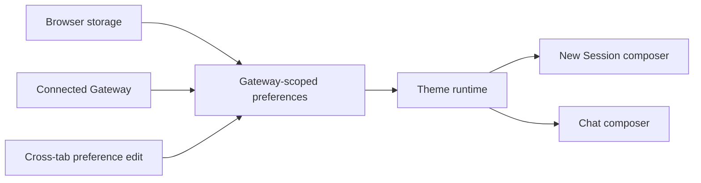

Codex review: needs maintainer review before merge. _Reviewed September 2, 2026, 12:34 PM ET / 16:34 UTC._

# ClawSweeper review

## What this changes

This PR reduces New Session startup assets, splits Chat-only presentation into lazy modules, and replaces render-time settings reads with a token-free preference snapshot bound to the connected Gateway.

## Merge readiness

⚠️ **Ready for maintainer review - 3 items remain**

Keep this PR open: the reviewed branch has a coherent Control UI ownership refactor with no supported blocking code finding, but it changes persisted-preference scoping and is maintainer-labeled; exact-head CI is still queued and an owner should confirm the documented upgrade semantic before landing.

**Priority:** P2
**Reviewed head:** `5d0eeabd86c287fdd1ddc7abd2c4e52d280d8400`
**Owner decision:** Required. See [Decision needed](#decision-needed).

## Review scores

| Measure | Result | What it means |
|---|---|---|
| **Overall readiness** | 🐚 platinum hermit **(4/6)** | A substantial but coherent refactor with focused behavior coverage and detailed real-run evidence; exact-head CI and compatibility ownership confirmation remain before merge. |
| **Proof confidence** | 🐚 platinum hermit **(4/6)** | Not applicable: The repository state identifies this as a MEMBER-authored PR, so the external-contributor proof gate does not apply; the PR body nevertheless documents isolated real-Gateway browser runs for the changed preference and startup paths. |
| **Patch quality** | 🐚 platinum hermit **(4/6)** | No actionable review findings were identified. |

## Verification

| Check | Result | Evidence |
|---|---|---|
| **Real behavior** | Not applicable | Not applicable: The repository state identifies this as a MEMBER-authored PR, so the external-contributor proof gate does not apply; the PR body nevertheless documents isolated real-Gateway browser runs for the changed preference and startup paths. |
| **Evidence reviewed** | 6 items | Preference owner and write path: The branch separates UiPreferences from credentials, reads preferences for the connected Gateway, and refreshes the bound owner after same-scope writes; the theme subscribes to gateway and storage changes before notifying New Session and Chat consumers. Consumer propagation: New Session subscribes to the shared theme and uses its preference snapshot; Chat updates page settings from the same snapshot while retaining the connection token only in Chat state. Focused regression coverage: The branch adds browser coverage for storage-free New/Chat rerenders and same-Gateway cross-tab preference updates, plus preference-scoping and pending-content coverage. |
| **Findings** | None | None. |
| **Security** | None | None. |

## How this fits together

The Control UI loads browser preferences while connecting to a Gateway, then supplies them to New Session and Chat composers. This change makes the theme runtime the mounted preference owner so rendering consumes a live snapshot instead of repeatedly reading browser storage.

## Decision needed

| Question | Recommendation |
|---|---|
| Does the Control UI owner approve making the connected Gateway, rather than another tab's persisted selector, authoritative for the mounted tab's existing display preferences? | **Accept mounted-Gateway scoping:** Treat the documented same-Gateway preference behavior as the upgrade contract once exact-head CI succeeds. |

Why: This is an intentional compatibility-sensitive change to persisted browser preference resolution, and the PR carries the maintainer label.

## Before merge

- [ ] **Resolve merge risk (P1)** - Existing browser profiles will now resolve display preferences from the mounted Gateway rather than a persisted selector; that intentional upgrade semantic needs owner confirmation and successful exact-head CI before landing.
- [ ] **Complete next step (P2)** - Wait for the queued exact-head CI to complete successfully, then obtain Control UI owner confirmation of the mounted-Gateway preference scope before merge.

<strong>Agent review details</strong>

### Security

None.

### PR surface

Source +63, Tests +656, Docs +4. Total +723 across 78 files.

View PR surface stats

| Area | Files | Added | Removed | Net |
|---|---:|---:|---:|---:|
| Source | 35 | 7397 | 7334 | +63 |
| Tests | 41 | 1107 | 451 | +656 |
| Docs | 2 | 4 | 0 | +4 |
| Config | 0 | 0 | 0 | 0 |
| Generated | 0 | 0 | 0 | 0 |
| Other | 0 | 0 | 0 | 0 |
| **Total** | **78** | **8508** | **7785** | **+723** |

### Review metrics

| Metric | Value | Why it matters |
|---|---|---|
| **Production versus test delta** | production +7,384/-7,285 (net +99); tests/support +1,107/-451 (net +656); generated -36; docs +4 | Most production churn is stylesheet relocation; the remaining growth implements the shared preference-owner lifecycle and needs the compatibility review above. |

### Merge-risk options

**Maintainer options:**
1. **Confirm scope, then validate exact head (recommended)**  
   Confirm the mounted-Gateway preference contract and wait for the current-head CI run to complete successfully before preparing a merge.
2. **Pause for a narrower compatibility design**  
   Keep the PR open if existing selector-driven behavior must remain authoritative after a tab is already connected.

### Technical review

Best possible solution:

Retain one token-free, Gateway-scoped preference owner and land only after its documented scope behavior is accepted and the queued exact-head validation completes.

Do we have a high-confidence way to reproduce the issue?

Not applicable as a defect report: this PR is a performance and ownership refactor, and its stated storage-read and cross-tab scenarios have focused branch coverage.

Is this the best way to solve the issue?

Yes, subject to the owner confirming the persisted-preference scope: a single mounted, token-free snapshot removes repeated consumer reads more cleanly than adding caches at each composer.

AGENTS.md: found and applied where relevant.

Codex review notes: model internal, reasoning high; reviewed against [1623683f478b](https://github.com/openclaw/openclaw/commit/1623683f478b1e4a2e3d5632585f006ea142e08c).

### Labels

Label justifications:

- `P2`: This is a user-facing Control UI performance and preference-scope improvement without evidence of an urgent active regression.
- `merge-risk: 🚨 compatibility`: The branch changes how existing persisted browser preferences are selected and refreshed across Gateway connections and tabs.
- `rating: 🐚 platinum hermit`: Overall readiness is 🐚 platinum hermit; proof is 🐚 platinum hermit and patch quality is 🐚 platinum hermit.
- `status: 👀 ready for maintainer look`: ClawSweeper has no concrete contributor-facing blocker left for this PR. Not applicable: The repository state identifies this as a MEMBER-authored PR, so the external-contributor proof gate does not apply; the PR body nevertheless documents isolated real-Gateway browser runs for the changed preference and startup paths.

### Evidence

What I checked:

- **Preference owner and write path:** The branch separates UiPreferences from credentials, reads preferences for the connected Gateway, and refreshes the bound owner after same-scope writes; the theme subscribes to gateway and storage changes before notifying New Session and Chat consumers. ([`ui/src/app/settings.ts:442`](https://github.com/openclaw/openclaw/blob/5d0eeabd86c287fdd1ddc7abd2c4e52d280d8400/ui/src/app/settings.ts#L442), [5d0eeabd86c2](https://github.com/openclaw/openclaw/commit/5d0eeabd86c287fdd1ddc7abd2c4e52d280d8400))
- **Consumer propagation:** New Session subscribes to the shared theme and uses its preference snapshot; Chat updates page settings from the same snapshot while retaining the connection token only in Chat state. ([`ui/src/pages/new-session/new-session-page.ts:179`](https://github.com/openclaw/openclaw/blob/5d0eeabd86c287fdd1ddc7abd2c4e52d280d8400/ui/src/pages/new-session/new-session-page.ts#L179), [5d0eeabd86c2](https://github.com/openclaw/openclaw/commit/5d0eeabd86c287fdd1ddc7abd2c4e52d280d8400))
- **Focused regression coverage:** The branch adds browser coverage for storage-free New/Chat rerenders and same-Gateway cross-tab preference updates, plus preference-scoping and pending-content coverage. ([`ui/src/e2e/settings-prefs-reconnect.e2e.test.ts:139`](https://github.com/openclaw/openclaw/blob/5d0eeabd86c287fdd1ddc7abd2c4e52d280d8400/ui/src/e2e/settings-prefs-reconnect.e2e.test.ts#L139), [5d0eeabd86c2](https://github.com/openclaw/openclaw/commit/5d0eeabd86c287fdd1ddc7abd2c4e52d280d8400))
- **Current-main comparison:** The PR head is not an ancestor of current main. Comparing the PR base f1ae53b7360f16250223f5edf74db727c9d96132 with current main found no changes in the reviewed preference, New Session, Chat, boot-manifest, gateway-test, or documentation paths, so current main has not independently absorbed this work. ([1623683f478b](https://github.com/openclaw/openclaw/commit/1623683f478b1e4a2e3d5632585f006ea142e08c))
- **Area history:** History for the central preference/theme/New Session files shows Peter Steinberger carrying the recent Control UI startup, pending-send, and title-preparation work; the PR's production commit has the verified recorded parent ad3268ecccbc7758878662b31adcd72475343d3e. ([`ui/src/app/settings.ts:442`](https://github.com/openclaw/openclaw/blob/fdac225c0c3daed65f583efc8f8b3d5e528ba667/ui/src/app/settings.ts#L442), [fdac225c0c3d](https://github.com/openclaw/openclaw/commit/fdac225c0c3daed65f583efc8f8b3d5e528ba667))
- **Codex boundary check:** Direct sibling-source inspection found Codex's separate Rust protocol/runtime surface; this PR does not import or execute it, so its UI e2e filename does not establish a Codex dependency contract. (`codex-rs/agent-identity/src/lib.rs:15`, `5adb68a49933ae446bf11935662c83dba55a0804`)

Likely related people:

- **steipete:** Suggested for follow-up; no historical authorship or introduction is verified. (role: unverified routing candidate; confidence: low)

### Rank-up moves

Optional improvements that raise the rating; they are not merge blockers.

- Let the queued exact-head checks complete successfully.
- Confirm the documented mounted-Gateway preference scope for existing browser profiles.

### Rating scale

| Score | Internal tier | Crab rank | Meaning |
|---:|:---:|---|---|
| **6/6** | S | 🦀 challenger crab | Exceptional readiness |
| **5/6** | A | 🦞 diamond lobster | Very strong readiness |
| **4/6** | B | 🐚 platinum hermit | Good normal PR; ordinary maintainer review |
| **3/6** | C | 🦐 gold shrimp | Useful, but confidence is limited |
| **2/6** | D | 🦪 silver shellfish | Proof or implementation needs work |
| **1/6** | F | 🧂 unranked krab | Not merge-ready |
| N/A | NA | 🌊 off-meta tidepool | Rating does not apply |

Overall follows the weaker of proof and patch quality.
Shiny media proof means a screenshot, video, or linked artifact directly shows the changed behavior. Runtime, network, CSP, and security claims still need visible diagnostics.

### Workflow

- ClawSweeper keeps one durable marker-backed review comment per issue or PR.
- Re-runs edit this comment so the latest verdict, findings, and automation markers stay together instead of adding duplicate bot comments.
- A fresh review can be triggered by eligible `@clawsweeper re-review` comments, exact-item GitHub events, scheduled/background review runs, or manual workflow dispatch.
- PR/issue authors and users with repository write access can comment `@clawsweeper re-review` or `@clawsweeper re-run` on an open PR or issue to request a fresh review only.
- Maintainers can also comment `@clawsweeper review` to request a fresh review only.
- Fresh-review commands do not start repair, autofix, rebase, CI repair, or automerge.
- Maintainer-only repair and merge flows require explicit commands such as `@clawsweeper autofix`, `@clawsweeper automerge`, `@clawsweeper fix ci`, or `@clawsweeper address review`.
- Maintainers can comment `@clawsweeper explain` to ask for more context, or `@clawsweeper stop` to stop active automation.

### History

Review history (4 earlier review cycles)

<!-- clawsweeper-review-history v=1 total=4 -->
- reviewed 2026-09-02T14:45:12.851Z sha b3a6fb2078f8a415ba2fa1d70caf38ec5b3aa76f :: found issues before merge. :: [P1] Restore the New Session titlebar inset during pending creates
- reviewed 2026-09-02T15:08:29.940Z sha 04be37fba9bb01dc66284540eb5e4dff673ed153 :: needs maintainer review before merge. :: none
- reviewed 2026-09-02T15:24:22.295Z sha 04be37fba9bb01dc66284540eb5e4dff673ed153 :: needs maintainer review before merge. :: none
- reviewed 2026-09-02T16:10:37.899Z sha 0a6efe43dc7af999dba8a0a3fb9b6d3362f88853 :: needs maintainer review before merge. :: none

<!-- clawsweeper-verdict:needs-human item=136362 sha=5d0eeabd86c287fdd1ddc7abd2c4e52d280d8400 confidence=medium updated_at=2026-09-02T16:31:11Z reviewed_at=2026-09-02T16:34:17.728Z lease_owner=github-run-33655163082-1 lease_comment_id=5512888777 source_revision=0cf2e377954a4386f0315e8072e93f3e7aa379ebaf3e1e6d55ae17ce323ec47b live_verification=absent -->

<!-- clawsweeper-review-version item=136362 reviewed_at=2026-09-02T16:34:17.728Z sha=5d0eeabd86c287fdd1ddc7abd2c4e52d280d8400 source_revision=0cf2e377954a4386f0315e8072e93f3e7aa379ebaf3e1e6d55ae17ce323ec47b lease_owner=github-run-33655163082-1 lease_comment_id=5512888777 v=1 -->

<!-- clawsweeper-review item=136362 -->