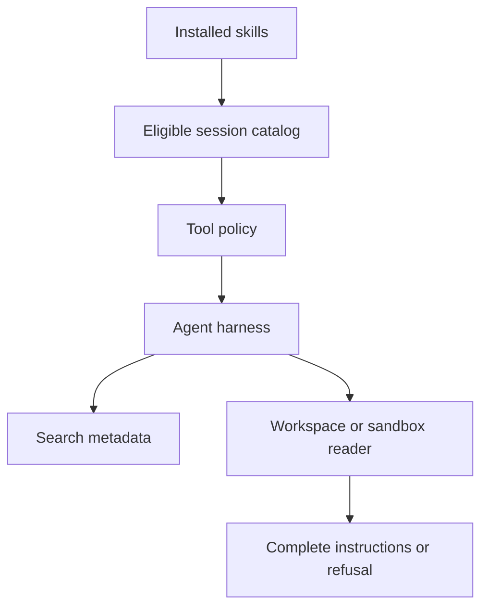

Codex review: needs maintainer review before merge. _Reviewed October 1, 2026, 7:09 AM ET / 11:09 UTC (Revision 9)._

# ClawSweeper review

## What this changes

Makes eligible installed skills searchable and readable across embedded agents, OpenClaw Code Mode, and Codex while preserving policy, sandbox placement, and usage accounting.

## Merge readiness

✅ **Ready for maintainer review**

This PR remains necessary: merged prerequisites provide the catalog and tools, while current main lacks these runtime bindings. Prior blocking findings are repaired, and no new actionable defect was identified. Member-authored work is also protected from automatic closure.

**Priority:** P2
**Reviewed head:** `08c2c76ac9ff643da9a651231ea0d260d38a8593`

## Review scores

| Measure | Result | What it means |
|---|---|---|
| **Overall readiness** | 🐚 platinum hermit **(4/6)** | A coherent integration with repaired prior findings, meaningful boundary coverage, and successful exact-head CI. |
| **Proof confidence** | 🌊 off-meta tidepool | Not applicable: The member-authored PR is exempt from ordinary external-contributor proof. Inspected production-boundary regressions cover Code Mode dispatch, workspace reads, sandbox placement, host closure, and Codex whole-or-error delivery; they are supplemental validation, and no live-model result is claimed. No unresolved authority violation or stored-data model change was identified. |
| **Patch quality** | 🐚 platinum hermit **(4/6)** | No actionable review findings were identified. |

## Verification

| Check | Result | Evidence |
|---|---|---|
| **Real behavior** | Not applicable | Not applicable: The member-authored PR is exempt from ordinary external-contributor proof. Inspected production-boundary regressions cover Code Mode dispatch, workspace reads, sandbox placement, host closure, and Codex whole-or-error delivery; they are supplemental validation, and no live-model result is claimed. No unresolved authority violation or stored-data model change was identified. |
| **Evidence reviewed** | 8 items | Pinned introduction and clean checkout: Reviewed the introduced delta from the verified merge base to the exact original PR head. The stale test merge was not used to infer removal of current-main behavior. Whitespace validation passed, and the working tree remained clean. Distinct work remains beyond merged prerequisites: Current main still prepares the old prompt-selected Code Mode catalog rather than the installed-skill runtime catalog. The merged foundation at https://github.com/openclaw/openclaw/pull/158090 explicitly leaves runtime catalog preparation to this PR; it does not supersede the harness integration. Host-owned eligibility and filesystem placement: The host retains its captured snapshot, cannot remove an admitted sandbox through later placement options, and binds reads to delivered sandbox paths or the selected workspace owner. Readers check current authority around awaited reads; host-bound tools also check admission before execution and before returning results. |
| **Findings** | None | None. |
| **Security** | None | None. |

## How this fits together

Installed skills supply task instructions to agents. This integration carries the session’s eligible catalog into each harness and returns bounded search metadata or complete instructions through the normal tool dispatch path.

## Before merge

None.

<strong>Agent review details</strong>

### Security

None.

### PR surface

Source +279, Tests +575, Docs +48, Other -1. Total +901 across 55 files.

View PR surface stats

| Area | Files | Added | Removed | Net |
|---|---:|---:|---:|---:|
| Source | 31 | 556 | 277 | +279 |
| Tests | 21 | 723 | 148 | +575 |
| Docs | 2 | 48 | 0 | +48 |
| Config | 0 | 0 | 0 | 0 |
| Generated | 0 | 0 | 0 | 0 |
| Other | 1 | 0 | 1 | -1 |
| **Total** | **55** | **1327** | **426** | **+901** |

### Review metrics

| Metric | Value | Why it matters |
|---|---|---|
| **Production versus test growth** | production net +289 lines; tests and test support net +565 lines | Production growth has a stated purpose: shared catalog ownership and harness integration rather than separate discovery implementations. |

### Technical review

Best possible solution:

Keep one host-owned eligible catalog and shared dispatch path across harnesses, preserving existing read grants and complete-instruction delivery.

Do we have a high-confidence way to reproduce the issue?

Not applicable as a feature review. Source and regression inspection establish the runtime integration gap; this read-only review did not execute the behavior.

Is this the best way to solve the issue?

Yes. The branch extends the existing installed-skill tools and normal dispatch owner, preserving policy and filesystem ownership instead of introducing a competing discovery service.

AGENTS.md: found and applied where relevant.

Codex review notes: model internal, reasoning medium; reviewed against [d07e6df877a2](https://github.com/openclaw/openclaw/commit/d07e6df877a27de919f5ce7d5b17f40307ac3a33).

### Labels

Label changes:

No label changes.

Label justifications:

- `P2`: Installed-skill discovery is a bounded agent capability improvement without evidence of an urgent current regression.
- `rating: 🐚 platinum hermit`: Overall readiness is 🐚 platinum hermit; proof is 🌊 off-meta tidepool and patch quality is 🐚 platinum hermit.
- `status: 👀 ready for maintainer look`: ClawSweeper has no concrete contributor-facing blocker left for this PR. Not applicable: The member-authored PR is exempt from ordinary external-contributor proof. Inspected production-boundary regressions cover Code Mode dispatch, workspace reads, sandbox placement, host closure, and Codex whole-or-error delivery; they are supplemental validation, and no live-model result is claimed. No unresolved authority violation or stored-data model change was identified.

### Evidence

What I checked:

- **Pinned introduction and clean checkout:** Reviewed the introduced delta from the verified merge base to the exact original PR head. The stale test merge was not used to infer removal of current-main behavior. Whitespace validation passed, and the working tree remained clean. ([08c2c76ac9ff](https://github.com/openclaw/openclaw/commit/08c2c76ac9ff643da9a651231ea0d260d38a8593))
- **Distinct work remains beyond merged prerequisites:** Current main still prepares the old prompt-selected Code Mode catalog rather than the installed-skill runtime catalog. The merged foundation at https://github.com/openclaw/openclaw/pull/158090 explicitly leaves runtime catalog preparation to this PR; it does not supersede the harness integration. ([`src/agents/embedded-agent-runner/skill-runtime.ts:138`](https://github.com/openclaw/openclaw/blob/d07e6df877a27de919f5ce7d5b17f40307ac3a33/src/agents/embedded-agent-runner/skill-runtime.ts#L138), [d07e6df877a2](https://github.com/openclaw/openclaw/commit/d07e6df877a27de919f5ce7d5b17f40307ac3a33))
- **Host-owned eligibility and filesystem placement:** The host retains its captured snapshot, cannot remove an admitted sandbox through later placement options, and binds reads to delivered sandbox paths or the selected workspace owner. Readers check current authority around awaited reads; host-bound tools also check admission before execution and before returning results. ([`src/agents/harness/host-skills.ts:19`](https://github.com/openclaw/openclaw/blob/08c2c76ac9ff643da9a651231ea0d260d38a8593/src/agents/harness/host-skills.ts#L19), [08c2c76ac9ff](https://github.com/openclaw/openclaw/commit/08c2c76ac9ff643da9a651231ea0d260d38a8593))
- **Earlier policy and compatibility findings repaired:** Explicit denials precede inherited read grants, frozen profile intersections now retain denial semantics, and prompt-listed instructions preserve whole reads. Worker-bridge regressions cover independent search/read availability and read-denial precedence. The previous completed review covered this same head and retained no findings. ([`src/agents/tool-policy-match.ts:58`](https://github.com/openclaw/openclaw/blob/08c2c76ac9ff643da9a651231ea0d260d38a8593/src/agents/tool-policy-match.ts#L58), [08c2c76ac9ff](https://github.com/openclaw/openclaw/commit/08c2c76ac9ff643da9a651231ea0d260d38a8593))
- **Codex whole-or-error response boundary:** Oversized successful skill results become explicit errors before presentation, observer notification, and response conversion. The production-host-to-Codex regression covers denied access, complete delivery, and oversized refusal. This changed response contract establishes the affirmative dependency signal for inspecting Codex itself. ([`extensions/codex/src/app-server/dynamic-tool-content.ts:14`](https://github.com/openclaw/openclaw/blob/08c2c76ac9ff643da9a651231ea0d260d38a8593/extensions/codex/src/app-server/dynamic-tool-content.ts#L14), [08c2c76ac9ff](https://github.com/openclaw/openclaw/commit/08c2c76ac9ff643da9a651231ea0d260d38a8593))
- **Exact Codex consumer contract inspected:** Verified repository ownership through the sibling cache’s upstream remote, inspected the sibling implementation, and independently read the exact revision cited by the PR through GitHub. DynamicToolHandler consumes response content_items and success directly, supporting the whole-or-error adapter behavior. ([`codex-rs/core/src/tools/handlers/dynamic.rs:169`](https://github.com/openai/codex/blob/4b0d9669cc46ba97bf85fa6312431b630d80498d/codex-rs/core/src/tools/handlers/dynamic.rs#L169), [4b0d9669cc46](https://github.com/openai/codex/commit/4b0d9669cc46ba97bf85fa6312431b630d80498d))

Likely related people:

- **vincentkoc:** Suggested for follow-up; no historical authorship or introduction is verified. (role: unverified routing candidate; confidence: low)
- **steipete:** Suggested for follow-up; no historical authorship or introduction is verified. (role: unverified routing candidate; confidence: low)

### Rating scale

| Score | Internal tier | Crab rank | Meaning |
|---:|:---:|---|---|
| **6/6** | S | 🦀 challenger crab | Exceptional readiness |
| **5/6** | A | 🦞 diamond lobster | Very strong readiness |
| **4/6** | B | 🐚 platinum hermit | Good normal PR; ordinary maintainer review |
| **3/6** | C | 🦐 gold shrimp | Useful, but confidence is limited |
| **2/6** | D | 🦪 silver shellfish | Proof or implementation needs work |
| **1/6** | F | 🧂 unranked krab | Not merge-ready |
| N/A | NA | 🌊 off-meta tidepool | Rating does not apply |

Overall follows the weaker of proof and patch quality.
Shiny media proof means a screenshot, video, or linked artifact directly shows the changed behavior. Runtime, network, CSP, and security claims still need visible diagnostics.

### Workflow

- ClawSweeper keeps one durable marker-backed review comment per issue or PR.
- Re-runs edit this comment so the latest verdict, findings, and automation markers stay together instead of adding duplicate bot comments.
- A fresh review can be triggered by eligible `@clawsweeper re-review` comments, exact-item GitHub events, scheduled/background review runs, or manual workflow dispatch.
- PR/issue authors and users with repository write access can comment `@clawsweeper re-review` or `@clawsweeper re-run` on an open PR or issue to request a fresh review only.
- Maintainers can also comment `@clawsweeper review` to request a fresh review only.
- Fresh-review commands do not start repair, autofix, rebase, CI repair, or automerge.
- Maintainer-only repair and merge flows require explicit commands such as `@clawsweeper autofix`, `@clawsweeper automerge`, `@clawsweeper fix ci`, or `@clawsweeper address review`.
- Maintainers can comment `@clawsweeper explain` to ask for more context, or `@clawsweeper stop` to stop active automation.

### History

Review history (8 earlier review cycles)

<!-- clawsweeper-review-history v=1 total=8 -->
- reviewed 2026-09-25T11:47:08.564Z sha edf53bba1f2748f589941bed583847e047007e6f :: needs changes before merge. :: [P2] Keep listing available when search alone is admitted | [P2] Advertise only admitted Code Mode skill operations
- reviewed 2026-09-26T20:04:39.818Z sha edf53bba1f2748f589941bed583847e047007e6f :: blocked before merge. :: [P1] Preserve released skill reads under existing read grants | [P2] Keep listing available when search alone is admitted | [P2] Advertise only admitted Code Mode skill operations
- reviewed 2026-10-01T08:48:05.193Z sha 2c7f3b8ec2726db7de724ffa8c887d13d4345ff1 :: blocked before merge. :: [P1] Preserve released skill reads under existing read grants
- reviewed 2026-10-01T09:02:53.785Z sha fbf7a2600d7905b6220d4e1794a3367eabafbd41 :: blocked before merge. :: [P1] Preserve released skill reads under existing read grants
- reviewed 2026-10-01T09:37:45.979Z sha 590036a0c63f575a92d4b8f9286a625b5df100b7 :: blocked before merge. :: [P1] Preserve released skill reads under existing read grants
- reviewed 2026-10-01T10:11:26.311Z sha 8c581a0f835df2f2acdf41a7a641437a722751a3 :: needs changes before merge. :: [P2] Preserve whole-or-error reads at the Codex response boundary
- reviewed 2026-10-01T10:30:57.661Z sha 08c2c76ac9ff643da9a651231ea0d260d38a8593 :: needs maintainer review before merge. :: none
- reviewed 2026-10-01T10:44:17.131Z sha 08c2c76ac9ff643da9a651231ea0d260d38a8593 :: needs maintainer review before merge. :: none

<!-- clawsweeper-verdict:needs-human item=158091 sha=08c2c76ac9ff643da9a651231ea0d260d38a8593 confidence=high updated_at=2026-10-01T11:05:43Z reviewed_at=2026-10-01T11:09:20.530Z lease_owner=github-run-36853098577-1 lease_comment_id=5930054172 source_revision=75c7fd31f2908846a78c6e043b90a69ee22e0bdeb1232e9344b6b565aeb8fd55 live_verification=absent -->
<!-- clawsweeper-review-state:ready item=158091 sha=08c2c76ac9ff643da9a651231ea0d260d38a8593 v=1 -->

<!-- clawsweeper-review-version item=158091 reviewed_at=2026-10-01T11:09:20.530Z sha=08c2c76ac9ff643da9a651231ea0d260d38a8593 source_revision=75c7fd31f2908846a78c6e043b90a69ee22e0bdeb1232e9344b6b565aeb8fd55 lease_owner=github-run-36853098577-1 lease_comment_id=5930054172 v=1 -->

<!-- clawsweeper-review item=158091 -->