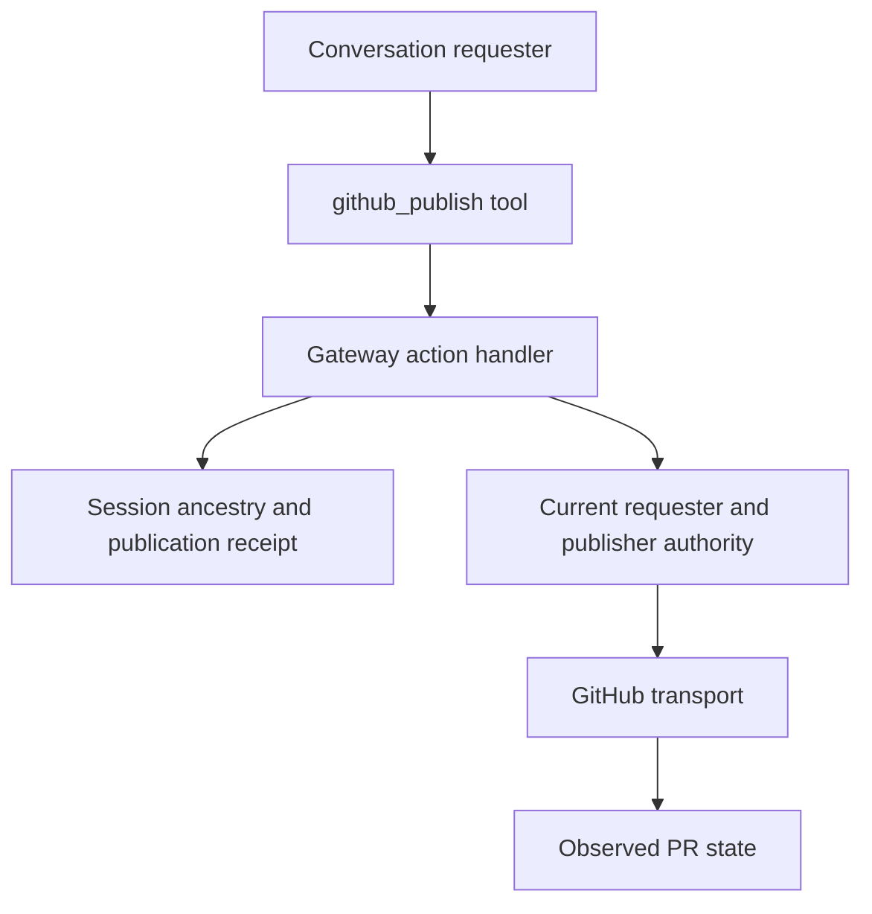

Codex review: needs maintainer review before merge.

## What this changes

Extends github_publish with authorized inspection, readiness, and merge actions for a conversation’s recorded PR or explicitly selected descendant’s PR.

**Example:** An administrator returns to a guest-created conversation whose draft PR is ready to land.
- **Before:** github_publish accepts only title and body, so the administrator cannot land the PR through that tool.
- **After:** The administrator can inspect the publication, mark it ready, and request squash merge using its requestId and expectedHeadCommit.

## Review scores

| Measure | Result | What it means |
|---|---|---|
| **Overall readiness** | 🐚 platinum hermit **(4/6)** | Useful, focused implementation with source-qualified live evidence, meaningful authority coverage, and no actionable findings. |
| **Proof confidence** | 🐚 platinum hermit **(4/6)** | Sufficient (live_output): Source-qualified live conversation evidence and inspected before/after screenshots cover authorized inspection, readiness, and merge; native guest-denial output and the registered-owner role-revocation case cover rejection before effects. The final commit changes only the checkpoint fixture. The video could not be inspected because ffprobe was unavailable and the web fallback failed; that review-side limitation does not invalidate the remaining supplied evidence. |
| **Patch quality** | 🐚 platinum hermit **(4/6)** | No actionable review findings were identified. |

## Product

**Kind:** Feature · **Worth it:** Yes · **Fix scope:** Complete
**User problem:** Authorized operators cannot finish landing a sandboxed conversation’s published PR through its existing publication tool.
**Reason:** The maintainer-authored direction closes a concrete workflow gap while retaining guest draft-only behavior and repository merge requirements.

## Merge readiness

✅ **Ready for maintainer review**

Keep open: this maintainer-authored feature fills a supported workflow gap, and the checkpoint mock correction introduces no production change or actionable defect.

**Priority:** P2
**Reviewed head:** `0c49f3b92b653b349045294d3d57347eb578c211`

## Before merge

None.

## Findings

None.

<strong>Agent review details</strong>

### How this fits together

The agent tool sends session-bound requests to the Gateway, which resolves publication receipts, checks current requester and publisher authority, calls GitHub, and returns observed PR state.

### Technical review

Best possible solution:

Retain the existing Gateway publication owner and session-bound authority checks while adding these explicit landing operations.

Do we have a high-confidence way to reproduce the issue?

The baseline tool schema confirms the requested capability is absent; this is an intentional feature extension rather than a reproduced defect.

Is this the best way to solve the issue?

Extending the existing publication tool and Gateway transport keeps credentials and authorization with their current owners instead of exposing shell credentials or arbitrary PR targets.

AGENTS.md: found and applied where relevant.

Codex review notes: model internal, reasoning medium; reviewed against [b4b89d404ca4](https://github.com/openclaw/openclaw/commit/b4b89d404ca45b832b1686b3c4fca78be2965ec4).

### Provenance checked

- `Draft publication tool and continuation guidance` keeps the original intent (0606e31d0e623f010a96f0efe7d6434324cb6467: Provide Gateway-brokered publication without giving workers standing forge credentials; later continuation guidance distinguishes publication receipts from completed landing work.)
- `Guest requester permissions and sandbox exposure` keeps the original intent (https://github.com/openclaw/openclaw/pull/154655: Allow creator-scoped draft publication while retaining live requester permissions and stronger workflow authority.)
- `Documentation’s publication-only boundary` changes intended behavior with a stated reason (https://github.com/openclaw/openclaw/pull/171803: Default sandbox exposure intentionally provided publication without merge capability; this maintainer-authored extension explicitly separates full-write landing from guest publication.)

### Testing

Proof path: shipped entry point.

### Security

None.

### Evidence

What I checked:

- **Pinned correction preserves module exports:** The final commit changes only the checkpoint mock: it spreads the real module exports and replaces withSessionRepositoryCheckpoint. ([`src/gateway/github-publication-actions.test.ts:32`](https://github.com/openclaw/openclaw/blob/0c49f3b92b653b349045294d3d57347eb578c211/src/gateway/github-publication-actions.test.ts#L32), [0c49f3b92b65](https://github.com/openclaw/openclaw/commit/0c49f3b92b653b349045294d3d57347eb578c211))
- **Current main retains publication-only tool:** The fetched main tool exposes title/body publication requests without inspect, ready, or merge actions. ([`src/agents/tools/github-publish-tool.ts:33`](https://github.com/openclaw/openclaw/blob/b4b89d404ca45b832b1686b3c4fca78be2965ec4/src/agents/tools/github-publish-tool.ts#L33), [b4b89d404ca4](https://github.com/openclaw/openclaw/commit/b4b89d404ca45b832b1686b3c4fca78be2965ec4))
- **Authority and target remain bound at effect:** The action checks full-write requester authority, retained session ancestry, the publication receipt, selected publisher identity, and expected head; the transport receives a synchronous beforeRun authority check. ([`src/gateway/github-publication-actions.ts:318`](https://github.com/openclaw/openclaw/blob/0c49f3b92b653b349045294d3d57347eb578c211/src/gateway/github-publication-actions.ts#L318), [0c49f3b92b65](https://github.com/openclaw/openclaw/commit/0c49f3b92b653b349045294d3d57347eb578c211))
- **Nearest forbidden principal and revocation coverage:** Registered-handler coverage rejects guest actions and unrelated publishing sessions without writes, and changes the canonical operator role during the awaited GitHub read before asserting zero GitHub writes. ([`src/gateway/github-publication-actions.test.ts:236`](https://github.com/openclaw/openclaw/blob/0c49f3b92b653b349045294d3d57347eb578c211/src/gateway/github-publication-actions.test.ts#L236), [0c49f3b92b65](https://github.com/openclaw/openclaw/commit/0c49f3b92b653b349045294d3d57347eb578c211))
- **Existing publication boundaries respected:** The merged requester-permission work at https://github.com/openclaw/openclaw/pull/154655 and sandbox exposure at https://github.com/openclaw/openclaw/pull/171803 establish the existing draft-publication route; this PR retains that guest route and adds current full-write actions separately. Public docs: [`docs/gateway/config-tools/github-identity.md`](https://docs.openclaw.ai/gateway/config-tools/github-identity). ([`docs/gateway/config-tools/github-identity.md:78`](https://docs.openclaw.ai/gateway/config-tools/github-identity), [0c49f3b92b65](https://github.com/openclaw/openclaw/commit/0c49f3b92b653b349045294d3d57347eb578c211))
- **CI failure independently observed elsewhere:** The PR-chip assertion expecting '#103469' but receiving 'openclaw/openclaw#103469' also fails on https://github.com/openclaw/openclaw/pull/172493 at https://github.com/openclaw/openclaw/actions/runs/38709097076/job/116336299195; it is not established as caused by this diff. ([`ui/src/e2e/chat-pull-requests.e2e.test.ts:167`](https://github.com/openclaw/openclaw/blob/b456340cdcf96a95288a7fbd44660f6f54bb44bc/ui/src/e2e/chat-pull-requests.e2e.test.ts#L167), [b456340cdcf9](https://github.com/openclaw/openclaw/commit/b456340cdcf96a95288a7fbd44660f6f54bb44bc))

### PR surface

Source +458, Tests +456, Docs +6. Total +920 across 16 files. Added test files: 1.

View PR surface stats

| Area | Files | Added | Removed | Net |
|---|---:|---:|---:|---:|
| Source | 11 | 471 | 13 | +458 |
| Tests | 4 | 458 | 2 | +456 |
| Docs | 1 | 7 | 1 | +6 |
| Config | 0 | 0 | 0 | 0 |
| Generated | 0 | 0 | 0 | 0 |
| Other | 0 | 0 | 0 | 0 |
| **Total** | **16** | **936** | **16** | **+920** |

### Review metrics

| Metric | Value | Why it matters |
|---|---|---|
| **Privileged action surface** | 1 new RPC with 3 actions | sessions.github.action adds inspect, ready, and merge behind full operator write authority, without adding configuration options. |

### Labels

Label changes:

- remove `proof: 📸 screenshot`: Current real behavior proof evidence kind is live_output.

Label justifications:

- `P2`: A useful, bounded improvement to authorized session publication workflows without evidence of an urgent runtime regression.
- `rating: 🐚 platinum hermit`: Overall readiness is 🐚 platinum hermit; proof is 🐚 platinum hermit and patch quality is 🐚 platinum hermit.
- `status: 👀 ready for maintainer look`: ClawSweeper has no concrete contributor-facing blocker left for this PR.
- `proof: sufficient`: Contributor real behavior proof is sufficient.

### Rating scale

6/6 🦀 challenger crab · 5/6 🦞 diamond lobster · 4/6 🐚 platinum hermit · 3/6 🦐 gold shrimp · 2/6 🦪 silver shellfish · 1/6 🧂 unranked krab. Overall follows the weaker of proof and patch quality; ✨ marks media proof (a screenshot, video, or linked artifact) that directly shows the changed behavior.

### Workflow

ClawSweeper edits this one comment on every review. Comment `@clawsweeper re-review` for a fresh review only. Repair and merge execution lanes are retired.

### History

Review history (3 earlier review cycles)

<!-- clawsweeper-review-history v=1 total=3 -->
- reviewed 2026-10-15T08:04:49.370Z sha dc282ce9cc4c8c70a53e04fd34e02a159e90da10 :: needs real behavior proof before merge. :: none
- reviewed 2026-10-15T08:49:02.796Z sha 09d8ae382e5343a41e33dd0f92f7a2e1fc97dc9f :: needs maintainer review before merge. :: none
- reviewed 2026-10-15T09:16:09.427Z sha 0c49f3b92b653b349045294d3d57347eb578c211 :: needs maintainer review before merge. :: none

_Reviewed October 15, 2026, 5:23 AM ET / 09:23 UTC (Revision 4)._

<!-- clawsweeper-verdict:needs-human item=172901 sha=0c49f3b92b653b349045294d3d57347eb578c211 confidence=high updated_at=2026-10-15T09:18:34Z reviewed_at=2026-10-15T09:23:03.595Z lease_owner=github-run-38711876349-1 lease_comment_id=6188611560 source_revision=6dde63d712338469b1be5a464a7be3a8fbff0b40648380c6c9aa0000683fa759 hold=not_opted_in findings=0 -->
<!-- clawsweeper-review-state:ready item=172901 sha=0c49f3b92b653b349045294d3d57347eb578c211 v=1 -->

<!-- clawsweeper-review-version item=172901 reviewed_at=2026-10-15T09:23:03.595Z sha=0c49f3b92b653b349045294d3d57347eb578c211 source_revision=6dde63d712338469b1be5a464a7be3a8fbff0b40648380c6c9aa0000683fa759 lease_owner=github-run-38711876349-1 lease_comment_id=6188611560 v=1 -->

<!-- clawsweeper-review item=172901 -->