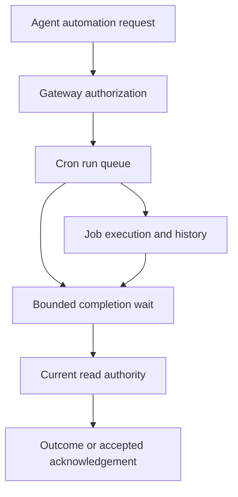

Codex review: needs maintainer review before merge. _Reviewed October 1, 2026, 6:55 AM ET / 10:55 UTC (Revision 9)._

# ClawSweeper review

## What this changes

The automations tool gains a bounded wait for a manually triggered job’s outcome, exact-run history lookup, older-Gateway fallback, and matching protocol, documentation, tests, and prompt snapshots.

## Merge readiness

✅ **Ready for maintainer review**

This PR remains useful: current main and the latest release still return an enqueue acknowledgement without the agent-facing completion capability. Earlier actionable findings are addressed, the stated tradeoffs have verified maintainer acceptance, and no blocking defect was found.

**Priority:** P2
**Reviewed head:** `d07c382797cb80ae3d332eaf9ea11b54dc2f4e07`

## Review scores

| Measure | Result | What it means |
|---|---|---|
| **Overall readiness** | 🐚 platinum hermit **(4/6)** | Useful runtime evidence and a focused implementation support normal good PR quality with no remaining actionable finding. |
| **Proof confidence** | 🦞 diamond lobster **(5/6)** | Sufficient (live_output): Recorded isolated-Gateway observations exercise the production automations tool and cron owner: completion returns delivered success and summary, timeout preserves a continuing run and exact lookup, and main-session work acknowledges promptly. Handler coverage checks allowed and revoked outcome readers, with verified maintainer acceptance of that scoped proof. No stored-data contract changes. |
| **Patch quality** | 🐚 platinum hermit **(4/6)** | No actionable review findings were identified. |

## Verification

| Check | Result | Evidence |
|---|---|---|
| **Real behavior** | Verified | Sufficient (live_output): Recorded isolated-Gateway observations exercise the production automations tool and cron owner: completion returns delivered success and summary, timeout preserves a continuing run and exact lookup, and main-session work acknowledges promptly. Handler coverage checks allowed and revoked outcome readers, with verified maintainer acceptance of that scoped proof. No stored-data contract changes. |
| **Evidence reviewed** | 9 items | Pinned production change: The introduced merge-base-to-head diff adds completion waiting through the existing cron service and history reader. Main-session and caller-session jobs bypass the wait, and refused outcome reads preserve the accepted acknowledgement. Current-main and release necessity: Inspection of the fetched main handler shows cron.run still responds directly after enqueueing. The v2026.9.7 request schema lacks waitTimeoutMs. The merged CLI wait work at https://github.com/openclaw/openclaw/pull/81929 deliberately retained that enqueue-only Gateway behavior and does not replace this agent-tool change. Upgrade compatibility: The tool retries without waitTimeoutMs only for the specific pre-enqueue INVALID_REQUEST rejection. The output-contract regression checks that single fallback and validates the resulting acknowledgement. Existing CLI defaults, saved jobs, and stored history formats are unchanged. |
| **Findings** | None | None. |
| **Security** | None | None. |

## How this fits together

Agents use the automations tool to trigger jobs through the Gateway’s cron service. The service executes accepted work and records its outcome; the Gateway returns authorized completion details or an acknowledgement for later follow-up.

## Before merge

None.

<strong>Agent review details</strong>

### Security

None.

### PR surface

Source +160, Tests +177, Docs +2. Total +339 across 24 files.

View PR surface stats

| Area | Files | Added | Removed | Net |
|---|---:|---:|---:|---:|
| Source | 11 | 181 | 21 | +160 |
| Tests | 11 | 202 | 25 | +177 |
| Docs | 2 | 3 | 1 | +2 |
| Config | 0 | 0 | 0 | 0 |
| Generated | 0 | 0 | 0 | 0 |
| Other | 0 | 0 | 0 | 0 |
| **Total** | **24** | **386** | **47** | **+339** |

### Review metrics

| Metric | Value | Why it matters |
|---|---|---|
| **Completion contract** | 1 optional RPC parameter; agent wait defaults to 60 seconds, capped at 10 minutes | The RPC remains non-blocking by default while the agent tool explicitly requests bounded completion. |
| **Production versus test growth** | Production +181/-21 lines; tests, support, and fixtures +202/-25 lines | Production growth implements service-owned settlement, authorized outcome reads, and compatibility fallback; test growth covers those distinct boundaries. |

### Technical review

Best possible solution:

Keep completion tracking with the cron execution owner, reuse authorized history reads, and preserve enqueue acknowledgements whenever waiting cannot yield an available outcome.

Do we have a high-confidence way to reproduce the issue?

Not applicable as an established-behavior bug: enqueue-only responses were intentional. Current source and the recorded before/after Gateway observations establish the missing agent completion capability.

Is this the best way to solve the issue?

Yes. An event-driven wait at the cron owner avoids client polling and preserves accepted work, existing history visibility, and older-Gateway compatibility.

AGENTS.md: found and applied where relevant.

Codex review notes: model internal, reasoning medium; reviewed against [d64730851269](https://github.com/openclaw/openclaw/commit/d64730851269b8ca5e82d9778810aa0669eb2e3e).

### Labels

Label changes:

No label changes.

Label justifications:

- `P2`: This is a bounded automation improvement that reduces misleading agent follow-up without changing scheduled execution or CLI defaults.
- `rating: 🐚 platinum hermit`: Overall readiness is 🐚 platinum hermit; proof is 🦞 diamond lobster and patch quality is 🐚 platinum hermit.
- `status: 👀 ready for maintainer look`: ClawSweeper has no concrete contributor-facing blocker left for this PR. Sufficient (live_output): Recorded isolated-Gateway observations exercise the production automations tool and cron owner: completion returns delivered success and summary, timeout preserves a continuing run and exact lookup, and main-session work acknowledges promptly. Handler coverage checks allowed and revoked outcome readers, with verified maintainer acceptance of that scoped proof. No stored-data contract changes.
- `proof: sufficient`: Contributor real behavior proof is sufficient. Recorded isolated-Gateway observations exercise the production automations tool and cron owner: completion returns delivered success and summary, timeout preserves a continuing run and exact lookup, and main-session work acknowledges promptly. Handler coverage checks allowed and revoked outcome readers, with verified maintainer acceptance of that scoped proof. No stored-data contract changes.

### Evidence

What I checked:

- **Pinned production change:** The introduced merge-base-to-head diff adds completion waiting through the existing cron service and history reader. Main-session and caller-session jobs bypass the wait, and refused outcome reads preserve the accepted acknowledgement. ([`src/gateway/server-methods/cron.ts:900`](https://github.com/openclaw/openclaw/blob/d07c382797cb80ae3d332eaf9ea11b54dc2f4e07/src/gateway/server-methods/cron.ts#L900), [d07c382797cb](https://github.com/openclaw/openclaw/commit/d07c382797cb80ae3d332eaf9ea11b54dc2f4e07))
- **Current-main and release necessity:** Inspection of the fetched main handler shows cron.run still responds directly after enqueueing. The v2026.9.7 request schema lacks waitTimeoutMs. The merged CLI wait work at https://github.com/openclaw/openclaw/pull/81929 deliberately retained that enqueue-only Gateway behavior and does not replace this agent-tool change. ([`src/gateway/server-methods/cron.ts`](https://github.com/openclaw/openclaw/blob/d64730851269b8ca5e82d9778810aa0669eb2e3e/src/gateway/server-methods/cron.ts), [d64730851269](https://github.com/openclaw/openclaw/commit/d64730851269b8ca5e82d9778810aa0669eb2e3e))
- **Upgrade compatibility:** The tool retries without waitTimeoutMs only for the specific pre-enqueue INVALID_REQUEST rejection. The output-contract regression checks that single fallback and validates the resulting acknowledgement. Existing CLI defaults, saved jobs, and stored history formats are unchanged. ([`src/agents/tools/cron-tool.ts:634`](https://github.com/openclaw/openclaw/blob/d07c382797cb80ae3d332eaf9ea11b54dc2f4e07/src/agents/tools/cron-tool.ts#L634), [d07c382797cb](https://github.com/openclaw/openclaw/commit/d07c382797cb80ae3d332eaf9ea11b54dc2f4e07))
- **Recorded real behavior:** The captured PR body reports an isolated real Gateway and production automations tool using a deterministic provider and the real Telegram plugin against a synthetic Bot API. The fast run returned succeeded/delivered with its summary after 4.3 seconds; the timeout case returned its runId after 2.6 seconds, continued delivering, and later returned one exact history entry; the main-session case acknowledged in 0.6 seconds. These observations exercise the changed core completion path rather than claiming Telegram Test Server coverage.
- **Outcome authority and accepted tradeoffs:** The handler rechecks caller and agent-runtime read authority plus the active management grant after reading history and immediately before returning the outcome. Allowed-versus-revoked handler coverage accompanies it. GitHub's collaborator permission endpoint verified obviyus has role_name maintain, validating the acceptance comments concerning bounded detached cancellation, management outcomes, and scoped authority proof: https://github.com/openclaw/openclaw/pull/162481#issuecomment-5926906742 and https://github.com/openclaw/openclaw/pull/162481#issuecomment-5927631804. ([`src/gateway/server-methods/cron.ts:931`](https://github.com/openclaw/openclaw/blob/d07c382797cb80ae3d332eaf9ea11b54dc2f4e07/src/gateway/server-methods/cron.ts#L931), [d07c382797cb](https://github.com/openclaw/openclaw/commit/d07c382797cb80ae3d332eaf9ea11b54dc2f4e07))
- **Re-review continuity:** The preceding reviewed head has no retained findings or published rank-up moves. Its delta to the current head only adjusts the native-attempt regression to request a 1 ms wait while its cron lane is deliberately blocked; the admission, cancellation, and revocation assertions remain intact. Earlier compatibility, inaccessible-history, follow-up, pre-abort, and final-authority concerns were checked against current source. ([`src/cron/service/ops.native-attempt.test.ts:188`](https://github.com/openclaw/openclaw/blob/d07c382797cb80ae3d332eaf9ea11b54dc2f4e07/src/cron/service/ops.native-attempt.test.ts#L188), [d07c382797cb](https://github.com/openclaw/openclaw/commit/d07c382797cb80ae3d332eaf9ea11b54dc2f4e07))

Likely related people:

- **obviyus:** Suggested for follow-up; no historical authorship or introduction is verified. (role: unverified routing candidate; confidence: low)
- **steipete:** Suggested for follow-up; no historical authorship or introduction is verified. (role: unverified routing candidate; confidence: low)

### Rating scale

| Score | Internal tier | Crab rank | Meaning |
|---:|:---:|---|---|
| **6/6** | S | 🦀 challenger crab | Exceptional readiness |
| **5/6** | A | 🦞 diamond lobster | Very strong readiness |
| **4/6** | B | 🐚 platinum hermit | Good normal PR; ordinary maintainer review |
| **3/6** | C | 🦐 gold shrimp | Useful, but confidence is limited |
| **2/6** | D | 🦪 silver shellfish | Proof or implementation needs work |
| **1/6** | F | 🧂 unranked krab | Not merge-ready |
| N/A | NA | 🌊 off-meta tidepool | Rating does not apply |

Overall follows the weaker of proof and patch quality.
Shiny media proof means a screenshot, video, or linked artifact directly shows the changed behavior. Runtime, network, CSP, and security claims still need visible diagnostics.

### Workflow

- ClawSweeper keeps one durable marker-backed review comment per issue or PR.
- Re-runs edit this comment so the latest verdict, findings, and automation markers stay together instead of adding duplicate bot comments.
- A fresh review can be triggered by eligible `@clawsweeper re-review` comments, exact-item GitHub events, scheduled/background review runs, or manual workflow dispatch.
- PR/issue authors and users with repository write access can comment `@clawsweeper re-review` or `@clawsweeper re-run` on an open PR or issue to request a fresh review only.
- Maintainers can also comment `@clawsweeper review` to request a fresh review only.
- Fresh-review commands do not start repair, autofix, rebase, CI repair, or automerge.
- Maintainer-only repair and merge flows require explicit commands such as `@clawsweeper autofix`, `@clawsweeper automerge`, `@clawsweeper fix ci`, or `@clawsweeper address review`.
- Maintainers can comment `@clawsweeper explain` to ask for more context, or `@clawsweeper stop` to stop active automation.

### History

Review history (8 earlier review cycles)

<!-- clawsweeper-review-history v=1 total=8 -->
- reviewed 2026-10-01T06:46:22.238Z sha d3030c79dffe971e2e284ed57ca5c53c15593499 :: blocked before merge. :: [P1] Preserve cron.run support against shipped Gateways | [P2] Preserve the accepted acknowledgement when outcome authority expires | [P2] Distinguish completed but inaccessible runs from pending work | [P2] Give management-only turns an available follow-up path | [P2] Handle signals already aborted before waiter registration
- reviewed 2026-10-01T07:00:47.286Z sha 5c9cffbf67fd955052a01b161018ff52023ba5f7 :: blocked before merge. :: [P2] Propagate caller cancellation to the completion wait
- reviewed 2026-10-01T08:12:34.672Z sha 5c9cffbf67fd955052a01b161018ff52023ba5f7 :: needs real behavior proof before merge. :: [P2] Revalidate history authority before sending the outcome
- reviewed 2026-10-01T08:22:03.745Z sha cf942df0601778092d56ca34453ff545cf23db06 :: needs real behavior proof before merge. :: none
- reviewed 2026-10-01T08:59:21.707Z sha cf942df0601778092d56ca34453ff545cf23db06 :: needs changes before merge. :: none
- reviewed 2026-10-01T09:30:08.506Z sha cf942df0601778092d56ca34453ff545cf23db06 :: needs maintainer review before merge. :: none
- reviewed 2026-10-01T10:22:20.648Z sha cf942df0601778092d56ca34453ff545cf23db06 :: needs maintainer review before merge. :: none
- reviewed 2026-10-01T10:41:02.940Z sha 5a3d4d3abdb7c16a3f35df1b4391eadaeb2301fe :: needs maintainer review before merge. :: none

<!-- clawsweeper-verdict:needs-human item=162481 sha=d07c382797cb80ae3d332eaf9ea11b54dc2f4e07 confidence=high updated_at=2026-10-01T10:51:38Z reviewed_at=2026-10-01T10:55:44.379Z lease_owner=github-run-36851619074-1 lease_comment_id=5929843336 source_revision=51984c947333929dbdc04f07ff4c93acf5061861a07e11783760e506fb849776 live_verification=absent -->
<!-- clawsweeper-review-state:ready item=162481 sha=d07c382797cb80ae3d332eaf9ea11b54dc2f4e07 v=1 -->

<!-- clawsweeper-review-version item=162481 reviewed_at=2026-10-01T10:55:44.379Z sha=d07c382797cb80ae3d332eaf9ea11b54dc2f4e07 source_revision=51984c947333929dbdc04f07ff4c93acf5061861a07e11783760e506fb849776 lease_owner=github-run-36851619074-1 lease_comment_id=5929843336 v=1 -->

<!-- clawsweeper-review item=162481 -->