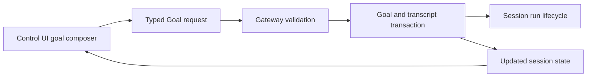

Codex review: needs maintainer review before merge. _Reviewed August 28, 2026, 7:15 AM ET / 11:15 UTC._

# ClawSweeper review

## What this changes

Adds a Control UI Goal composer and typed Gateway Goal operations so operators can start and manage session goals without entering slash-command text.

## Merge readiness

⚠️ **Ready for maintainer review - 3 items remain**

The typed Goal composer and Gateway owner path appear coherent, but this maintainer-owned, compatibility-sensitive PR remains open until the rebased head’s required checks complete and a maintainer makes the merge decision.

**Priority:** P2
**Reviewed head:** `443dd171a1f481495694b52724e38bb761de53a4`
**Owner decision:** Required. See [Decision needed](#decision-needed).

## Review scores

| Measure | Result | What it means |
|---|---|---|
| **Overall readiness** | 🦐 gold shrimp **(3/6)** | Direct source inspection found no concrete defect, but incomplete exact-head checks and unavailable introduction evidence limit merge confidence. |
| **Proof confidence** | 🌊 off-meta tidepool | Not applicable: The Repository State identifies a MEMBER author, so the external-contributor proof gate does not apply; the body nevertheless describes claimed real-flow evidence. |
| **Patch quality** | 🐚 platinum hermit **(4/6)** | No actionable review findings were identified. |

## Verification

| Check | Result | Evidence |
|---|---|---|
| **Real behavior** | Not applicable | Not applicable: The Repository State identifies a MEMBER author, so the external-contributor proof gate does not apply; the body nevertheless describes claimed real-flow evidence. |
| **Evidence reviewed** | 6 items | Typed UI owner: The UI creates typed start, update, resume, and clear operations, and rejects stale delayed responses by connection epoch and visible session.<br>Gateway admission boundary: Goal intents are validated before session/lifecycle work, converted to a typed operation, and excluded from slash-command and stop interpretation.<br>Durable state owner: Goal mutation, transcript append, session entry, and replay receipt are committed in the queued transaction after freshness checks. |
| **Findings** | None | None. |
| **Security** | None | None. |

## How this fits together

The Control UI turns an operator’s Goal draft into a typed chat or session-management request. Gateway validates it, writes replay-safe goal state with the transcript/run lifecycle, then returns session updates to the UI.



## Decision needed

| Question | Recommendation |
|---|---|
| Should this maintainer-owned Goal protocol and durable-state change land once the rebased head’s required checks are green? | **Wait for exact-head checks:** Confirm the required suite on 443dd171a1f481495694b52724e38bb761de53a4, then make the normal maintainer merge decision. |

Why: The PR adds public Gateway methods and durable replay receipts, so merge scope and the retained contract require maintainer ownership despite the recorded architectural acceptance.

## Before merge

- [ ] **Resolve merge risk (P1)** - The additive public Gateway methods and retained operation receipts are compatibility-sensitive; their retention and replay contract should remain an explicit maintainer-owned decision.
- [ ] **Complete next step (P2)** - Pending exact-head lifecycle and changed-file checks plus protected maintainer review are merge gates; no mechanical repair was identified.


<details>
<summary><strong>Agent review details</strong></summary>

### Security

None.

### Review metrics

| Metric | Value | Why it matters |
|---|---|---|
| **Production versus test growth** | production +2,739/−538; tests/support +2,650/−69 | The PR-reported cross-layer feature growth makes exact-head validation of durable receipt and Gateway API behavior material before merge. |

### Stored data model

Persistent data-model change detected: `database schema: packages/gateway-protocol/src/schema/sessions-goal.ts`, `serialized state: packages/gateway-protocol/src/schema/sessions-goal.ts`, `serialized state: src/auto-reply/reply/session.ts`, `serialized state: src/config/sessions/goals-operations.ts`, `serialized state: src/config/sessions/goals-operations.types.ts`, `serialized state: src/config/sessions/goals-transitions.ts`, and 10 more. Confirm migration or upgrade compatibility proof before merge.

### Root-cause cluster

Relationship: `fixed_by_candidate`
Canonical: https://github.com/openclaw/openclaw/issues/131063
Summary: This PR is the candidate implementation of the replay-safe Goal protocol proposed in issue #131063.

Members:
- `canonical`: https://github.com/openclaw/openclaw/issues/131063 - It defines the same replay-safe Goal protocol and durable-operation design.
- `partial_overlap`: https://github.com/openclaw/openclaw/issues/125773 - It concerns transcript-free Control UI Goal actions but does not cover the full protocol and lifecycle design.
- `adjacent_distinct`: https://github.com/openclaw/openclaw/pull/131245 - It is an alternative protocol approach, not a verified replacement for this PR.

Proposal only: this assessment does not dispatch repair, suppress jobs, mutate sibling items, close, or merge anything.

### Merge-risk options

- The rebased head still has incomplete required checks, so its cross-layer protocol and durable session-state behavior has not yet received exact-head CI confirmation.

**Maintainer options:**
1. **Validate the rebased integration head (recommended)**  
   Wait for the required checks on the exact rebased head before merging the new public Goal operations and durable replay path.
2. **Pause the feature contract**  
   Hold the PR if maintainers want to revise the public Goal API or operation-receipt retention semantics before release.

<details>
<summary>Copy recommended automerge instruction</summary>

```text
@clawsweeper automerge

Special instructions:
After exact-head required checks are green, confirm the accepted Goal receipt-retention contract before merge.
```

</details>

### Technical review

Best possible solution:

Keep the typed Goal design and land only after the exact rebased head has green required checks and a maintainer confirms the additive protocol and retained-receipt contract.

Do we have a high-confidence way to reproduce the issue?

Not applicable as a bug reproduction: this is a new feature. The PR body claims a real Control UI-to-isolated-Gateway flow, but external media could not be independently inspected in this review environment.

Is this the best way to solve the issue?

Yes in direction: typed start intent preserves the normal user turn that starts work, while typed management RPCs keep transcript-free controls in the session owner.

AGENTS.md: found and applied where relevant.

Codex review notes: model internal, reasoning high; reviewed against [640d73e3d452](https://github.com/openclaw/openclaw/commit/640d73e3d452b3fb53f78cfa679c23101434c927).

### Labels

Label justifications:

- `P2`: This is a substantial but non-emergency Control UI and Gateway capability change awaiting normal maintainer review.
- `merge-risk: 🚨 compatibility`: New advertised Gateway session-goal methods and request shapes can affect compatible clients and upgrades.
- `merge-risk: 🚨 session-state`: Goal operations write durable session state and replay receipts alongside transcript and run lifecycle state.
- `rating: 🦐 gold shrimp`: Overall readiness is 🦐 gold shrimp; proof is 🌊 off-meta tidepool and patch quality is 🐚 platinum hermit.
- `status: 👀 ready for maintainer look`: ClawSweeper has no concrete contributor-facing blocker left for this PR. Not applicable: The Repository State identifies a MEMBER author, so the external-contributor proof gate does not apply; the body nevertheless describes claimed real-flow evidence.

### Evidence

What I checked:

- **Typed UI owner:** The UI creates typed start, update, resume, and clear operations, and rejects stale delayed responses by connection epoch and visible session. ([`ui/src/pages/chat/chat-goals.ts:36`](https://github.com/openclaw/openclaw/blob/443dd171a1f4/ui/src/pages/chat/chat-goals.ts#L36), [443dd171a1f4](https://github.com/openclaw/openclaw/commit/443dd171a1f4))
- **Gateway admission boundary:** Goal intents are validated before session/lifecycle work, converted to a typed operation, and excluded from slash-command and stop interpretation. ([`src/gateway/server-methods/chat-send-request.ts:90`](https://github.com/openclaw/openclaw/blob/443dd171a1f4/src/gateway/server-methods/chat-send-request.ts#L90), [443dd171a1f4](https://github.com/openclaw/openclaw/commit/443dd171a1f4))
- **Durable state owner:** Goal mutation, transcript append, session entry, and replay receipt are committed in the queued transaction after freshness checks. ([`src/config/sessions/session-accessor.sqlite-transcript-turn.ts:54`](https://github.com/openclaw/openclaw/blob/443dd171a1f4/src/config/sessions/session-accessor.sqlite-transcript-turn.ts#L54), [443dd171a1f4](https://github.com/openclaw/openclaw/commit/443dd171a1f4))
- **Protocol authorization:** The closed Goal schemas bound user fields, while the core descriptors require operator.write for the new handlers. ([`packages/gateway-protocol/src/schema/sessions-goal.ts:36`](https://github.com/openclaw/openclaw/blob/443dd171a1f4/packages/gateway-protocol/src/schema/sessions-goal.ts#L36), [443dd171a1f4](https://github.com/openclaw/openclaw/commit/443dd171a1f4))
- **Maintainer acceptance:** A maintainer comment records acceptance of the replay-safe Goal architecture, while retaining normal merge review for this implementation.
- **Review limitation:** The local checkout has no usable introduction merge-base and host introduction evidence is incomplete; base-to-head comparison is endpoint drift, so no introduced-hunk finding is asserted. ([443dd171a1f4](https://github.com/openclaw/openclaw/commit/443dd171a1f4))

Likely related people:

- **steipete:** Current Goal UI and Gateway owner paths are attributed to this contributor at the reviewed head. (role: recent area contributor; confidence: high; commits: [443dd171a1f4](https://github.com/openclaw/openclaw/commit/443dd171a1f481495694b52724e38bb761de53a4); files: `ui/src/pages/chat/chat-goals.ts`, `src/gateway/server-methods/sessions-goal.ts`)

### Rank-up moves

Optional improvements that raise the rating; they are not merge blockers.

- Wait for the required exact-head check suite, then refresh the maintainer merge decision.

### Rating scale

| Score | Internal tier | Crab rank | Meaning |
|---:|:---:|---|---|
| **6/6** | S | 🦀 challenger crab | Exceptional readiness |
| **5/6** | A | 🦞 diamond lobster | Very strong readiness |
| **4/6** | B | 🐚 platinum hermit | Good normal PR; ordinary maintainer review |
| **3/6** | C | 🦐 gold shrimp | Useful, but confidence is limited |
| **2/6** | D | 🦪 silver shellfish | Proof or implementation needs work |
| **1/6** | F | 🧂 unranked krab | Not merge-ready |
| N/A | NA | 🌊 off-meta tidepool | Rating does not apply |

Overall follows the weaker of proof and patch quality.
Shiny media proof means a screenshot, video, or linked artifact directly shows the changed behavior. Runtime, network, CSP, and security claims still need visible diagnostics.

### Workflow

- ClawSweeper keeps one durable marker-backed review comment per issue or PR.
- Re-runs edit this comment so the latest verdict, findings, and automation markers stay together instead of adding duplicate bot comments.
- A fresh review can be triggered by eligible `@clawsweeper re-review` comments, exact-item GitHub events, scheduled/background review runs, or manual workflow dispatch.
- PR/issue authors and users with repository write access can comment `@clawsweeper re-review` or `@clawsweeper re-run` on an open PR or issue to request a fresh review only.
- Maintainers can also comment `@clawsweeper review` to request a fresh review only.
- Fresh-review commands do not start repair, autofix, rebase, CI repair, or automerge.
- Maintainer-only repair and merge flows require explicit commands such as `@clawsweeper autofix`, `@clawsweeper automerge`, `@clawsweeper fix ci`, or `@clawsweeper address review`.
- Maintainers can comment `@clawsweeper explain` to ask for more context, or `@clawsweeper stop` to stop active automation.

### History

<details>
<summary>Review history (6 earlier review cycles)</summary>

<!-- clawsweeper-review-history v=1 total=6 -->
- reviewed 2026-08-28T01:40:05.292Z sha 1294ddad4a78143f852e0a86964ecae1b4fd71be :: needs maintainer review before merge. :: none
- reviewed 2026-08-28T08:18:18.719Z sha 1bdef036e8fb0cb4691e9cc3361d3525aef9fdc8 :: needs maintainer review before merge. :: none
- reviewed 2026-08-28T09:48:10.238Z sha e813a8d5fd9eaf2dd63c4a048cddd108db5ad912 :: needs maintainer review before merge. :: none
- reviewed 2026-08-28T10:22:04.735Z sha 25f130bde91cd644eef3e55ce1e74c62b8270740 :: needs maintainer review before merge. :: none
- reviewed 2026-08-28T10:32:06.970Z sha 25f130bde91cd644eef3e55ce1e74c62b8270740 :: needs maintainer review before merge. :: none
- reviewed 2026-08-28T10:58:19.155Z sha f252956f5a885b480ddf68de1eb12be4b018fdee :: needs maintainer review before merge. :: none

</details>

</details>

<!-- clawsweeper-verdict:needs-human item=131370 sha=443dd171a1f481495694b52724e38bb761de53a4 confidence=medium updated_at=2026-08-28T11:11:57Z reviewed_at=2026-08-28T11:15:46.799Z lease_owner=github-run-33166093435-1 lease_comment_id=5451800601 source_revision=932f47316a6cc10d2292718ec9755f55f73dd99a32ca7f1941dc83e556350682 live_verification=absent -->

<!-- clawsweeper-review-version item=131370 reviewed_at=2026-08-28T11:15:46.799Z sha=443dd171a1f481495694b52724e38bb761de53a4 source_revision=932f47316a6cc10d2292718ec9755f55f73dd99a32ca7f1941dc83e556350682 lease_owner=github-run-33166093435-1 lease_comment_id=5451800601 v=1 -->

<!-- clawsweeper-review item=131370 -->