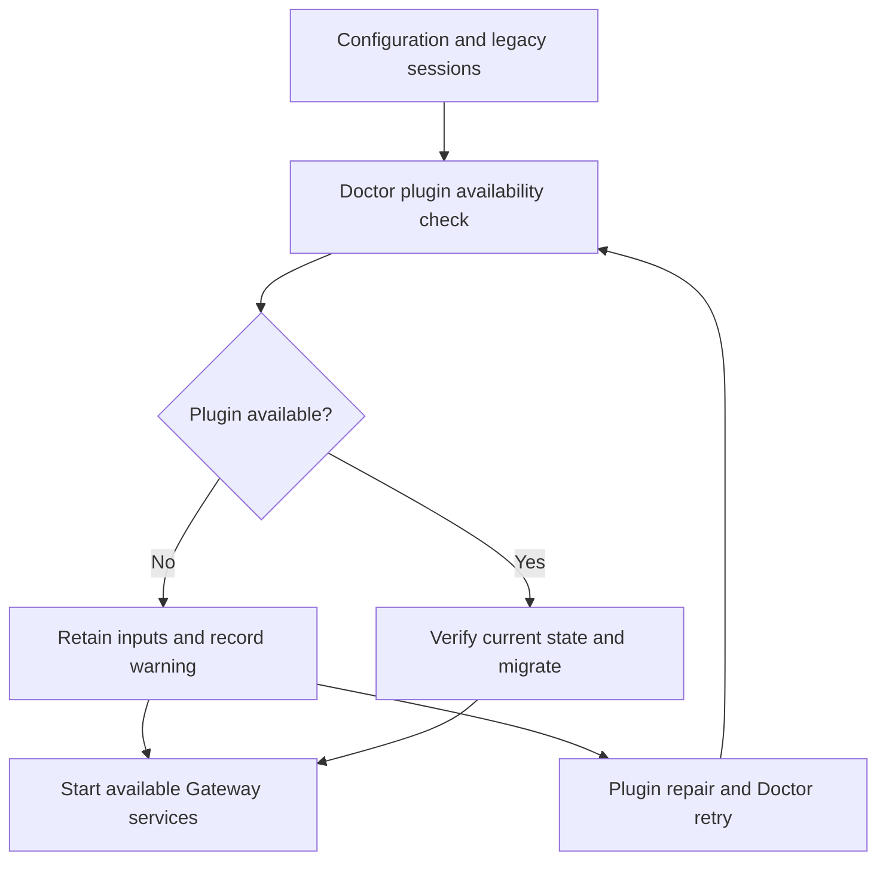

Codex review: blocked before merge. _Reviewed September 15, 2026, 2:19 AM ET / 06:19 UTC (Revision 22)._

# ClawSweeper review

## What this changes

Doctor defers unavailable plugin migrations with recovery warnings, preserves their inputs, and prevents retries from overwriting newer configuration or session state.

> [!WARNING]
> **SQLite table change**
>
> This PR modifies persisted SQLite tables in `extensions/codex/src/migration/session-binding-sidecars.ts`, `src/state/openclaw-agent-schema.sql`. Prefer a design that avoids changing persisted SQLite tables. If the change is necessary, verify migration and upgrade compatibility against an existing database before merge.

## Merge readiness

⛔ **Blocked before merge - 5 items remain**

This remains a useful recovery fix, with no actionable correctness findings at the reviewed head. The prior ACP replay findings are addressed, and the documented compatibility limitations have maintainer acceptance.

**Priority:** P0
**Reviewed head:** `e4f6f12c2606bed81018e2ee74d6e585ece16643`

## Review scores

| Measure | Result | What it means |
|---|---|---|
| **Overall readiness** | 🐚 platinum hermit **(4/6)** | A useful repair with substantial boundary coverage, resolved prior findings, and explicit acceptance of its compatibility limits. |
| **Proof confidence** | 🦞 diamond lobster **(5/6)** ✨ media proof bonus | Sufficient (linked_artifact): The retained published-2026.9.2 updater scenario exercises Doctor deferral, continued Gateway availability, warning delivery, preserved inputs, and plugin recovery at b650fdd189d5ca2a2c440b8546693145593ed325. Later corrections have focused regression evidence and successful current-head CI; the maintainer explicitly accepts that bounded coverage. Raw log download was unavailable to this reviewer. |
| **Patch quality** | 🐚 platinum hermit **(4/6)** | No actionable review findings were identified. |

## Verification

| Check | Result | Evidence |
|---|---|---|
| **Real behavior** | Verified | Sufficient (linked_artifact): The retained published-2026.9.2 updater scenario exercises Doctor deferral, continued Gateway availability, warning delivery, preserved inputs, and plugin recovery at b650fdd189d5ca2a2c440b8546693145593ed325. Later corrections have focused regression evidence and successful current-head CI; the maintainer explicitly accepts that bounded coverage. Raw log download was unavailable to this reviewer. |
| **Evidence reviewed** | 9 items | Review identity and policy: The clean checkout matches pinned head e4f6f12c2606bed81018e2ee74d6e585ece16643. The complete introduced file list was obtained locally, supplementing the truncated prompt. Root and all six applicable policy scopes were inspected; .agents/maintainer-notes is absent. The supplied test merge has mismatched parents and was not used to infer removal of main behavior. Still necessary on main and the latest release: Fetched main still converts relevant plugin convergence warnings into blocking startup diagnostics and has no deferred-plugin-migrations module. The v2026.9.4 source also retains blocking diagnostics. The merged reporting repair at https://github.com/openclaw/openclaw/pull/148702 does not implement this deferral lifecycle. Prior replay findings addressed: The importer checks component completion, canonical lifecycle identity, existing ACP metadata, and recorded source fingerprints. Canonical ACP initialization and closure consume provenance within the shared-state mutation transaction. The inspected regression suite covers closure before first import, key repair, deletion, lifecycle replacement, null provenance, and receipt rollback. |
| **Findings** | None | None. |
| **Security** | None | None. |

## How this fits together

Doctor prepares configuration, installed plugins, and stored sessions before updates and Gateway startup. Its migration results determine whether available services can start and which recovery work remains pending.

## Before merge

- [ ] **Resolve merge risk (P1)** - Accepted compatibility limitation: operators cannot change retained migration inputs until plugin recovery completes; unrelated settings remain writable.
- [ ] **Resolve merge risk (P1)** - Accepted downgrade limitation: older ACP writers can reopen the database but do not record supersession, so pending recovery must finish before returning to them when that protection is needed.
- [ ] **Resolve merge risk (P1)** - The published-updater run covers an earlier head; focused regressions and current-head CI cover subsequent corrections, as explicitly accepted in the PR body.
- [ ] **Review config compatibility** - Confirm compatibility and upgrade impact for the changed config or default surface before merge.
- [ ] **Add data-model compatibility proof** - Confirm migration or upgrade compatibility proof before merge.

<strong>Agent review details</strong>

### Security

None.

### PR surface

PR surface statistics unavailable: the file list is incomplete.

### Review metrics

| Metric | Value | Why it matters |
|---|---|---|
| **Persistent schema contract** | 1 bare nullable column; no schema-version bump | The additive-column exception preserves older-reader compatibility while requiring the documented older-writer limitation. |
| **Update status output** | 2 optional JSON fields | migrationWarnings and migrationWarningsError expose current recovery state independently of historical updater records. |

### Stored data model

Persistent data-model change detected: `database schema: src/state/openclaw-agent-schema.sql`, `migration/backfill/repair: config/knip.config.ts`, `migration/backfill/repair: extensions/codex/src/migration/session-binding-sidecars.ts`, `migration/backfill/repair: scripts/e2e/lib/upgrade-survivor/assertions.mjs`, `migration/backfill/repair: scripts/e2e/lib/upgrade-survivor/missing-configured-plugin-migration.mjs`, `migration/backfill/repair: scripts/e2e/lib/upgrade-survivor/missing-configured-plugin-migration.sh`, and 44 more. Confirm migration or upgrade compatibility proof before merge.

### Merge-risk options

**Maintainer options:**
1. **Retain the accepted compatibility contract (recommended)**  
   Proceed with the documented pending-input restrictions and older-writer limitation already accepted in the PR body.

### Technical review

Best possible solution:

Keep deferral, recovery guidance, and completion under Doctor’s existing owners, with canonical session changes taking precedence over retained migration inputs.

Do we have a high-confidence way to reproduce the issue?

Yes, from source: an unavailable configured plugin can still produce blocking convergence diagnostics on fetched main and v2026.9.4. No local runtime reproduction was executed during this read-only review.

Is this the best way to solve the issue?

Yes. The patch uses existing migration, configuration, and session owners; recorded component completion addresses the demonstrated replay gap that row absence alone cannot resolve.

AGENTS.md: found and applied where relevant.

Codex review notes: model internal, reasoning medium; reviewed against [4971b9f5184e](https://github.com/openclaw/openclaw/commit/4971b9f5184ef200eb6aa6bac098dd493b4f45d5).

### Labels

Label justifications:

- `P0`: The linked production report describes repeated Gateway startup failure with all channels unavailable, and related reports show blocked updates.
- `merge-risk: 🚨 compatibility`: Pending-input edits are intentionally restricted, and older writers do not enforce the new supersession protection despite database readability.
- `rating: 🐚 platinum hermit`: Overall readiness is 🐚 platinum hermit; proof is 🦞 diamond lobster and patch quality is 🐚 platinum hermit.
- `status: 👀 ready for maintainer look`: ClawSweeper has no concrete contributor-facing blocker left for this PR. Sufficient (linked_artifact): The retained published-2026.9.2 updater scenario exercises Doctor deferral, continued Gateway availability, warning delivery, preserved inputs, and plugin recovery at b650fdd189d5ca2a2c440b8546693145593ed325. Later corrections have focused regression evidence and successful current-head CI; the maintainer explicitly accepts that bounded coverage. Raw log download was unavailable to this reviewer.
- `proof: sufficient`: Contributor real behavior proof is sufficient. The retained published-2026.9.2 updater scenario exercises Doctor deferral, continued Gateway availability, warning delivery, preserved inputs, and plugin recovery at b650fdd189d5ca2a2c440b8546693145593ed325. Later corrections have focused regression evidence and successful current-head CI; the maintainer explicitly accepts that bounded coverage. Raw log download was unavailable to this reviewer.

### Evidence

What I checked:

- **Review identity and policy:** The clean checkout matches pinned head e4f6f12c2606bed81018e2ee74d6e585ece16643. The complete introduced file list was obtained locally, supplementing the truncated prompt. Root and all six applicable policy scopes were inspected; .agents/maintainer-notes is absent. The supplied test merge has mismatched parents and was not used to infer removal of main behavior. ([`AGENTS.md:1`](https://github.com/openclaw/openclaw/blob/e4f6f12c2606bed81018e2ee74d6e585ece16643/AGENTS.md#L1), [e4f6f12c2606](https://github.com/openclaw/openclaw/commit/e4f6f12c2606bed81018e2ee74d6e585ece16643))
- **Still necessary on main and the latest release:** Fetched main still converts relevant plugin convergence warnings into blocking startup diagnostics and has no deferred-plugin-migrations module. The v2026.9.4 source also retains blocking diagnostics. The merged reporting repair at https://github.com/openclaw/openclaw/pull/148702 does not implement this deferral lifecycle. ([`src/commands/doctor-config-preflight-plugin-verification.ts:142`](https://github.com/openclaw/openclaw/blob/4971b9f5184ef200eb6aa6bac098dd493b4f45d5/src/commands/doctor-config-preflight-plugin-verification.ts#L142), [4971b9f5184e](https://github.com/openclaw/openclaw/commit/4971b9f5184ef200eb6aa6bac098dd493b4f45d5))
- **Prior replay findings addressed:** The importer checks component completion, canonical lifecycle identity, existing ACP metadata, and recorded source fingerprints. Canonical ACP initialization and closure consume provenance within the shared-state mutation transaction. The inspected regression suite covers closure before first import, key repair, deletion, lifecycle replacement, null provenance, and receipt rollback. ([`src/infra/state-migrations.acp-session-metadata.ts:35`](https://github.com/openclaw/openclaw/blob/e4f6f12c2606bed81018e2ee74d6e585ece16643/src/infra/state-migrations.acp-session-metadata.ts#L35), [e4f6f12c2606](https://github.com/openclaw/openclaw/commit/e4f6f12c2606bed81018e2ee74d6e585ece16643))
- **Configuration publication preserves current obligations:** Configuration publication rechecks pending migration records under the shared-state coordinator immediately before publishing the prepared file. Include writes use the same guard; explicit edits intersecting retained inputs receive recovery guidance instead of silently losing their changes. ([`src/config/io.write.ts:539`](https://github.com/openclaw/openclaw/blob/e4f6f12c2606bed81018e2ee74d6e585ece16643/src/config/io.write.ts#L539), [e4f6f12c2606](https://github.com/openclaw/openclaw/commit/e4f6f12c2606bed81018e2ee74d6e585ece16643))
- **Accepted storage and upgrade contract:** The captured PR body explicitly accepts the bare nullable provenance column, temporary protection of pending configuration inputs, older-writer limitation, and retained updater proof. Documentation states the downgrade limitation; inspected schema tests cover fresh and existing databases, read-only absence, unchanged version/data, and rollback-safe first use. The previous completed review at this same head has no findings or published rank-up moves. Public docs: [`docs/reference/database-schemas/versioning.md`](https://docs.openclaw.ai/reference/database-schemas/versioning). ([`docs/reference/database-schemas/versioning.md:45`](https://docs.openclaw.ai/reference/database-schemas/versioning), [e4f6f12c2606](https://github.com/openclaw/openclaw/commit/e4f6f12c2606bed81018e2ee74d6e585ece16643))
- **Published-updater behavior proof:** GitHub confirms https://github.com/openclaw/openclaw/actions/runs/34836838875 succeeded at b650fdd189d5ca2a2c440b8546693145593ed325, including the published-upgrade-survivor job. The captured body records a 229-second 2026.9.2 updater run with Gateway availability, retained inputs, warnings, and subsequent plugin recovery; the inspected scenario exercises those boundaries. Later corrections have focused regression evidence, not a full current-head updater rerun. Downloading raw job logs was blocked by the reviewer network allowlist. ([`scripts/e2e/lib/upgrade-survivor/missing-configured-plugin-migration.sh:25`](https://github.com/openclaw/openclaw/blob/b650fdd189d5ca2a2c440b8546693145593ed325/scripts/e2e/lib/upgrade-survivor/missing-configured-plugin-migration.sh#L25), [b650fdd189d5](https://github.com/openclaw/openclaw/commit/b650fdd189d5ca2a2c440b8546693145593ed325))

Likely related people:

- **steipete:** Suggested for follow-up; no historical authorship or introduction is verified. (role: unverified routing candidate; confidence: low)
- **VACInc:** Suggested for follow-up; no historical authorship or introduction is verified. (role: unverified routing candidate; confidence: low)

### Rating scale

| Score | Internal tier | Crab rank | Meaning |
|---:|:---:|---|---|
| **6/6** | S | 🦀 challenger crab | Exceptional readiness |
| **5/6** | A | 🦞 diamond lobster | Very strong readiness |
| **4/6** | B | 🐚 platinum hermit | Good normal PR; ordinary maintainer review |
| **3/6** | C | 🦐 gold shrimp | Useful, but confidence is limited |
| **2/6** | D | 🦪 silver shellfish | Proof or implementation needs work |
| **1/6** | F | 🧂 unranked krab | Not merge-ready |
| N/A | NA | 🌊 off-meta tidepool | Rating does not apply |

Overall follows the weaker of proof and patch quality.
Shiny media proof means a screenshot, video, or linked artifact directly shows the changed behavior. Runtime, network, CSP, and security claims still need visible diagnostics.

### Workflow

- ClawSweeper keeps one durable marker-backed review comment per issue or PR.
- Re-runs edit this comment so the latest verdict, findings, and automation markers stay together instead of adding duplicate bot comments.
- A fresh review can be triggered by eligible `@clawsweeper re-review` comments, exact-item GitHub events, scheduled/background review runs, or manual workflow dispatch.
- PR/issue authors and users with repository write access can comment `@clawsweeper re-review` or `@clawsweeper re-run` on an open PR or issue to request a fresh review only.
- Maintainers can also comment `@clawsweeper review` to request a fresh review only.
- Fresh-review commands do not start repair, autofix, rebase, CI repair, or automerge.
- Maintainer-only repair and merge flows require explicit commands such as `@clawsweeper autofix`, `@clawsweeper automerge`, `@clawsweeper fix ci`, or `@clawsweeper address review`.
- Maintainers can comment `@clawsweeper explain` to ask for more context, or `@clawsweeper stop` to stop active automation.

### History

Review history (21 earlier review cycles; latest 8 shown)

<!-- clawsweeper-review-history v=1 total=21 -->
- reviewed 2026-09-15T02:04:37.808Z sha a9559b0a43acd13be5ea4bd3b96281518abfb35c :: blocked before merge. :: none
- reviewed 2026-09-15T02:46:52.234Z sha a9559b0a43acd13be5ea4bd3b96281518abfb35c :: blocked before merge. :: none
- reviewed 2026-09-15T03:28:41.517Z sha 8dc8c7296f2961be0b2c02b14a595a2e4f1ffaba :: blocked before merge. :: [P1] [P1] Preserve ACP closure before the first retained-source import
- reviewed 2026-09-15T04:20:49.764Z sha 8dc8c7296f2961be0b2c02b14a595a2e4f1ffaba :: blocked before merge. :: [P1] Preserve canonical ACP closure before the first retained import
- reviewed 2026-09-15T05:00:50.700Z sha 0f77c7e67c5228515594ce86eaff0ed4df624ee6 :: blocked before merge. :: none
- reviewed 2026-09-15T05:21:26.191Z sha 5b51b6acbb6c10ed8dd20cfc626590d3d4bcbbfe :: blocked before merge. :: none
- reviewed 2026-09-15T05:34:33.963Z sha a2d3cc3a2cf91f6d07861a7702db4e39bea7be77 :: blocked before merge. :: none
- reviewed 2026-09-15T05:53:12.501Z sha e4f6f12c2606bed81018e2ee74d6e585ece16643 :: blocked before merge. :: none

<!-- clawsweeper-verdict:needs-human item=147711 sha=e4f6f12c2606bed81018e2ee74d6e585ece16643 confidence=high updated_at=2026-09-15T06:15:24Z reviewed_at=2026-09-15T06:19:29.765Z lease_owner=github-run-34936013243-1 lease_comment_id=5675640061 source_revision=9209fcb3b6ba83e9ebb696992609d444b2004e7c113c8893b237d15f68013311 live_verification=absent -->
<!-- clawsweeper-review-state:blocked item=147711 sha=e4f6f12c2606bed81018e2ee74d6e585ece16643 v=1 -->

<!-- clawsweeper-review-version item=147711 reviewed_at=2026-09-15T06:19:29.765Z sha=e4f6f12c2606bed81018e2ee74d6e585ece16643 source_revision=9209fcb3b6ba83e9ebb696992609d444b2004e7c113c8893b237d15f68013311 lease_owner=github-run-34936013243-1 lease_comment_id=5675640061 v=1 -->

<!-- clawsweeper-review item=147711 -->