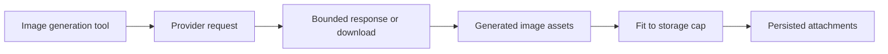

Codex review: needs maintainer review before merge.

## What this changes

This PR separates generated-image download limits from storage limits so oversized outputs can reach the existing image-fitting step.

**Example:** Generate a high-quality 2048×2048 PNG using openai/gpt-image-2 with the default 6 MiB storage cap.
- **Before:** An approximately 8.8 MB output fails with “JSON response exceeds 9437184 bytes” before persistence.
- **After:** The supplied live run saves a 2,107,627-byte JPEG at 2048×2048.

## Review scores

| Measure | Result | What it means |
|---|---|---|
| **Overall readiness** | 🦞 diamond lobster **(5/6)** | Focused shared-owner repair with supplied shipped-entry-point proof, the prior finding resolved, and successful exact-head validation. |
| **Proof confidence** | 🦞 diamond lobster **(5/6)** | Sufficient (terminal): The supplied isolated agent turn through built dist exercises image_generate with an oversized OpenAI PNG and records successful JPEG persistence; the subsequent commit changes only the two previously incorrect URL-download test suites. |
| **Patch quality** | 🦞 diamond lobster **(5/6)** | No actionable review findings were identified. |

## Product

**Kind:** Bug fix · **Worth it:** Yes · **Fix scope:** Complete
**User problem:** A paid image generation is discarded when its output exceeds the storage cap before the existing fitting step can process it.
**Reason:** The maintainer-authored change completes the provider-read follow-up to merged storage fitting with one shared policy and no new user configuration.

## Merge readiness

✅ **Ready for maintainer review**

Keep open: the provider-read failure remains on main, and this PR resolves the prior finding with no remaining actionable defects and a green exact-head CI gate.

**Priority:** P2
**Reviewed head:** `4514ab8faef3d6ab9963de2c7764b4e32a362b6c`

## Before merge

None.

## Findings

None.

<strong>Agent review details</strong>

### How this fits together

Image providers read remote outputs into image assets; the image-generation execution owner then fits those assets to the storage cap and persists attachments.

### Technical review

Best possible solution:

Land the shared bounded image-download policy so provider outputs reach the existing storage-fitting owner.

Do we have a high-confidence way to reproduce the issue?

Current-main source shows the storage cap constraining provider reads before fitting, and the supplied live agent run records the matching oversized-response failure.

Is this the best way to solve the issue?

The shared helper fixes the owning read policy across affected providers while preserving bounded reads, configured storage limits, and existing download security.

AGENTS.md: found and applied where relevant.

Codex review notes: model internal, reasoning medium; reviewed against [facbe21ddf98](https://github.com/openclaw/openclaw/commit/facbe21ddf986047e97c39a5a0de2471f16c5bed).

### Provenance checked

- `Generated-media cap interpretation` changes intended behavior with a stated reason (749dbcb2a7bf081b7a484c9e5ad9fef16115afd4: Consolidated repeated configured-cap interpretation across generated-media providers while keeping response, download, and persistence caps conceptually separate.)
- `Bounded image-provider JSON reads` keeps the original intent (https://github.com/openclaw/openclaw/pull/96495: Prevented untrusted success responses from being buffered without a ceiling; this PR retains the bounded reader and changes its image budget.)
- `Compatible-provider URL downloads` keeps the original intent (https://github.com/openclaw/openclaw/pull/173508: Centralized URL downloads with origin-scoped trust, credential isolation, bounded bodies, and an operation deadline; this PR preserves those contracts.)

### Testing

Proof path: shipped entry point.

### Security

None.

### Evidence

What I checked:

- **Introduced change:** The pinned introduction diff adds one shared download-limit helper and migrates image-provider reads while retaining the existing storage-limit helper. ([`src/media/configured-max-bytes.ts:31`](https://github.com/openclaw/openclaw/blob/4514ab8faef3d6ab9963de2c7764b4e32a362b6c/src/media/configured-max-bytes.ts#L31), [4514ab8faef3](https://github.com/openclaw/openclaw/commit/4514ab8faef3d6ab9963de2c7764b4e32a362b6c))
- **Current-main failure remains:** Current main still derives compatible-provider response and download bounds from the storage cap; its persistence owner already fits oversized images after generation. ([`src/image-generation/openai-compatible-image-provider.ts:233`](https://github.com/openclaw/openclaw/blob/facbe21ddf986047e97c39a5a0de2471f16c5bed/src/image-generation/openai-compatible-image-provider.ts#L233), [facbe21ddf98](https://github.com/openclaw/openclaw/commit/facbe21ddf986047e97c39a5a0de2471f16c5bed))
- **Merged persistence prerequisite:** https://github.com/openclaw/openclaw/pull/174601 merged storage fitting; obviyus’s closing discussion explicitly identifies provider download bounds as the separate remaining failure. ([`src/agents/tools/image-generate-tool.execution.ts:58`](https://github.com/openclaw/openclaw/blob/b2d8b51b9d64f437711014f4659a039e40c350c5/src/agents/tools/image-generate-tool.execution.ts#L58), [b2d8b51b9d64](https://github.com/openclaw/openclaw/commit/b2d8b51b9d64f437711014f4659a039e40c350c5))
- **Prior finding resolved:** Both URL-download suites now accept images above a one-byte storage cap and reject streamed responses above the new 32 MiB ceiling. ([`extensions/openai/image-generation-provider.url.test.ts:159`](https://github.com/openclaw/openclaw/blob/4514ab8faef3d6ab9963de2c7764b4e32a362b6c/extensions/openai/image-generation-provider.url.test.ts#L159), [4514ab8faef3](https://github.com/openclaw/openclaw/commit/4514ab8faef3d6ab9963de2c7764b4e32a362b6c))
- **Supplied production behavior proof:** The PR body records an isolated local agent turn through built dist and image_generate: the formerly rejected high-quality PNG reaches persistence and is saved as a 2048×2048 JPEG. ([051a10199db4](https://github.com/openclaw/openclaw/commit/051a10199db4a2159f4a653625a2974a2572bd85))
- **Exact-head validation:** The CI, dependency-review, and security-sensitive-review statuses are successful for the reviewed head; the previously failing changed-extension bundle also passes. A separate dispatch job was cancelled, not failed. ([4514ab8faef3](https://github.com/openclaw/openclaw/commit/4514ab8faef3d6ab9963de2c7764b4e32a362b6c))

Likely related people:

- **Masato Hoshino:** Raw commit dc43a7e79cc3571b89663970a496c10bd60ef99b adds src/image-generation/openai-compatible-image-provider.ts:232 relative to its recorded parents. This identifies author metadata, not feature responsibility or a PR merger. (role: source-line author; confidence: high; commits: [dc43a7e79cc3](https://github.com/openclaw/openclaw/commit/dc43a7e79cc3571b89663970a496c10bd60ef99b); files: `src/image-generation/openai-compatible-image-provider.ts`)

### PR surface

Source +25, Tests +37. Total +62 across 20 files. Added test files: 0.

View PR surface stats

| Area | Files | Added | Removed | Net |
|---|---:|---:|---:|---:|
| Source | 11 | 44 | 19 | +25 |
| Tests | 9 | 85 | 48 | +37 |
| Docs | 0 | 0 | 0 | 0 |
| Config | 0 | 0 | 0 | 0 |
| Generated | 0 | 0 | 0 | 0 |
| Other | 0 | 0 | 0 | 0 |
| **Total** | **20** | **129** | **67** | **+62** |

### Review metrics

| Metric | Value | Why it matters |
|---|---|---|
| **Image read budget** | 32 MiB minimum, or a larger configured media cap | Separates bounded provider reads from storage fitting; inline JSON budgets also account for base64 expansion and result count. |

### Labels

Label changes:

- add `merge-risk: 🚨 compatibility`: Adds a helper to an existing Plugin SDK runtime surface and migrates bundled callers; the maintainer-authored direction accepts this additive change without removing existing contracts.
- add `rating: 🦞 diamond lobster`: Overall readiness is 🦞 diamond lobster; proof is 🦞 diamond lobster and patch quality is 🦞 diamond lobster.
- add `status: 👀 ready for maintainer look`: ClawSweeper has no concrete contributor-facing blocker left for this PR.
- remove `rating: 🦐 gold shrimp`: Current PR rating is `rating: 🦞 diamond lobster`, so this older rating label is no longer current.
- remove `status: ⏳ waiting on author`: Current PR status label is `status: 👀 ready for maintainer look`.

Label justifications:

- `P2`: Valid paid image generations can fail before persistence, with impact limited to sufficiently large outputs.
- `merge-risk: 🚨 compatibility`: Adds a helper to an existing Plugin SDK runtime surface and migrates bundled callers; the maintainer-authored direction accepts this additive change without removing existing contracts.
- `rating: 🦞 diamond lobster`: Overall readiness is 🦞 diamond lobster; proof is 🦞 diamond lobster and patch quality is 🦞 diamond lobster.
- `status: 👀 ready for maintainer look`: ClawSweeper has no concrete contributor-facing blocker left for this PR.
- `proof: sufficient`: Contributor real behavior proof is sufficient.

### Rating scale

6/6 🦀 challenger crab · 5/6 🦞 diamond lobster · 4/6 🐚 platinum hermit · 3/6 🦐 gold shrimp · 2/6 🦪 silver shellfish · 1/6 🧂 unranked krab. Overall follows the weaker of proof and patch quality; ✨ marks media proof (a screenshot, video, or linked artifact) that directly shows the changed behavior.

### Workflow

ClawSweeper edits this one comment on every review. Comment `@clawsweeper re-review` for a fresh review only. Repair and merge execution lanes are retired.

### History

Review history (1 earlier review cycle)

<!-- clawsweeper-review-history v=1 total=1 -->
- reviewed 2026-10-16T21:06:22.345Z sha 051a10199db4a2159f4a653625a2974a2572bd85 :: needs changes before merge. :: [P2] Update both URL-download suites for the new download ceiling

_Reviewed October 16, 2026, 6:22 PM ET / 22:22 UTC (Revision 2)._

<!-- clawsweeper-verdict:needs-human item=174661 sha=4514ab8faef3d6ab9963de2c7764b4e32a362b6c confidence=high updated_at=2026-10-16T22:18:44Z reviewed_at=2026-10-16T22:22:44.374Z lease_owner=github-run-38974884339-1 lease_comment_id=6225760789 source_revision=e95fa95e6930a828d9c8eccd58990c48a424ea7f779747498c78ca5ad39c181f hold=not_opted_in findings=0 -->
<!-- clawsweeper-review-state:ready item=174661 sha=4514ab8faef3d6ab9963de2c7764b4e32a362b6c v=1 -->

<!-- clawsweeper-review-version item=174661 reviewed_at=2026-10-16T22:22:44.374Z sha=4514ab8faef3d6ab9963de2c7764b4e32a362b6c source_revision=e95fa95e6930a828d9c8eccd58990c48a424ea7f779747498c78ca5ad39c181f lease_owner=github-run-38974884339-1 lease_comment_id=6225760789 v=1 -->

<!-- clawsweeper-review item=174661 -->