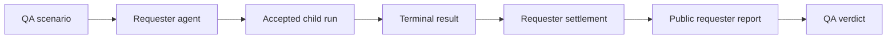

Codex review: needs maintainer review before merge.

## What this changes

Require an accepted child, successful completion, and its delivered result in the requester’s subsequent report before passing subagent-handoff QA.

**Example:** sessions_spawn returns status "forbidden", and the requester reports "no child was created" under the expected labels.
- **Before:** The scenario can pass from planned-spawn evidence and labeled prose.
- **After:** The scenario fails because no accepted child run exists.

## Review scores

| Measure | Result | What it means |
|---|---|---|
| **Overall readiness** | 🧂 unranked krab **(1/6)** | The implementation is focused and source-consistent, but synthetic observations do not satisfy the repository’s required production-flow proof. |
| **Proof confidence** | 🧂 unranked krab **(1/6)** | Real behavior proof is not required for maintainer- or bot-authored pull requests. |
| **Patch quality** | 🐚 platinum hermit **(4/6)** | No actionable review findings were identified. |

## Product

**Kind:** Bug fix · **Worth it:** Yes · **Fix scope:** Complete
**User problem:** Maintainers can receive a passing subagent-handoff result even though delegation was refused and no child ran.
**Reason:** The change restores the scenario’s documented success contract without changing agent capabilities, permissions, or user configuration.

## Merge readiness

✅ **Ready for maintainer review**

This PR addresses a current QA false pass with a focused correction; source review found no concrete correctness or security defect.

**Priority:** P2
**Reviewed head:** `0222f7b1a7e0b03037ff3ad198340b6bc511703c`

## Before merge

None.

## Findings

None.

### Tests

- Missing end-to-end proof: The registered scenario has not been shown completing through an isolated Gateway with an accepted child, successful settlement, and subsequent public requester report.

<strong>Agent review details</strong>

### How this fits together

QA Lab runs the registered scenario through a Gateway, reads tool receipts and child completion, then joins public requester history to the internal settlement transcript to produce a pass or failure.

### Technical review

Best possible solution:

Keep the correction in QA Lab, using existing receipt, completion, formatter, and transcript owners to establish the handoff.

Do we have a high-confidence way to reproduce the issue?

Current-main source permits the reported refused-spawn false pass, consistent with the linked synthetic reproduction; this read-only review executed no target code.

Is this the best way to solve the issue?

The fix addresses the scoring invariant directly, replaces the weaker predicate, and reuses production formatting rather than introducing another completion owner.

AGENTS.md: found and applied where relevant.

Codex review notes: model internal, reasoning medium; reviewed against [4393498591bb](https://github.com/openclaw/openclaw/commit/4393498591bbd3bbff3371e2821ae2305c0f19ea).

### Provenance checked

- `Planned-spawn and prose-based scoring` keeps the original intent (b13844732e39996c4d32905efc0257445720d559: Prevent prose-only fabricated delegation and evidence borrowed from another scenario.)
- `Scenario request isolation` keeps the original intent (6a8e11e63ceed04aed5476180b2a9a4dccea44a0: Scope diagnostic requests to the current scenario and establish causal evidence before accepting delivery.)
- `Mock requester completion handling` keeps the original intent (d6b2ad33fd27baeaa0e7dd37928d83a3c13bbe0c: Wait for protected child completion rather than treating a spawn acceptance receipt as the result.)

### Testing

Proof path: in-process harness.

### Security

None.

### Evidence

What I checked:

- **Current-main false-pass path:** Current main checks labeled requester prose and a planned sessions_spawn request, without requiring accepted admission or child completion. ([`qa/scenarios/agents/subagent-handoff.yaml:83`](https://github.com/openclaw/openclaw/blob/4393498591bbd3bbff3371e2821ae2305c0f19ea/qa/scenarios/agents/subagent-handoff.yaml#L83), [4393498591bb](https://github.com/openclaw/openclaw/commit/4393498591bbd3bbff3371e2821ae2305c0f19ea))
- **Pinned introduced change:** The introduced diff replaces the old predicate with current-request admission, matching run completion, visible terminal output, and a settlement-linked requester report. ([`qa/scenarios/agents/subagent-handoff.yaml:54`](https://github.com/openclaw/openclaw/blob/0222f7b1a7e0b03037ff3ad198340b6bc511703c/qa/scenarios/agents/subagent-handoff.yaml#L54), [0222f7b1a7e0](https://github.com/openclaw/openclaw/commit/0222f7b1a7e0b03037ff3ad198340b6bc511703c))
- **Production settlement contract:** The completion producer emits status and prompt-data-framed child results; the new reader uses that formatter and checks settlement provenance plus transcript ancestry. ([`src/agents/subagents/announce/subagent-announce-result.ts:191`](https://github.com/openclaw/openclaw/blob/0222f7b1a7e0b03037ff3ad198340b6bc511703c/src/agents/subagents/announce/subagent-announce-result.ts#L191), [0222f7b1a7e0](https://github.com/openclaw/openclaw/commit/0222f7b1a7e0b03037ff3ad198340b6bc511703c))
- **Private QA facade:** qa-runtime is explicitly private and excluded from published package artifacts; the formatter re-export does not expand the public plugin API. ([`scripts/lib/plugin-sdk-private-local-only-subpaths.json:161`](https://github.com/openclaw/openclaw/blob/0222f7b1a7e0b03037ff3ad198340b6bc511703c/scripts/lib/plugin-sdk-private-local-only-subpaths.json#L161), [0222f7b1a7e0](https://github.com/openclaw/openclaw/commit/0222f7b1a7e0b03037ff3ad198340b6bc511703c))
- **Linked reproduction and supplied validation:** https://github.com/openclaw/openclaw/issues/176098 reports a synthetic refused-spawn false pass; this PR explicitly describes evaluator and mocked-observation validation without a live provider.
- **Original anti-fabrication intent:** The historical parity repair sought to prevent fabricated delegation and cross-scenario evidence; the replacement strengthens that intent by using a unique requester session and actual receipts. ([`qa/scenarios/agents/subagent-handoff.md`](https://github.com/openclaw/openclaw/blob/b13844732e39996c4d32905efc0257445720d559/qa/scenarios/agents/subagent-handoff.md), [b13844732e39](https://github.com/openclaw/openclaw/commit/b13844732e39996c4d32905efc0257445720d559))

Likely related people:

- **Josh Avant:** Raw commit 1a0e022cb1e271024fe90a2d70d6d529f89dfd68 adds extensions/qa-lab/src/suite-runtime-agent-session.ts:535 relative to its recorded parents. This identifies author metadata, not feature responsibility or a PR merger. (role: source-line author; confidence: high; commits: [1a0e022cb1e2](https://github.com/openclaw/openclaw/commit/1a0e022cb1e271024fe90a2d70d6d529f89dfd68); files: `extensions/qa-lab/src/suite-runtime-agent-session.ts`)

### PR surface

Source +104, Tests +166, Other +4. Total +274 across 6 files. Added test files: 1.

View PR surface stats

| Area | Files | Added | Removed | Net |
|---|---:|---:|---:|---:|
| Source | 3 | 104 | 0 | +104 |
| Tests | 2 | 179 | 13 | +166 |
| Docs | 0 | 0 | 0 | 0 |
| Config | 0 | 0 | 0 | 0 |
| Generated | 0 | 0 | 0 | 0 |
| Other | 1 | 62 | 58 | +4 |
| **Total** | **6** | **345** | **71** | **+274** |

### Root-cause cluster

Relationship: `fixed_by_candidate`
Canonical: https://github.com/openclaw/openclaw/issues/176098
Summary: This PR is the candidate correction for the linked issue’s refused-spawn QA false pass.

Members:
- `canonical`: https://github.com/openclaw/openclaw/issues/176098 - The issue specifies the same accepted-child, completion, delivery, and requester-report invariant.

Proposal only: this assessment does not dispatch repair, suppress jobs, mutate sibling items, close, or merge anything.

### Labels

Label changes:

- add `rating: 🧂 unranked krab`: Overall readiness is 🧂 unranked krab; proof is 🧂 unranked krab and patch quality is 🐚 platinum hermit.
- remove `rating: 🦐 gold shrimp`: Current PR rating is `rating: 🧂 unranked krab`, so this older rating label is no longer current.

Label justifications:

- `P2`: A false QA success weakens release-validation confidence, with no demonstrated change to shipped agent permissions or delivery.
- `rating: 🧂 unranked krab`: Overall readiness is 🧂 unranked krab; proof is 🧂 unranked krab and patch quality is 🐚 platinum hermit.
- `status: 👀 ready for maintainer look`: ClawSweeper has no concrete contributor-facing blocker left for this PR.

### Rank-up moves

Optional improvements that raise the rating; they are not merge blockers.

- Exercise the registered scenario through an isolated Gateway and retain redacted accepted-child, settlement, and requester-report evidence.

### Rating scale

6/6 🦀 challenger crab · 5/6 🦞 diamond lobster · 4/6 🐚 platinum hermit · 3/6 🦐 gold shrimp · 2/6 🦪 silver shellfish · 1/6 🧂 unranked krab. Overall follows the weaker of proof and patch quality; ✨ marks media proof (a screenshot, video, or linked artifact) that directly shows the changed behavior.

### Workflow

ClawSweeper edits this one comment on every review. Comment `@clawsweeper re-review` for a fresh review only. Repair and merge execution lanes are retired.

### History

Review history (1 earlier review cycle)

<!-- clawsweeper-review-history v=1 total=1 -->
- reviewed 2026-10-18T06:43:10.038Z sha 33e0c0d17ad21fde43054b57877dd91a816c08a8 :: needs maintainer review before merge. :: none

_Reviewed October 18, 2026, 6:34 PM ET / 22:34 UTC (Revision 2)._

<!-- clawsweeper-verdict:needs-human item=176106 sha=0222f7b1a7e0b03037ff3ad198340b6bc511703c confidence=high updated_at=2026-10-18T22:31:03Z reviewed_at=2026-10-18T22:34:59.689Z lease_owner=github-run-39172499030-1 lease_comment_id=6255957041 source_revision=c5df0a2da5886ef9008a49124517e340193dc63b2420d94f088195660938b3ff hold=not_opted_in findings=0 -->
<!-- clawsweeper-review-state:ready item=176106 sha=0222f7b1a7e0b03037ff3ad198340b6bc511703c v=1 -->

<!-- clawsweeper-review-version item=176106 reviewed_at=2026-10-18T22:34:59.689Z sha=0222f7b1a7e0b03037ff3ad198340b6bc511703c source_revision=c5df0a2da5886ef9008a49124517e340193dc63b2420d94f088195660938b3ff lease_owner=github-run-39172499030-1 lease_comment_id=6255957041 v=1 -->

<!-- clawsweeper-review item=176106 -->