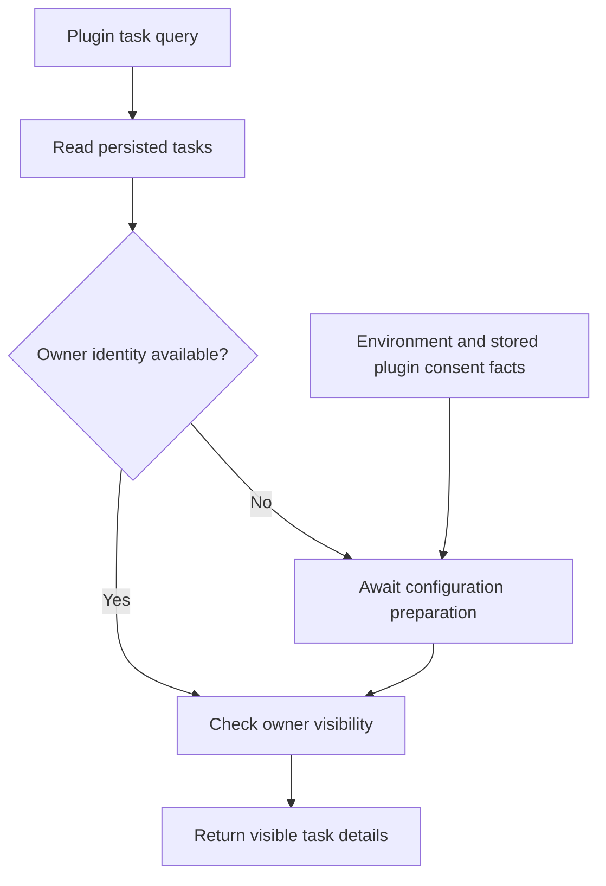

Codex review: blocked before merge. _Reviewed September 14, 2026, 5:49 PM ET / 21:49 UTC (Revision 3)._

# ClawSweeper review

## What this changes

The PR makes asynchronous task reads await configuration, environment, plugin metadata, and consent preparation while sharing validation with existing synchronous loaders.

## Merge readiness

⛔ **Blocked before merge - 1 item remains**

This remains useful work: current main still prepares configuration synchronously during bare-owner task visibility checks. No blocking introduced defect was found, and the prior generic migration-proof warning is not supported by a changed persistent contract.

**Priority:** P2
**Reviewed head:** `1c6050ff27c6342c8a314aec3c9e4d3bd30a571a`

## Review scores

| Measure | Result | What it means |
|---|---|---|
| **Overall readiness** | 🐚 platinum hermit **(4/6)** | A coherent internal cutover with meaningful boundary coverage and no blocking source finding; reported executions were not independently rerun. |
| **Proof confidence** | 🌊 off-meta tidepool | Not applicable: The maintainer-authored PR is exempt from ordinary contributor proof. Its reported registered task-runtime checks exercise cold valid/invalid configuration through real SQLite after registry readiness; inspected tests support that scope, without establishing live-provider or Windows behavior. |
| **Patch quality** | 🐚 platinum hermit **(4/6)** | No actionable review findings were identified. |

## Verification

| Check | Result | Evidence |
|---|---|---|
| **Real behavior** | Not applicable | Not applicable: The maintainer-authored PR is exempt from ordinary contributor proof. Its reported registered task-runtime checks exercise cold valid/invalid configuration through real SQLite after registry readiness; inspected tests support that scope, without establishing live-provider or Windows behavior. |
| **Evidence reviewed** | 10 items | Current main still needs this cutover: Current main calls synchronous canOwnerAccessTask after worker reads; that owner resolves bare session identities through getRuntimeConfig. The supplied merged metadata prerequisite explicitly leaves configuration preparation as separate work. Publication and visibility safeguards: Task visibility awaits the existing identity rules and rechecks database admission before returning records. Cold configuration publication checks source selectors, snapshot generation, preparer generation, candidate facts, and staged environment; superseded environment publication rolls back. Persistent contracts remain unchanged: The new worker selector reads the existing plugins.bundledDiscovery row, and the Claw reader selects existing consent columns through the artifact-preserving reader with an ownership check. No DDL, persisted encoding, retention rule, or schema-version change is introduced. |
| **Findings** | None | None. |
| **Security** | None | None. |

## How this fits together

Plugins query background tasks through OpenClaw’s task runtime. It reads persisted records, resolves the requesting owner’s identity, and returns only visible task details; cold configuration preparation supplies missing identity and policy facts.

## Before merge

- [ ] **Add data-model compatibility proof** - Confirm migration or upgrade compatibility proof before merge.

<strong>Agent review details</strong>

### Security

None.

### PR surface

Source +1192, Tests +1502, Docs 0, Other -1. Total +2693 across 43 files.

View PR surface stats

| Area | Files | Added | Removed | Net |
|---|---:|---:|---:|---:|
| Source | 31 | 2182 | 990 | +1192 |
| Tests | 10 | 1503 | 1 | +1502 |
| Docs | 1 | 3 | 3 | 0 |
| Config | 0 | 0 | 0 | 0 |
| Generated | 0 | 0 | 0 | 0 |
| Other | 1 | 1 | 2 | -1 |
| **Total** | **43** | **3689** | **996** | **+2693** |

### Review metrics

| Metric | Value | Why it matters |
|---|---|---|
| **Production versus test growth** | Production +1,192 net lines; tests/support +1,502 net lines | The PR justifies production growth through awaited preparation and shared validation, with substantial boundary and publication coverage. |

### Stored data model

Persistent data-model change detected: `database schema: src/claws/provenance-runtime-read.kernel.ts`, `database schema: src/claws/provenance-runtime-read.ts`. Confirm migration or upgrade compatibility proof before merge.

### Root-cause cluster

Relationship: `partial_overlap`
Canonical: https://github.com/openclaw/openclaw/issues/144592
Summary: This PR handles configuration preparation within the broader asynchronous-storage effort; registry restoration remains separate.

Members:
- `canonical`: https://github.com/openclaw/openclaw/issues/144592 - The open umbrella explicitly tracks asynchronous store owners and their actual callers.
- `adjacent_distinct`: https://github.com/openclaw/openclaw/pull/148017 - The merged prerequisite moves installed metadata reads to the worker and explicitly excludes broader configuration preparation.

Proposal only: this assessment does not dispatch repair, suppress jobs, mutate sibling items, close, or merge anything.

### Technical review

Best possible solution:

Keep configuration preparation behind the existing publication and metadata owners, preserving task visibility and synchronous compatibility while moving cold SQLite reads off the Gateway thread.

Do we have a high-confidence way to reproduce the issue?

Yes, from source: a bare-owner task without a persisted requester agent reaches the synchronous configuration loader on current main. The registered SQLite test provides a focused measurement path; this review did not execute it.

Is this the best way to solve the issue?

Yes. Shared sync/async orchestration retains one validation policy and existing storage owners, while the added preparation path addresses the identified cold-read boundary.

AGENTS.md: found and applied where relevant.

Codex review notes: model internal, reasoning medium; reviewed against [52f2f2fd87bb](https://github.com/openclaw/openclaw/commit/52f2f2fd87bb313e39b40edd1a57bf3cc970b889).

### Labels

Label justifications:

- `P2`: This is a bounded runtime responsiveness improvement for cold task visibility checks, with no demonstrated urgent user-facing outage.
- `rating: 🐚 platinum hermit`: Overall readiness is 🐚 platinum hermit; proof is 🌊 off-meta tidepool and patch quality is 🐚 platinum hermit.
- `status: 👀 ready for maintainer look`: ClawSweeper has no concrete contributor-facing blocker left for this PR. Not applicable: The maintainer-authored PR is exempt from ordinary contributor proof. Its reported registered task-runtime checks exercise cold valid/invalid configuration through real SQLite after registry readiness; inspected tests support that scope, without establishing live-provider or Windows behavior.

### Evidence

What I checked:

- **Current main still needs this cutover:** Current main calls synchronous canOwnerAccessTask after worker reads; that owner resolves bare session identities through getRuntimeConfig. The supplied merged metadata prerequisite explicitly leaves configuration preparation as separate work. ([`src/plugins/runtime/runtime-tasks-async.ts:75`](https://github.com/openclaw/openclaw/blob/52f2f2fd87bb313e39b40edd1a57bf3cc970b889/src/plugins/runtime/runtime-tasks-async.ts#L75), [52f2f2fd87bb](https://github.com/openclaw/openclaw/commit/52f2f2fd87bb313e39b40edd1a57bf3cc970b889))
- **Publication and visibility safeguards:** Task visibility awaits the existing identity rules and rechecks database admission before returning records. Cold configuration publication checks source selectors, snapshot generation, preparer generation, candidate facts, and staged environment; superseded environment publication rolls back. ([`src/config/runtime-snapshot.ts:519`](https://github.com/openclaw/openclaw/blob/1c6050ff27c6342c8a314aec3c9e4d3bd30a571a/src/config/runtime-snapshot.ts#L519), [1c6050ff27c6](https://github.com/openclaw/openclaw/commit/1c6050ff27c6342c8a314aec3c9e4d3bd30a571a))
- **Persistent contracts remain unchanged:** The new worker selector reads the existing plugins.bundledDiscovery row, and the Claw reader selects existing consent columns through the artifact-preserving reader with an ownership check. No DDL, persisted encoding, retention rule, or schema-version change is introduced. ([`src/state/openclaw-state.worker.ts:145`](https://github.com/openclaw/openclaw/blob/1c6050ff27c6342c8a314aec3c9e4d3bd30a571a/src/state/openclaw-state.worker.ts#L145), [1c6050ff27c6](https://github.com/openclaw/openclaw/commit/1c6050ff27c6342c8a314aec3c9e4d3bd30a571a))
- **Prior review warning reassessed:** The prior completed review had no findings and requested generic migration or upgrade compatibility proof. The storage policy exempts semantics-preserving reads from its material-change checkpoint; inspected tests cover fresh defaults, existing metadata, environment ownership, and superseded recovery observations. No schema migration requirement was established. Public docs: [`docs/reference/database-schemas/storage-changes.md`](https://docs.openclaw.ai/reference/database-schemas/storage-changes). ([`docs/reference/database-schemas/storage-changes.md:412`](https://docs.openclaw.ai/reference/database-schemas/storage-changes), [1c6050ff27c6](https://github.com/openclaw/openclaw/commit/1c6050ff27c6342c8a314aec3c9e4d3bd30a571a))
- **Registered task boundary coverage:** The added valid/invalid bare-owner cases invoke createPluginRuntime().tasks.async across get, list, findLatest, and resolve against SQLite fixtures. They assert returned visibility, snapshot publication, and zero parent-thread SQLite calls after registry readiness. These tests were inspected, not executed during this review. ([`src/infra/sqlite-worker-task-runtime.test.ts:105`](https://github.com/openclaw/openclaw/blob/1c6050ff27c6342c8a314aec3c9e4d3bd30a571a/src/infra/sqlite-worker-task-runtime.test.ts#L105), [1c6050ff27c6](https://github.com/openclaw/openclaw/commit/1c6050ff27c6342c8a314aec3c9e4d3bd30a571a))
- **Captured validation evidence:** The supplied complete PR body reports 17 ordinary controls, an inherited schema control, 75 routing checks, the selected check gate, and a full build on tree 0b0ed30e91819da01727e110362b1aa4fd63ab17. Local tree identity matches. The body expressly excludes Windows, live-provider, and several native fault scenarios; those were not treated as exercised. ([1c6050ff27c6](https://github.com/openclaw/openclaw/commit/1c6050ff27c6342c8a314aec3c9e4d3bd30a571a))

Likely related people:

- **steipete:** Suggested for follow-up; no historical authorship or introduction is verified. (role: unverified routing candidate; confidence: low)
- **Ayaan Zaidi:** Suggested for follow-up; no historical authorship or introduction is verified. (role: unverified routing candidate; confidence: low)
- **SunnyShu:** Suggested for follow-up; no historical authorship or introduction is verified. (role: unverified routing candidate; confidence: low)

### Rating scale

| Score | Internal tier | Crab rank | Meaning |
|---:|:---:|---|---|
| **6/6** | S | 🦀 challenger crab | Exceptional readiness |
| **5/6** | A | 🦞 diamond lobster | Very strong readiness |
| **4/6** | B | 🐚 platinum hermit | Good normal PR; ordinary maintainer review |
| **3/6** | C | 🦐 gold shrimp | Useful, but confidence is limited |
| **2/6** | D | 🦪 silver shellfish | Proof or implementation needs work |
| **1/6** | F | 🧂 unranked krab | Not merge-ready |
| N/A | NA | 🌊 off-meta tidepool | Rating does not apply |

Overall follows the weaker of proof and patch quality.
Shiny media proof means a screenshot, video, or linked artifact directly shows the changed behavior. Runtime, network, CSP, and security claims still need visible diagnostics.

### Workflow

- ClawSweeper keeps one durable marker-backed review comment per issue or PR.
- Re-runs edit this comment so the latest verdict, findings, and automation markers stay together instead of adding duplicate bot comments.
- A fresh review can be triggered by eligible `@clawsweeper re-review` comments, exact-item GitHub events, scheduled/background review runs, or manual workflow dispatch.
- PR/issue authors and users with repository write access can comment `@clawsweeper re-review` or `@clawsweeper re-run` on an open PR or issue to request a fresh review only.
- Maintainers can also comment `@clawsweeper review` to request a fresh review only.
- Fresh-review commands do not start repair, autofix, rebase, CI repair, or automerge.
- Maintainer-only repair and merge flows require explicit commands such as `@clawsweeper autofix`, `@clawsweeper automerge`, `@clawsweeper fix ci`, or `@clawsweeper address review`.
- Maintainers can comment `@clawsweeper explain` to ask for more context, or `@clawsweeper stop` to stop active automation.

### History

Review history (2 earlier review cycles)

<!-- clawsweeper-review-history v=1 total=2 -->
- reviewed 2026-09-14T15:32:21.467Z sha 0ca85d681dc0f1e1a5277d331685531dd30775ce :: blocked before merge. :: none
- reviewed 2026-09-14T17:29:16.495Z sha 8d5efcc45ec16fc75634e9ea0292d5d8435a7263 :: blocked before merge. :: none

<!-- clawsweeper-verdict:needs-human item=148305 sha=1c6050ff27c6342c8a314aec3c9e4d3bd30a571a confidence=high updated_at=2026-09-14T21:45:41Z reviewed_at=2026-09-14T21:49:20.125Z lease_owner=github-run-34900285621-1 lease_comment_id=5671241906 source_revision=8847bc78a5ac17ae0259de1b215c96fa9789cb316783e6025b796d53dc9787af live_verification=absent -->
<!-- clawsweeper-review-state:blocked item=148305 sha=1c6050ff27c6342c8a314aec3c9e4d3bd30a571a v=1 -->

<!-- clawsweeper-review-version item=148305 reviewed_at=2026-09-14T21:49:20.125Z sha=1c6050ff27c6342c8a314aec3c9e4d3bd30a571a source_revision=8847bc78a5ac17ae0259de1b215c96fa9789cb316783e6025b796d53dc9787af lease_owner=github-run-34900285621-1 lease_comment_id=5671241906 v=1 -->

<!-- clawsweeper-review item=148305 -->