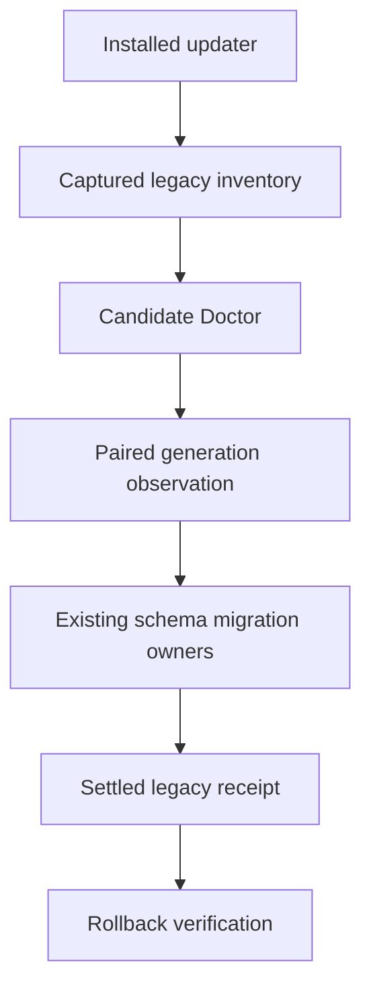

Codex review: blocked before merge.

## What this changes

This PR adapts legacy database fingerprints inside candidate Doctor and prepares schemas and cron identity for direct extended-stable upgrades.

**Example:** Update an installation running OpenClaw 2026.9.34 directly to a candidate containing this repair.
- **Before:** Candidate Doctor can reject unchanged databases with “SQLite migration source changed after update capture.”
- **After:** Doctor verifies the legacy inventory, attributes migrations using committed generations, and returns fingerprints the installed updater understands.

## Review scores

| Measure | Result | What it means |
|---|---|---|
| **Overall readiness** | 🦪 silver shellfish **(2/6)** | The compatibility repair has clear value and meaningful boundary coverage, but an introduced test fails and persisted-state upgrade acceptance remains incomplete. |
| **Proof confidence** | 🦪 silver shellfish **(2/6)** | The ordinary contributor media gate does not apply to this maintainer-authored PR; the body supplies focused regression results but explicitly claims no final-candidate product PASS. |
| **Patch quality** | 🦪 silver shellfish **(2/6)** | 1 actionable review finding remain. |

## Product

**Kind:** Bug fix · **Worth it:** Yes · **Fix scope:** Complete
**User problem:** An extended-stable installation can pass rehearsal but fail actual upgrade because Doctor rejects unchanged captured databases.
**Reason:** Compatibility with a shipped updater is a concrete product requirement, and the maintainer-authored direction is already approved.

## Merge readiness

⛔ **Blocked before merge - 2 items remain**

Keep open: this maintainer-authored PR addresses a documented shipped-updater incompatibility, but its newly added explicit-config cron regression fails on the reviewed head.

**Priority:** P1
**Reviewed head:** `e5f6d0f2eec82cc109d55a5dc9689b7cd10a649f`

## Before merge

- [ ] **Fix the added explicit-config cron snapshot case (P2)** - The newly added `explicit config` case fails on this exact head in `checks-node-changed-compact-small-11`: it supplies a config-directory selector and expects `config/cron/jobs.json`, but the reopened copy selects `source/cron/jobs.json`. This leaves the PR's claimed explicit-selector preservation unverified and introduces a failing CI test. Correct the fixture/input or projection according to the existing selector contract, preserving the assertion that the intended partition survives.
- [ ] **Add data-model compatibility proof** - The review found that existing stored data may not work after upgrade. Show that existing data still loads and works with this change.

## Findings

- [P2] Fix the added explicit-config cron snapshot case — `src/infra/update-candidate-state.inventory.test.ts:347-348`

### Tests

- Missing end-to-end proof: Final-candidate direct extended-stable upgrade, latest-stable upgrade, and forced rollback acceptance with retained settings and data are not demonstrated.

<strong>Agent review details</strong>

### How this fits together

The installed updater supplies captured database generations to candidate Doctor, which migrates preserved state and returns write receipts for rollback verification.

### Technical review

Best possible solution:

Retain candidate-side normalization in the existing owners and correct the explicit-config cron regression without weakening partition-selection checks.

Do we have a high-confidence way to reproduce the issue?

Released 2026.9.34 and current main use incompatible fingerprint formats, corroborated by native failures recorded in https://github.com/openclaw/openclaw/pull/179349; this review executed no target code.

Is this the best way to solve the issue?

Whole-inventory verification followed by candidate-local normalization addresses the compatibility boundary while retaining current generation and migration owners.

Full review comments:

- [P2] Fix the added explicit-config cron snapshot case — `src/infra/update-candidate-state.inventory.test.ts:347-348`
  The newly added `explicit config` case fails on this exact head in `checks-node-changed-compact-small-11`: it supplies a config-directory selector and expects `config/cron/jobs.json`, but the reopened copy selects `source/cron/jobs.json`. This leaves the PR's claimed explicit-selector preservation unverified and introduces a failing CI test. Correct the fixture/input or projection according to the existing selector contract, preserving the assertion that the intended partition survives.
  Confidence: 0.99

Overall correctness: patch is incorrect
Overall confidence: 0.88

AGENTS.md: found and applied where relevant.

Codex review notes: model internal, reasoning medium; reviewed against [7b95dbd3fdfe](https://github.com/openclaw/openclaw/commit/7b95dbd3fdfe7faafdda0a68e31cf8a304c00cff).

### Provenance checked

- `Committed versus physical database generations` keeps the original intent (0ac1c241fba8cb0e255a907e5f23e523ec579a43: Committed-content fingerprints replaced physical fingerprints so checkpoint-only changes would not prevent safe rollback.)
- `Migration and native-close attribution` keeps the original intent (8f622108e0003e722801b420187b6011e0a4536e: Credential cutover retained source-bound migration receipts and native custody for exact recovery.)
- `Version preparation before broader maintenance` keeps the original intent (3cd9950c462b4cf4bd56becf5517f14adbfc574e: Declared version phases finish before broader repairs so scoped backups retain their defined recovery boundary.)
- `Empty-reader WAL-index equivalence` keeps the original intent (237fdc662d90d216a8693fa6b9178afc0cbc54d6: A zero-write WAL index may appear or disappear after a read-only probe without changing committed contents.)

### Testing

Proof path: in-process harness.

### Security

None.

### Evidence

Acceptance criteria:

- pnpm test src/infra/update-candidate-state.inventory.test.ts --maxWorkers=1
- pnpm test src/infra/update-doctor-migration-attribution.test.ts --maxWorkers=1
- git diff --check

What I checked:

- **Pinned introduced change:** Reviewed the merge-base-to-head diff; the adapter remains in candidate inspection and Doctor settlement, without introducing configuration, dependencies, or another durable store. ([`src/infra/update-doctor-result.ts:297`](https://github.com/openclaw/openclaw/blob/e5f6d0f2eec82cc109d55a5dc9689b7cd10a649f/src/infra/update-doctor-result.ts#L297), [e5f6d0f2eec8](https://github.com/openclaw/openclaw/commit/e5f6d0f2eec82cc109d55a5dc9689b7cd10a649f))
- **Verified released fingerprint contract:** Published v2026.9.34 hashes serialized physical file generations and the 96-byte WAL-index header; the added physical observation reproduces that contract. ([`src/infra/update-database-generations.ts`](https://github.com/openclaw/openclaw/blob/f123d430a7dea78c9d78e05606c4cad621c0e2c8/src/infra/update-database-generations.ts), [f123d430a7de](https://github.com/openclaw/openclaw/commit/f123d430a7dea78c9d78e05606c4cad621c0e2c8))
- **Current main still needs compatibility:** Fetched main retains committed-content generations without legacy inventory normalization; https://github.com/openclaw/openclaw/pull/179349 records native failures and credits the verified intermediate-upgrade workaround. ([`src/infra/update-database-generations.ts:140`](https://github.com/openclaw/openclaw/blob/7b95dbd3fdfe7faafdda0a68e31cf8a304c00cff/src/infra/update-database-generations.ts#L140), [7b95dbd3fdfe](https://github.com/openclaw/openclaw/commit/7b95dbd3fdfe7faafdda0a68e31cf8a304c00cff))
- **Introduced cron regression fails:** The exact-head CI annotation reports that the new explicit-config case expected config/cron/jobs.json but received source/cron/jobs.json: https://github.com/openclaw/openclaw/actions/runs/40312346871/job/121537003203. ([`src/infra/update-candidate-state.inventory.test.ts:347`](https://github.com/openclaw/openclaw/blob/e5f6d0f2eec82cc109d55a5dc9689b7cd10a649f/src/infra/update-candidate-state.inventory.test.ts#L347), [e5f6d0f2eec8](https://github.com/openclaw/openclaw/commit/e5f6d0f2eec82cc109d55a5dc9689b7cd10a649f))
- **Complete proof disclosure:** The full body explicitly records final product lanes as unrun and claims no product PASS; earlier-source results do not establish compatibility for this candidate. ([e5f6d0f2eec8](https://github.com/openclaw/openclaw/commit/e5f6d0f2eec82cc109d55a5dc9689b7cd10a649f))
- **CI attribution limit:** Production and core-test typechecks also fail, but their annotations contain only exit codes; redirected logs are blocked by the network allowlist, so their causes remain unattributed. ([e5f6d0f2eec8](https://github.com/openclaw/openclaw/commit/e5f6d0f2eec82cc109d55a5dc9689b7cd10a649f))

Likely related people:

- **Peter Steinberger:** Raw commit 0ac1c241fba8cb0e255a907e5f23e523ec579a43 adds src/infra/update-database-generations.ts:26 relative to its recorded parents. This identifies author metadata, not feature responsibility or a PR merger. (role: source-line author; confidence: high; commits: [0ac1c241fba8](https://github.com/openclaw/openclaw/commit/0ac1c241fba8cb0e255a907e5f23e523ec579a43); files: `src/infra/update-database-generations.ts`)
- **Vincent Koc:** Raw commit 9c87c4e826208902078377ebb38be57fce85560f adds src/infra/update-database-generations.ts:35 relative to its recorded parents. This identifies author metadata, not feature responsibility or a PR merger. (role: source-line author; confidence: medium; commits: [9c87c4e82620](https://github.com/openclaw/openclaw/commit/9c87c4e826208902078377ebb38be57fce85560f); files: `src/infra/update-database-generations.ts`)

### PR surface

Source +199, Tests +281, Docs +13. Total +493 across 13 files. Added test files: 0.

View PR surface stats

| Area | Files | Added | Removed | Net |
|---|---:|---:|---:|---:|
| Source | 7 | 322 | 123 | +199 |
| Tests | 5 | 323 | 42 | +281 |
| Docs | 1 | 13 | 0 | +13 |
| Config | 0 | 0 | 0 | 0 |
| Generated | 0 | 0 | 0 | 0 |
| Other | 0 | 0 | 0 | 0 |
| **Total** | **13** | **658** | **165** | **+493** |

### Root-cause cluster

Relationship: `canonical`
Canonical: https://github.com/openclaw/openclaw/pull/184547
Summary: This PR explicitly replaces the earlier direct-upgrade implementation.

Members:
- `superseded`: https://github.com/openclaw/openclaw/pull/182129 - The body and commit identify the earlier legacy-fingerprint approach as superseded by candidate-side normalization.

Proposal only: this assessment does not dispatch repair, suppress jobs, mutate sibling items, close, or merge anything.

### Labels

Label changes:

- add `P1`: Direct upgrades from official extended-stable releases can fail during candidate Doctor and require operator recovery.
- add `rating: 🦪 silver shellfish`: Overall readiness is 🦪 silver shellfish; proof is 🦪 silver shellfish and patch quality is 🦪 silver shellfish.
- add `status: ⏳ waiting on author`: ClawSweeper has contributor-facing work open and is waiting for author action.

Label justifications:

- `P1`: Direct upgrades from official extended-stable releases can fail during candidate Doctor and require operator recovery.
- `rating: 🦪 silver shellfish`: Overall readiness is 🦪 silver shellfish; proof is 🦪 silver shellfish and patch quality is 🦪 silver shellfish.
- `status: ⏳ waiting on author`: ClawSweeper has contributor-facing work open and is waiting for author action.

### Rating scale

6/6 🦀 challenger crab · 5/6 🦞 diamond lobster · 4/6 🐚 platinum hermit · 3/6 🦐 gold shrimp · 2/6 🦪 silver shellfish · 1/6 🧂 unranked krab. Overall follows the weaker of proof and patch quality; ✨ marks media proof (a screenshot, video, or linked artifact) that directly shows the changed behavior.

### Workflow

ClawSweeper edits this one comment on every review. Comment `@clawsweeper re-review` for a fresh review only. Repair and merge execution lanes are retired.

_Reviewed October 26, 2026, 7:23 AM ET / 11:23 UTC._

<!-- clawsweeper-verdict:needs-human item=184547 sha=e5f6d0f2eec82cc109d55a5dc9689b7cd10a649f confidence=high updated_at=2026-10-26T11:18:23Z reviewed_at=2026-10-26T11:23:32.035Z lease_owner=github-run-40313875805-1 lease_comment_id=6414703616 source_revision=5d0258f3207e68d73e5745514c4f52e7e2cfcdcb44c388fb9d8a356f74ef3258 hold=blocked findings=1 -->
<!-- clawsweeper-review-state:blocked item=184547 sha=e5f6d0f2eec82cc109d55a5dc9689b7cd10a649f v=1 -->

<!-- clawsweeper-review-version item=184547 reviewed_at=2026-10-26T11:23:32.035Z sha=e5f6d0f2eec82cc109d55a5dc9689b7cd10a649f source_revision=5d0258f3207e68d73e5745514c4f52e7e2cfcdcb44c388fb9d8a356f74ef3258 lease_owner=github-run-40313875805-1 lease_comment_id=6414703616 v=1 -->

<!-- clawsweeper-review item=184547 -->