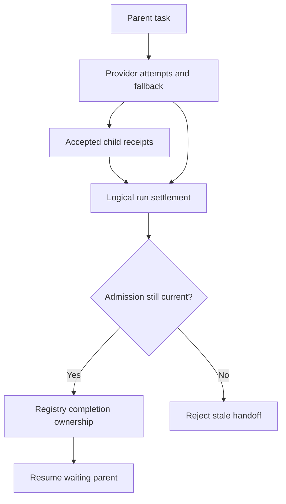

Codex review: needs maintainer review before merge. _Reviewed September 18, 2026, 3:06 PM ET / 19:06 UTC (Revision 4)._

# ClawSweeper review

## What this changes

Retains accepted child tasks across provider retries and fallback, then transfers their completion ownership when the parent’s logical run finishes.

## Merge readiness

✅ **Ready for maintainer review**

This repair remains necessary on pinned main. The prior CLI handoff blocker is resolved, and the reviewed head has no remaining actionable findings.

**Priority:** P1
**Reviewed head:** `4d4f4db734461b33e7abd34adedc10a0ae0d27a8`

## Review scores

| Measure | Result | What it means |
|---|---|---|
| **Overall readiness** | 🐚 platinum hermit **(4/6)** | A focused ownership repair with useful live evidence, meaningful regression coverage, and the prior blocker resolved. |
| **Proof confidence** | 🐚 platinum hermit **(4/6)** | Sufficient (live_output): Supplied Gateway/OpenAI output tied to this production head shows child delivery and automatic parent resumption. Production-owner coverage checks revoked/replaced admissions before SQLite mutation and successor dispatch; transport retry splitting is deterministic coverage, not a claimed live fault injection. |
| **Patch quality** | 🐚 platinum hermit **(4/6)** | No actionable review findings were identified. |

## Verification

| Check | Result | Evidence |
|---|---|---|
| **Real behavior** | Verified | Sufficient (live_output): Supplied Gateway/OpenAI output tied to this production head shows child delivery and automatic parent resumption. Production-owner coverage checks revoked/replaced admissions before SQLite mutation and successor dispatch; transport retry splitting is deterministic coverage, not a claimed live fault injection. |
| **Evidence reviewed** | 10 items | Prior CLI finding resolved: The exact-head commit patch adds retained receipts before classification is cached and defers candidate-level placement settlement. The outer entry now settles only after terminal cleanup. This addresses the previous finding and its requested regression coverage. Current authority gates the final mutation: Settlement checks cancellation and the exact active operational admission immediately before registry mutation. Failed persistence prevents acknowledgement and suppresses repeated settlement. The registry still validates the requester and complete child batch. Revocation and final-effect coverage: The production orchestration test pauses asynchronous cleanup, closes or replaces admission, and verifies unchanged SQLite rows, no persistence notification, and no Gateway dispatch. The active-owner case verifies the persisted batch and successor dispatch. These tests were inspected, not executed during this review. |
| **Findings** | None | None. |
| **Security** | None | None. |

## How this fits together

The agent runner executes parent tasks across model attempts while the subagent registry owns child completion delivery. Settlement connects those systems so completed children can resume a waiting parent.

## Before merge

None.

<strong>Agent review details</strong>

### Security

None.

### PR surface

Source +167, Tests +924, Other +1. Total +1092 across 34 files.

View PR surface stats

| Area | Files | Added | Removed | Net |
|---|---:|---:|---:|---:|
| Source | 18 | 310 | 143 | +167 |
| Tests | 15 | 1611 | 687 | +924 |
| Docs | 0 | 0 | 0 | 0 |
| Config | 0 | 0 | 0 | 0 |
| Generated | 0 | 0 | 0 | 0 |
| Other | 1 | 2 | 1 | +1 |
| **Total** | **34** | **1923** | **831** | **+1092** |

### Review metrics

| Metric | Value | Why it matters |
|---|---|---|
| **Ownership repair footprint** | Production net +167 lines; tests/support net +924; tooling net +1 | The stated production growth supports admission-scoped accounting and shared terminal settlement while removing competing attempt-level policies. |

### Technical review

Best possible solution:

Keep receipt accounting scoped to the exact admission and let one logical-run boundary transfer the complete batch through the existing registry.

Do we have a high-confidence way to reproduce the issue?

Yes, source establishes the trigger: accept children across attempts, then yield with an incomplete attempt-local batch. The PR supplies a failing-before regression; this read-only review did not execute it.

Is this the best way to solve the issue?

Yes. Moving settlement to the logical-run owner preserves existing registry, delivery, and admission contracts without adding configuration or persistent state.

AGENTS.md: found and applied where relevant.

Codex review notes: model internal, reasoning medium; reviewed against [a2505062600c](https://github.com/openclaw/openclaw/commit/a2505062600c86e0c8873ec4e66735def01faf9e).

### Labels

Label changes:

- add `rating: 🐚 platinum hermit`: Overall readiness is 🐚 platinum hermit; proof is 🐚 platinum hermit and patch quality is 🐚 platinum hermit.
- add `status: 👀 ready for maintainer look`: ClawSweeper has no concrete contributor-facing blocker left for this PR. Sufficient (live_output): Supplied Gateway/OpenAI output tied to this production head shows child delivery and automatic parent resumption. Production-owner coverage checks revoked/replaced admissions before SQLite mutation and successor dispatch; transport retry splitting is deterministic coverage, not a claimed live fault injection.
- remove `rating: 🦐 gold shrimp`: Current PR rating is `rating: 🐚 platinum hermit`, so this older rating label is no longer current.
- remove `merge-risk: 🚨 message-delivery`: Current PR review selected no merge-risk labels.
- remove `status: ⏳ waiting on author`: Current PR status label is `status: 👀 ready for maintainer look`.

Label justifications:

- `P1`: The defect can leave delegated parent tasks indefinitely idle after provider retries.
- `rating: 🐚 platinum hermit`: Overall readiness is 🐚 platinum hermit; proof is 🐚 platinum hermit and patch quality is 🐚 platinum hermit.
- `status: 👀 ready for maintainer look`: ClawSweeper has no concrete contributor-facing blocker left for this PR. Sufficient (live_output): Supplied Gateway/OpenAI output tied to this production head shows child delivery and automatic parent resumption. Production-owner coverage checks revoked/replaced admissions before SQLite mutation and successor dispatch; transport retry splitting is deterministic coverage, not a claimed live fault injection.
- `proof: sufficient`: Contributor real behavior proof is sufficient. Supplied Gateway/OpenAI output tied to this production head shows child delivery and automatic parent resumption. Production-owner coverage checks revoked/replaced admissions before SQLite mutation and successor dispatch; transport retry splitting is deterministic coverage, not a claimed live fault injection.

### Evidence

What I checked:

- **Prior CLI finding resolved:** The exact-head commit patch adds retained receipts before classification is cached and defers candidate-level placement settlement. The outer entry now settles only after terminal cleanup. This addresses the previous finding and its requested regression coverage. ([`src/agents/embedded-agent-runner/run-entry.ts:363`](https://github.com/openclaw/openclaw/blob/4d4f4db734461b33e7abd34adedc10a0ae0d27a8/src/agents/embedded-agent-runner/run-entry.ts#L363), [4d4f4db73446](https://github.com/openclaw/openclaw/commit/4d4f4db734461b33e7abd34adedc10a0ae0d27a8))
- **Current authority gates the final mutation:** Settlement checks cancellation and the exact active operational admission immediately before registry mutation. Failed persistence prevents acknowledgement and suppresses repeated settlement. The registry still validates the requester and complete child batch. ([`src/agents/requester-run-settlement.ts:102`](https://github.com/openclaw/openclaw/blob/4d4f4db734461b33e7abd34adedc10a0ae0d27a8/src/agents/requester-run-settlement.ts#L102), [4d4f4db73446](https://github.com/openclaw/openclaw/commit/4d4f4db734461b33e7abd34adedc10a0ae0d27a8))
- **Revocation and final-effect coverage:** The production orchestration test pauses asynchronous cleanup, closes or replaces admission, and verifies unchanged SQLite rows, no persistence notification, and no Gateway dispatch. The active-owner case verifies the persisted batch and successor dispatch. These tests were inspected, not executed during this review. ([`src/agents/embedded-agent-runner/sessions-yield.orchestration.test-support.ts:56`](https://github.com/openclaw/openclaw/blob/4d4f4db734461b33e7abd34adedc10a0ae0d27a8/src/agents/embedded-agent-runner/sessions-yield.orchestration.test-support.ts#L56), [4d4f4db73446](https://github.com/openclaw/openclaw/commit/4d4f4db734461b33e7abd34adedc10a0ae0d27a8))
- **Fallback ordering regression:** Coverage exercises a thrown attempt followed by an empty CLI or native candidate, retained versus absent children, cleanup revocation, and exhausted or skipped candidates. It checks classification before placement release and durable ownership after terminal acceptance. ([`src/agents/embedded-agent-runner/run-entry.failures.test-support.ts:17`](https://github.com/openclaw/openclaw/blob/4d4f4db734461b33e7abd34adedc10a0ae0d27a8/src/agents/embedded-agent-runner/run-entry.failures.test-support.ts#L17), [4d4f4db73446](https://github.com/openclaw/openclaw/commit/4d4f4db734461b33e7abd34adedc10a0ae0d27a8))
- **Still necessary on pinned main:** Pinned main retains attempt-level settlement using the current attempt’s receipt batch; it lacks this branch’s logical-run receipt accumulation and terminal handoff. ([`src/agents/embedded-agent-runner/run/backend.ts:40`](https://github.com/openclaw/openclaw/blob/a2505062600c86e0c8873ec4e66735def01faf9e/src/agents/embedded-agent-runner/run/backend.ts#L40), [a2505062600c](https://github.com/openclaw/openclaw/commit/a2505062600c86e0c8873ec4e66735def01faf9e))
- **Latest-release comparison:** The supplied latest release, v2026.9.4, also contains attempt-level settlement. This inspection does not establish a shipped fix. ([`src/agents/embedded-agent-runner/run/backend.ts:40`](https://github.com/openclaw/openclaw/blob/3a9d69db306cd7f081e06254cb89c4bcc14a7107/src/agents/embedded-agent-runner/run/backend.ts#L40), [3a9d69db306c](https://github.com/openclaw/openclaw/commit/3a9d69db306cd7f081e06254cb89c4bcc14a7107))

Likely related people:

- **steipete:** Suggested for follow-up; no historical authorship or introduction is verified. (role: unverified routing candidate; confidence: low)
- **unknown:** The claimed source-line change could not be verified from bounded local history. (role: source history unknown; confidence: low)

### Rating scale

| Score | Internal tier | Crab rank | Meaning |
|---:|:---:|---|---|
| **6/6** | S | 🦀 challenger crab | Exceptional readiness |
| **5/6** | A | 🦞 diamond lobster | Very strong readiness |
| **4/6** | B | 🐚 platinum hermit | Good normal PR; ordinary maintainer review |
| **3/6** | C | 🦐 gold shrimp | Useful, but confidence is limited |
| **2/6** | D | 🦪 silver shellfish | Proof or implementation needs work |
| **1/6** | F | 🧂 unranked krab | Not merge-ready |
| N/A | NA | 🌊 off-meta tidepool | Rating does not apply |

Overall follows the weaker of proof and patch quality.
Shiny media proof means a screenshot, video, or linked artifact directly shows the changed behavior. Runtime, network, CSP, and security claims still need visible diagnostics.

### Workflow

- ClawSweeper keeps one durable marker-backed review comment per issue or PR.
- Re-runs edit this comment so the latest verdict, findings, and automation markers stay together instead of adding duplicate bot comments.
- A fresh review can be triggered by eligible `@clawsweeper re-review` comments, exact-item GitHub events, scheduled/background review runs, or manual workflow dispatch.
- PR/issue authors and users with repository write access can comment `@clawsweeper re-review` or `@clawsweeper re-run` on an open PR or issue to request a fresh review only.
- Maintainers can also comment `@clawsweeper review` to request a fresh review only.
- Fresh-review commands do not start repair, autofix, rebase, CI repair, or automerge.
- Maintainer-only repair and merge flows require explicit commands such as `@clawsweeper autofix`, `@clawsweeper automerge`, `@clawsweeper fix ci`, or `@clawsweeper address review`.
- Maintainers can comment `@clawsweeper explain` to ask for more context, or `@clawsweeper stop` to stop active automation.

### History

Review history (3 earlier review cycles)

<!-- clawsweeper-review-history v=1 total=3 -->
- reviewed 2026-09-18T14:58:34.356Z sha c9e218e92c08fd2dae59e1552d5f446bc4f601b3 :: needs real behavior proof before merge. :: [P1] Settle retained children when the final provider attempt throws | [P1] Revalidate admitted authority before native requester handoff
- reviewed 2026-09-18T17:34:02.233Z sha 92fe167ae902210ff68768cfb4f74519592bf7f8 :: blocked before merge. :: none
- reviewed 2026-09-18T17:43:37.649Z sha 290a94600025bb8fc3c60a88288c1fe93667c193 :: blocked before merge. :: [P1] [P1] Defer CLI child handoff until fallback acceptance

<!-- clawsweeper-verdict:needs-human item=151879 sha=4d4f4db734461b33e7abd34adedc10a0ae0d27a8 confidence=high updated_at=2026-09-18T19:02:20Z reviewed_at=2026-09-18T19:06:02.079Z lease_owner=github-run-35383478124-1 lease_comment_id=5734833196 source_revision=82014d044d251274a12eb82fe55864792a6f96983850ef28b1a540c58053d27f live_verification=absent -->
<!-- clawsweeper-review-state:ready item=151879 sha=4d4f4db734461b33e7abd34adedc10a0ae0d27a8 v=1 -->

<!-- clawsweeper-review-version item=151879 reviewed_at=2026-09-18T19:06:02.079Z sha=4d4f4db734461b33e7abd34adedc10a0ae0d27a8 source_revision=82014d044d251274a12eb82fe55864792a6f96983850ef28b1a540c58053d27f lease_owner=github-run-35383478124-1 lease_comment_id=5734833196 v=1 -->

<!-- clawsweeper-review item=151879 -->