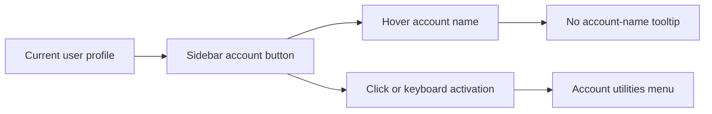

Codex review: blocked before merge. _Reviewed September 14, 2026, 8:07 PM ET / September 15, 2026, 00:07 UTC._

# ClawSweeper review

## What this changes

Removes the sidebar account-name tooltip and extends existing tests to preserve accessible naming and account-menu keyboard behavior.

## Merge readiness

⛔ **Blocked before merge - 2 items remain**

Keep open: this remains a useful, narrowly scoped polish change that current main has not adopted. No actionable correctness or security defects were found, and the protected maintainer label prevents automatic closure.

**Priority:** P3
**Reviewed head:** `22a5c7f18ac2e7f27f4fbb17bd3742189c1d9149`

## Review scores

| Measure | Result | What it means |
|---|---|---|
| **Overall readiness** | 🐚 platinum hermit **(4/6)** | A focused implementation with directly relevant visual proof and meaningful extensions to existing tests. |
| **Proof confidence** | 🦞 diamond lobster **(5/6)** ✨ media proof bonus | Sufficient (screenshot): Inspected before/after Chromium screenshots from the running Control UI with a mock Gateway directly demonstrate the footer renderer's tooltip removal at the stated candidate revision; published screenshot delivery verification remains a separate landing gate. |
| **Patch quality** | 🐚 platinum hermit **(4/6)** | No actionable review findings were identified. |

## Verification

| Check | Result | Evidence |
|---|---|---|
| **Real behavior** | Verified | Sufficient (screenshot): Inspected before/after Chromium screenshots from the running Control UI with a mock Gateway directly demonstrate the footer renderer's tooltip removal at the stated candidate revision; published screenshot delivery verification remains a separate landing gate. |
| **Evidence reviewed** | 8 items | Verified introduced change: The merge-base-to-head diff removes only the footer name's title attribute from production code. The button's accessible label, expanded state, and click handler remain intact. Current main still displays the hint: Fetched main retains title=${selfLabel} on the sidebar account name, so the requested polish remains outstanding. Latest release retains the tooltip: The v2026.9.4 source also contains the footer name title attribute. Release source was inspected through GitHub's contents API after local historical blob retrieval failed. |
| **Findings** | None | None. |
| **Security** | None | None. |

## How this fits together

The Control UI sidebar displays account information from the current user profile. Its footer button opens account utilities, while a shared tooltip adapter turns title attributes into hover hints.

## Before merge

- [ ] **Resolve merge risk (P1)** - The PR explicitly leaves published screenshot rendering unverified; originating-chat screenshot delivery is not established by the supplied context.
- [ ] **Complete next step (P2)** - Verify that the existing before/after screenshots render in the originating chat and published PR, and resolve the PR body's pending-verification note before landing.

<strong>Agent review details</strong>

### Security

None.

### PR surface

Source 0, Tests +17. Total +17 across 3 files.

View PR surface stats

| Area | Files | Added | Removed | Net |
|---|---:|---:|---:|---:|
| Source | 1 | 1 | 1 | 0 |
| Tests | 2 | 21 | 4 | +17 |
| Docs | 0 | 0 | 0 | 0 |
| Config | 0 | 0 | 0 | 0 |
| Generated | 0 | 0 | 0 | 0 |
| Other | 0 | 0 | 0 | 0 |
| **Total** | **3** | **22** | **5** | **+17** |

### Review metrics

None.

### Merge-risk options

**Maintainer options:**
1. **Decide the mitigation before merge**  
   Keep tooltip suppression local to the footer name while retaining the full accessible button label and expanded account-menu details.
2. **Pause or close**  
   Do not merge this PR until maintainers decide whether the risk is worth taking.

### Technical review

Best possible solution:

Keep tooltip suppression local to the footer name while retaining the full accessible button label and expanded account-menu details.

Do we have a high-confidence way to reproduce the issue?

Not applicable as a defect reproduction: this removes an existing visual hint by design. Current-main source and the supplied before screenshot establish the behavior being changed.

Is this the best way to solve the issue?

Yes. Removing the hint at its template source is the smallest solution and avoids special cases in the shared tooltip adapter.

AGENTS.md: found and applied where relevant.

Codex review notes: model internal, reasoning medium; reviewed against [b48baae45f3c](https://github.com/openclaw/openclaw/commit/b48baae45f3ca6ecd9e6dc5c08c8b188dcb86b57).

### Labels

Label changes:

- add `P3`: This is a localized visual polish change with preserved account-menu functionality.
- add `proof: sufficient`: Contributor real behavior proof is sufficient. Inspected before/after Chromium screenshots from the running Control UI with a mock Gateway directly demonstrate the footer renderer's tooltip removal at the stated candidate revision; published screenshot delivery verification remains a separate landing gate.
- add `proof: 📸 screenshot`: Contributor real behavior proof includes screenshot evidence. Inspected before/after Chromium screenshots from the running Control UI with a mock Gateway directly demonstrate the footer renderer's tooltip removal at the stated candidate revision; published screenshot delivery verification remains a separate landing gate.
- add `rating: 🐚 platinum hermit`: Overall readiness is 🐚 platinum hermit; proof is 🦞 diamond lobster and patch quality is 🐚 platinum hermit.
- add `status: 👀 ready for maintainer look`: ClawSweeper has no concrete contributor-facing blocker left for this PR. Sufficient (screenshot): Inspected before/after Chromium screenshots from the running Control UI with a mock Gateway directly demonstrate the footer renderer's tooltip removal at the stated candidate revision; published screenshot delivery verification remains a separate landing gate.

Label justifications:

- `P3`: This is a localized visual polish change with preserved account-menu functionality.
- `rating: 🐚 platinum hermit`: Overall readiness is 🐚 platinum hermit; proof is 🦞 diamond lobster and patch quality is 🐚 platinum hermit.
- `status: 👀 ready for maintainer look`: ClawSweeper has no concrete contributor-facing blocker left for this PR. Sufficient (screenshot): Inspected before/after Chromium screenshots from the running Control UI with a mock Gateway directly demonstrate the footer renderer's tooltip removal at the stated candidate revision; published screenshot delivery verification remains a separate landing gate.
- `proof: sufficient`: Contributor real behavior proof is sufficient. Inspected before/after Chromium screenshots from the running Control UI with a mock Gateway directly demonstrate the footer renderer's tooltip removal at the stated candidate revision; published screenshot delivery verification remains a separate landing gate.
- `proof: 📸 screenshot`: Contributor real behavior proof includes screenshot evidence. Inspected before/after Chromium screenshots from the running Control UI with a mock Gateway directly demonstrate the footer renderer's tooltip removal at the stated candidate revision; published screenshot delivery verification remains a separate landing gate.

### Evidence

What I checked:

- **Verified introduced change:** The merge-base-to-head diff removes only the footer name's title attribute from production code. The button's accessible label, expanded state, and click handler remain intact. ([`ui/src/components/app-sidebar-render.ts:503`](https://github.com/openclaw/openclaw/blob/22a5c7f18ac2e7f27f4fbb17bd3742189c1d9149/ui/src/components/app-sidebar-render.ts#L503), [22a5c7f18ac2](https://github.com/openclaw/openclaw/commit/22a5c7f18ac2e7f27f4fbb17bd3742189c1d9149))
- **Current main still displays the hint:** Fetched main retains title=${selfLabel} on the sidebar account name, so the requested polish remains outstanding. ([`ui/src/components/app-sidebar-render.ts:503`](https://github.com/openclaw/openclaw/blob/b48baae45f3ca6ecd9e6dc5c08c8b188dcb86b57/ui/src/components/app-sidebar-render.ts#L503), [b48baae45f3c](https://github.com/openclaw/openclaw/commit/b48baae45f3ca6ecd9e6dc5c08c8b188dcb86b57))
- **Latest release retains the tooltip:** The v2026.9.4 source also contains the footer name title attribute. Release source was inspected through GitHub's contents API after local historical blob retrieval failed. ([`ui/src/components/app-sidebar-render.ts:434`](https://github.com/openclaw/openclaw/blob/3a9d69db306cd7f081e06254cb89c4bcc14a7107/ui/src/components/app-sidebar-render.ts#L434), [3a9d69db306c](https://github.com/openclaw/openclaw/commit/3a9d69db306cd7f081e06254cb89c4bcc14a7107))
- **Shared tooltip boundary and regression coverage:** The adapter discovers title/data-tooltip attributes on pointerover or focusin and mounts its tooltip synchronously. The updated browser test exercises that real adapter, checks absence on hover and focus, and continues through menu keyboard navigation; teardown removes the adapter. ([`ui/src/components/app-sidebar-identity-keyboard.browser.test.ts:31`](https://github.com/openclaw/openclaw/blob/22a5c7f18ac2e7f27f4fbb17bd3742189c1d9149/ui/src/components/app-sidebar-identity-keyboard.browser.test.ts#L31), [22a5c7f18ac2](https://github.com/openclaw/openclaw/commit/22a5c7f18ac2e7f27f4fbb17bd3742189c1d9149))
- **Inspected visual proof:** Inspected all four prepared images: cropped and full-window before/after pairs visibly show the long-name tooltip disappearing without layout movement. The captured PR body identifies Chromium, a running Control UI with deterministic mock Gateway, baseline 7425f0a29761d8714dda877864b887ca87730903, and candidate 22a5c7f18ac2e7f27f4fbb17bd3742189c1d9149. The fifth menu image was not included in the prepared manifest and was not inspected. The body explicitly leaves published-page rendering verification pending. ([22a5c7f18ac2](https://github.com/openclaw/openclaw/commit/22a5c7f18ac2e7f27f4fbb17bd3742189c1d9149))
- **Area-history routing:** Current-main history identifies Peter Steinberger's recent footer work and Vyctor H. Brzezowski's earlier footer consolidation. GitHub commit metadata confirms steipete for the former. Local blame and pickaxe inspection failed on unavailable historical blobs, so no tooltip-introduction attribution is asserted. ([`ui/src/components/app-sidebar-render.ts:483`](https://github.com/openclaw/openclaw/blob/61b3bc279c853126256a566ee955cfa70a590fd1/ui/src/components/app-sidebar-render.ts#L483), [61b3bc279c85](https://github.com/openclaw/openclaw/commit/61b3bc279c853126256a566ee955cfa70a590fd1))

Likely related people:

- **unknown:** The claimed source-line change could not be verified from bounded local history. (role: source history unknown; confidence: low)
- **Vyctor H. Brzezowski:** Suggested for follow-up; no historical authorship or introduction is verified. (role: unverified routing candidate; confidence: low)

### Rating scale

| Score | Internal tier | Crab rank | Meaning |
|---:|:---:|---|---|
| **6/6** | S | 🦀 challenger crab | Exceptional readiness |
| **5/6** | A | 🦞 diamond lobster | Very strong readiness |
| **4/6** | B | 🐚 platinum hermit | Good normal PR; ordinary maintainer review |
| **3/6** | C | 🦐 gold shrimp | Useful, but confidence is limited |
| **2/6** | D | 🦪 silver shellfish | Proof or implementation needs work |
| **1/6** | F | 🧂 unranked krab | Not merge-ready |
| N/A | NA | 🌊 off-meta tidepool | Rating does not apply |

Overall follows the weaker of proof and patch quality.
Shiny media proof means a screenshot, video, or linked artifact directly shows the changed behavior. Runtime, network, CSP, and security claims still need visible diagnostics.

### Workflow

- ClawSweeper keeps one durable marker-backed review comment per issue or PR.
- Re-runs edit this comment so the latest verdict, findings, and automation markers stay together instead of adding duplicate bot comments.
- A fresh review can be triggered by eligible `@clawsweeper re-review` comments, exact-item GitHub events, scheduled/background review runs, or manual workflow dispatch.
- PR/issue authors and users with repository write access can comment `@clawsweeper re-review` or `@clawsweeper re-run` on an open PR or issue to request a fresh review only.
- Maintainers can also comment `@clawsweeper review` to request a fresh review only.
- Fresh-review commands do not start repair, autofix, rebase, CI repair, or automerge.
- Maintainer-only repair and merge flows require explicit commands such as `@clawsweeper autofix`, `@clawsweeper automerge`, `@clawsweeper fix ci`, or `@clawsweeper address review`.
- Maintainers can comment `@clawsweeper explain` to ask for more context, or `@clawsweeper stop` to stop active automation.

<!-- clawsweeper-verdict:needs-human item=148624 sha=22a5c7f18ac2e7f27f4fbb17bd3742189c1d9149 confidence=high updated_at=2026-09-15T00:04:49Z reviewed_at=2026-09-15T00:07:03.783Z lease_owner=github-run-34911533083-1 lease_comment_id=5672587327 source_revision=955415a4333db3668e44033ea6178dc16f912de7299c79eded3da927a517ebcb live_verification=absent -->
<!-- clawsweeper-review-state:blocked item=148624 sha=22a5c7f18ac2e7f27f4fbb17bd3742189c1d9149 v=1 -->

<!-- clawsweeper-review-version item=148624 reviewed_at=2026-09-15T00:07:03.783Z sha=22a5c7f18ac2e7f27f4fbb17bd3742189c1d9149 source_revision=955415a4333db3668e44033ea6178dc16f912de7299c79eded3da927a517ebcb lease_owner=github-run-34911533083-1 lease_comment_id=5672587327 v=1 -->

<!-- clawsweeper-review item=148624 -->