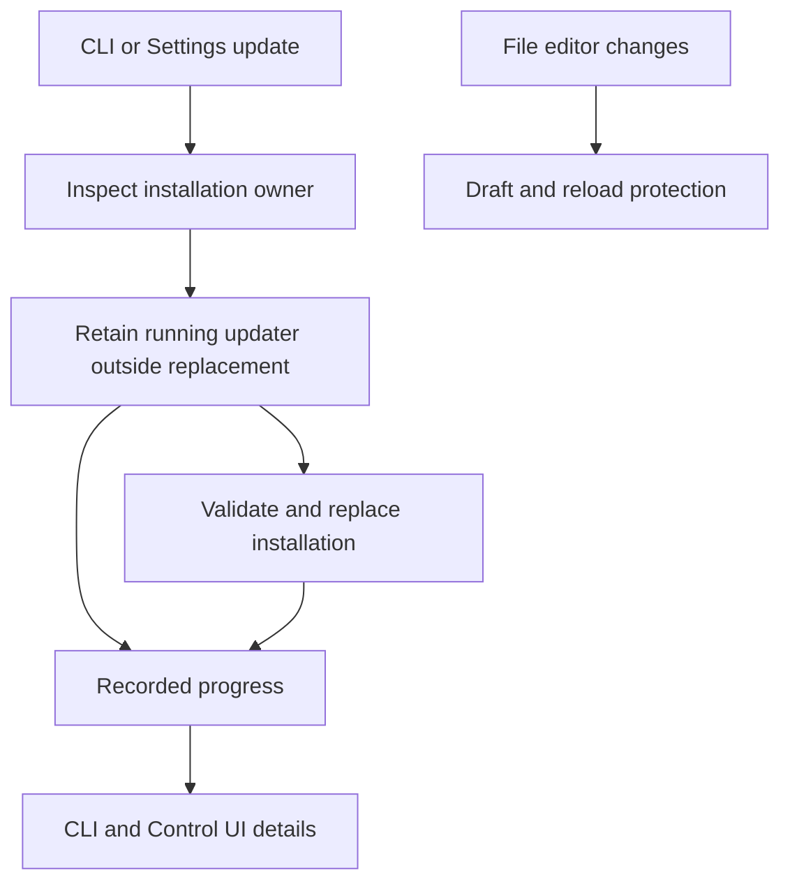

Codex review: needs maintainer review before merge. _Reviewed September 23, 2026, 7:51 AM ET / 11:51 UTC (Revision 11)._

# ClawSweeper review

## What this changes

The PR improves updater scratch placement and progress displays, and prevents normalized file-editor text from creating phantom unsaved drafts.

## Merge readiness

✅ **Ready for maintainer review**

This remains useful work that current main does not fully provide. No blocking introduced defect was found, and the supplied evidence supports normal merge review.

**Priority:** P2
**Reviewed head:** `d3388f1494d1fa660f1150f789f574ce54d043a4`

## Review scores

| Measure | Result | What it means |
|---|---|---|
| **Overall readiness** | 🐚 platinum hermit **(4/6)** | A useful, coherent repair with strong scoped evidence and no blocking findings. |
| **Proof confidence** | 🦞 diamond lobster **(5/6)** ✨ media proof bonus | Sufficient (screenshot): Inspected before/after UI screenshots directly demonstrate the changed presentation; supplied two-hop Docker observations exercise retained updater execution through replacement, and ordered Chromium evidence covers editor dirty-state recovery. Historical proof does not qualify inherited main changes or pending current-head CI. No stored-data format changes require migration. |
| **Patch quality** | 🐚 platinum hermit **(4/6)** | No actionable review findings were identified. |

## Verification

| Check | Result | Evidence |
|---|---|---|
| **Real behavior** | Verified | Sufficient (screenshot): Inspected before/after UI screenshots directly demonstrate the changed presentation; supplied two-hop Docker observations exercise retained updater execution through replacement, and ordered Chromium evidence covers editor dirty-state recovery. Historical proof does not qualify inherited main changes or pending current-head CI. No stored-data format changes require migration. |
| **Evidence reviewed** | 11 items | Pinned introduction reviewed: Reviewed the introduced backend, UI, editor, and test changes between the pinned base and original head. The head is an integration commit; inherited main changes were not treated as PR-introduced work. Current main still needs the central fix: Fetched main still allocates retained runtime under os.tmpdir(), allowing cross-filesystem copying. Its editor still compares incoming text with serialized document text, and its progress projection selects an older diagnostic when an active operation has no output. Retention and integrity boundaries: Retention resolves source and replacement boundaries, prefers a same-device sibling, and falls back for unavailable sibling storage. Native activation shares the package-project resolver. Mixed hardlink/copy validation records post-link ctime while retaining identity, mode, size, and modification-time checks. |
| **Findings** | None | None. |
| **Security** | None | None. |

## How this fits together

The updater preserves its running code while replacing an installation and publishes progress to the CLI and Control UI. The file editor separately tracks unsaved changes so interface reloads cannot discard edits.

## Before merge

None.

<strong>Agent review details</strong>

### Security

None.

### PR surface

Source +259, Tests +593. Total +852 across 28 files.

View PR surface stats

| Area | Files | Added | Removed | Net |
|---|---:|---:|---:|---:|
| Source | 17 | 351 | 92 | +259 |
| Tests | 11 | 767 | 174 | +593 |
| Docs | 0 | 0 | 0 | 0 |
| Config | 0 | 0 | 0 | 0 |
| Generated | 0 | 0 | 0 | 0 |
| Other | 0 | 0 | 0 | 0 |
| **Total** | **28** | **1118** | **266** | **+852** |

### Review metrics

| Metric | Value | Why it matters |
|---|---|---|
| **Production versus test growth** | Production +259 net lines; tests and test support +593 | Production growth has a stated purpose in retention ownership and progress presentation; existing preflight cases are relocated rather than discarded. |

### Technical review

Best possible solution:

Keep retention outside every replacement boundary, preserve fallback and integrity checks, and derive progress and dirty state from their existing owners.

Do we have a high-confidence way to reproduce the issue?

Yes, source establishes the cross-filesystem retention fallback and stale progress selection, with focused regressions supplied for both. This read-only review did not execute a current-main reproduction.

Is this the best way to solve the issue?

Yes. Sharing the installation-owner calculation and using editor-owned equality repair the existing boundaries without adding competing state or configuration.

AGENTS.md: found and applied where relevant.

Codex review notes: model internal, reasoning medium; reviewed against [bab3136d3c60](https://github.com/openclaw/openclaw/commit/bab3136d3c6074faf0c91c409619969749885b7e).

### Labels

Label changes:

No label changes.

Label justifications:

- `P2`: This repairs bounded updater preparation and progress problems, with an ancillary editor-state correction.
- `rating: 🐚 platinum hermit`: Overall readiness is 🐚 platinum hermit; proof is 🦞 diamond lobster and patch quality is 🐚 platinum hermit.
- `status: 👀 ready for maintainer look`: ClawSweeper has no concrete contributor-facing blocker left for this PR. Sufficient (screenshot): Inspected before/after UI screenshots directly demonstrate the changed presentation; supplied two-hop Docker observations exercise retained updater execution through replacement, and ordered Chromium evidence covers editor dirty-state recovery. Historical proof does not qualify inherited main changes or pending current-head CI. No stored-data format changes require migration.
- `proof: sufficient`: Contributor real behavior proof is sufficient. Inspected before/after UI screenshots directly demonstrate the changed presentation; supplied two-hop Docker observations exercise retained updater execution through replacement, and ordered Chromium evidence covers editor dirty-state recovery. Historical proof does not qualify inherited main changes or pending current-head CI. No stored-data format changes require migration.
- `proof: 📸 screenshot`: Contributor real behavior proof includes screenshot evidence. Inspected before/after UI screenshots directly demonstrate the changed presentation; supplied two-hop Docker observations exercise retained updater execution through replacement, and ordered Chromium evidence covers editor dirty-state recovery. Historical proof does not qualify inherited main changes or pending current-head CI. No stored-data format changes require migration.

### Evidence

What I checked:

- **Pinned introduction reviewed:** Reviewed the introduced backend, UI, editor, and test changes between the pinned base and original head. The head is an integration commit; inherited main changes were not treated as PR-introduced work. ([d3388f1494d1](https://github.com/openclaw/openclaw/commit/d3388f1494d1fa660f1150f789f574ce54d043a4))
- **Current main still needs the central fix:** Fetched main still allocates retained runtime under os.tmpdir(), allowing cross-filesystem copying. Its editor still compares incoming text with serialized document text, and its progress projection selects an older diagnostic when an active operation has no output. ([`src/infra/update-retained-runtime.ts:51`](https://github.com/openclaw/openclaw/blob/bab3136d3c6074faf0c91c409619969749885b7e/src/infra/update-retained-runtime.ts#L51), [bab3136d3c60](https://github.com/openclaw/openclaw/commit/bab3136d3c6074faf0c91c409619969749885b7e))
- **Retention and integrity boundaries:** Retention resolves source and replacement boundaries, prefers a same-device sibling, and falls back for unavailable sibling storage. Native activation shares the package-project resolver. Mixed hardlink/copy validation records post-link ctime while retaining identity, mode, size, and modification-time checks. ([`src/infra/update-retained-runtime.ts:55`](https://github.com/openclaw/openclaw/blob/d3388f1494d1fa660f1150f789f574ce54d043a4/src/infra/update-retained-runtime.ts#L55), [d3388f1494d1](https://github.com/openclaw/openclaw/commit/d3388f1494d1fa660f1150f789f574ce54d043a4))
- **Supplied runtime and upgrade evidence:** The captured PR body reports published 2026.9.5 updating in-process to candidate 9e0b7f1ec3a0f0360bd69bdca8523b4fcdea9ee2, followed by a second update without legacy compatibility chunks. Both exited successfully, preserved service intent, changed the running PID, and left no transaction residue. This is historical candidate evidence, not execution by this reviewer or proof of subsequently inherited main changes. No production speedup or missing-chunk negative control is claimed. ([9e0b7f1ec3a0](https://github.com/openclaw/openclaw/commit/9e0b7f1ec3a0f0360bd69bdca8523b4fcdea9ee2))
- **Visual proof inspected:** Inspected all four prepared GitHub attachment images. The before/after pairs demonstrate readable step labels, independently accessible disclosures, grouped diagnostic details, and the bounded report presentation. These use synthetic data and a mock Gateway; they do not establish backend performance. ([`ui/src/components/update-run-view.ts:124`](https://github.com/openclaw/openclaw/blob/d3388f1494d1fa660f1150f789f574ce54d043a4/ui/src/components/update-run-view.ts#L124), [d3388f1494d1](https://github.com/openclaw/openclaw/commit/d3388f1494d1fa660f1150f789f574ce54d043a4))
- **Editor owner and regression coverage:** The panel passes editor-computed semantic dirty state into the existing draft owner, preserving its read-only guard and save-hash handling. The supplied ordered Chromium evidence reports 35 passing cases covering mixed endings, edit/undo, conflict reload, HTML previews, and newer edits during saves. ([`ui/src/pages/chat/components/chat-detail-panel.ts:290`](https://github.com/openclaw/openclaw/blob/d3388f1494d1fa660f1150f789f574ce54d043a4/ui/src/pages/chat/components/chat-detail-panel.ts#L290), [d3388f1494d1](https://github.com/openclaw/openclaw/commit/d3388f1494d1fa660f1150f789f574ce54d043a4))

Likely related people:

- **Peter Steinberger:** Raw commit eeb450c9cf2dd0a29243089a7042a3f0c5882717 adds src/infra/update-retained-runtime-tree.ts:112 relative to its recorded parents. This identifies author metadata, not feature responsibility or a PR merger. (role: source-line author; confidence: high; commits: [eeb450c9cf2d](https://github.com/openclaw/openclaw/commit/eeb450c9cf2dd0a29243089a7042a3f0c5882717); files: `src/infra/update-retained-runtime-tree.ts`)
- **unknown:** The claimed source-line change could not be verified from bounded local history. (role: source history unknown; confidence: low)

### Rating scale

| Score | Internal tier | Crab rank | Meaning |
|---:|:---:|---|---|
| **6/6** | S | 🦀 challenger crab | Exceptional readiness |
| **5/6** | A | 🦞 diamond lobster | Very strong readiness |
| **4/6** | B | 🐚 platinum hermit | Good normal PR; ordinary maintainer review |
| **3/6** | C | 🦐 gold shrimp | Useful, but confidence is limited |
| **2/6** | D | 🦪 silver shellfish | Proof or implementation needs work |
| **1/6** | F | 🧂 unranked krab | Not merge-ready |
| N/A | NA | 🌊 off-meta tidepool | Rating does not apply |

Overall follows the weaker of proof and patch quality.
Shiny media proof means a screenshot, video, or linked artifact directly shows the changed behavior. Runtime, network, CSP, and security claims still need visible diagnostics.

### Workflow

- ClawSweeper keeps one durable marker-backed review comment per issue or PR.
- Re-runs edit this comment so the latest verdict, findings, and automation markers stay together instead of adding duplicate bot comments.
- A fresh review can be triggered by eligible `@clawsweeper re-review` comments, exact-item GitHub events, scheduled/background review runs, or manual workflow dispatch.
- PR/issue authors and users with repository write access can comment `@clawsweeper re-review` or `@clawsweeper re-run` on an open PR or issue to request a fresh review only.
- Maintainers can also comment `@clawsweeper review` to request a fresh review only.
- Fresh-review commands do not start repair, autofix, rebase, CI repair, or automerge.
- Maintainer-only repair and merge flows require explicit commands such as `@clawsweeper autofix`, `@clawsweeper automerge`, `@clawsweeper fix ci`, or `@clawsweeper address review`.
- Maintainers can comment `@clawsweeper explain` to ask for more context, or `@clawsweeper stop` to stop active automation.

### History

Review history (10 earlier review cycles; latest 8 shown)

<!-- clawsweeper-review-history v=1 total=10 -->
- reviewed 2026-09-23T06:48:11.946Z sha 8ff77e038280f52bf88281b72157a3cef54761b8 :: needs maintainer review before merge. :: none
- reviewed 2026-09-23T06:56:06.930Z sha 8ff77e038280f52bf88281b72157a3cef54761b8 :: needs maintainer review before merge. :: none
- reviewed 2026-09-23T07:19:26.049Z sha 1166f3ad5fb65e66e22e50ef4db46870215f6f81 :: needs maintainer review before merge. :: none
- reviewed 2026-09-23T07:27:04.270Z sha bea39cc77dcd0993c69840ebbd863db3f08a11d4 :: needs maintainer review before merge. :: none
- reviewed 2026-09-23T07:51:27.440Z sha fcf72e033191be084244e1cbfcc29e3fdc6df8eb :: needs maintainer review before merge. :: none
- reviewed 2026-09-23T10:03:50.218Z sha fcf72e033191be084244e1cbfcc29e3fdc6df8eb :: needs maintainer review before merge. :: none
- reviewed 2026-09-23T10:25:11.284Z sha c9e6d0c983b2b5a5767ab45ad622d40e0d2587e2 :: needs maintainer review before merge. :: none
- reviewed 2026-09-23T11:04:46.812Z sha d9f9fcbc33011f74e3c58de2036e0e24ca94bf32 :: needs maintainer review before merge. :: none

<!-- clawsweeper-verdict:needs-human item=156227 sha=d3388f1494d1fa660f1150f789f574ce54d043a4 confidence=high updated_at=2026-09-23T11:47:57Z reviewed_at=2026-09-23T11:51:44.170Z lease_owner=github-run-35856428665-1 lease_comment_id=5794248403 source_revision=ae724fb6609f375626c5098786902a02f882d49c3ac685dfb4dbe4188f7a537c live_verification=absent -->
<!-- clawsweeper-review-state:ready item=156227 sha=d3388f1494d1fa660f1150f789f574ce54d043a4 v=1 -->

<!-- clawsweeper-review-version item=156227 reviewed_at=2026-09-23T11:51:44.170Z sha=d3388f1494d1fa660f1150f789f574ce54d043a4 source_revision=ae724fb6609f375626c5098786902a02f882d49c3ac685dfb4dbe4188f7a537c lease_owner=github-run-35856428665-1 lease_comment_id=5794248403 v=1 -->

<!-- clawsweeper-review item=156227 -->