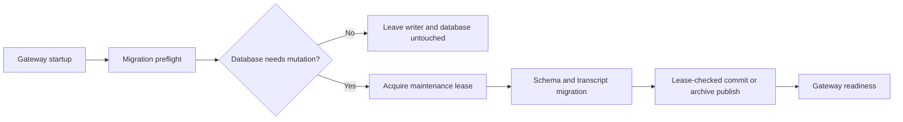

Codex review: needs maintainer review before merge. _Reviewed August 31, 2026, 1:13 AM ET / 05:13 UTC._

# ClawSweeper review

## What this changes

The PR makes automatic historical transcript migration acquire and renew the existing stopped-writer lease only when a per-agent SQLite database needs mutation, with regression tests for no-op, expiry, and archive cases.

> [!WARNING]
> **SQLite table change**
>
> This PR modifies persisted SQLite tables in `src/state/openclaw-agent-db-schema.ts`. Prefer a design that avoids changing persisted SQLite tables. If the change is necessary, verify migration and upgrade compatibility against an existing database before merge.

## Regression provenance

Possible regression — probable (reproduction; reviewed change). No predecessor PR is attributed.

## Merge readiness

⚠️ **Ready for maintainer review - 4 items remain**

Keep this PR open: current main still has the unfenced synchronous migration path, while the introduced lease-bound path addresses the linked startup failure without a discrete correctness defect found in review. Its persistent-state authority change warrants the normal state-owner review before merge.

**Priority:** P1
**Reviewed head:** `b23b964b1b5bd2963b7b4358974d3ec1aaffb819`
**Owner decision:** Required. See [Decision needed](#decision-needed).

## Review scores

| Measure | Result | What it means |
|---|---|---|
| **Overall readiness** | 🐚 platinum hermit **(4/6)** | A focused, well-covered state-migration repair with no blocking defect found, subject to owner review of its persistent-state authority boundary. |
| **Proof confidence** | 🌊 off-meta tidepool | Not applicable: The Repository State identifies this as a member-authored PR, so external-contributor real-behavior proof is not a merge gate; the supplied hermetic tests nevertheless exercise the production migration and lease owners. |
| **Patch quality** | 🐚 platinum hermit **(4/6)** | No actionable review findings were identified. |

## Verification

| Check | Result | Evidence |
|---|---|---|
| **Real behavior** | Not applicable | Not applicable: The Repository State identifies this as a member-authored PR, so external-contributor real-behavior proof is not a merge gate; the supplied hermetic tests nevertheless exercise the production migration and lease owners. |
| **Evidence reviewed** | 6 items | Current-main behavior: The fetched current-main revision retains the synchronous target loop and calls the migration without the maintenance-lease wrapper, so the reported older-schema path remains unresolved on main. Introduced owner boundary: The PR first performs read-only need detection, then runs only selected targets inside the existing global maintenance lease. Lease contract: The existing maintenance wrapper acquires the shared lease before checking active writers and runs the migration in retained maintenance authority. |
| **Findings** | None | None. |
| **Security** | None | None. |

## How this fits together

Gateway startup scans per-agent SQLite databases for legacy transcript directives before reporting readiness. Mutating migrations use a shared-state maintenance lease so an active agent-database writer cannot race schema, transcript, archive, or cursor changes.

## Decision needed

| Question | Recommendation |
|---|---|
| Should the state owner accept this cross-database lease-renewal design for automatic startup migration? | **Accept the fenced migration design:** Merge after the normal exact-head checks and owner review confirm the tested lease-loss and upgrade cases. |

Why: The PR is a focused repair, but it changes the authority that protects persisted agent state across the shared-state and agent-database boundary.

## Before merge

- [ ] **Resolve merge risk (P1)** - The PR changes automatic writes to persisted agent databases and lease behavior; a defect could still prevent Gateway readiness or leave a migration incomplete under contention.
- [ ] **Resolve merge risk (P1)** - The post-fix evidence is hermetic rather than an isolated Gateway startup against a copied older database; this is not a contributor-proof gate for the member-authored PR, but remains relevant merge context.
- [ ] **Complete next step (P2)** - No repair job is needed because no discrete introduced defect was found; the remaining action is state-owner acceptance of the persistent-state authority change.

<strong>Agent review details</strong>

### Security

None.

### PR surface

Source +213, Tests +502. Total +715 across 7 files.

View PR surface stats

| Area | Files | Added | Removed | Net |
|---|---:|---:|---:|---:|
| Source | 6 | 256 | 43 | +213 |
| Tests | 1 | 515 | 13 | +502 |
| Docs | 0 | 0 | 0 | 0 |
| Config | 0 | 0 | 0 | 0 |
| Generated | 0 | 0 | 0 | 0 |
| Other | 0 | 0 | 0 | 0 |
| **Total** | **7** | **771** | **56** | **+715** |

### Review metrics

| Metric | Value | Why it matters |
|---|---|---|
| **Production versus regression coverage** | production +256/-43; tests +515/-13 | The net +213 production lines add conditional migration planning and lease checks; the larger test delta covers durable-state and authority-loss boundaries. |

### Stored data model

Persistent data-model change detected: `unknown-data-model-change: src/state/openclaw-agent-db-schema.ts`. Confirm migration or upgrade compatibility proof before merge.

### Merge-risk options

**Maintainer options:**
1. **Accept the fenced migration design (recommended)**  
   Land after exact-head merge gates and state-owner review confirm the migration and lease-loss coverage.
2. **Obtain isolated startup evidence**  
   Pause merge until a sanitized copied older-database startup confirms readiness through the production entrypoint.

### Technical review

Best possible solution:

Retain the conditional read-only preflight and single existing maintenance-lease path, with final ownership checks at every persistent mutation boundary.

Do we have a high-confidence way to reproduce the issue?

Yes, source-reproducible: fetched current main invokes the migration without the existing maintenance wrapper, and a supported v17 database reaches the guarded schema upgrade path. I did not execute the repository because this review is read-only.

Is this the best way to solve the issue?

Yes. Reusing the established maintenance lease, skipping it for proven no-op databases, and checking it at mutation boundaries is the narrowest maintainable repair; no parallel migration path or new setting is introduced.

AGENTS.md: found and applied where relevant.

Codex review notes: model internal, reasoning high; reviewed against [f3607b1963db](https://github.com/openclaw/openclaw/commit/f3607b1963dbc56fac01fe16eb6040fdbe62d653).

### Labels

Label changes:

- add `status: 🚀 automerge armed`: This PR is in ClawSweeper's automerge lane. Not applicable: The Repository State identifies this as a member-authored PR, so external-contributor real-behavior proof is not a merge gate; the supplied hermetic tests nevertheless exercise the production migration and lease owners.
- remove `status: 👀 ready for maintainer look`: Current PR status label is `status: 🚀 automerge armed`.

Label justifications:

- `P1`: A supported older agent database can block Gateway readiness during automatic startup migration.
- `merge-risk: 🚨 session-state`: The patch changes when transcript, archive, cursor, and schema maintenance may write per-agent persistent state.
- `merge-risk: 🚨 availability`: Lease acquisition, renewal, or loss affects whether startup migration can complete and the Gateway can become ready.
- `rating: 🐚 platinum hermit`: Overall readiness is 🐚 platinum hermit; proof is 🌊 off-meta tidepool and patch quality is 🐚 platinum hermit.
- `status: 🚀 automerge armed`: This PR is in ClawSweeper's automerge lane. Not applicable: The Repository State identifies this as a member-authored PR, so external-contributor real-behavior proof is not a merge gate; the supplied hermetic tests nevertheless exercise the production migration and lease owners.

### Evidence

What I checked:

- **Current-main behavior:** The fetched current-main revision retains the synchronous target loop and calls the migration without the maintenance-lease wrapper, so the reported older-schema path remains unresolved on main. ([`src/infra/state-migrations.transcript-directives.ts:315`](https://github.com/openclaw/openclaw/blob/f3607b1963db/src/infra/state-migrations.transcript-directives.ts#L315), [f3607b1963db](https://github.com/openclaw/openclaw/commit/f3607b1963db))
- **Introduced owner boundary:** The PR first performs read-only need detection, then runs only selected targets inside the existing global maintenance lease. ([`src/infra/state-migrations.transcript-directives.ts:373`](https://github.com/openclaw/openclaw/blob/b23b964b1b5b/src/infra/state-migrations.transcript-directives.ts#L373), [b23b964b1b5b](https://github.com/openclaw/openclaw/commit/b23b964b1b5b))
- **Lease contract:** The existing maintenance wrapper acquires the shared lease before checking active writers and runs the migration in retained maintenance authority. ([`src/state/openclaw-agent-db.ts:668`](https://github.com/openclaw/openclaw/blob/b23b964b1b5b/src/state/openclaw-agent-db.ts#L668), [b23b964b1b5b](https://github.com/openclaw/openclaw/commit/b23b964b1b5b))
- **Renewal authorization:** The new renewal operation updates the lease only for the exact owner while it is unexpired, and the callback receives that operation with the existing ownership assertions. ([`src/state/openclaw-state-lease.ts:551`](https://github.com/openclaw/openclaw/blob/b23b964b1b5b/src/state/openclaw-state-lease.ts#L551), [b23b964b1b5b](https://github.com/openclaw/openclaw/commit/b23b964b1b5b))
- **Regression coverage:** The focused suite creates supported v17 fixtures, exercises no-op active-writer behavior, forces lease loss before commit and archive rename, and checks renewal across the original lease lifetime. ([`src/infra/state-migrations.transcript-directives.test.ts:498`](https://github.com/openclaw/openclaw/blob/b23b964b1b5b/src/infra/state-migrations.transcript-directives.test.ts#L498), [b23b964b1b5b](https://github.com/openclaw/openclaw/commit/b23b964b1b5b))
- **Area history:** Recent state-schema and maintenance history includes the v17 repair, legacy database migration, and agent-database boundary refactor that define this ownership area. ([`src/state/openclaw-agent-db-schema.ts:549`](https://github.com/openclaw/openclaw/blob/0771787da2db/src/state/openclaw-agent-db-schema.ts#L549), [0771787da2db](https://github.com/openclaw/openclaw/commit/0771787da2db))

Likely related people:

- **Peter Steinberger:** Suggested for follow-up; no historical authorship or introduction is verified. (role: unverified routing candidate; confidence: low)
- **Shakker:** Suggested for follow-up; no historical authorship or introduction is verified. (role: unverified routing candidate; confidence: low)

### Rating scale

| Score | Internal tier | Crab rank | Meaning |
|---:|:---:|---|---|
| **6/6** | S | 🦀 challenger crab | Exceptional readiness |
| **5/6** | A | 🦞 diamond lobster | Very strong readiness |
| **4/6** | B | 🐚 platinum hermit | Good normal PR; ordinary maintainer review |
| **3/6** | C | 🦐 gold shrimp | Useful, but confidence is limited |
| **2/6** | D | 🦪 silver shellfish | Proof or implementation needs work |
| **1/6** | F | 🧂 unranked krab | Not merge-ready |
| N/A | NA | 🌊 off-meta tidepool | Rating does not apply |

Overall follows the weaker of proof and patch quality.
Shiny media proof means a screenshot, video, or linked artifact directly shows the changed behavior. Runtime, network, CSP, and security claims still need visible diagnostics.

### Workflow

- ClawSweeper keeps one durable marker-backed review comment per issue or PR.
- Re-runs edit this comment so the latest verdict, findings, and automation markers stay together instead of adding duplicate bot comments.
- A fresh review can be triggered by eligible `@clawsweeper re-review` comments, exact-item GitHub events, scheduled/background review runs, or manual workflow dispatch.
- PR/issue authors and users with repository write access can comment `@clawsweeper re-review` or `@clawsweeper re-run` on an open PR or issue to request a fresh review only.
- Maintainers can also comment `@clawsweeper review` to request a fresh review only.
- Fresh-review commands do not start repair, autofix, rebase, CI repair, or automerge.
- Maintainer-only repair and merge flows require explicit commands such as `@clawsweeper autofix`, `@clawsweeper automerge`, `@clawsweeper fix ci`, or `@clawsweeper address review`.
- Maintainers can comment `@clawsweeper explain` to ask for more context, or `@clawsweeper stop` to stop active automation.

### History

Review history (13 earlier review cycles; latest 8 shown)

<!-- clawsweeper-review-history v=1 total=13 -->
- reviewed 2026-08-31T00:35:20.665Z sha 9ca5b388d3612532c84bb3481a5c38a748227c1e :: found issues before merge. :: [P2] Keep a failed preflight local to its target | [P2] Prune stale writer leases before skipping completion | [P3] Remove the release-owned changelog entry
- reviewed 2026-08-31T00:42:54.176Z sha c62047f93e443bfb12d4f920ecb930f71185e67c :: found issues before merge. :: [P2] Keep failed preflight local to its target | [P2] Prune stale writer leases before skipping completion | [P3] Remove the release-owned changelog entry
- reviewed 2026-08-31T01:12:49.931Z sha 8cab2d71a14c22dbfba87142da6f1749a29ba4cb :: found issues before merge. :: [P2] Report unreadable targets at the preflight boundary
- reviewed 2026-08-31T01:21:16.968Z sha 2ab98b72d81d620430931b91ee6c8e67941c573b :: found issues before merge. :: [P1] Skip maintenance for canonical archive rows
- reviewed 2026-08-31T01:27:37.590Z sha 2ab98b72d81d620430931b91ee6c8e67941c573b :: found issues before merge. :: [P1] Skip maintenance for canonical archive rows
- reviewed 2026-08-31T03:14:38.142Z sha 3850aa8399670d327f839505f3a75107298c3717 :: found issues before merge. :: [P1] Fence same-version schema convergence before commit | [P2] Keep versioned schema upgrades within the maintenance lease
- reviewed 2026-08-31T03:46:01.570Z sha 7fbfa2b78d9a7efd91c6469d713e8e07c4bd6804 :: found issues before merge. :: [P2] Surface lease-inspection failures during preflight
- reviewed 2026-08-31T04:56:48.140Z sha b23b964b1b5bd2963b7b4358974d3ec1aaffb819 :: needs maintainer review before merge. :: none

<!-- clawsweeper-verdict:needs-human item=133563 sha=b23b964b1b5bd2963b7b4358974d3ec1aaffb819 confidence=high updated_at=2026-08-31T05:10:17Z reviewed_at=2026-08-31T05:13:57.952Z lease_owner=github-run-33359454816-1 lease_comment_id=5474010818 source_revision=3b5f4218d021de04f368443810e47688621bc24c989eb42521067d5459962a3a live_verification=absent -->

<!-- clawsweeper-review-version item=133563 reviewed_at=2026-08-31T05:13:57.952Z sha=b23b964b1b5bd2963b7b4358974d3ec1aaffb819 source_revision=3b5f4218d021de04f368443810e47688621bc24c989eb42521067d5459962a3a lease_owner=github-run-33359454816-1 lease_comment_id=5474010818 v=1 -->

<!-- clawsweeper-review item=133563 -->