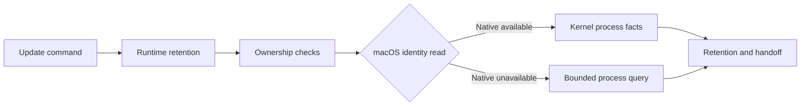

Codex review: needs maintainer review before merge. _Reviewed September 25, 2026, 3:13 AM ET / 07:13 UTC (Revision 4)._

# ClawSweeper review

## What this changes

The branch reads macOS process birth and parent data through libproc, retains a bounded process-query fallback, and adds identity and timeout tests.

## Merge readiness

✅ **Ready for maintainer review**

Keep open: current main still starts a process query for each macOS identity read. The latest branch correction addresses the prior slow-native-failure finding, and no new blocking defect is evident.

**Priority:** P2
**Reviewed head:** `e2d48db78b9c10e4a2a3d1d3d9d4e92ac19a1997`

## Review scores

| Measure | Result | What it means |
|---|---|---|
| **Overall readiness** | 🐚 platinum hermit **(4/6)** | The focused native-path proof and corrected fallback support a sound patch, with ordinary exact-head validation still pending in the captured context. |
| **Proof confidence** | 🦞 diamond lobster **(5/6)** | Sufficient (terminal): The changed shared identity reader feeds macOS updater retention and managed handoff. Reported real-process terminal traces show fewer process launches, parity with an installed driver, and corrected admission after a slow native-load failure; a full native-service deployment was not reported. No stored-data format changes. |
| **Patch quality** | 🐚 platinum hermit **(4/6)** | No actionable review findings were identified. |

## Verification

| Check | Result | Evidence |
|---|---|---|
| **Real behavior** | Verified | Sufficient (terminal): The changed shared identity reader feeds macOS updater retention and managed handoff. Reported real-process terminal traces show fewer process launches, parity with an installed driver, and corrected admission after a slow native-load failure; a full native-service deployment was not reported. No stored-data format changes. |
| **Evidence reviewed** | 9 items | Current main still uses process queries: At the fetched main revision, both Darwin identity readers call /bin/ps; the PR's native read remains a distinct change. Introduced native reader: The pinned merge-base-to-head diff adds fresh libproc queries, validates the returned PID and birth fields, and retains shell fallback. Prior finding corrected: An omitted timeout now preserves a 1000 ms shell recovery opportunity after native failure; an explicit allowance still subtracts elapsed native time. This addresses the previous review's reported handoff failure. |
| **Findings** | None | None. |
| **Security** | None | None. |

## How this fits together

During an OpenClaw update, runtime retention checks that the updater still owns its work while preserving files needed by the running process. The shared process-identity reader also supplies birth and parent information to managed service handoff checks.

## Before merge

None.

<strong>Agent review details</strong>

### Security

None.

### PR surface

Source +76, Tests +223. Total +299 across 4 files.

View PR surface stats

| Area | Files | Added | Removed | Net |
|---|---:|---:|---:|---:|
| Source | 1 | 80 | 4 | +76 |
| Tests | 3 | 230 | 7 | +223 |
| Docs | 0 | 0 | 0 | 0 |
| Config | 0 | 0 | 0 | 0 |
| Generated | 0 | 0 | 0 | 0 |
| Other | 0 | 0 | 0 | 0 |
| **Total** | **4** | **310** | **11** | **+299** |

### Review metrics

| Metric | Value | Why it matters |
|---|---|---|
| **Production versus test growth** | production +76 net lines; tests +223 net lines | The native reader accounts for the production growth, with measured speed and compatibility evidence in the PR body. |

### Technical review

Best possible solution:

Keep the shared process-identity reader as the owner for update and handoff checks, with fresh birth comparisons, a bounded fallback, and the measured macOS speedup.

Do we have a high-confidence way to reproduce the issue?

Yes. Current main's Darwin reader launches ps for each identity check, and the reported retention run measured 277 launches across 128 files; this review did not execute that run.

Is this the best way to solve the issue?

Yes. The patch changes the existing shared reader, and the latest correction preserves shell recovery while avoiding repeated process startup when native reads succeed.

AGENTS.md: found and applied where relevant.

Codex review notes: model internal, reasoning high; reviewed against [04fb3c8e35b3](https://github.com/openclaw/openclaw/commit/04fb3c8e35b3e1cb88630c797ac3ce4e50f38735).

### Labels

Label changes:

- add `rating: 🐚 platinum hermit`: Overall readiness is 🐚 platinum hermit; proof is 🦞 diamond lobster and patch quality is 🐚 platinum hermit.
- add `status: 👀 ready for maintainer look`: ClawSweeper has no concrete contributor-facing blocker left for this PR. Sufficient (terminal): The changed shared identity reader feeds macOS updater retention and managed handoff. Reported real-process terminal traces show fewer process launches, parity with an installed driver, and corrected admission after a slow native-load failure; a full native-service deployment was not reported. No stored-data format changes.
- remove `rating: 🦐 gold shrimp`: Current PR rating is `rating: 🐚 platinum hermit`, so this older rating label is no longer current.
- remove `status: ⏳ waiting on author`: Current PR status label is `status: 👀 ready for maintainer look`.

Label justifications:

- `P2`: Repeated macOS process starts slow updates, with limited platform scope and a bounded fix.
- `merge-risk: 🚨 compatibility`: Changing the source of Darwin birth identities affects existing leases; the reported published-driver comparison supports epoch-second parity.
- `rating: 🐚 platinum hermit`: Overall readiness is 🐚 platinum hermit; proof is 🦞 diamond lobster and patch quality is 🐚 platinum hermit.
- `status: 👀 ready for maintainer look`: ClawSweeper has no concrete contributor-facing blocker left for this PR. Sufficient (terminal): The changed shared identity reader feeds macOS updater retention and managed handoff. Reported real-process terminal traces show fewer process launches, parity with an installed driver, and corrected admission after a slow native-load failure; a full native-service deployment was not reported. No stored-data format changes.
- `proof: sufficient`: Contributor real behavior proof is sufficient. The changed shared identity reader feeds macOS updater retention and managed handoff. Reported real-process terminal traces show fewer process launches, parity with an installed driver, and corrected admission after a slow native-load failure; a full native-service deployment was not reported. No stored-data format changes.

### Evidence

What I checked:

- **Current main still uses process queries:** At the fetched main revision, both Darwin identity readers call /bin/ps; the PR's native read remains a distinct change. ([`src/shared/pid-alive.ts:138`](https://github.com/openclaw/openclaw/blob/04fb3c8e35b3e1cb88630c797ac3ce4e50f38735/src/shared/pid-alive.ts#L138), [04fb3c8e35b3](https://github.com/openclaw/openclaw/commit/04fb3c8e35b3e1cb88630c797ac3ce4e50f38735))
- **Introduced native reader:** The pinned merge-base-to-head diff adds fresh libproc queries, validates the returned PID and birth fields, and retains shell fallback. ([`src/shared/pid-alive.ts:18`](https://github.com/openclaw/openclaw/blob/e2d48db78b9c10e4a2a3d1d3d9d4e92ac19a1997/src/shared/pid-alive.ts#L18), [e2d48db78b9c](https://github.com/openclaw/openclaw/commit/e2d48db78b9c10e4a2a3d1d3d9d4e92ac19a1997))
- **Prior finding corrected:** An omitted timeout now preserves a 1000 ms shell recovery opportunity after native failure; an explicit allowance still subtracts elapsed native time. This addresses the previous review's reported handoff failure. ([`src/shared/pid-alive.ts:154`](https://github.com/openclaw/openclaw/blob/e2d48db78b9c10e4a2a3d1d3d9d4e92ac19a1997/src/shared/pid-alive.ts#L154), [e2d48db78b9c](https://github.com/openclaw/openclaw/commit/e2d48db78b9c10e4a2a3d1d3d9d4e92ac19a1997))
- **Authority remains checked at the handoff owner:** Managed handoff compares freshly read process birth identities with the lease identity; ancestor reads are cached only within one synchronous validation. ([`src/infra/update-managed-service-handoff-process.ts:75`](https://github.com/openclaw/openclaw/blob/e2d48db78b9c10e4a2a3d1d3d9d4e92ac19a1997/src/infra/update-managed-service-handoff-process.ts#L75), [e2d48db78b9c](https://github.com/openclaw/openclaw/commit/e2d48db78b9c10e4a2a3d1d3d9d4e92ac19a1997))
- **Real behavior evidence:** The captured PR body reports a 128-file retention run falling from 277 process launches to none, 129 real child-process cross-version identity reads, and corrected-head admission of a live child after a simulated slow native-load failure. These are contributor-reported traces, not commands executed in this read-only review. ([e2d48db78b9c](https://github.com/openclaw/openclaw/commit/e2d48db78b9c10e4a2a3d1d3d9d4e92ac19a1997))
- **Existing dependency:** Koffi is already declared in the target package; this PR does not change dependency resolution or lockfiles. ([`package.json:2294`](https://github.com/openclaw/openclaw/blob/e2d48db78b9c10e4a2a3d1d3d9d4e92ac19a1997/package.json#L2294), [e2d48db78b9c](https://github.com/openclaw/openclaw/commit/e2d48db78b9c10e4a2a3d1d3d9d4e92ac19a1997))

Likely related people:

- **Peter Steinberger:** Suggested for follow-up; no historical authorship or introduction is verified. (role: unverified routing candidate; confidence: low)
- **Vincent Koc:** Suggested for follow-up; no historical authorship or introduction is verified. (role: unverified routing candidate; confidence: low)
- **Alix-007:** Suggested for follow-up; no historical authorship or introduction is verified. (role: unverified routing candidate; confidence: low)

### Rating scale

| Score | Internal tier | Crab rank | Meaning |
|---:|:---:|---|---|
| **6/6** | S | 🦀 challenger crab | Exceptional readiness |
| **5/6** | A | 🦞 diamond lobster | Very strong readiness |
| **4/6** | B | 🐚 platinum hermit | Good normal PR; ordinary maintainer review |
| **3/6** | C | 🦐 gold shrimp | Useful, but confidence is limited |
| **2/6** | D | 🦪 silver shellfish | Proof or implementation needs work |
| **1/6** | F | 🧂 unranked krab | Not merge-ready |
| N/A | NA | 🌊 off-meta tidepool | Rating does not apply |

Overall follows the weaker of proof and patch quality.
Shiny media proof means a screenshot, video, or linked artifact directly shows the changed behavior. Runtime, network, CSP, and security claims still need visible diagnostics.

### Workflow

- ClawSweeper keeps one durable marker-backed review comment per issue or PR.
- Re-runs edit this comment so the latest verdict, findings, and automation markers stay together instead of adding duplicate bot comments.
- A fresh review can be triggered by eligible `@clawsweeper re-review` comments, exact-item GitHub events, scheduled/background review runs, or manual workflow dispatch.
- PR/issue authors and users with repository write access can comment `@clawsweeper re-review` or `@clawsweeper re-run` on an open PR or issue to request a fresh review only.
- Maintainers can also comment `@clawsweeper review` to request a fresh review only.
- Fresh-review commands do not start repair, autofix, rebase, CI repair, or automerge.
- Maintainer-only repair and merge flows require explicit commands such as `@clawsweeper autofix`, `@clawsweeper automerge`, `@clawsweeper fix ci`, or `@clawsweeper address review`.
- Maintainers can comment `@clawsweeper explain` to ask for more context, or `@clawsweeper stop` to stop active automation.

### History

Review history (3 earlier review cycles)

<!-- clawsweeper-review-history v=1 total=3 -->
- reviewed 2026-09-25T06:06:57.308Z sha faf8ad1685c1467dda7360f759551b004a58a4af :: needs maintainer review before merge. :: none
- reviewed 2026-09-25T06:25:35.589Z sha af20fec3d82ad91ce16abceb7585d619291b3b42 :: blocked before merge. :: [P1] Keep a shell recovery attempt after slow native lookup
- reviewed 2026-09-25T06:34:44.907Z sha af20fec3d82ad91ce16abceb7585d619291b3b42 :: blocked before merge. :: [P1] Preserve shell recovery after slow native failure

<!-- clawsweeper-verdict:needs-human item=157954 sha=e2d48db78b9c10e4a2a3d1d3d9d4e92ac19a1997 confidence=high updated_at=2026-09-25T07:10:34Z reviewed_at=2026-09-25T07:13:26.740Z lease_owner=github-run-36106183854-1 lease_comment_id=5828412455 source_revision=c470a381befc54e3ee58ff78b509b3d8ff44d30d5d9eac44d4743f11fa201813 live_verification=absent -->
<!-- clawsweeper-review-state:ready item=157954 sha=e2d48db78b9c10e4a2a3d1d3d9d4e92ac19a1997 v=1 -->

<!-- clawsweeper-review-version item=157954 reviewed_at=2026-09-25T07:13:26.740Z sha=e2d48db78b9c10e4a2a3d1d3d9d4e92ac19a1997 source_revision=c470a381befc54e3ee58ff78b509b3d8ff44d30d5d9eac44d4743f11fa201813 lease_owner=github-run-36106183854-1 lease_comment_id=5828412455 v=1 -->

<!-- clawsweeper-review item=157954 -->