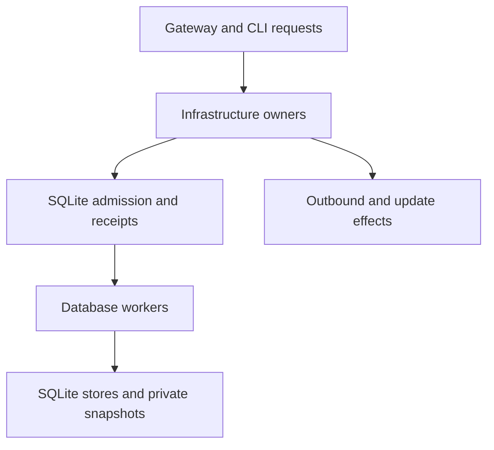

Codex review: blocked before merge.

## What this changes

This PR simplifies SQLite admission, snapshot cleanup, worker shutdown, proxy ownership, and outbound preparation around existing owners.

**Example:** Start the managed proxy twice with http://127.0.0.1:3128.
- **Before:** Both starts receive nested handles, and routing remains active until both stop.
- **After:** The second start fails with guidance to stop the active proxy first.

## Review scores

| Measure | Result | What it means |
|---|---|---|
| **Overall readiness** | 🦐 gold shrimp **(3/6)** | Useful owner-approved simplification with substantial integration support and no definite introduced defect; merge readiness remains limited by compatibility qualification. |
| **Proof confidence** | 🦐 gold shrimp **(3/6)** | Maintainer-authored infrastructure work is outside the ordinary contributor proof gate; the supplied evidence exercises real owners through integration harnesses, but provides no latest-stable upgrade cell for the changed update and persisted recovery paths. |
| **Patch quality** | 🐚 platinum hermit **(4/6)** | No actionable review findings were identified. |

## Product

**Kind:** Refactor · **Worth it:** Yes
**Reason:** The infrastructure owner approved reducing coordination complexity and explicitly recorded the exceptional failure behavior being relinquished.

## Merge readiness

⛔ **Blocked before merge - 1 item remains**

Keep this maintainer-directed simplification open; its tradeoffs are explicitly accepted, and inspection found no definite introduced code defect.

**Priority:** P3
**Reviewed head:** `479d7d4e68f60f5eb2942c90b440f030e63478ae`

## Before merge

- [ ] **Add data-model compatibility proof** - The review found that existing stored data may not work after upgrade. Show that existing data still loads and works with this change.

## Findings

None.

### Tests

- Low-value test `src/infra/sqlite-database-write-receipts.test.ts`: Remove the helper-only fixture or move its case into the existing worker-broker suite: separate in-memory handles and a hand-built publisher simulate the isolate registration boundary without exercising worker publication or a native write.
- Missing end-to-end proof: Supply a v2026.10.1 published-updater-to-candidate run covering retained handoff recovery and existing delivery records, with settings and valid data preserved.

<strong>Agent review details</strong>

### How this fits together

Gateway and CLI operations enter infrastructure owners that coordinate database workers, temporary snapshots, outbound delivery, and update custody; they return committed facts, results, and cleanup outcomes.

### Technical review

Best possible solution:

Retain the smaller existing-owner design with qualified published-update and persisted-recovery compatibility.

Do we have a high-confidence way to reproduce the issue?

This is a refactor rather than a defect report; supplied integration results exercise retained owners, and this review ran no target code.

Is this the best way to solve the issue?

The simplification follows the repository’s deliberate-complexity policy and the feature owner’s recorded tradeoffs.

AGENTS.md: found and applied where relevant.

Codex review notes: model internal, reasoning medium; reviewed against [ce34a0faa4a2](https://github.com/openclaw/openclaw/commit/ce34a0faa4a2806f890a79e0afa106ea81c114d6).

### Provenance checked

- `SQLite admission and writer coordination` changes intended behavior with a stated reason (https://github.com/openclaw/openclaw/pull/167739: Share physical-database admission across handles and workers while retaining native custody and committed publication.)
- `Snapshot custody and native shutdown recovery` changes intended behavior with a stated reason (https://github.com/openclaw/openclaw/pull/160946: Retain snapshots and native resources through preparation failure, supervisor loss, cancellation, and cleanup retries.)
- `Automatic broker cleanup failure retention` changes intended behavior with a stated reason (https://github.com/openclaw/openclaw/pull/162128: Keep cleanup failures observable and retain the original source until broker cleanup succeeds.)
- `Outbound bootstrap cache and lifecycle checks` changes intended behavior with a stated reason (https://github.com/openclaw/openclaw/pull/153105: Prevent retired plugin reuse and stale unavailable outcomes while preserving selected discovery context.)
- `Nested managed proxy registration` changes intended behavior with a stated reason (https://github.com/openclaw/openclaw/pull/74905: Keep overlapping proxy handles active while routing direct APNs HTTP/2 through the managed proxy.)
- `Retained update-reader validation` changes intended behavior with a stated reason (https://github.com/openclaw/openclaw/pull/156757: Reuse reader setup without retaining stale authority, pager contents, or schema decisions between ownership checks.)
- `Usage refresh cleanup` changes intended behavior with a stated reason (https://github.com/openclaw/openclaw/pull/152543: Keep large usage reports responsive and preserve worker publication and refresh-lock cleanup.)

### Testing

Proof path: in-process harness.

### Security

None.

### Evidence

What I checked:

- **Pinned change and accepted direction:** The full PR body records maintainer-requested simplification and explicitly accepts the removed reload, cancellation, overlapping-writer, and exceptional-recovery mechanisms. The supplied repository state identifies the author as MEMBER; live REST reports CONTRIBUTOR, while prior merged feature history independently establishes area ownership. The body was read beyond the supplied excerpts; its captured source identity is 33098d3c3603f90bb8877db4549bd63ada17a2b64f4bd8e46e1fd8866dc63045. ([479d7d4e68f6](https://github.com/openclaw/openclaw/commit/479d7d4e68f60f5eb2942c90b440f030e63478ae))
- **Introduction distinguished from base movement:** The local merge-base-to-head diff supplies the complete introduced path list, including paths omitted from the prompt. Current main still retains the writer census and coordination being removed. GitHub reports mergeable=true; blocked does not establish a conflict. ([`src/infra/sqlite-database-admission.ts:54`](https://github.com/openclaw/openclaw/blob/479d7d4e68f60f5eb2942c90b440f030e63478ae/src/infra/sqlite-database-admission.ts#L54), [479d7d4e68f6](https://github.com/openclaw/openclaw/commit/479d7d4e68f60f5eb2942c90b440f030e63478ae))
- **Effect authority retained:** Managed handoff writes still assert the captured database identity immediately before commit. Outbound execution retains cancellation, session-writer authority, generation checks, and claim-fenced dispatch after preparation. ([`src/infra/update-managed-service-handoff-database.ts:568`](https://github.com/openclaw/openclaw/blob/479d7d4e68f60f5eb2942c90b440f030e63478ae/src/infra/update-managed-service-handoff-database.ts#L568), [479d7d4e68f6](https://github.com/openclaw/openclaw/commit/479d7d4e68f60f5eb2942c90b440f030e63478ae))
- **Persisted recovery compatibility gate:** The patch changes legacy delivery migration checkpoints and managed-update storage/recovery handling. The full body and human discussion report focused tests but no v2026.10.1 published-driver-to-candidate upgrade run preserving existing settings and durable records. Root policy requires that update cell; unchanged schema versions alone do not provide it. ([`src/infra/outbound/delivery-queue-migration.ts:140`](https://github.com/openclaw/openclaw/blob/479d7d4e68f60f5eb2942c90b440f030e63478ae/src/infra/outbound/delivery-queue-migration.ts#L140), [479d7d4e68f6](https://github.com/openclaw/openclaw/commit/479d7d4e68f60f5eb2942c90b440f030e63478ae))
- **Current failures match recorded baselines:** Current-head annotations identify the same canonical-main-key publication failures and model-auth injection assertion documented with main-baseline comparisons in https://github.com/openclaw/openclaw/pull/168859#issuecomment-6108249515. Other checks remain running. The audit selects the previous head, so it is not a completed current-head CI pass. Job-log downloads were blocked by the allowlist; GitHub annotations remained readable. ([`src/infra/sqlite-readonly-worker.model-auth.test.ts:215`](https://github.com/openclaw/openclaw/blob/479d7d4e68f60f5eb2942c90b440f030e63478ae/src/infra/sqlite-readonly-worker.model-auth.test.ts#L215), [479d7d4e68f6](https://github.com/openclaw/openclaw/commit/479d7d4e68f60f5eb2942c90b440f030e63478ae))
- **Historical safeguards and reported incidents:** Read the original reasons in https://github.com/openclaw/openclaw/pull/160946, https://github.com/openclaw/openclaw/pull/162128, https://github.com/openclaw/openclaw/pull/153105, and https://github.com/openclaw/openclaw/pull/74905. The current owner explains the intentional reversals. The real reports at https://github.com/openclaw/openclaw/issues/103910 and https://github.com/openclaw/openclaw/issues/159897 support retaining exact-token usage cleanup and stale-update-owner recovery. ([`src/infra/worker-native-lifecycle.ts`](https://github.com/openclaw/openclaw/blob/ce34a0faa4a2806f890a79e0afa106ea81c114d6/src/infra/worker-native-lifecycle.ts), [ce34a0faa4a2](https://github.com/openclaw/openclaw/commit/ce34a0faa4a2806f890a79e0afa106ea81c114d6))

Likely related people:

- **Peter Steinberger:** Raw commit bb7d32e55d48a85c6a08b374064e7a45d1e52b9c adds src/infra/sqlite-database-admission.ts:47 relative to its recorded parents. This identifies author metadata, not feature responsibility or a PR merger. (role: source-line author; confidence: high; commits: [bb7d32e55d48](https://github.com/openclaw/openclaw/commit/bb7d32e55d48a85c6a08b374064e7a45d1e52b9c); files: `src/infra/sqlite-database-admission.ts`)
- **Jesse Merhi:** Raw commit 2633b1491413b09eaa096461ba2a70c56b9d2a72 adds src/infra/net/proxy/proxy-lifecycle.ts:72 relative to its recorded parents. This identifies author metadata, not feature responsibility or a PR merger. (role: source-line author; confidence: high; commits: [2633b1491413](https://github.com/openclaw/openclaw/commit/2633b1491413b09eaa096461ba2a70c56b9d2a72); files: `src/infra/net/proxy/proxy-lifecycle.ts`)
- **Galin Iliev:** Raw commit 4269cd4e1afb58c14aa4a91904825b78ca0017ac adds src/infra/sqlite-snapshot-single-flight.ts:6 relative to its recorded parents. This identifies author metadata, not feature responsibility or a PR merger. (role: source-line author; confidence: medium; commits: [4269cd4e1afb](https://github.com/openclaw/openclaw/commit/4269cd4e1afb58c14aa4a91904825b78ca0017ac); files: `src/infra/sqlite-snapshot-single-flight.ts`)
- **Jason (Json):** Raw commit 8bb889e8c841ac581a53ca3a6674ba1b6be69f16 adds src/infra/sqlite-existing-database.ts:28 relative to its recorded parents. This identifies author metadata, not feature responsibility or a PR merger. (role: source-line author; confidence: medium; commits: [8bb889e8c841](https://github.com/openclaw/openclaw/commit/8bb889e8c841ac581a53ca3a6674ba1b6be69f16); files: `src/infra/sqlite-existing-database.ts`)

### PR surface

PR surface statistics unavailable: the file list is incomplete.

### Labels

Label changes:

- add `merge-risk: 🚨 compatibility`: Update and persisted recovery behavior changes require release-to-candidate compatibility evidence even though schemas and public configuration remain unchanged.
- remove `status: ⏳ waiting on author`: Current PR status no longer selects a status label.

Label justifications:

- `P3`: This is an owner-directed internal simplification without a demonstrated urgent user-facing regression.
- `merge-risk: 🚨 compatibility`: Update and persisted recovery behavior changes require release-to-candidate compatibility evidence even though schemas and public configuration remain unchanged.
- `rating: 🦐 gold shrimp`: Overall readiness is 🦐 gold shrimp; proof is 🦐 gold shrimp and patch quality is 🐚 platinum hermit.

### Rating scale

6/6 🦀 challenger crab · 5/6 🦞 diamond lobster · 4/6 🐚 platinum hermit · 3/6 🦐 gold shrimp · 2/6 🦪 silver shellfish · 1/6 🧂 unranked krab. Overall follows the weaker of proof and patch quality; ✨ marks media proof (a screenshot, video, or linked artifact) that directly shows the changed behavior.

### Workflow

ClawSweeper edits this one comment on every review. Comment `@clawsweeper re-review` for a fresh review only; repair and merge need explicit maintainer commands such as `@clawsweeper autofix` or `@clawsweeper automerge`.

### History

Review history (10 earlier review cycles; latest 8 shown)

<!-- clawsweeper-review-history v=1 total=10 -->
- reviewed 2026-10-11T05:07:25.928Z sha 9cdb84f3246c46555d8dfc571f3abd3df572f2ab :: blocked before merge. :: none
- reviewed 2026-10-11T05:40:25.948Z sha 9cdb84f3246c46555d8dfc571f3abd3df572f2ab :: blocked before merge. :: none
- reviewed 2026-10-11T06:30:48.780Z sha 41cbbbebe05b2f07d68d3dc93c0831b4a073361b :: blocked before merge. :: [P2] Update ownership tests for process-lifetime read admission | [P2] Move actor and replica assertions to write settlement
- reviewed 2026-10-11T08:49:19.613Z sha ca322706cba91524e4a00f8100096bc42b6aff79 :: blocked before merge. :: [P2] Retain cold physical admission before entering a transaction
- reviewed 2026-10-11T09:39:39.358Z sha 82b86877d0151dc9ca94a2dc6037da122b53a1f5 :: blocked before merge. :: none
- reviewed 2026-10-11T10:58:05.185Z sha 82b86877d0151dc9ca94a2dc6037da122b53a1f5 :: blocked before merge. :: none
- reviewed 2026-10-11T11:43:31.257Z sha e9d76ba7dc14fa4dd38b2d3bec9c1d3487f35cf5 :: blocked before merge. :: none
- reviewed 2026-10-11T12:06:10.720Z sha 965ae21d3bbdc98cabf462e13a46c50a36384760 :: blocked before merge. :: none

_Reviewed October 11, 2026, 8:52 AM ET / 12:52 UTC (Revision 11)._

<!-- clawsweeper-verdict:needs-human item=168859 sha=479d7d4e68f60f5eb2942c90b440f030e63478ae confidence=high updated_at=2026-10-11T12:46:35Z reviewed_at=2026-10-11T12:52:34.841Z lease_owner=github-run-38140501814-1 lease_comment_id=6109170659 source_revision=09618df3f40315858c7e0f73f09291aa4e0aaf4ac2f1c06008bbe673faec77f4 live_verification=absent hold=blocked findings=0 -->
<!-- clawsweeper-review-state:blocked item=168859 sha=479d7d4e68f60f5eb2942c90b440f030e63478ae v=1 -->

<!-- clawsweeper-review-version item=168859 reviewed_at=2026-10-11T12:52:34.841Z sha=479d7d4e68f60f5eb2942c90b440f030e63478ae source_revision=09618df3f40315858c7e0f73f09291aa4e0aaf4ac2f1c06008bbe673faec77f4 lease_owner=github-run-38140501814-1 lease_comment_id=6109170659 v=1 -->

<!-- clawsweeper-review item=168859 -->