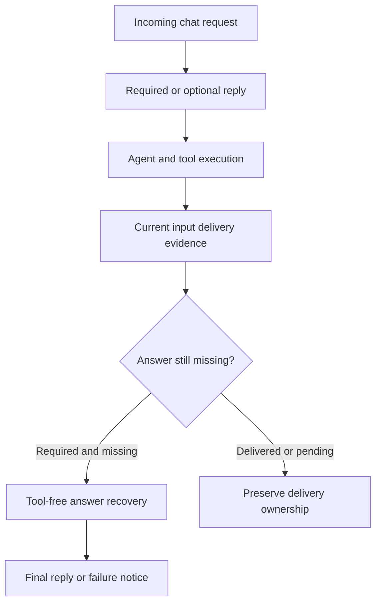

Codex review: blocked before merge. _Reviewed September 19, 2026, 12:41 PM ET / 16:41 UTC (Revision 15)._

# ClawSweeper review

## What this changes

The PR makes reply requirements host-owned and reconciles delivery receipts before recovering missing answers, without repeating completed tools.

## Merge readiness

⛔ **Blocked before merge - 2 items remain**

The missing-reply repair remains necessary on current main. Prior actionable findings are addressed, the recorded runtime evidence covers the changed behavior, and no remaining blocking defect was identified.

**Priority:** P2
**Reviewed head:** `59c61656eddc5a3a2184e05d8577202851825452`

## Review scores

| Measure | Result | What it means |
|---|---|---|
| **Overall readiness** | 🐚 platinum hermit **(4/6)** | A coherent runtime repair with strong scenario-specific proof and no remaining actionable findings. |
| **Proof confidence** | 🦞 diamond lobster **(5/6)** | Sufficient (live_output): Recorded real Telegram and Gateway runs exercise required-reply recovery, duplicate prevention, optional silence, queued failures, and cancellation; final-head SDK probes cover the changed tool-cap matcher and explicit denial. Revision identities remain distinct, and the related PR’s screenshots are not credited to this patch. |
| **Patch quality** | 🐚 platinum hermit **(4/6)** | No actionable review findings were identified. |

## Verification

| Check | Result | Evidence |
|---|---|---|
| **Real behavior** | Verified | Sufficient (live_output): Recorded real Telegram and Gateway runs exercise required-reply recovery, duplicate prevention, optional silence, queued failures, and cancellation; final-head SDK probes cover the changed tool-cap matcher and explicit denial. Revision identities remain distinct, and the related PR’s screenshots are not credited to this patch. |
| **Evidence reviewed** | 8 items | Current main still permits required silence: The inspected main implementation accepts explicit NO_REPLY as intentional silence independently of required reply expectations. The central repair is therefore still relevant. Single reply-completion contract: Explicit host expectations take precedence over legacy inputs; empty required output remains missing, and observation failures retain pending custody. Prior failure-policy findings addressed: Immediate and queued paths now share the policy that suppresses generic failures only for optional turns without visible progress. Classified guidance remains visible; focused regression cases cover these distinctions. |
| **Findings** | None | None. |
| **Security** | None | None. |

## How this fits together

OpenClaw’s reply pipeline connects incoming chat requests to agent execution and outgoing messages. It decides whether an answer is required, distinguishes progress from completed delivery, and recovers missing final replies.

## Before merge

- [ ] **Review config compatibility** - Confirm compatibility and upgrade impact for the changed config or default surface before merge.
- [ ] **Add data-model compatibility proof** - Confirm migration or upgrade compatibility proof before merge.

<strong>Agent review details</strong>

### Security

None.

### PR surface

PR surface statistics unavailable: the file list is incomplete.

### Review metrics

| Metric | Value | Why it matters |
|---|---|---|
| **Production versus test growth** | production net +326 lines; tests and test support net +932 lines | Production growth implements shared completion accounting and delivery observation; most net growth supplies regression coverage. |

### Stored data model

Persistent data-model change detected: `unknown-truncated-pull-files`. Confirm migration or upgrade compatibility proof before merge.

### Technical review

Best possible solution:

Keep one host-owned reply contract, recover through the existing tool-free finalizer, and preserve documented delivery custody for legacy plugin adapters.

Do we have a high-confidence way to reproduce the issue?

Yes, from source: required turns can accept NO_REPLY after completed tools without confirmed delivery. The PR records matching runtime scenarios; this read-only review did not execute a current-main reproduction.

Is this the best way to solve the issue?

Yes. Reusing the existing tool-free finalizer and distinguishing missing, pending, and delivered replies avoids both replaying completed actions and guessing delivery from callback invocation.

AGENTS.md: found and applied where relevant.

Codex review notes: model internal, reasoning medium; reviewed against [4822727e0a43](https://github.com/openclaw/openclaw/commit/4822727e0a4330149c0ddcb9b6372a92a6d4b518).

### Labels

Label changes:

- remove `merge-risk: 🚨 compatibility`: Current PR review selected no merge-risk labels.

Label justifications:

- `P2`: Repairs missing replies under specific tool-completion and silence sequences without evidence of a broad runtime outage.
- `rating: 🐚 platinum hermit`: Overall readiness is 🐚 platinum hermit; proof is 🦞 diamond lobster and patch quality is 🐚 platinum hermit.
- `status: 👀 ready for maintainer look`: ClawSweeper has no concrete contributor-facing blocker left for this PR. Sufficient (live_output): Recorded real Telegram and Gateway runs exercise required-reply recovery, duplicate prevention, optional silence, queued failures, and cancellation; final-head SDK probes cover the changed tool-cap matcher and explicit denial. Revision identities remain distinct, and the related PR’s screenshots are not credited to this patch.
- `proof: sufficient`: Contributor real behavior proof is sufficient. Recorded real Telegram and Gateway runs exercise required-reply recovery, duplicate prevention, optional silence, queued failures, and cancellation; final-head SDK probes cover the changed tool-cap matcher and explicit denial. Revision identities remain distinct, and the related PR’s screenshots are not credited to this patch.
- `proof: telegram-e2e`: This PR needs Telegram Test Server proof with the repository E2E skill. Final-reply visibility and group silence are Telegram-observable; the recorded Test Server scenarios cover them.

### Evidence

What I checked:

- **Current main still permits required silence:** The inspected main implementation accepts explicit NO_REPLY as intentional silence independently of required reply expectations. The central repair is therefore still relevant. ([`src/agents/embedded-agent-runner/run/incomplete-turn-recovery.ts:125`](https://github.com/openclaw/openclaw/blob/4822727e0a4330149c0ddcb9b6372a92a6d4b518/src/agents/embedded-agent-runner/run/incomplete-turn-recovery.ts#L125), [4822727e0a43](https://github.com/openclaw/openclaw/commit/4822727e0a4330149c0ddcb9b6372a92a6d4b518))
- **Single reply-completion contract:** Explicit host expectations take precedence over legacy inputs; empty required output remains missing, and observation failures retain pending custody. ([`src/agents/reply-completion.ts:22`](https://github.com/openclaw/openclaw/blob/59c61656eddc5a3a2184e05d8577202851825452/src/agents/reply-completion.ts#L22), [59c61656eddc](https://github.com/openclaw/openclaw/commit/59c61656eddc5a3a2184e05d8577202851825452))
- **Prior failure-policy findings addressed:** Immediate and queued paths now share the policy that suppresses generic failures only for optional turns without visible progress. Classified guidance remains visible; focused regression cases cover these distinctions. ([`src/auto-reply/reply/agent-runner-failure-reply.ts:416`](https://github.com/openclaw/openclaw/blob/59c61656eddc5a3a2184e05d8577202851825452/src/auto-reply/reply/agent-runner-failure-reply.ts#L416), [59c61656eddc](https://github.com/openclaw/openclaw/commit/59c61656eddc5a3a2184e05d8577202851825452))
- **Plugin compatibility concern resolved in the contract:** Legacy block callbacks retain pending custody, including uncertain send-then-throw outcomes. Explicit observers override that fallback, and the SDK documentation explains collection, confirmed non-delivery, input scoping, and retirement. This is a documented compatibility limit rather than an outstanding mechanical repair. Public docs: [`docs/plugins/sdk-runtime/agent.md`](https://docs.openclaw.ai/plugins/sdk-runtime/agent). ([`docs/plugins/sdk-runtime/agent.md:163`](https://docs.openclaw.ai/plugins/sdk-runtime/agent), [59c61656eddc](https://github.com/openclaw/openclaw/commit/59c61656eddc5a3a2184e05d8577202851825452))
- **Recorded production-path proof:** The captured PR body reports 14 real Telegram Test Server scenarios and eight real-Gateway probes on 9a05675a5c95fc6712c67b830cc3cd1e4dd6ac81: one persistent final, no repeated writes, preserved optional silence, visible actionable failures, and cancellation without message delivery. Three final-head public-SDK/Gateway scenarios additionally cover wildcard caps, messaging-group caps, and explicit message-tool denial. Model responses are synthetic; transports and Gateway entrypoints are real. ([59c61656eddc](https://github.com/openclaw/openclaw/commit/59c61656eddc5a3a2184e05d8577202851825452))
- **Proof revision continuity:** The raw tree comparison confirms that only stranded-reply recovery and its test changed after the transport-tested revision. The final source uses the canonical runtime matcher to narrow recovery to messaging; the PR separately records final-head coverage. ([`src/auto-reply/reply/stranded-reply-recovery.ts:99`](https://github.com/openclaw/openclaw/blob/59c61656eddc5a3a2184e05d8577202851825452/src/auto-reply/reply/stranded-reply-recovery.ts#L99), [59c61656eddc](https://github.com/openclaw/openclaw/commit/59c61656eddc5a3a2184e05d8577202851825452))

Likely related people:

- **jalehman:** Suggested for follow-up; no historical authorship or introduction is verified. (role: unverified routing candidate; confidence: low)
- **steipete:** Suggested for follow-up; no historical authorship or introduction is verified. (role: unverified routing candidate; confidence: low)

### Rating scale

| Score | Internal tier | Crab rank | Meaning |
|---:|:---:|---|---|
| **6/6** | S | 🦀 challenger crab | Exceptional readiness |
| **5/6** | A | 🦞 diamond lobster | Very strong readiness |
| **4/6** | B | 🐚 platinum hermit | Good normal PR; ordinary maintainer review |
| **3/6** | C | 🦐 gold shrimp | Useful, but confidence is limited |
| **2/6** | D | 🦪 silver shellfish | Proof or implementation needs work |
| **1/6** | F | 🧂 unranked krab | Not merge-ready |
| N/A | NA | 🌊 off-meta tidepool | Rating does not apply |

Overall follows the weaker of proof and patch quality.
Shiny media proof means a screenshot, video, or linked artifact directly shows the changed behavior. Runtime, network, CSP, and security claims still need visible diagnostics.

### Workflow

- ClawSweeper keeps one durable marker-backed review comment per issue or PR.
- Re-runs edit this comment so the latest verdict, findings, and automation markers stay together instead of adding duplicate bot comments.
- A fresh review can be triggered by eligible `@clawsweeper re-review` comments, exact-item GitHub events, scheduled/background review runs, or manual workflow dispatch.
- PR/issue authors and users with repository write access can comment `@clawsweeper re-review` or `@clawsweeper re-run` on an open PR or issue to request a fresh review only.
- Maintainers can also comment `@clawsweeper review` to request a fresh review only.
- Fresh-review commands do not start repair, autofix, rebase, CI repair, or automerge.
- Maintainer-only repair and merge flows require explicit commands such as `@clawsweeper autofix`, `@clawsweeper automerge`, `@clawsweeper fix ci`, or `@clawsweeper address review`.
- Maintainers can comment `@clawsweeper explain` to ask for more context, or `@clawsweeper stop` to stop active automation.

### History

Review history (14 earlier review cycles; latest 8 shown)

<!-- clawsweeper-review-history v=1 total=14 -->
- reviewed 2026-09-19T13:20:52.138Z sha a827d8de8a4de9d579508ebb5d8ced650ab487b0 :: blocked before merge. :: [P1] Preserve optional group silence on generic runner failures | [P2] Keep actionable failures visible for queued optional group turns
- reviewed 2026-09-19T13:45:59.724Z sha a827d8de8a4de9d579508ebb5d8ced650ab487b0 :: blocked before merge. :: [P1] Preserve optional group silence on generic runner failures | [P2] Keep actionable failures visible for queued optional group turns
- reviewed 2026-09-19T14:39:04.123Z sha cd05540fbb356535f57341293c54a9ddfdabb2ce :: blocked before merge. :: none
- reviewed 2026-09-19T15:00:08.227Z sha 9a05675a5c95fc6712c67b830cc3cd1e4dd6ac81 :: blocked before merge. :: none
- reviewed 2026-09-19T15:11:08.314Z sha 9a05675a5c95fc6712c67b830cc3cd1e4dd6ac81 :: blocked before merge. :: none
- reviewed 2026-09-19T15:33:39.667Z sha 9a05675a5c95fc6712c67b830cc3cd1e4dd6ac81 :: blocked before merge. :: none
- reviewed 2026-09-19T15:48:24.357Z sha 59c61656eddc5a3a2184e05d8577202851825452 :: blocked before merge. :: none
- reviewed 2026-09-19T16:21:33.359Z sha 59c61656eddc5a3a2184e05d8577202851825452 :: blocked before merge. :: none

<!-- clawsweeper-verdict:needs-human item=152786 sha=59c61656eddc5a3a2184e05d8577202851825452 confidence=high updated_at=2026-09-19T16:37:15Z reviewed_at=2026-09-19T16:41:14.612Z lease_owner=github-run-35455446624-1 lease_comment_id=5743543689 source_revision=dae2e68a5a9480dd77d87b0653b6020962ce6dad2d4777f59cea8f3b29aa8e80 live_verification=absent -->
<!-- clawsweeper-review-state:blocked item=152786 sha=59c61656eddc5a3a2184e05d8577202851825452 v=1 -->

<!-- clawsweeper-review-version item=152786 reviewed_at=2026-09-19T16:41:14.612Z sha=59c61656eddc5a3a2184e05d8577202851825452 source_revision=dae2e68a5a9480dd77d87b0653b6020962ce6dad2d4777f59cea8f3b29aa8e80 lease_owner=github-run-35455446624-1 lease_comment_id=5743543689 v=1 -->

<!-- clawsweeper-review item=152786 -->