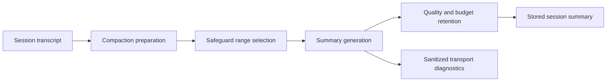

Codex review: needs maintainer review before merge. _Reviewed August 26, 2026, 12:23 AM ET / 04:23 UTC._

# ClawSweeper review

## What this changes

The PR bounds safeguard compaction to its prepared session range, caps and repairs structured-summary retention, and records redacted OpenAI stream-termination diagnostics.

## Regression provenance

Possible regression — probable (reviewed change; failure trace). No predecessor PR is attributed.

## Merge readiness

⚠️ **Ready for maintainer review - 2 items remain**

Keep open: this protected maintainer PR contains a coherent owner-boundary repair, and the prior ClawSweeper blockers are addressed at the current head. Exact-head CI is still running, so it is not yet land-ready.

**Priority:** P1
**Reviewed head:** `e141a1a4c349ff6593ff53ba67689e05e079ec9b`

## Review scores

| Measure | Result | What it means |
|---|---|---|
| **Overall readiness** | 🐚 platinum hermit **(4/6)** | The patch is a focused, net-negative owner-boundary repair with concrete regressions and no remaining correctness finding; exact-head CI remains the merge gate. |
| **Proof confidence** | 🌊 off-meta tidepool | Not applicable: Repository context identifies this as a member-authored PR; contributor real-behavior proof is not required. The PR body nevertheless describes after-fix production observations and focused regressions. |
| **Patch quality** | 🐚 platinum hermit **(4/6)** | No actionable review findings were identified. |

## Verification

| Check | Result | Evidence |
|---|---|---|
| **Real behavior** | Not applicable | Not applicable: Repository context identifies this as a member-authored PR; contributor real-behavior proof is not required. The PR body nevertheless describes after-fix production observations and focused regressions. |
| **Evidence reviewed** | 8 items | Prepared-range owner repair: The safeguard now uses the prepared messages by default and only recovers a boundary-scoped preparation range, rather than replaying the raw branch.<br>Canonical boundary behavior: The shared session-context builder selects the latest reset or compaction boundary, retains its allowed tail, and excludes earlier history.<br>Retention cap and repair: The quality plan rebuilds a fitting summary when strict identifiers are missing or protected sections exceed their cap, and reserves required identifier facts before optional content. |
| **Findings** | None | None. |
| **Security** | None | None. |


### Live Verification

**Command:** `node scripts/run-vitest.mjs src/agents/agent-hooks/compaction-safeguard.test.ts -t "summarizes only the prepared tool-only window when the context anchors it"`

**Result:** PASS (completed)

```text
[test] starting test/vitest/vitest.agents-support.config.ts

 RUN  v4.1.10 /tmp/clawsweeper-live-proof-129423-UiRae4/target

 ✓  agents-support  src/agents/agent-hooks/compaction-safeguard.test.ts (138 tests | 137 skipped) 30ms

 Test Files  1 passed (1)
      Tests  1 passed | 137 skipped (138)
   Start at  04:24:25
   Duration  13.87s (transform 10.91s, setup 916ms, import 12.53s, tests 30ms, environment 0ms)

[test] passed 1 Vitest shard in 20.32s
[test] starting test/vitest/vitest.agents-support.config.ts

 RUN  v4.1.10 /tmp/clawsweeper-live-proof-129423-UiRae4/target

 ✓  agents-support  src/agents/agent-hooks/compaction-safeguard.test.ts (138 tests | 137 skipped) 23ms

 Test Files  1 passed (1)
      Tests  1 passed | 137 skipped (138)
   Start at  04:24:47
   Duration  6.48s (transform 3.62s, setup 439ms, import 5.76s, tests 23ms, environment 0ms)

[test] passed 1 Vitest shard in 12.94s
```

**Assertions:**

- PASS `expect_output`: 1 passed

## How this fits together

Safeguard compaction turns an agent’s bounded session history into a durable summary when context is exhausted. The resulting summary feeds later turns, while the OpenAI Responses transport reports sanitized failure classifications for diagnostics.



## Before merge

- [ ] **Resolve merge risk (P1)** - Session-summary selection and retention are compatibility-sensitive; merge only after the exact-head compaction and provider checks finish successfully.
- [ ] **Complete next step (P2)** - This open, maintainer-labeled implementation PR needs normal exact-head CI completion and maintainer merge review, not a replacement repair job.


<details>
<summary><strong>Agent review details</strong></summary>

### Security

None.

### PR surface

Source -16, Tests +3, Other 0. Total -13 across 6 files.

<details>
<summary>View PR surface stats</summary>

| Area | Files | Added | Removed | Net |
|---|---:|---:|---:|---:|
| Source | 3 | 215 | 231 | -16 |
| Tests | 2 | 428 | 425 | +3 |
| Docs | 0 | 0 | 0 | 0 |
| Config | 0 | 0 | 0 | 0 |
| Generated | 0 | 0 | 0 | 0 |
| Other | 1 | 1 | 1 | 0 |
| **Total** | **6** | **644** | **657** | **-13** |

</details>

### Review metrics

| Metric | Value | Why it matters |
|---|---|---|
| **Production versus test LOC** | production −16, tests +3, baseline 0 | The bug fix absorbs the new bounded retention and diagnostics behavior while deleting the raw-branch replay and its obsolete test path. |

### Stored data model

Persistent data-model change detected: `serialized state: packages/ai/src/providers/openai-chatgpt-responses-streaming.test.ts`, `vector/embedding metadata: packages/ai/src/providers/openai-chatgpt-responses-streaming.test.ts`. Confirm migration or upgrade compatibility proof before merge.

### Merge-risk options

**Maintainer options:**
1. **Verify exact-head session coverage (recommended)**  
   Wait for the current head’s compaction and provider checks to pass before merging the changed transcript-selection and summary-retention behavior.

### Technical review

Best possible solution:

Land the single boundary-scoped compaction flow after exact-head CI confirms the focused regressions and changed-path checks.

Do we have a high-confidence way to reproduce the issue?

Yes—source-reproducible: current-main comparison shows the raw-branch fallback and uncapped fitting-summary path, while the focused tests encode the reset/compaction and identifier-dump failures. This read-only review did not execute the regression suite.

Is this the best way to solve the issue?

Yes—the branch reuses the canonical session-context projector and keeps deterministic identifier repair at the final summary-budget owner, rather than adding another fallback or configuration path.

AGENTS.md: found and applied where relevant.

Codex review notes: model internal, reasoning high; reviewed against [ceb074ef46aa](https://github.com/openclaw/openclaw/commit/ceb074ef46aaf0e661b1b9b96d31693949598a01).

### Labels

Label changes:

- add `rating: 🐚 platinum hermit`: Overall readiness is 🐚 platinum hermit; proof is 🌊 off-meta tidepool and patch quality is 🐚 platinum hermit.
- add `status: 👀 ready for maintainer look`: ClawSweeper has no concrete contributor-facing blocker left for this PR. Not applicable: Repository context identifies this as a member-authored PR; contributor real-behavior proof is not required. The PR body nevertheless describes after-fix production observations and focused regressions.
- remove `rating: 🧂 unranked krab`: Current PR rating is `rating: 🐚 platinum hermit`, so this older rating label is no longer current.
- remove `status: ⏳ waiting on author`: Current PR status label is `status: 👀 ready for maintainer look`.

Label justifications:

- `P1`: The repaired failures can leave active long-running agent sessions blocked until the operator starts a new session.
- `merge-risk: 🚨 session-state`: The patch changes which transcript entries are summarized and what durable summary content survives later compactions.
- `rating: 🐚 platinum hermit`: Overall readiness is 🐚 platinum hermit; proof is 🌊 off-meta tidepool and patch quality is 🐚 platinum hermit.
- `status: 👀 ready for maintainer look`: ClawSweeper has no concrete contributor-facing blocker left for this PR. Not applicable: Repository context identifies this as a member-authored PR; contributor real-behavior proof is not required. The PR body nevertheless describes after-fix production observations and focused regressions.

### Evidence

What I checked:

- **Prepared-range owner repair:** The safeguard now uses the prepared messages by default and only recovers a boundary-scoped preparation range, rather than replaying the raw branch. ([`src/agents/agent-hooks/compaction-safeguard.ts:935`](https://github.com/openclaw/openclaw/blob/e141a1a4c349/src/agents/agent-hooks/compaction-safeguard.ts#L935), [e141a1a4c349](https://github.com/openclaw/openclaw/commit/e141a1a4c349))
- **Canonical boundary behavior:** The shared session-context builder selects the latest reset or compaction boundary, retains its allowed tail, and excludes earlier history. ([`packages/agent-core/src/harness/session/session.ts:83`](https://github.com/openclaw/openclaw/blob/e141a1a4c349/packages/agent-core/src/harness/session/session.ts#L83), [e141a1a4c349](https://github.com/openclaw/openclaw/commit/e141a1a4c349))
- **Retention cap and repair:** The quality plan rebuilds a fitting summary when strict identifiers are missing or protected sections exceed their cap, and reserves required identifier facts before optional content. ([`src/agents/agent-hooks/compaction-safeguard-quality.ts:217`](https://github.com/openclaw/openclaw/blob/e141a1a4c349/src/agents/agent-hooks/compaction-safeguard-quality.ts#L217), [e141a1a4c349](https://github.com/openclaw/openclaw/commit/e141a1a4c349))
- **Regression coverage:** Focused tests cover the formerly fitting identifier dump, omitted source identifiers, and the boundary-scoped tool-only preparation path. ([`src/agents/agent-hooks/compaction-safeguard.test.ts:2316`](https://github.com/openclaw/openclaw/blob/e141a1a4c349/src/agents/agent-hooks/compaction-safeguard.test.ts#L2316), [e141a1a4c349](https://github.com/openclaw/openclaw/commit/e141a1a4c349))
- **Diagnostic privacy boundary:** The warning emits local timing and a closed failure-kind enum, without provider-controlled message, body, code, type, or name fields. ([`packages/ai/src/providers/openai-chatgpt-responses.ts:656`](https://github.com/openclaw/openclaw/blob/e141a1a4c349/packages/ai/src/providers/openai-chatgpt-responses.ts#L656), [e141a1a4c349](https://github.com/openclaw/openclaw/commit/e141a1a4c349))
- **Current-main comparison:** All three production owner paths differ from current main, so this central repair is not already implemented there. ([`src/agents/agent-hooks/compaction-safeguard.ts:935`](https://github.com/openclaw/openclaw/blob/e141a1a4c349/src/agents/agent-hooks/compaction-safeguard.ts#L935), [e141a1a4c349](https://github.com/openclaw/openclaw/commit/e141a1a4c349))

Likely related people:

- **Peter Steinberger:** Recent main history owns the surrounding compaction and session behavior, including the current-main refactor and silent-failure repair. (role: recent area contributor; confidence: high; commits: [b3d3494919ed](https://github.com/openclaw/openclaw/commit/b3d3494919ed31bfd3040a87ba0998aab462fdea), [3cc55589e379](https://github.com/openclaw/openclaw/commit/3cc55589e3795b0637ab43904b6578681bfde60f); files: `src/agents/agent-hooks/compaction-safeguard.ts`, `src/agents/agent-hooks/compaction-safeguard-quality.ts`)
- **Josh Avant:** Merged compaction-quality and final-budget history establishes the audit and retention invariants this PR modifies. (role: introduced structured-summary quality behavior; confidence: high; commits: [8eb97397240d](https://github.com/openclaw/openclaw/commit/8eb97397240daf39c185d5b83f534da9e240c802), [2ce443d9a46b](https://github.com/openclaw/openclaw/commit/2ce443d9a46bd4c5280a3eac9e419655f945e836); files: `src/agents/agent-hooks/compaction-safeguard-quality.ts`, `src/agents/agent-hooks/compaction-safeguard.ts`)
- **amknight:** The prior merged fallback was introduced in the earlier compaction safeguard repair cited by this PR. (role: introduced earlier fallback behavior; confidence: medium; commits: [1c2915677bdf](https://github.com/openclaw/openclaw/commit/1c2915677bdfdabda55ea7e9ca2d4b5bbb8c2cae); files: `src/agents/agent-hooks/compaction-safeguard.ts`)

### Rank-up moves

Optional improvements that raise the rating; they are not merge blockers.

- Wait for the exact-head compaction and provider checks to complete green.

### Rating scale

| Score | Internal tier | Crab rank | Meaning |
|---:|:---:|---|---|
| **6/6** | S | 🦀 challenger crab | Exceptional readiness |
| **5/6** | A | 🦞 diamond lobster | Very strong readiness |
| **4/6** | B | 🐚 platinum hermit | Good normal PR; ordinary maintainer review |
| **3/6** | C | 🦐 gold shrimp | Useful, but confidence is limited |
| **2/6** | D | 🦪 silver shellfish | Proof or implementation needs work |
| **1/6** | F | 🧂 unranked krab | Not merge-ready |
| N/A | NA | 🌊 off-meta tidepool | Rating does not apply |

Overall follows the weaker of proof and patch quality.
Shiny media proof means a screenshot, video, or linked artifact directly shows the changed behavior. Runtime, network, CSP, and security claims still need visible diagnostics.

### Workflow

- ClawSweeper keeps one durable marker-backed review comment per issue or PR.
- Re-runs edit this comment so the latest verdict, findings, and automation markers stay together instead of adding duplicate bot comments.
- A fresh review can be triggered by eligible `@clawsweeper re-review` comments, exact-item GitHub events, scheduled/background review runs, or manual workflow dispatch.
- PR/issue authors and users with repository write access can comment `@clawsweeper re-review` or `@clawsweeper re-run` on an open PR or issue to request a fresh review only.
- Maintainers can also comment `@clawsweeper review` to request a fresh review only.
- Fresh-review commands do not start repair, autofix, rebase, CI repair, or automerge.
- Maintainer-only repair and merge flows require explicit commands such as `@clawsweeper autofix`, `@clawsweeper automerge`, `@clawsweeper fix ci`, or `@clawsweeper address review`.
- Maintainers can comment `@clawsweeper explain` to ask for more context, or `@clawsweeper stop` to stop active automation.

### History

<details>
<summary>Review history (8 earlier review cycles)</summary>

<!-- clawsweeper-review-history v=1 total=8 -->
- reviewed 2026-08-25T16:54:03.732Z sha ead5f63a6e4a103992d584bfe640bb7e676c0f31 :: needs maintainer review before merge. :: none
- reviewed 2026-08-25T18:23:59.414Z sha 9199ec50547978736fcf9a33fbc76579718a19df :: needs changes before merge. :: [P1] Preserve deprecated-profile handling for external provider plugins
- reviewed 2026-08-25T20:45:35.529Z sha 53d5064f69df87a13f023e61a7a472209d34ae82 :: needs maintainer review before merge. :: none
- reviewed 2026-08-25T22:56:17.632Z sha 0bbe7e9e6b8deee412b83ae22e03cca58d18dc22 :: needs maintainer review before merge. :: none
- reviewed 2026-08-26T00:16:31.033Z sha c2f853973cf98d5fcaeb93defb085bf184017979 :: needs changes before merge. :: [P1] Avoid logging arbitrary provider error text
- reviewed 2026-08-26T01:57:16.827Z sha 0110b96a1493b87a55b9fce63d76fdc33a472a48 :: found issues before merge. :: [P1] Keep provider-controlled codes out of transport logs
- reviewed 2026-08-26T02:27:27.133Z sha b3321b9af3bc5ff87722f83f961808af5534bbb3 :: needs maintainer review before merge. :: none
- reviewed 2026-08-26T03:48:35.023Z sha ff0322262eb5fd5fab0f3f0e237ae797dcf2eaa5 :: needs changes before merge. :: [P1] Enforce the identifier-section cap below the total budget | [P1] Keep surplus budget out of protected sections | [P2] Classify direct HTTP rejections as provider failures

</details>

</details>

<!-- clawsweeper-verdict:needs-human item=129423 sha=e141a1a4c349ff6593ff53ba67689e05e079ec9b confidence=high updated_at=2026-08-26T04:20:16Z reviewed_at=2026-08-26T04:23:33.553Z lease_owner=github-run-32929750177-1 lease_comment_id=5420550126 source_revision=19e209725bf10386a1d5bcc9e892d55ffef365857810dff7d966a37a7e5a0329 -->

<!-- clawsweeper-review-version item=129423 reviewed_at=2026-08-26T04:23:33.553Z sha=e141a1a4c349ff6593ff53ba67689e05e079ec9b source_revision=19e209725bf10386a1d5bcc9e892d55ffef365857810dff7d966a37a7e5a0329 lease_owner=github-run-32929750177-1 lease_comment_id=5420550126 v=1 -->

<!-- clawsweeper-review item=129423 -->