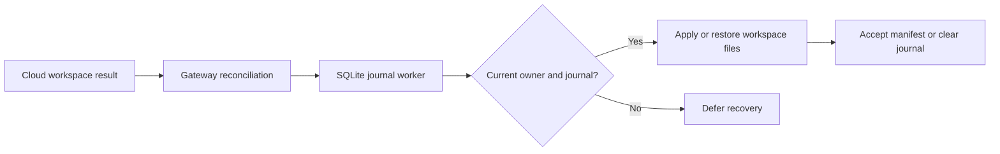

Codex review: blocked before merge. _Reviewed September 30, 2026, 5:25 AM ET / 09:25 UTC (Revision 6)._

# ClawSweeper review

## What this changes

The branch moves cloud workspace reconciliation journal reads and writes to SQLite workers, makes callers await durable results, and adds authority and recovery coverage.

## Merge readiness

⛔ **Blocked before merge - 5 items remain**

Keep open. Current main still runs workspace journal storage on the Gateway thread, and this PR provides a substantive worker migration. The remaining blocker is recovery proof for a pending journal written by the latest release.

**Priority:** P2
**Reviewed head:** `daf740e6a77f6da7e2b4b5c020849163adfe4bb6`

## Review scores

| Measure | Result | What it means |
|---|---|---|
| **Overall readiness** | 🐚 platinum hermit **(4/6)** | The migration has substantive production-boundary and authority coverage, with one release-upgrade recovery case still needed. |
| **Proof confidence** | 🐚 platinum hermit **(4/6)** | Sufficient (terminal): The changed journal owner is exercised through the production SQLite worker broker with injected reply corruption and observed retained-journal recovery; editor tests also check the final database effect after revocation and session reassignment. The reported real-Gateway setup run supports integration but does not cover a v2026.9.7 pending journal entering candidate startup. No stored journal format or schema change was identified, so data-model compatibility is not applicable; the release upgrade recovery gap remains a separate merge risk. |
| **Patch quality** | 🐚 platinum hermit **(4/6)** | No actionable review findings were identified. |

## Verification

| Check | Result | Evidence |
|---|---|---|
| **Real behavior** | Verified | Sufficient (terminal): The changed journal owner is exercised through the production SQLite worker broker with injected reply corruption and observed retained-journal recovery; editor tests also check the final database effect after revocation and session reassignment. The reported real-Gateway setup run supports integration but does not cover a v2026.9.7 pending journal entering candidate startup. No stored journal format or schema change was identified, so data-model compatibility is not applicable; the release upgrade recovery gap remains a separate merge risk. |
| **Evidence reviewed** | 9 items | Current main still uses synchronous journal storage: The registered placement store on current main uses the synchronous journal operations; the PR substitutes worker operations at the same registration point. Worker journal registration: The PR registers the worker-backed journal operations in the placement store. Live admission and commit receipt: The worker handoff checks caller authority at admission, validates commit receipts, and uses a committed receipt after ordinary reply loss. |
| **Findings** | None | None. |
| **Security** | None | None. |

## How this fits together

The Gateway uses a durable journal while applying cloud worker changes to a local workspace. It reads placement and journal state, applies or restores workspace files, and then records the accepted manifest or clears the journal.

## Before merge

- [ ] **Resolve merge risk (P1)** - A pending journal written by v2026.9.7 has not been shown restoring workspace bytes and clearing its row through candidate startup; an existing workspace could remain in deferred recovery after update.
- [ ] **Complete next step (P2)** - Demonstrate that a v2026.9.7 pending journal survives candidate startup, restores workspace bytes, and clears only after successful recovery.
- [ ] **Resolve review confidence** - ClawSweeper must reach high confidence before merge readiness is known.
- [ ] **Review config compatibility** - Confirm compatibility and upgrade impact for the changed config or default surface before merge.
- [ ] **Add data-model compatibility proof** - Confirm migration or upgrade compatibility proof before merge.

<strong>Agent review details</strong>

### Security

None.

### PR surface

PR surface statistics unavailable: the file list is incomplete.

### Review metrics

| Metric | Value | Why it matters |
|---|---|---|
| **Production and test growth** | production net +643 lines; tests and support net +593 lines | The worker handoff and authority fencing explain the production growth, while the added test support exercises the new boundaries. |

### Stored data model

Persistent data-model change detected: `unknown-truncated-pull-files`. Confirm migration or upgrade compatibility proof before merge.

### Merge-risk options

**Maintainer options:**
1. **Prove released-journal recovery (recommended)**  
   Start the candidate Gateway with a pending v2026.9.7 journal and verify restored file bytes, preserved owner checks, and journal cleanup.

### Technical review

Best possible solution:

Keep the shared workers as the journal storage owner and qualify restart recovery with a pending journal produced by v2026.9.7 before landing.

Do we have a high-confidence way to reproduce the issue?

Not applicable as a refactor request. Current-main source establishes the synchronous journal path, while the PR's production broker tests exercise the proposed replacement.

Is this the best way to solve the issue?

Yes, the existing shared-state workers are the appropriate storage owner. The remaining release-to-candidate recovery case must be verified before merge.

AGENTS.md: found and applied where relevant.

Codex review notes: model internal, reasoning high; reviewed against [94ee9b54006b](https://github.com/openclaw/openclaw/commit/94ee9b54006bb4bec0be4882a65648f3fa9861df).

### Labels

Label changes:

No label changes.

Label justifications:

- `P2`: This is a bounded Gateway performance and reliability improvement without evidence of an urgent current-user outage.
- `merge-risk: 🚨 session-state`: Moving durable journal operations across an asynchronous worker boundary could leave pre-existing workspace recovery pending after update.
- `rating: 🐚 platinum hermit`: Overall readiness is 🐚 platinum hermit; proof is 🐚 platinum hermit and patch quality is 🐚 platinum hermit.
- `status: 👀 ready for maintainer look`: ClawSweeper has no concrete contributor-facing blocker left for this PR. Sufficient (terminal): The changed journal owner is exercised through the production SQLite worker broker with injected reply corruption and observed retained-journal recovery; editor tests also check the final database effect after revocation and session reassignment. The reported real-Gateway setup run supports integration but does not cover a v2026.9.7 pending journal entering candidate startup. No stored journal format or schema change was identified, so data-model compatibility is not applicable; the release upgrade recovery gap remains a separate merge risk.
- `proof: sufficient`: Contributor real behavior proof is sufficient. The changed journal owner is exercised through the production SQLite worker broker with injected reply corruption and observed retained-journal recovery; editor tests also check the final database effect after revocation and session reassignment. The reported real-Gateway setup run supports integration but does not cover a v2026.9.7 pending journal entering candidate startup. No stored journal format or schema change was identified, so data-model compatibility is not applicable; the release upgrade recovery gap remains a separate merge risk.

### Evidence

What I checked:

- **Current main still uses synchronous journal storage:** The registered placement store on current main uses the synchronous journal operations; the PR substitutes worker operations at the same registration point. ([`src/gateway/worker-environments/placement-store.ts:141`](https://github.com/openclaw/openclaw/blob/94ee9b54006bb4bec0be4882a65648f3fa9861df/src/gateway/worker-environments/placement-store.ts#L141), [94ee9b54006b](https://github.com/openclaw/openclaw/commit/94ee9b54006bb4bec0be4882a65648f3fa9861df))
- **Worker journal registration:** The PR registers the worker-backed journal operations in the placement store. ([`src/gateway/worker-environments/placement-store.ts:141`](https://github.com/openclaw/openclaw/blob/daf740e6a77f6da7e2b4b5c020849163adfe4bb6/src/gateway/worker-environments/placement-store.ts#L141), [daf740e6a77f](https://github.com/openclaw/openclaw/commit/daf740e6a77f6da7e2b4b5c020849163adfe4bb6))
- **Live admission and commit receipt:** The worker handoff checks caller authority at admission, validates commit receipts, and uses a committed receipt after ordinary reply loss. ([`src/gateway/worker-environments/placement-workspace-journal-store.ts:90`](https://github.com/openclaw/openclaw/blob/daf740e6a77f6da7e2b4b5c020849163adfe4bb6/src/gateway/worker-environments/placement-workspace-journal-store.ts#L90), [daf740e6a77f](https://github.com/openclaw/openclaw/commit/daf740e6a77f6da7e2b4b5c020849163adfe4bb6))
- **Final worker transaction:** Journal mutation runs in the shared-state write transaction and requests admission again before its commit receipt. ([`src/gateway/worker-environments/placement-workspace-journal.worker.ts:39`](https://github.com/openclaw/openclaw/blob/daf740e6a77f6da7e2b4b5c020849163adfe4bb6/src/gateway/worker-environments/placement-workspace-journal.worker.ts#L39), [daf740e6a77f](https://github.com/openclaw/openclaw/commit/daf740e6a77f6da7e2b4b5c020849163adfe4bb6))
- **Recovery and forbidden-authority coverage:** Production broker tests inspect a corrupted worker reply, reject a revoked caller before a journal write, and check that a queued editor manifest cannot commit after its session binding changes. ([`src/gateway/worker-environments/workspace-result-repository.editor-admission.test.ts:129`](https://github.com/openclaw/openclaw/blob/daf740e6a77f6da7e2b4b5c020849163adfe4bb6/src/gateway/worker-environments/workspace-result-repository.editor-admission.test.ts#L129), [daf740e6a77f](https://github.com/openclaw/openclaw/commit/daf740e6a77f6da7e2b4b5c020849163adfe4bb6))
- **Published journal format:** The v2026.9.7 journal has version 1 and stores plan_json and base_pack. The PR changes their access path; the inspected source does not show a stored-format change. ([`src/gateway/worker-environments/placement-workspace-journal.ts:187`](https://github.com/openclaw/openclaw/blob/c074824a27c96d3983043f9eeb33823cd1772d8c/src/gateway/worker-environments/placement-workspace-journal.ts#L187), [c074824a27c9](https://github.com/openclaw/openclaw/commit/c074824a27c96d3983043f9eeb33823cd1772d8c))

Likely related people:

- **Peter Steinberger:** Suggested for follow-up; no historical authorship or introduction is verified. (role: unverified routing candidate; confidence: low)

### Rank-up moves

Optional improvements that raise the rating; they are not merge blockers.

- Show a v2026.9.7 pending journal surviving restart into the candidate Gateway, including restored workspace bytes and journal cleanup.

### Rating scale

| Score | Internal tier | Crab rank | Meaning |
|---:|:---:|---|---|
| **6/6** | S | 🦀 challenger crab | Exceptional readiness |
| **5/6** | A | 🦞 diamond lobster | Very strong readiness |
| **4/6** | B | 🐚 platinum hermit | Good normal PR; ordinary maintainer review |
| **3/6** | C | 🦐 gold shrimp | Useful, but confidence is limited |
| **2/6** | D | 🦪 silver shellfish | Proof or implementation needs work |
| **1/6** | F | 🧂 unranked krab | Not merge-ready |
| N/A | NA | 🌊 off-meta tidepool | Rating does not apply |

Overall follows the weaker of proof and patch quality.
Shiny media proof means a screenshot, video, or linked artifact directly shows the changed behavior. Runtime, network, CSP, and security claims still need visible diagnostics.

### Workflow

- ClawSweeper keeps one durable marker-backed review comment per issue or PR.
- Re-runs edit this comment so the latest verdict, findings, and automation markers stay together instead of adding duplicate bot comments.
- A fresh review can be triggered by eligible `@clawsweeper re-review` comments, exact-item GitHub events, scheduled/background review runs, or manual workflow dispatch.
- PR/issue authors and users with repository write access can comment `@clawsweeper re-review` or `@clawsweeper re-run` on an open PR or issue to request a fresh review only.
- Maintainers can also comment `@clawsweeper review` to request a fresh review only.
- Fresh-review commands do not start repair, autofix, rebase, CI repair, or automerge.
- Maintainer-only repair and merge flows require explicit commands such as `@clawsweeper autofix`, `@clawsweeper automerge`, `@clawsweeper fix ci`, or `@clawsweeper address review`.
- Maintainers can comment `@clawsweeper explain` to ask for more context, or `@clawsweeper stop` to stop active automation.

### History

Review history (5 earlier review cycles)

<!-- clawsweeper-review-history v=1 total=5 -->
- reviewed 2026-09-30T02:52:21.184Z sha 15b48699306329ec63ba011fb35b3d4c5cd80e27 :: needs changes before merge. :: [P3] Record the expanded journal test file's measured cost
- reviewed 2026-09-30T03:18:19.763Z sha 979d7be326213d8dc9d58e426348f5e51f7fde65 :: blocked before merge. :: [P3] Report the expanded journal test file's one-worker wall time
- reviewed 2026-09-30T04:19:50.931Z sha 2212353c2712991bf414a86ddf3a00709eb93b05 :: needs maintainer review before merge. :: none
- reviewed 2026-09-30T06:53:47.016Z sha 3c0627f863d63ea01a822aba3e4f500210518c2a :: blocked before merge. :: none
- reviewed 2026-09-30T08:36:48.827Z sha e4e1bcace73aa5dfc64de6ba51dbf315b70354f8 :: blocked before merge. :: none

<!-- clawsweeper-verdict:needs-human item=161539 sha=daf740e6a77f6da7e2b4b5c020849163adfe4bb6 confidence=medium updated_at=2026-09-30T09:22:48Z reviewed_at=2026-09-30T09:25:56.536Z lease_owner=github-run-36695643699-1 lease_comment_id=5908202030 source_revision=937a404e8217add272b9295ae74b46713abb5a58a61046a996e40a7f9c1d1089 live_verification=absent -->
<!-- clawsweeper-review-state:blocked item=161539 sha=daf740e6a77f6da7e2b4b5c020849163adfe4bb6 v=1 -->

<!-- clawsweeper-review-version item=161539 reviewed_at=2026-09-30T09:25:56.536Z sha=daf740e6a77f6da7e2b4b5c020849163adfe4bb6 source_revision=937a404e8217add272b9295ae74b46713abb5a58a61046a996e40a7f9c1d1089 lease_owner=github-run-36695643699-1 lease_comment_id=5908202030 v=1 -->

<!-- clawsweeper-review item=161539 -->