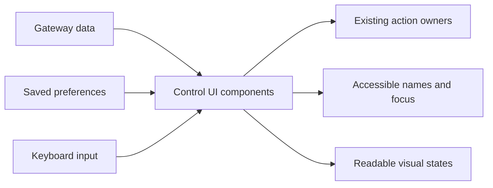

Codex review: blocked before merge. _Reviewed September 22, 2026, 10:00 PM ET / September 23, 2026, 02:00 UTC (Revision 4)._

# ClawSweeper review

## What this changes

The PR repairs Control UI keyboard navigation, accessible names and announcements, focus recovery, and contrast, with corresponding tests and documentation.

## Merge readiness

⛔ **Blocked before merge - 2 items remain**

The accessibility repairs remain useful, and no blocking introduced defect was found. The earlier compatibility warning is resolved: the complete diff preserves configuration defaults, stored formats, and Gateway contracts.

**Priority:** P2
**Reviewed head:** `f9cde668c37ea8340d3296ba90211a71ec4f439c`

## Review scores

| Measure | Result | What it means |
|---|---|---|
| **Overall readiness** | 🐚 platinum hermit **(4/6)** | Useful, coherent accessibility repairs with inspected visual evidence, focused regression coverage, and no identified blocking defect. |
| **Proof confidence** | 🐚 platinum hermit **(4/6)** ✨ media proof bonus | Sufficient (screenshot): Inspected before/after browser screenshots show the new sidebar reorder control and improved session-label contrast in the synthetic Control UI setup. Recorded Chromium accessibility-tree and keyboard checks supplement those visible results; screenshots alone are not treated as screen-reader certification. No stored-data contract changes require migration proof. |
| **Patch quality** | 🐚 platinum hermit **(4/6)** | No actionable review findings were identified. |

## Verification

| Check | Result | Evidence |
|---|---|---|
| **Real behavior** | Verified | Sufficient (screenshot): Inspected before/after browser screenshots show the new sidebar reorder control and improved session-label contrast in the synthetic Control UI setup. Recorded Chromium accessibility-tree and keyboard checks supplement those visible results; screenshots alone are not treated as screen-reader certification. No stored-data contract changes require migration proof. |
| **Evidence reviewed** | 9 items | Complete introduced scope: Inspected the pinned merge-base-to-head inventory and production hunks, rather than treating base-branch drift or the truncated GitHub inventory as PR changes. The scope consists of UI implementation, tests, styles, English copy, documentation, and shrinking lint baselines. Final correction preserves regression assertions: GitHub's exact commit patch moves placeTrigger.click() before reading the visible From control. The empty value, Loading placeholder, retained feature-choice value after the delayed response, and final sessions.create assertions remain intact. Local comparison encountered an unavailable prior blob; the read-only commit API supplied the exact patch. Existing ordering and authorization owners retained: Keyboard ordering calls the existing sidebar-order callback and section mutation operation. The section owner still checks the current mutation scope and operator.write access before groupsPut; the patch changes neither serialized order structures nor that authorization path. |
| **Findings** | None | None. |
| **Security** | None | None. |

## How this fits together

The Control UI turns Gateway data and user preferences into browser controls for chats, sessions, and settings. These changes improve how those controls accept keyboard input and expose their state to assistive technology.

## Before merge

- [ ] **Review config compatibility** - Confirm compatibility and upgrade impact for the changed config or default surface before merge.
- [ ] **Add data-model compatibility proof** - Confirm migration or upgrade compatibility proof before merge.

<strong>Agent review details</strong>

### Security

None.

### PR surface

PR surface statistics unavailable: the file list is incomplete.

### Review metrics

| Metric | Value | Why it matters |
|---|---|---|
| **UI production versus tests** | Production net +766 lines; tests and test support net +878 lines | Production growth adds keyboard and accessibility behavior, with renderer extractions explained by existing file-size limits. |
| **Persistent contract changes** | 0 new configuration keys; 0 stored-format migrations | The settings and ordering changes reuse existing values and owners, resolving the previous inventory-based compatibility warning. |

### Stored data model

Persistent data-model change detected: `unknown-truncated-pull-files`. Confirm migration or upgrade compatibility proof before merge.

### Technical review

Best possible solution:

Keep accessibility behavior in the existing UI components while retaining their shared settings, persistence, and mutation owners.

Do we have a high-confidence way to reproduce the issue?

Yes, source inspection identifies missing keyboard paths and accessible semantics, with focused regression scenarios supplied in the PR; this review did not execute them.

Is this the best way to solve the issue?

Yes, the patch extends existing component and mutation owners, and the final fixture correction restores the necessary visible-popover precondition without weakening assertions.

AGENTS.md: found and applied where relevant.

Codex review notes: model internal, reasoning medium; reviewed against [0ad150c12cbd](https://github.com/openclaw/openclaw/commit/0ad150c12cbd442a6dd79f9f5ee7fc87675eecc4).

### Labels

Label changes:

No label changes.

Label justifications:

- `P2`: This repairs established keyboard and assistive-technology interactions across the Control UI without an identified urgent runtime regression.
- `rating: 🐚 platinum hermit`: Overall readiness is 🐚 platinum hermit; proof is 🐚 platinum hermit and patch quality is 🐚 platinum hermit.
- `status: 👀 ready for maintainer look`: ClawSweeper has no concrete contributor-facing blocker left for this PR. Sufficient (screenshot): Inspected before/after browser screenshots show the new sidebar reorder control and improved session-label contrast in the synthetic Control UI setup. Recorded Chromium accessibility-tree and keyboard checks supplement those visible results; screenshots alone are not treated as screen-reader certification. No stored-data contract changes require migration proof.
- `proof: sufficient`: Contributor real behavior proof is sufficient. Inspected before/after browser screenshots show the new sidebar reorder control and improved session-label contrast in the synthetic Control UI setup. Recorded Chromium accessibility-tree and keyboard checks supplement those visible results; screenshots alone are not treated as screen-reader certification. No stored-data contract changes require migration proof.
- `proof: 📸 screenshot`: Contributor real behavior proof includes screenshot evidence. Inspected before/after browser screenshots show the new sidebar reorder control and improved session-label contrast in the synthetic Control UI setup. Recorded Chromium accessibility-tree and keyboard checks supplement those visible results; screenshots alone are not treated as screen-reader certification. No stored-data contract changes require migration proof.

### Evidence

What I checked:

- **Complete introduced scope:** Inspected the pinned merge-base-to-head inventory and production hunks, rather than treating base-branch drift or the truncated GitHub inventory as PR changes. The scope consists of UI implementation, tests, styles, English copy, documentation, and shrinking lint baselines. ([f9cde668c37e](https://github.com/openclaw/openclaw/commit/f9cde668c37ea8340d3296ba90211a71ec4f439c))
- **Final correction preserves regression assertions:** GitHub's exact commit patch moves placeTrigger.click() before reading the visible From control. The empty value, Loading placeholder, retained feature-choice value after the delayed response, and final sessions.create assertions remain intact. Local comparison encountered an unavailable prior blob; the read-only commit API supplied the exact patch. ([`ui/src/e2e/new-session-page.catalog-reconnect.e2e.test.ts:904`](https://github.com/openclaw/openclaw/blob/f9cde668c37ea8340d3296ba90211a71ec4f439c/ui/src/e2e/new-session-page.catalog-reconnect.e2e.test.ts#L904), [f9cde668c37e](https://github.com/openclaw/openclaw/commit/f9cde668c37ea8340d3296ba90211a71ec4f439c))
- **Existing ordering and authorization owners retained:** Keyboard ordering calls the existing sidebar-order callback and section mutation operation. The section owner still checks the current mutation scope and operator.write access before groupsPut; the patch changes neither serialized order structures nor that authorization path. ([`ui/src/components/session-organizer-catalog.ts:162`](https://github.com/openclaw/openclaw/blob/f9cde668c37ea8340d3296ba90211a71ec4f439c/ui/src/components/session-organizer-catalog.ts#L162), [f9cde668c37e](https://github.com/openclaw/openclaw/commit/f9cde668c37ea8340d3296ba90211a71ec4f439c))
- **Settings compatibility:** Provider-default changes relocate help and label the existing controls; scalar-form changes expose existing validation messages. Microphone preferences retain the same values and callbacks. No introduced storage schema, preference key, migration, provider default, or Gateway API change was identified. ([`ui/src/pages/model-providers/default-models-view.ts:296`](https://github.com/openclaw/openclaw/blob/f9cde668c37ea8340d3296ba90211a71ec4f439c/ui/src/pages/model-providers/default-models-view.ts#L296), [f9cde668c37e](https://github.com/openclaw/openclaw/commit/f9cde668c37ea8340d3296ba90211a71ec4f439c))
- **Repairs remain absent from fetched main:** Fetched main still only registers the popover without forwarding its accessible name, and session labels still use the original accent color. This supports retaining the PR; no merged replacement was established. ([`ui/src/components/web-awesome-popover.ts:2`](https://github.com/openclaw/openclaw/blob/0ad150c12cbd442a6dd79f9f5ee7fc87675eecc4/ui/src/components/web-awesome-popover.ts#L2), [0ad150c12cbd](https://github.com/openclaw/openclaw/commit/0ad150c12cbd442a6dd79f9f5ee7fc87675eecc4))
- **Inspected visual evidence and recorded validation:** Inspected all four prepared images from the media manifest: two before/after pairs visibly demonstrate the sidebar reorder menu and darker session labels. The captured PR body separately reports Chromium accessibility-tree checks, keyboard flows, an Axe audit, and timed regression runs. These screenshots establish visible results, not manual screen-reader or cross-browser certification. The final comment reports 15 reconnect cases passing in 40.36 seconds; tests were not rerun during this read-only review. ([f9cde668c37e](https://github.com/openclaw/openclaw/commit/f9cde668c37ea8340d3296ba90211a71ec4f439c))

Likely related people:

- **unknown:** The claimed source-line change could not be verified from bounded local history. (role: source history unknown; confidence: low)
- **unknown:** The claimed source-line change could not be verified from bounded local history. (role: source history unknown; confidence: low)

### Rating scale

| Score | Internal tier | Crab rank | Meaning |
|---:|:---:|---|---|
| **6/6** | S | 🦀 challenger crab | Exceptional readiness |
| **5/6** | A | 🦞 diamond lobster | Very strong readiness |
| **4/6** | B | 🐚 platinum hermit | Good normal PR; ordinary maintainer review |
| **3/6** | C | 🦐 gold shrimp | Useful, but confidence is limited |
| **2/6** | D | 🦪 silver shellfish | Proof or implementation needs work |
| **1/6** | F | 🧂 unranked krab | Not merge-ready |
| N/A | NA | 🌊 off-meta tidepool | Rating does not apply |

Overall follows the weaker of proof and patch quality.
Shiny media proof means a screenshot, video, or linked artifact directly shows the changed behavior. Runtime, network, CSP, and security claims still need visible diagnostics.

### Workflow

- ClawSweeper keeps one durable marker-backed review comment per issue or PR.
- Re-runs edit this comment so the latest verdict, findings, and automation markers stay together instead of adding duplicate bot comments.
- A fresh review can be triggered by eligible `@clawsweeper re-review` comments, exact-item GitHub events, scheduled/background review runs, or manual workflow dispatch.
- PR/issue authors and users with repository write access can comment `@clawsweeper re-review` or `@clawsweeper re-run` on an open PR or issue to request a fresh review only.
- Maintainers can also comment `@clawsweeper review` to request a fresh review only.
- Fresh-review commands do not start repair, autofix, rebase, CI repair, or automerge.
- Maintainer-only repair and merge flows require explicit commands such as `@clawsweeper autofix`, `@clawsweeper automerge`, `@clawsweeper fix ci`, or `@clawsweeper address review`.
- Maintainers can comment `@clawsweeper explain` to ask for more context, or `@clawsweeper stop` to stop active automation.

### History

Review history (3 earlier review cycles)

<!-- clawsweeper-review-history v=1 total=3 -->
- reviewed 2026-09-23T01:06:27.908Z sha 6b9169b9616635f4e195403c3c555d73938d2010 :: blocked before merge. :: none
- reviewed 2026-09-23T01:18:35.047Z sha 41afd5233cbceb16defc2243bcc3be3aeedb6656 :: blocked before merge. :: none
- reviewed 2026-09-23T01:51:11.942Z sha 9043e9ad9452b22eb2d420ebad96b9775de11531 :: blocked before merge. :: none

<!-- clawsweeper-verdict:needs-human item=156050 sha=f9cde668c37ea8340d3296ba90211a71ec4f439c confidence=high updated_at=2026-09-23T01:57:15Z reviewed_at=2026-09-23T02:00:41.749Z lease_owner=github-run-35808276403-1 lease_comment_id=5787641944 source_revision=f8a14347b511cede87bf712f285be3eb15e0c1639c7097979c9efc6f08b6d3c8 live_verification=absent -->
<!-- clawsweeper-review-state:blocked item=156050 sha=f9cde668c37ea8340d3296ba90211a71ec4f439c v=1 -->

<!-- clawsweeper-review-version item=156050 reviewed_at=2026-09-23T02:00:41.749Z sha=f9cde668c37ea8340d3296ba90211a71ec4f439c source_revision=f8a14347b511cede87bf712f285be3eb15e0c1639c7097979c9efc6f08b6d3c8 lease_owner=github-run-35808276403-1 lease_comment_id=5787641944 v=1 -->

<!-- clawsweeper-review item=156050 -->