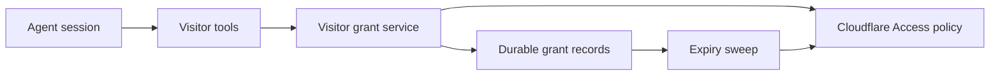

Codex review: found issues before merge. _Reviewed August 28, 2026, 4:22 PM ET / 20:22 UTC._

# ClawSweeper review

## What this changes

This PR adds a bundled internal plugin that lets agent sessions invite, list, revoke, and expire email-based Cloudflare Access visitors.

## Merge readiness

⚠️ **Ready for maintainer review - 6 items remain**

Keep this PR open: the private visitor-plugin direction fits the team deployment, but retargeting its Cloudflare policy configuration can leave expired visitor access active permanently.

**Priority:** P1
**Reviewed head:** `02fab86f887f8841de4149b70344aa549e3dabce`
**Owner decision:** Required. See [Decision needed](#decision-needed).

## Review scores

| Measure | Result | What it means |
|---|---|---|
| **Overall readiness** | 🦐 gold shrimp **(3/6)** | The feature has credible live policy evidence but needs a focused durable-authorization repair before merge. |
| **Proof confidence** | 🦞 diamond lobster **(5/6)** | Not applicable: This maintainer-created PR includes a redacted live Cloudflare policy trace, while the contributor-proof gate does not apply. |
| **Patch quality** | 🦐 gold shrimp **(3/6)** | Security review found an item that needs attention. |

## Verification

| Check | Result | Evidence |
|---|---|---|
| **Real behavior** | Not applicable | Not applicable: This maintainer-created PR includes a redacted live Cloudflare policy trace, while the contributor-proof gate does not apply. |
| **Evidence reviewed** | 6 items | Persistent grant lacks its policy target: The introduced durable grant model records identity and expiry but no account, application, or policy binding. Restart uses only current configuration: Plugin startup constructs its policy client from the currently configured Cloudflare account, application, and policy values. Expiry sweep deletes orphaned cleanup state: After reconciling the current policy, sweep unconditionally deletes expired local grants; after a target change this cannot revoke the old policy grant. |
| **Findings** | 1 actionable finding | [P1] Preserve grants when configuration is retargeted |
| **Security** | Needs attention | Retargeting can leave external access active: A grant record is deleted after a sweep of the newly configured policy even when the email remains granted in the formerly configured policy. |

## How this fits together

Visitor Access turns approved agent tool calls into updates of one Cloudflare Access email policy. Plugin state retains issued grants so later expiry sweeps can revoke external access.

## Decision needed

| Question | Recommendation |
|---|---|
| Should retargeting a Cloudflare Access policy be blocked while this plugin has outstanding visitor grants? | **Require explicit cleanup before retargeting:** Persist the initial target binding and fail closed until grants under that target are revoked or reconciled. |

Why: Changing target identity affects durable external authorization and requires an explicit operator-safe lifecycle rather than a best-effort documentation warning.

## Before merge

- [ ] **Preserve grants when configuration is retargeted (P1)** - `sweep()` deletes every expired local record after updating only the policy selected by current configuration. Because stored grants have no account/application/policy binding, an operator can retarget from policy A to B, sweep an expired record against B, and permanently leave the email granted in A. Persist and validate the original target before cleanup, and fail closed until that target is explicitly reconciled.
- [ ] **Resolve security concern: Retargeting can leave external access active** - A grant record is deleted after a sweep of the newly configured policy even when the email remains granted in the formerly configured policy.
- [ ] **Resolve merge risk (P1)** - Changing the configured Cloudflare account, application, or policy while grants remain can delete the only cleanup record without revoking the original external grant.
- [ ] **Resolve merge risk (P1)** - The changed plugin lacks an end-to-end Gateway-path test proving a sandboxed default visitor session cannot reach the Cloudflare mutation client.
- [ ] **Complete next step (P2)** - A maintainer must choose the operator-safe retarget lifecycle before the focused durable-state repair can be finalized.

## Findings

- [P1] Preserve grants when configuration is retargeted — `extensions/visitor-access/src/visitors.ts:244-270`
- [high] Retargeting can leave external access active — `extensions/visitor-access/src/visitors.ts:268`

<strong>Agent review details</strong>

### Security

Needs attention: The PR can orphan durable cleanup for an external Access grant after policy retargeting.

### PR surface

Source +769, Tests +974, Docs +147, Config +24, Other +13. Total +1927 across 18 files.

View PR surface stats

| Area | Files | Added | Removed | Net |
|---|---:|---:|---:|---:|
| Source | 9 | 769 | 0 | +769 |
| Tests | 4 | 974 | 0 | +974 |
| Docs | 1 | 147 | 0 | +147 |
| Config | 3 | 24 | 0 | +24 |
| Generated | 0 | 0 | 0 | 0 |
| Other | 1 | 13 | 0 | +13 |
| **Total** | **18** | **1927** | **0** | **+1927** |

### Review metrics

| Metric | Value | Why it matters |
|---|---|---|
| **Plugin configuration surface** | 3 required, 3 optional/defaulted | External account, application, credential, policy, expiry, and capacity settings need a safe authorization lifecycle. |
| **Production versus test LOC** | production +793, tests +974, docs +147, lockfile +13 | New feature growth is substantial and should land only with the durable authorization boundary repaired. |

### Stored data model

Persistent data-model change detected: `vector/embedding metadata: extensions/visitor-access/index.ts`. Confirm migration or upgrade compatibility proof before merge.

### Merge-risk options

**Maintainer options:**
1. **Repair durable target ownership (recommended)**  
   Bind existing grants to their original Access policy and retain records whenever the configured target differs.
2. **Pause the plugin**  
   Leave the internal feature unmerged until its authorization lifecycle has a safe retarget path.

### Technical review

Best possible solution:

Keep the visitor manager plugin-local, but bind outstanding grants to one immutable Cloudflare target and refuse retargeting until that target has been explicitly reconciled or revoked.

Do we have a high-confidence way to reproduce the issue?

Yes, from source: invite into target A, retarget configuration to B, then run an expiry sweep; the sweep queries B and deletes the local record while A retains the email grant.

Is this the best way to solve the issue?

No. A README warning and manual revoke instruction do not enforce the durable authorization invariant at the state owner.

Full review comments:

- [P1] Preserve grants when configuration is retargeted — `extensions/visitor-access/src/visitors.ts:244-270`
  `sweep()` deletes every expired local record after updating only the policy selected by current configuration. Because stored grants have no account/application/policy binding, an operator can retarget from policy A to B, sweep an expired record against B, and permanently leave the email granted in A. Persist and validate the original target before cleanup, and fail closed until that target is explicitly reconciled.
  Confidence: 0.99
  Late finding: first raised on code an earlier review cycle already covered.

Overall correctness: patch is incorrect
Overall confidence: 0.99

AGENTS.md: found and applied where relevant.

Codex review notes: model internal, reasoning high; reviewed against [c417dcf392bf](https://github.com/openclaw/openclaw/commit/c417dcf392bff2172d219f792430952909b53db0).

### Labels

Label changes:

- add `P1`: The introduced lifecycle can leave an expired visitor with active external Access authorization.
- add `merge-risk: 🚨 compatibility`: An operator configuration retarget can silently invalidate the plugin's ability to clean up pre-existing grants.
- add `rating: 🦐 gold shrimp`: Overall readiness is 🦐 gold shrimp; proof is 🦞 diamond lobster and patch quality is 🦐 gold shrimp.
- add `status: ⏳ waiting on author`: ClawSweeper has contributor-facing work open and is waiting for author action. Not applicable: This maintainer-created PR includes a redacted live Cloudflare policy trace, while the contributor-proof gate does not apply.
- remove `P2`: Current review triage priority is P1, so this older priority label is no longer current.
- remove `rating: 🐚 platinum hermit`: Current PR rating is `rating: 🦐 gold shrimp`, so this older rating label is no longer current.
- remove `status: 👀 ready for maintainer look`: Current PR status label is `status: ⏳ waiting on author`.

Label justifications:

- `P1`: The introduced lifecycle can leave an expired visitor with active external Access authorization.
- `merge-risk: 🚨 compatibility`: An operator configuration retarget can silently invalidate the plugin's ability to clean up pre-existing grants.
- `merge-risk: 🚨 security-boundary`: The defect can preserve external access beyond the recorded grant expiry.
- `rating: 🦐 gold shrimp`: Overall readiness is 🦐 gold shrimp; proof is 🦞 diamond lobster and patch quality is 🦐 gold shrimp.
- `status: ⏳ waiting on author`: ClawSweeper has contributor-facing work open and is waiting for author action. Not applicable: This maintainer-created PR includes a redacted live Cloudflare policy trace, while the contributor-proof gate does not apply.

### Evidence

Security concerns:

- [high] Retargeting can leave external access active — `extensions/visitor-access/src/visitors.ts:268`
  A grant record is deleted after a sweep of the newly configured policy even when the email remains granted in the formerly configured policy.
  Confidence: 0.99

What I checked:

- **Persistent grant lacks its policy target:** The introduced durable grant model records identity and expiry but no account, application, or policy binding. ([`extensions/visitor-access/src/visitors.ts:7`](https://github.com/openclaw/openclaw/blob/02fab86f887f/extensions/visitor-access/src/visitors.ts#L7), [02fab86f887f](https://github.com/openclaw/openclaw/commit/02fab86f887f))
- **Restart uses only current configuration:** Plugin startup constructs its policy client from the currently configured Cloudflare account, application, and policy values. ([`extensions/visitor-access/index.ts:19`](https://github.com/openclaw/openclaw/blob/02fab86f887f/extensions/visitor-access/index.ts#L19), [02fab86f887f](https://github.com/openclaw/openclaw/commit/02fab86f887f))
- **Expiry sweep deletes orphaned cleanup state:** After reconciling the current policy, sweep unconditionally deletes expired local grants; after a target change this cannot revoke the old policy grant. ([`extensions/visitor-access/src/visitors.ts:268`](https://github.com/openclaw/openclaw/blob/02fab86f887f/extensions/visitor-access/src/visitors.ts#L268), [02fab86f887f](https://github.com/openclaw/openclaw/commit/02fab86f887f))
- **Documentation acknowledges the unsafe transition:** The README warns that retargeting while grants exist can leave the prior policy granting access, but this is not enforced by the durable-state owner. ([`extensions/visitor-access/README.md:38`](https://github.com/openclaw/openclaw/blob/02fab86f887f/extensions/visitor-access/README.md#L38), [02fab86f887f](https://github.com/openclaw/openclaw/commit/02fab86f887f))
- **Main-only status:** The plugin does not exist at fetched current main, so its implementation is not already available there. ([`extensions/visitor-access/index.ts:1`](https://github.com/openclaw/openclaw/blob/c417dcf392bf/extensions/visitor-access/index.ts#L1), [c417dcf392bf](https://github.com/openclaw/openclaw/commit/c417dcf392bf))
- **Dependency boundary:** The plugin directly calls the Cloudflare Access REST API through fetch; upstream documentation could not be inspected because DNS resolution was unavailable. ([`extensions/visitor-access/src/cloudflare.ts:45`](https://github.com/openclaw/openclaw/blob/02fab86f887f/extensions/visitor-access/src/cloudflare.ts#L45), [02fab86f887f](https://github.com/openclaw/openclaw/commit/02fab86f887f))

Likely related people:

- **steipete:** Authored the visitor-access implementation and recent work governing its plugin and sandbox availability. (role: feature and adjacent runtime contributor; confidence: high; commits: [18e0d85501d3](https://github.com/openclaw/openclaw/commit/18e0d85501d3a7ca5fd27a337c47580ea8ee049e), [d90267b71dc4](https://github.com/openclaw/openclaw/commit/d90267b71dc4c0e8623d24ab9c94608ba720e8e0); files: `extensions/visitor-access/index.ts`, `extensions/visitor-access/src/visitors.ts`, `src/agents/sandbox/tool-policy.ts`)

### Rank-up moves

Optional improvements that raise the rating; they are not merge blockers.

- Bind grants to their original target and add a retarget-before-expiry regression.
- Add a Gateway-path test proving the nearest sandboxed unauthorized session cannot reach Cloudflare mutation I/O.

### Rating scale

| Score | Internal tier | Crab rank | Meaning |
|---:|:---:|---|---|
| **6/6** | S | 🦀 challenger crab | Exceptional readiness |
| **5/6** | A | 🦞 diamond lobster | Very strong readiness |
| **4/6** | B | 🐚 platinum hermit | Good normal PR; ordinary maintainer review |
| **3/6** | C | 🦐 gold shrimp | Useful, but confidence is limited |
| **2/6** | D | 🦪 silver shellfish | Proof or implementation needs work |
| **1/6** | F | 🧂 unranked krab | Not merge-ready |
| N/A | NA | 🌊 off-meta tidepool | Rating does not apply |

Overall follows the weaker of proof and patch quality.
Shiny media proof means a screenshot, video, or linked artifact directly shows the changed behavior. Runtime, network, CSP, and security claims still need visible diagnostics.

### Workflow

- ClawSweeper keeps one durable marker-backed review comment per issue or PR.
- Re-runs edit this comment so the latest verdict, findings, and automation markers stay together instead of adding duplicate bot comments.
- A fresh review can be triggered by eligible `@clawsweeper re-review` comments, exact-item GitHub events, scheduled/background review runs, or manual workflow dispatch.
- PR/issue authors and users with repository write access can comment `@clawsweeper re-review` or `@clawsweeper re-run` on an open PR or issue to request a fresh review only.
- Maintainers can also comment `@clawsweeper review` to request a fresh review only.
- Fresh-review commands do not start repair, autofix, rebase, CI repair, or automerge.
- Maintainer-only repair and merge flows require explicit commands such as `@clawsweeper autofix`, `@clawsweeper automerge`, `@clawsweeper fix ci`, or `@clawsweeper address review`.
- Maintainers can comment `@clawsweeper explain` to ask for more context, or `@clawsweeper stop` to stop active automation.

### History

Review history (1 earlier review cycle)

<!-- clawsweeper-review-history v=1 total=1 -->
- reviewed 2026-08-28T20:11:45.963Z sha 18e0d85501d3a7ca5fd27a337c47580ea8ee049e :: needs maintainer review before merge. :: none

<!-- clawsweeper-security:security-sensitive item=132073 sha=02fab86f887f8841de4149b70344aa549e3dabce confidence=high updated_at=2026-08-28T20:18:08Z reviewed_at=2026-08-28T20:22:54.886Z lease_owner=github-run-33207470920-1 lease_comment_id=5457338156 source_revision=25e9adf354d57e062e6ed62a0842fe4b1f29a50e5e933c911a14e0730d635bb1 live_verification=absent -->
<!-- clawsweeper-verdict:needs-human item=132073 sha=02fab86f887f8841de4149b70344aa549e3dabce confidence=high updated_at=2026-08-28T20:18:08Z reviewed_at=2026-08-28T20:22:54.886Z lease_owner=github-run-33207470920-1 lease_comment_id=5457338156 source_revision=25e9adf354d57e062e6ed62a0842fe4b1f29a50e5e933c911a14e0730d635bb1 live_verification=absent -->

<!-- clawsweeper-review-version item=132073 reviewed_at=2026-08-28T20:22:54.886Z sha=02fab86f887f8841de4149b70344aa549e3dabce source_revision=25e9adf354d57e062e6ed62a0842fe4b1f29a50e5e933c911a14e0730d635bb1 lease_owner=github-run-33207470920-1 lease_comment_id=5457338156 v=1 -->

<!-- clawsweeper-review item=132073 -->