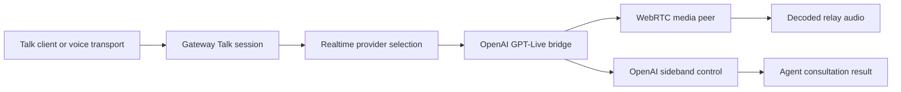

Codex review: needs maintainer review before merge. _Reviewed July 29, 2026, 12:17 PM ET / 16:17 UTC._

# ClawSweeper review

## What this changes

This PR adds a Gateway-owned WebRTC relay for OpenAI GPT-Live, with media conversion, agent consultation support, provider and Gateway routing updates, documentation, tests, and plugin-local media dependencies.

## Merge readiness

⚠️ **Needs maintainer review before merge - 4 items remain**

Keep this maintainer-labeled PR open for explicit compatibility and security-boundary review. The supplied live OAuth proof is strong and no concrete patch defect is established here, but the new Gateway WebRTC path expands the realtime plugin contract and introduces a network-facing dependency chain that needs an owner decision before merge.

**Priority:** P2
**Reviewed head:** `dfd6f605b2ea4402c4daf8249902936b15265dd6`
**Owner decision:** Required. See [Decision needed](#decision-needed).

## Review scores

| Measure | Result | What it means |
|---|---|---|
| **Overall readiness** | 🦐 gold shrimp **(3/6)** | The stated live proof is strong, but merge readiness remains limited by the security-boundary and shared plugin-contract decisions. |
| **Proof confidence** | 🦞 diamond lobster **(5/6)** | Sufficient (live_output): The PR body provides after-fix live OAuth Gateway-peer output: a real `/v1/live` call, sideband startup, and non-empty decoded inbound RTP PCM. |
| **Patch quality** | 🦐 gold shrimp **(3/6)** | Security review found an item that needs attention. |

## Verification

| Check | Result | Evidence |
|---|---|---|
| **Real behavior** | Verified | Sufficient (live_output): The PR body provides after-fix live OAuth Gateway-peer output: a real `/v1/live` call, sideband startup, and non-empty decoded inbound RTP PCM. |
| **Evidence reviewed** | 4 items | After-fix live behavior proof: The PR body reports a live OAuth Gateway-peer run that created a real `/v1/live` call, applied the answer, joined the sideband, observed `session.started`, and received non-empty decoded inbound RTP PCM. Compatibility-sensitive SDK and relay changes: The proposed branch adds the reusable `RealtimeVoiceAgentConsultRunner` type plus optional `agentId` and `runAgentConsult` bridge-request fields, and introduces a distinct `gateway-relay` provider-selection surface. Network dependency review surface: The OpenAI plugin adds `werift` and `libopus-wasm`; the workspace also adds a scoped `werift-ice` override to substitute `neoip` for the vulnerable `ip` helper. The supplied Socket discussion still flags the transitive `@noble/hashes@1.8.0` package for review. |
| **Findings** | None | None. |
| **Security** | Needs attention | Review the new media dependency chain: The OpenAI plugin adds `werift` and `libopus-wasm`; the supplied dependency review also records a Socket warning for transitive `@noble/hashes@1.8.0`. The `neoip` override addresses a separate vulnerable `ip` dependency and does not settle that alert. |

## How this fits together

OpenClaw Talk selects a configured realtime voice provider for browser sessions or Gateway-owned relay sessions. This change lets the OpenAI plugin create a GPT-Live WebRTC peer for the Gateway relay, returning decoded audio to the relay and forwarding agent-control events through the shared voice contract.

## Decision needed

| Question | Recommendation |
|---|---|
| Should OpenClaw accept the new `werift`-based WebRTC dependency chain, including the remaining Socket alert, for the ChatGPT OAuth Gateway relay path? | **Accept with recorded dependency review:** Approve the plugin-local media dependencies after reviewing the resolved package tree and documenting acceptance of the remaining transitive-package alert. |

Why: This is a network-facing media and OAuth boundary. The PR documents live behavior and a scoped replacement for a separate vulnerable helper, but an explicit maintainer decision is still needed for the newly introduced dependency chain and alert.

## Before merge

- [ ] **Resolve security concern: Review the new media dependency chain** - The OpenAI plugin adds `werift` and `libopus-wasm`; the supplied dependency review also records a Socket warning for transitive `@noble/hashes@1.8.0`. The `neoip` override addresses a separate vulnerable `ip` dependency and does not settle that alert.
- [ ] **Resolve merge risk (P1)** - Merging adds a network-facing WebRTC and Opus dependency chain to the OpenAI plugin; Socket’s transitive `@noble/hashes@1.8.0` alert requires an explicit maintainer acceptance or remediation decision.
- [ ] **Resolve merge risk (P1)** - The new optional realtime-voice bridge fields and `gateway-relay` resolution path affect the provider contract and can create compatibility drift for existing or external providers if not deliberately accepted.

## Findings

- [medium] Review the new media dependency chain — `extensions/openai/package.json:8`

<strong>Agent review details</strong>

### Security

Needs attention: The PR adds a network-facing WebRTC/Opus dependency chain and routes OAuth-backed media through the Gateway; the remaining Socket alert needs an explicit maintainer decision.

### PR surface

Source +1335, Tests +1370, Docs +22, Config +3, Other +459. Total +3189 across 32 files.

View PR surface stats

| Area | Files | Added | Removed | Net |
|---|---:|---:|---:|---:|
| Source | 18 | 1407 | 72 | +1335 |
| Tests | 9 | 1380 | 10 | +1370 |
| Docs | 2 | 87 | 65 | +22 |
| Config | 2 | 3 | 0 | +3 |
| Generated | 0 | 0 | 0 | 0 |
| Other | 1 | 459 | 0 | +459 |
| **Total** | **32** | **3336** | **147** | **+3189** |

### Review metrics

| Metric | Value | Why it matters |
|---|---|---|
| **Realtime plugin API** | 1 named type exported; 2 optional bridge-request fields added | The change expands the shared contract between the Gateway and realtime voice providers. |
| **Plugin dependency surface** | 2 direct media dependencies added; 1 scoped transitive override added | The feature introduces a network-facing media stack and lockfile-level dependency policy change. |

### Merge-risk options

**Maintainer options:**
1. **Complete dependency acceptance (recommended)**  
   Review the resolved `werift` dependency tree and Socket alert, then record an explicit approval before merging the OAuth WebRTC relay.
2. **Defer the OAuth WebRTC path**  
   Keep the existing backend-WebSocket GPT-Live support and pause this relay path until the dependency boundary is acceptable.

### Technical review

Best possible solution:

Retain the plugin-owned Gateway relay design, but merge only after the relevant owner explicitly accepts the resolved media dependency chain and confirms the expanded realtime-voice contract is the intended public plugin API.

Do we have a high-confidence way to reproduce the issue?

Not applicable: this PR adds a new Gateway relay capability rather than repairing a current-main bug. The supplied PR body includes an after-fix live OAuth run that exercises the new media path.

Is this the best way to solve the issue?

Unclear: the plugin-owned implementation fits the stated boundary, but the best path cannot be confirmed without completing the required dependency and plugin-contract review.

AGENTS.md: unclear because the file could not be read completely.

Codex review notes: model internal, reasoning high; reviewed against [b4d14d784806](https://github.com/openclaw/openclaw/commit/b4d14d78480650860423964b4b450e8a3f878150).

### Labels

Label justifications:

- `P2`: This is a substantial optional realtime voice capability with bounded impact rather than a demonstrated default-path outage.
- `merge-risk: 🚨 compatibility`: The PR changes the realtime voice SDK request contract and adds Gateway relay-specific provider selection behavior.
- `merge-risk: 🚨 security-boundary`: The PR adds a WebRTC media runtime and carries ChatGPT OAuth traffic through a Gateway-owned relay.
- `rating: 🦐 gold shrimp`: Overall readiness is 🦐 gold shrimp; proof is 🦞 diamond lobster and patch quality is 🦐 gold shrimp.
- `status: ⏳ waiting on author`: ClawSweeper has contributor-facing work open and is waiting for author action. Sufficient (live_output): The PR body provides after-fix live OAuth Gateway-peer output: a real `/v1/live` call, sideband startup, and non-empty decoded inbound RTP PCM.
- `proof: sufficient`: Contributor real behavior proof is sufficient. The PR body provides after-fix live OAuth Gateway-peer output: a real `/v1/live` call, sideband startup, and non-empty decoded inbound RTP PCM.

### Evidence

Security concerns:

- [medium] Review the new media dependency chain — `extensions/openai/package.json:8`
  The OpenAI plugin adds `werift` and `libopus-wasm`; the supplied dependency review also records a Socket warning for transitive `@noble/hashes@1.8.0`. The `neoip` override addresses a separate vulnerable `ip` dependency and does not settle that alert.
  Confidence: 0.94

What I checked:

- **After-fix live behavior proof:** The PR body reports a live OAuth Gateway-peer run that created a real `/v1/live` call, applied the answer, joined the sideband, observed `session.started`, and received non-empty decoded inbound RTP PCM. ([`extensions/openai/realtime-quicksilver-gateway-bridge.live.test.ts:1`](https://github.com/openclaw/openclaw/blob/dfd6f605b2ea/extensions/openai/realtime-quicksilver-gateway-bridge.live.test.ts#L1), [dfd6f605b2ea](https://github.com/openclaw/openclaw/commit/dfd6f605b2ea))
- **Compatibility-sensitive SDK and relay changes:** The proposed branch adds the reusable `RealtimeVoiceAgentConsultRunner` type plus optional `agentId` and `runAgentConsult` bridge-request fields, and introduces a distinct `gateway-relay` provider-selection surface. ([`src/talk/provider-types.ts:106`](https://github.com/openclaw/openclaw/blob/dfd6f605b2ea/src/talk/provider-types.ts#L106), [dfd6f605b2ea](https://github.com/openclaw/openclaw/commit/dfd6f605b2ea))
- **Network dependency review surface:** The OpenAI plugin adds `werift` and `libopus-wasm`; the workspace also adds a scoped `werift-ice` override to substitute `neoip` for the vulnerable `ip` helper. The supplied Socket discussion still flags the transitive `@noble/hashes@1.8.0` package for review. ([`extensions/openai/package.json:8`](https://github.com/openclaw/openclaw/blob/dfd6f605b2ea/extensions/openai/package.json#L8), [dfd6f605b2ea](https://github.com/openclaw/openclaw/commit/dfd6f605b2ea))
- **Related implementation already merged:** The related backend-WebSocket GPT-Live implementation merged as a distinct Platform-key transport. It shares the provider area but does not provide this PR’s ChatGPT OAuth WebRTC Gateway relay path. ([`extensions/openai/realtime-voice-provider.ts:1`](https://github.com/openclaw/openclaw/blob/744136201491/extensions/openai/realtime-voice-provider.ts#L1), [744136201491](https://github.com/openclaw/openclaw/commit/744136201491))

Likely related people:

- **steipete:** The supplied history shows steipete authored this PR and the related merged GPT-Live backend-WebSocket implementation, making them the clearest routing candidate for the OpenAI realtime relay design. (role: feature owner and recent area contributor; confidence: high; commits: [d57361f6071e](https://github.com/openclaw/openclaw/commit/d57361f6071eae3d913cc88d57eee34fff37b1bf), [8322fe88fbd7](https://github.com/openclaw/openclaw/commit/8322fe88fbd72132733e8f7030462c85a1194ab3), [744136201491](https://github.com/openclaw/openclaw/commit/744136201491dbf0943b71e9aaa05e5226b4c248); files: `extensions/openai/realtime-voice-provider.ts`, `extensions/openai/realtime-quicksilver-gateway-bridge.ts`, `src/gateway/talk-realtime-relay-session-create.ts`)

### Rank-up moves

Optional improvements that raise the rating; they are not merge blockers.

- Record maintainer acceptance or remediation for the resolved `werift` dependency tree and Socket alert.
- Confirm that the added realtime voice bridge contract is the intended compatibility commitment for providers.

### Rating scale

| Score | Internal tier | Crab rank | Meaning |
|---:|:---:|---|---|
| **6/6** | S | 🦀 challenger crab | Exceptional readiness |
| **5/6** | A | 🦞 diamond lobster | Very strong readiness |
| **4/6** | B | 🐚 platinum hermit | Good normal PR; ordinary maintainer review |
| **3/6** | C | 🦐 gold shrimp | Useful, but confidence is limited |
| **2/6** | D | 🦪 silver shellfish | Proof or implementation needs work |
| **1/6** | F | 🧂 unranked krab | Not merge-ready |
| N/A | NA | 🌊 off-meta tidepool | Rating does not apply |

Overall follows the weaker of proof and patch quality.
Shiny media proof means a screenshot, video, or linked artifact directly shows the changed behavior. Runtime, network, CSP, and security claims still need visible diagnostics.

### Workflow

- ClawSweeper keeps one durable marker-backed review comment per issue or PR.
- Re-runs edit this comment so the latest verdict, findings, and automation markers stay together instead of adding duplicate bot comments.
- A fresh review can be triggered by eligible `@clawsweeper re-review` comments, exact-item GitHub events, scheduled/background review runs, or manual workflow dispatch.
- PR/issue authors and users with repository write access can comment `@clawsweeper re-review` or `@clawsweeper re-run` on an open PR or issue to request a fresh review only.
- Maintainers can also comment `@clawsweeper review` to request a fresh review only.
- Fresh-review commands do not start repair, autofix, rebase, CI repair, or automerge.
- Maintainer-only repair and merge flows require explicit commands such as `@clawsweeper autofix`, `@clawsweeper automerge`, `@clawsweeper fix ci`, or `@clawsweeper address review`.
- Maintainers can comment `@clawsweeper explain` to ask for more context, or `@clawsweeper stop` to stop active automation.

### History

Review history (5 earlier review cycles)

<!-- clawsweeper-review-history v=1 total=5 -->
- reviewed 2026-07-29T13:06:01.758Z sha c4afeef282471492fad3d30374f0e0cbfa7a4105 :: needs maintainer review before merge. :: none
- reviewed 2026-07-29T13:22:18.761Z sha 3a21c6e2dab2e67f85659097b673c1a91f8a3fa8 :: needs maintainer review before merge. :: none
- reviewed 2026-07-29T14:14:34.245Z sha 37c91d9e9c5d3868d73ac6a7a014c9cdf3523205 :: needs maintainer review before merge. :: none
- reviewed 2026-07-29T14:54:21.978Z sha 6348c451e46c7a1fa6de865287b8d67595456e46 :: needs maintainer review before merge. :: none
- reviewed 2026-07-29T16:10:16.863Z sha 8322fe88fbd72132733e8f7030462c85a1194ab3 :: needs maintainer review before merge. :: none

<!-- clawsweeper-security:security-sensitive item=115831 sha=dfd6f605b2ea4402c4daf8249902936b15265dd6 confidence=medium updated_at=2026-07-29T16:16:33Z reviewed_at=2026-07-29T16:17:59.683Z lease_owner=github-run-30469866638-1 lease_comment_id=5120518420 source_revision=bc965e3fa0a54765714e2dc1a60eb846046546f8a5a56d616d1464ce590cd073 -->
<!-- clawsweeper-verdict:needs-human item=115831 sha=dfd6f605b2ea4402c4daf8249902936b15265dd6 confidence=medium updated_at=2026-07-29T16:16:33Z reviewed_at=2026-07-29T16:17:59.683Z lease_owner=github-run-30469866638-1 lease_comment_id=5120518420 source_revision=bc965e3fa0a54765714e2dc1a60eb846046546f8a5a56d616d1464ce590cd073 -->

<!-- clawsweeper-review-version item=115831 reviewed_at=2026-07-29T16:17:59.683Z sha=dfd6f605b2ea4402c4daf8249902936b15265dd6 source_revision=bc965e3fa0a54765714e2dc1a60eb846046546f8a5a56d616d1464ce590cd073 lease_owner=github-run-30469866638-1 lease_comment_id=5120518420 v=1 -->

<!-- clawsweeper-review item=115831 -->