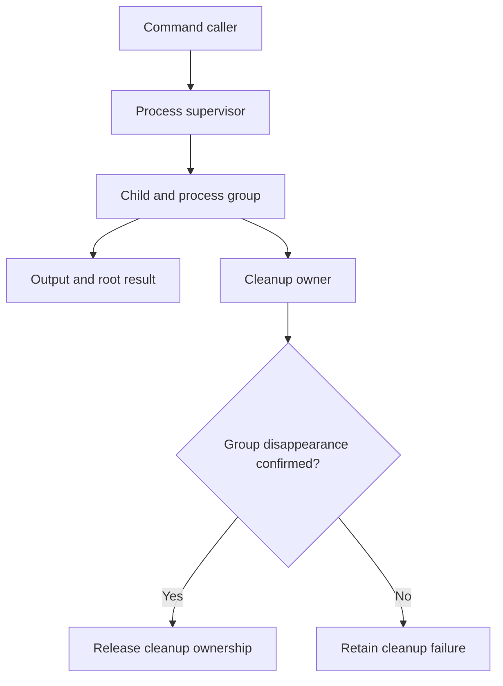

Codex review: blocked before merge. _Reviewed September 5, 2026, 8:25 PM ET / September 6, 2026, 00:25 UTC._

# ClawSweeper review

## What this changes

The PR separates command results from confirmed process cleanup, retains cleanup failures, preserves output drainage, and gives local TUI shell commands an explicit cleanup owner.

## Merge readiness

⛔ **Blocked before merge - 3 items remain**

This remains a useful fix: pinned main and the latest release lack the new cleanup confirmation. No actionable introduced defect was found. The maintainer has explicitly accepted conservative shutdown failure reporting, so the previous concern does not require another decision.

**Priority:** P2
**Reviewed head:** `6c39158b3dd1eefeea5f7733f6290dd33833041a`

## Review scores

| Measure | Result | What it means |
|---|---|---|
| **Overall readiness** | 🐚 platinum hermit **(4/6)** | A coherent owner-level repair with meaningful regression coverage, no actionable findings, and an explicitly accepted compatibility tradeoff. |
| **Proof confidence** | 🌊 off-meta tidepool | Not applicable: The ordinary contributor-proof gate is exempt for this MEMBER-authored PR. Reported macOS process-suite runs exercise the changed cleanup owner, but were not independently rerun; native Windows execution is explicitly deferred. |
| **Patch quality** | 🐚 platinum hermit **(4/6)** | No actionable review findings were identified. |

## Verification

| Check | Result | Evidence |
|---|---|---|
| **Real behavior** | Not applicable | Not applicable: The ordinary contributor-proof gate is exempt for this MEMBER-authored PR. Reported macOS process-suite runs exercise the changed cleanup owner, but were not independently rerun; native Windows execution is explicitly deferred. |
| **Evidence reviewed** | 9 items | Current main still lacks group-disappearance confirmation: The main relay resolves extinction from a closing receipt without the added kernel process-group probe. Main’s only change since the pinned merge base is in diagnostics-prometheus, outside this PR’s introduced paths. Latest-release comparison: The same receipt-only extinction path is present in v2026.9.2; the central repair is not already supplied by that release. Independent result and cleanup settlement: The relay preserves an observed root result while drainage completes, and confirms POSIX extinction only after a closing receipt and ESRCH from a signal-zero group probe. Other probe failures retain uncertainty. |
| **Findings** | None | None. |
| **Security** | None | None. |

## How this fits together

OpenClaw’s process supervisor launches commands for agents, Gateway services, and the terminal interface. It returns command output and exit status while separately tracking whether owned processes have actually stopped.

## Before merge

- [ ] **Resolve merge risk (P1)** - Commands requiring forced termination can leave shutdown reporting cleanup failure even after the root exits; the PR body explicitly accepts this operator-visible compatibility tradeoff.
- [ ] **Resolve merge risk (P2)** - Native Windows process-start execution remains unverified; the supplied evidence covers its environment and timeout behavior with fixtures.
- [ ] **Add data-model compatibility proof** - Confirm migration or upgrade compatibility proof before merge.

<strong>Agent review details</strong>

### Security

None.

### PR surface

Source +395, Tests +634, Docs +6. Total +1035 across 36 files.

View PR surface stats

| Area | Files | Added | Removed | Net |
|---|---:|---:|---:|---:|
| Source | 14 | 500 | 105 | +395 |
| Tests | 21 | 743 | 109 | +634 |
| Docs | 1 | 6 | 0 | +6 |
| Config | 0 | 0 | 0 | 0 |
| Generated | 0 | 0 | 0 | 0 |
| Other | 0 | 0 | 0 | 0 |
| **Total** | **36** | **1249** | **214** | **+1035** |

### Review metrics

| Metric | Value | Why it matters |
|---|---|---|
| **Production versus test growth** | production +395 net; tests and test support +634 net | Production growth has a stated purpose: native extinction checks, retained cleanup failures, and shared process-event delivery. |

### Stored data model

Persistent data-model change detected: `unknown-data-model-change: src/shared/pid-alive.ts`. Confirm migration or upgrade compatibility proof before merge.

### Merge-risk options

**Maintainer options:**
1. **Retain the accepted cleanup contract (recommended)**  
   Keep conservative shutdown failure reporting and the optional public helper additions as explicitly documented and accepted in the PR body.

### Technical review

Best possible solution:

Retain the existing process owner as the single cleanup boundary, preserving command results and the maintainer-accepted conservative shutdown contract.

Do we have a high-confidence way to reproduce the issue?

Yes, from source: pinned main accepts a closing receipt without checking group disappearance, and the regression cases cover descendants surviving root or descriptor closure. No runtime reproduction was executed in this review.

Is this the best way to solve the issue?

Yes. Extending the existing supervisor and native cleanup owner preserves the established result path while strengthening cleanup evidence; no competing implementation or persisted-data migration is introduced.

AGENTS.md: found and applied where relevant.

Codex review notes: model internal, reasoning medium; reviewed against [61690da40bd4](https://github.com/openclaw/openclaw/commit/61690da40bd436684311adec59d69bae3b0e383d).

### Labels

Label justifications:

- `P2`: This repairs process-cleanup reliability without evidence of a widespread urgent outage.
- `merge-risk: 🚨 compatibility`: Shutdown can newly report failure after forced cleanup, and public process helpers gain optional metadata and arguments; the body explicitly discusses and accepts these changes.
- `rating: 🐚 platinum hermit`: Overall readiness is 🐚 platinum hermit; proof is 🌊 off-meta tidepool and patch quality is 🐚 platinum hermit.
- `status: 👀 ready for maintainer look`: ClawSweeper has no concrete contributor-facing blocker left for this PR. Not applicable: The ordinary contributor-proof gate is exempt for this MEMBER-authored PR. Reported macOS process-suite runs exercise the changed cleanup owner, but were not independently rerun; native Windows execution is explicitly deferred.

### Evidence

What I checked:

- **Current main still lacks group-disappearance confirmation:** The main relay resolves extinction from a closing receipt without the added kernel process-group probe. Main’s only change since the pinned merge base is in diagnostics-prometheus, outside this PR’s introduced paths. ([`src/process/supervisor/service-child-relay-host.ts:297`](https://github.com/openclaw/openclaw/blob/61690da40bd436684311adec59d69bae3b0e383d/src/process/supervisor/service-child-relay-host.ts#L297), [61690da40bd4](https://github.com/openclaw/openclaw/commit/61690da40bd436684311adec59d69bae3b0e383d))
- **Latest-release comparison:** The same receipt-only extinction path is present in v2026.9.2; the central repair is not already supplied by that release. ([`src/process/supervisor/service-child-relay-host.ts`](https://github.com/openclaw/openclaw/blob/3928bad9badfcb6c7d140530435e806fb8092190/src/process/supervisor/service-child-relay-host.ts), [3928bad9badf](https://github.com/openclaw/openclaw/commit/3928bad9badfcb6c7d140530435e806fb8092190))
- **Independent result and cleanup settlement:** The relay preserves an observed root result while drainage completes, and confirms POSIX extinction only after a closing receipt and ESRCH from a signal-zero group probe. Other probe failures retain uncertainty. ([`src/process/supervisor/service-child-relay-host.ts:335`](https://github.com/openclaw/openclaw/blob/6c39158b3dd1eefeea5f7733f6290dd33833041a/src/process/supervisor/service-child-relay-host.ts#L335), [6c39158b3dd1](https://github.com/openclaw/openclaw/commit/6c39158b3dd1eefeea5f7733f6290dd33833041a))
- **Cleanup failure retention:** Acquired scopes retain failures after adapter retirement, legacy joins retain failed owners, and supervisor shutdown preserves the first cleanup failure. TUI closes admission before joining its uniquely named scope. ([`src/process/supervisor/supervisor.ts:185`](https://github.com/openclaw/openclaw/blob/6c39158b3dd1eefeea5f7733f6290dd33833041a/src/process/supervisor/supervisor.ts#L185), [6c39158b3dd1](https://github.com/openclaw/openclaw/commit/6c39158b3dd1eefeea5f7733f6290dd33833041a))
- **Regression coverage at the process boundary:** Introduced cases exercise real descendants that close inherited descriptors, cooperative versus forced cleanup, output backpressure, repeated failed joins, and Linux zombie leaders with live threads. These tests were inspected, not executed during this read-only review. ([`src/process/supervisor/supervisor.anchored-shell.real.test.ts:169`](https://github.com/openclaw/openclaw/blob/6c39158b3dd1eefeea5f7733f6290dd33833041a/src/process/supervisor/supervisor.anchored-shell.real.test.ts#L169), [6c39158b3dd1](https://github.com/openclaw/openclaw/commit/6c39158b3dd1eefeea5f7733f6290dd33833041a))
- **Public helper compatibility and accepted behavior:** The existing plugin process-runtime barrel exposes the affected command and PID helpers. Added result metadata and PID-query arguments are optional. The captured PR body explicitly accepts conservative cleanup reporting and defers native Windows validation; the previous review contained no findings and only that optional rank-up. ([`src/plugin-sdk/process-runtime.ts:4`](https://github.com/openclaw/openclaw/blob/6c39158b3dd1eefeea5f7733f6290dd33833041a/src/plugin-sdk/process-runtime.ts#L4), [6c39158b3dd1](https://github.com/openclaw/openclaw/commit/6c39158b3dd1eefeea5f7733f6290dd33833041a))

Likely related people:

- **steipete:** Suggested for follow-up; no historical authorship or introduction is verified. (role: unverified routing candidate; confidence: low)
- **Josh Avant:** Suggested for follow-up; no historical authorship or introduction is verified. (role: unverified routing candidate; confidence: low)

### Rating scale

| Score | Internal tier | Crab rank | Meaning |
|---:|:---:|---|---|
| **6/6** | S | 🦀 challenger crab | Exceptional readiness |
| **5/6** | A | 🦞 diamond lobster | Very strong readiness |
| **4/6** | B | 🐚 platinum hermit | Good normal PR; ordinary maintainer review |
| **3/6** | C | 🦐 gold shrimp | Useful, but confidence is limited |
| **2/6** | D | 🦪 silver shellfish | Proof or implementation needs work |
| **1/6** | F | 🧂 unranked krab | Not merge-ready |
| N/A | NA | 🌊 off-meta tidepool | Rating does not apply |

Overall follows the weaker of proof and patch quality.
Shiny media proof means a screenshot, video, or linked artifact directly shows the changed behavior. Runtime, network, CSP, and security claims still need visible diagnostics.

### Workflow

- ClawSweeper keeps one durable marker-backed review comment per issue or PR.
- Re-runs edit this comment so the latest verdict, findings, and automation markers stay together instead of adding duplicate bot comments.
- A fresh review can be triggered by eligible `@clawsweeper re-review` comments, exact-item GitHub events, scheduled/background review runs, or manual workflow dispatch.
- PR/issue authors and users with repository write access can comment `@clawsweeper re-review` or `@clawsweeper re-run` on an open PR or issue to request a fresh review only.
- Maintainers can also comment `@clawsweeper review` to request a fresh review only.
- Fresh-review commands do not start repair, autofix, rebase, CI repair, or automerge.
- Maintainer-only repair and merge flows require explicit commands such as `@clawsweeper autofix`, `@clawsweeper automerge`, `@clawsweeper fix ci`, or `@clawsweeper address review`.
- Maintainers can comment `@clawsweeper explain` to ask for more context, or `@clawsweeper stop` to stop active automation.

### History

Review history (2 earlier review cycles)

<!-- clawsweeper-review-history v=1 total=2 -->
- reviewed 2026-09-05T23:46:32.682Z sha 28e1c9676e6d9146a735ad9d8bd32f8bebb24892 :: blocked before merge. :: none
- reviewed 2026-09-06T00:05:39.850Z sha 651a2756a3a86d08f16787e03727131912c76894 :: blocked before merge. :: none

<!-- clawsweeper-verdict:needs-human item=139517 sha=6c39158b3dd1eefeea5f7733f6290dd33833041a confidence=high updated_at=2026-09-06T00:22:45Z reviewed_at=2026-09-06T00:25:48.116Z lease_owner=github-run-34001062313-1 lease_comment_id=5555762255 source_revision=201344b079b4e012a4e47b8248d19a081dd80641e437ce322b0eb2ea6fcd3aae live_verification=absent -->
<!-- clawsweeper-review-state:blocked item=139517 sha=6c39158b3dd1eefeea5f7733f6290dd33833041a v=1 -->

<!-- clawsweeper-review-version item=139517 reviewed_at=2026-09-06T00:25:48.116Z sha=6c39158b3dd1eefeea5f7733f6290dd33833041a source_revision=201344b079b4e012a4e47b8248d19a081dd80641e437ce322b0eb2ea6fcd3aae lease_owner=github-run-34001062313-1 lease_comment_id=5555762255 v=1 -->

<!-- clawsweeper-review item=139517 -->