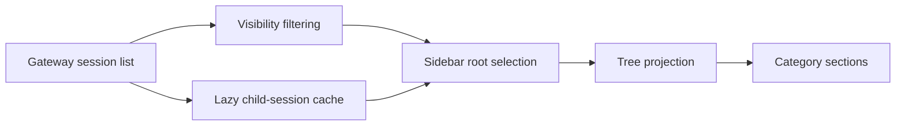

Codex review: needs changes before merge. _Reviewed August 19, 2026, 4:18 PM ET / 20:18 UTC._

# ClawSweeper review

## What this changes

The PR promotes explicitly categorized child sessions into sidebar category roots while keeping uncategorized children nested under their navigation parent.

## Merge readiness

⚠️ **Ready for maintainer review - 5 items remain**

Needs changes: the follow-up fixes direct-list child admission, but categorized children loaded through the sidebar’s child cache still disappear. The patch is otherwise focused; final UI evidence remains advisable before landing.

**Priority:** P1
**Reviewed head:** `f7c97fbf09370a44d072d547124144852ca98470`

## Review scores

| Measure | Result | What it means |
|---|---|---|
| **Overall readiness** | 🦐 gold shrimp **(3/6)** | The patch is focused and has useful harness coverage, but a P1 lazy-cache path remains unhandled. |
| **Proof confidence** | 🌊 off-meta tidepool | Not applicable: This maintainer-authored ClawSweeper PR is not subject to the external-contributor proof gate; repository UI policy still calls for final sanitized Control UI evidence before landing. |
| **Patch quality** | 🦐 gold shrimp **(3/6)** | 1 actionable review finding remain. |

## Verification

| Check | Result | Evidence |
|---|---|---|
| **Real behavior** | Not applicable | Not applicable: This maintainer-authored ClawSweeper PR is not subject to the external-contributor proof gate; repository UI policy still calls for final sanitized Control UI evidence before landing. |
| **Evidence reviewed** | 5 items | Current-main root filtering: Current main derives sidebar roots with the shared visible-row filter, which excludes spawned children from ordinary roots.<br>Cached children are a real runtime input: Expanding a sidebar parent fetches child rows and stores them only in childSessionRowsByParent.<br>PR omits cached rows from admission: The new category-root loop examines only rows, while the later main-child promotion already combines rows with childSessionRowsByParent. |
| **Findings** | 1 actionable finding | [P1] Include cached child rows when promoting category roots |
| **Security** | None | None. |


### Live Verification

**Command:** `pnpm ui:build`

**Result:** PASS (completed)

```text
../dist/control-ui/assets/cypher-7B-pzmVj.js                                          3.31 kB │ gzip:   1.59 kB │ map:     8.52 kB
../dist/control-ui/assets/tiki-CFRPp0lZ.js                                            3.33 kB │ gzip:   1.35 kB │ map:    12.42 kB
../dist/control-ui/assets/src-Dwngm7Hu.js                                             3.36 kB │ gzip:   1.37 kB │ map:   404.45 kB
../dist/control-ui/assets/control-ui-shared-DcW10Hxz.js                               3.36 kB │ gzip:   1.62 kB │ map:    15.34 kB
../dist/control-ui/assets/vhdl-BZddcJrO.js                                            3.42 kB │ gzip:   1.59 kB │ map:     9.62 kB
../dist/control-ui/assets/session-row-badges-CyvD0xaK.js                              3.43 kB │ gzip:   1.39 kB │ map:    10.82 kB
../dist/control-ui/assets/sparql-DyxwoOhd.js                                          3.44 kB │ gzip:   1.68 kB │ map:     9.50 kB
../dist/control-ui/assets/update-confirmation.runtime-CGlUhP68.js                     3.50 kB │ gzip:   1.40 kB │ map:    11.06 kB
../dist/control-ui/assets/grouping-DZ_k6S5u.js                                        3.50 kB │ gzip:   1.48 kB │ map:    16.90 kB
../dist/control-ui/assets/dist-nzjtGiB0.js                                            3.51 kB │ gzip:   1.82 kB │ map:     6.97 kB
../dist/control-ui/assets/catalog-target-DqZim5VD.js                                  3.53 kB │ gzip:   1.44 kB │ map:    11.35 kB
../dist/control-ui/assets/mscgen-B32__qDo.js                                          3.61 kB │ gzip:   1.07 kB │ map:     9.69 kB
../dist/control-ui/assets/exec-approval-BNBN7YMf.js                                   3.67 kB │ gzip:   1.57 kB │ map:    10.40 kB
../dist/control-ui/assets/data-HUO5emU7.js                                            3.71 kB │ gzip:   1.46 kB │ map:    13.90 kB
../dist/control-ui/assets/app-sidebar-workboard.runtime-G6NkeRZh.js                   3.73 kB │ gzip:   1.49 kB │ map:    10.48 kB
../dist/control-ui/assets/dashboards-page-CqmkFtVA.js                                 3.76 kB │ gzip:   1.55 kB │ map:     8.90 kB
../dist/control-ui/assets/d-CHTIqqSE.js                                               3.79 kB │ gzip:   1.78 kB │ map:    10.87 kB
../dist/control-ui/assets/vb-r_8gcpmz.js                                              3.79 kB │ gzip:   1.93 kB │ map:    11.63 kB
../dist/control-ui/assets/q-DgUvnPlH.js                                               3.79 kB │ gzip:   1.77 kB │ map:     9.81 kB
../dist/control-ui/assets/swift-Bj43ctJA.js                                           3.89 kB │ gzip:   1.93 kB │ map:    10.80 kB
../dist/control-ui/assets/session-progress-cards-BXd9PrSe.js                          3.92 kB │ gzip:   1.72 kB │ map:    16.23 kB
../dist/control-ui/assets/heartbeat-display-CWsOin0K.js                               3.93 kB │ gzip:   1.84 kB │ map:    16.66 kB
../dist/control-ui/assets/session-placement-recovery-DQI7Kxq-.js                      3.94 kB │ gzip:   1.54 kB │ map:    19.85 kB
../dist/control-ui/assets/fortran-DZ1KI-Ge.js                                         3.97 kB │ gzip:   2.02 kB │ map:     9.72 kB
../dist/control-ui/assets/coffeescript-B7AjrdCL.js                                    3.98 kB │ gzip:   1.78 kB │ map:    13.74 kB
../dist/control-ui/assets/asn1-B1dG7mN_.js                                            4.06 kB │ gzip:   2.04 kB │ map:    10.99 kB
../dist/control-ui/assets/place-browser-BoUYXzBg.js                                   4.09 kB │ gzip:   1.44 kB │ map:     9.84 kB
../dist/control-ui/assets/dylan-Dgw7ONEs.js                                           4.15 kB │ gzip:   1.72 kB │ map:    13.98 kB
../dist/control-ui/assets/asterisk-Diryl_rN.js                                        4.19 kB │ gzip:   1.83 kB │ map:     9.30 kB
../dist/control-ui/assets/livescript-B5wMXth4.js                                      4.19 kB │ gzip:   1.72 kB │ map:     9.99 kB
../dist/control-ui/assets/ttcn-cfg-CX9fFXmr.js
… output truncated …
```

**Assertions:**

- PASS `expect_output`: built in

## How this fits together

The Control UI sidebar filters gateway session rows, projects their parent/child tree, then groups roots into category sections. Child rows may arrive either in the main session list or through the lazy child-session cache.



## Before merge

- [ ] **Include cached child rows when promoting category roots (P1)** - Expanded parents store fetched children in `childSessionRowsByParent`, but this loop only examines `rows`. Tree projection then deliberately refuses to nest a categorized cached child, so it disappears; include the cache in the admission set and cover that path.
- [ ] **Resolve merge risk (P1)** - A categorized child fetched after its parent expands remains absent because it is cached outside the loop that creates category roots.
- [ ] **Resolve merge risk (P1)** - The bug fix has a production net increase of 47 lines; the added shared scope predicate is useful, but the final repair should avoid a second, divergent child-selection path.
- [ ] **Resolve merge risk (P1)** - No direct before/after Control UI evidence is attached for this user-visible sidebar change.
- [ ] **Complete next step (P2)** - A narrow, source-proven repair can extend the existing category-root admission loop to the lazy child cache.

## Findings

- [P1] Include cached child rows when promoting category roots — `ui/src/components/app-sidebar-session-navigation.ts:660`


<details>
<summary><strong>Agent review details</strong></summary>

### Security

None.

### PR surface

Source +108, Tests +37. Total +145 across 6 files.

<details>
<summary>View PR surface stats</summary>

| Area | Files | Added | Removed | Net |
|---|---:|---:|---:|---:|
| Source | 5 | 123 | 15 | +108 |
| Tests | 1 | 37 | 0 | +37 |
| Docs | 0 | 0 | 0 | 0 |
| Config | 0 | 0 | 0 | 0 |
| Generated | 0 | 0 | 0 | 0 |
| Other | 0 | 0 | 0 | 0 |
| **Total** | **6** | **160** | **15** | **+145** |

</details>

### Review metrics

| Metric | Value | Why it matters |
|---|---|---|
| **Production vs test delta** | production +62/-15 (net +47); tests +98/-0 | The change adds a shared visibility predicate and category-root admission; the remaining cache-path defect means the production growth has not yet completed the behavior it introduces. |

### Stored data model

Persistent data-model change detected: `serialized state: ui/src/lib/sessions/navigation.ts`. Confirm migration or upgrade compatibility proof before merge.

### Merge-risk options

**Maintainer options:**
1. **Include fetched child rows before merge (recommended)**  
   Extend category-root admission to the lazy child cache and add a regression that expands a parent before asserting the categorized child’s section placement.

<details>
<summary>Copy recommended automerge instruction</summary>

```text
@clawsweeper automerge

Special instructions:
Include cached child rows in category-root admission and add lazy-child regression coverage before re-review.
```

</details>

### Technical review

Best possible solution:

Select category-root candidates from both the main session list and cached child rows, retain the shared visibility predicate, and cover the lazy-child path in the existing sidebar harness.

Do we have a high-confidence way to reproduce the issue?

Yes: expand a parent so its child is stored in childSessionRowsByParent, assign that child a category, and it is neither admitted as a root nor attached beneath its parent.

Is this the best way to solve the issue?

No: the repair handles children in the main list but not the existing lazy child cache; one canonical candidate set must cover both sources.

Full review comments:

- [P1] Include cached child rows when promoting category roots — `ui/src/components/app-sidebar-session-navigation.ts:660`
  Expanded parents store fetched children in `childSessionRowsByParent`, but this loop only examines `rows`. Tree projection then deliberately refuses to nest a categorized cached child, so it disappears; include the cache in the admission set and cover that path.
  Confidence: 0.99

Overall correctness: patch is incorrect
Overall confidence: 0.96

AGENTS.md: found and applied where relevant.

Codex review notes: model internal, reasoning high; reviewed against [f68503084b7a](https://github.com/openclaw/openclaw/commit/f68503084b7ad967d9ba763dbe06065d8762042f).

### Labels

Label changes:

- add `rating: 🦐 gold shrimp`: Overall readiness is 🦐 gold shrimp; proof is 🌊 off-meta tidepool and patch quality is 🦐 gold shrimp.
- remove `rating: 🧂 unranked krab`: Current PR rating is `rating: 🦐 gold shrimp`, so this older rating label is no longer current.

Label justifications:

- `P1`: The current patch leaves an ordinary lazy-loaded sidebar path unable to show categorized child sessions.
- `merge-risk: 🚨 other`: Merging would preserve a user-visible session-placement failure for children returned through the lazy cache.
- `rating: 🦐 gold shrimp`: Overall readiness is 🦐 gold shrimp; proof is 🌊 off-meta tidepool and patch quality is 🦐 gold shrimp.
- `status: ⏳ waiting on author`: ClawSweeper has contributor-facing work open and is waiting for author action. Not applicable: This maintainer-authored ClawSweeper PR is not subject to the external-contributor proof gate; repository UI policy still calls for final sanitized Control UI evidence before landing.

### Evidence

Acceptance criteria:

- [P1] node scripts/run-vitest.mjs ui/src/components/app-sidebar-session-navigation-logic.test.ts ui/src/test-helpers/app-sidebar-cases/child-sessions.ts.
- [P1] node scripts/check-changed.mjs -- ui/src/components/app-sidebar-session-navigation.ts ui/src/components/app-sidebar-session-navigation-logic.test.ts ui/src/test-helpers/app-sidebar-cases/child-sessions.ts.

What I checked:

- **Current-main root filtering:** Current main derives sidebar roots with the shared visible-row filter, which excludes spawned children from ordinary roots. ([`ui/src/components/app-sidebar-session-navigation.ts:605`](https://github.com/openclaw/openclaw/blob/f68503084b7a/ui/src/components/app-sidebar-session-navigation.ts#L605), [f68503084b7a](https://github.com/openclaw/openclaw/commit/f68503084b7a))
- **Cached children are a real runtime input:** Expanding a sidebar parent fetches child rows and stores them only in childSessionRowsByParent. ([`ui/src/components/session-data-controller.ts:552`](https://github.com/openclaw/openclaw/blob/f68503084b7a/ui/src/components/session-data-controller.ts#L552), [f68503084b7a](https://github.com/openclaw/openclaw/commit/f68503084b7a))
- **PR omits cached rows from admission:** The new category-root loop examines only rows, while the later main-child promotion already combines rows with childSessionRowsByParent. ([`ui/src/components/app-sidebar-session-navigation.ts:660`](https://github.com/openclaw/openclaw/blob/f7c97fbf0937/ui/src/components/app-sidebar-session-navigation.ts#L660), [f7c97fbf0937](https://github.com/openclaw/openclaw/commit/f7c97fbf0937))
- **Tests miss the cache path:** The new rendered-sidebar test places every child directly in the main fixture list and does not populate childSessionRowsByParent. ([`ui/src/test-helpers/app-sidebar-cases/child-sessions.ts:15`](https://github.com/openclaw/openclaw/blob/f7c97fbf0937/ui/src/test-helpers/app-sidebar-cases/child-sessions.ts#L15), [f7c97fbf0937](https://github.com/openclaw/openclaw/commit/f7c97fbf0937))
- **Current-main comparison:** A direct tree comparison against current main shows this PR is not already implemented there and isolates the changed sidebar/filter surfaces. ([`ui/src/components/app-sidebar-session-navigation.ts:659`](https://github.com/openclaw/openclaw/blob/f7c97fbf0937/ui/src/components/app-sidebar-session-navigation.ts#L659), [f7c97fbf0937](https://github.com/openclaw/openclaw/commit/f7c97fbf0937))

Likely related people:

- **steipete:** Current-main blame attributes both sidebar root selection and lazy child-session loading to this recent session-navigation change. (role: recent area contributor; confidence: high; commits: [ea72ce9e9820](https://github.com/openclaw/openclaw/commit/ea72ce9e9820451bcf6b41deacd00342fef2c4ae); files: `ui/src/components/app-sidebar-session-navigation.ts`, `ui/src/components/session-data-controller.ts`)
- **obviyus:** Recent Control UI work established the system-session visibility behavior reused by the extracted scope predicate. (role: adjacent visibility-policy contributor; confidence: medium; commits: [45ec5f4662f2](https://github.com/openclaw/openclaw/commit/45ec5f4662f2ec28902bd65b704b2aff5f1b2170); files: `ui/src/lib/sessions/navigation.ts`)

### Rank-up moves

Optional improvements that raise the rating; they are not merge blockers.

- Include cached child rows in category-root admission.
- Add a sidebar harness case where the categorized child arrives through an expanded parent’s child cache.
- Attach sanitized before/after Control UI evidence for the completed behavior.

### Rating scale

| Score | Internal tier | Crab rank | Meaning |
|---:|:---:|---|---|
| **6/6** | S | 🦀 challenger crab | Exceptional readiness |
| **5/6** | A | 🦞 diamond lobster | Very strong readiness |
| **4/6** | B | 🐚 platinum hermit | Good normal PR; ordinary maintainer review |
| **3/6** | C | 🦐 gold shrimp | Useful, but confidence is limited |
| **2/6** | D | 🦪 silver shellfish | Proof or implementation needs work |
| **1/6** | F | 🧂 unranked krab | Not merge-ready |
| N/A | NA | 🌊 off-meta tidepool | Rating does not apply |

Overall follows the weaker of proof and patch quality.
Shiny media proof means a screenshot, video, or linked artifact directly shows the changed behavior. Runtime, network, CSP, and security claims still need visible diagnostics.

### Workflow

- ClawSweeper keeps one durable marker-backed review comment per issue or PR.
- Re-runs edit this comment so the latest verdict, findings, and automation markers stay together instead of adding duplicate bot comments.
- A fresh review can be triggered by eligible `@clawsweeper re-review` comments, exact-item GitHub events, scheduled/background review runs, or manual workflow dispatch.
- PR/issue authors and users with repository write access can comment `@clawsweeper re-review` or `@clawsweeper re-run` on an open PR or issue to request a fresh review only.
- Maintainers can also comment `@clawsweeper review` to request a fresh review only.
- Fresh-review commands do not start repair, autofix, rebase, CI repair, or automerge.
- Maintainer-only repair and merge flows require explicit commands such as `@clawsweeper autofix`, `@clawsweeper automerge`, `@clawsweeper fix ci`, or `@clawsweeper address review`.
- Maintainers can comment `@clawsweeper explain` to ask for more context, or `@clawsweeper stop` to stop active automation.

### History

<details>
<summary>Review history (1 earlier review cycle)</summary>

<!-- clawsweeper-review-history v=1 total=1 -->
- reviewed 2026-08-19T18:00:18.424Z sha daeb300823e4f8e900e9d07027b9d5f551f47c05 :: needs changes before merge. :: [P1] Promote categorized children before tree projection

</details>

</details>

<!-- clawsweeper-verdict:needs-human item=126388 sha=f7c97fbf09370a44d072d547124144852ca98470 confidence=high updated_at=2026-08-19T20:14:51Z reviewed_at=2026-08-19T20:18:14.918Z lease_owner=github-run-32297384272-1 lease_comment_id=5347483528 source_revision=b36863103bd5fd374e423062247a7589be256e1f0ac2bb88c91de5c96ee6f45a -->

<!-- clawsweeper-review-version item=126388 reviewed_at=2026-08-19T20:18:14.918Z sha=f7c97fbf09370a44d072d547124144852ca98470 source_revision=b36863103bd5fd374e423062247a7589be256e1f0ac2bb88c91de5c96ee6f45a lease_owner=github-run-32297384272-1 lease_comment_id=5347483528 v=1 -->

<!-- clawsweeper-review item=126388 -->