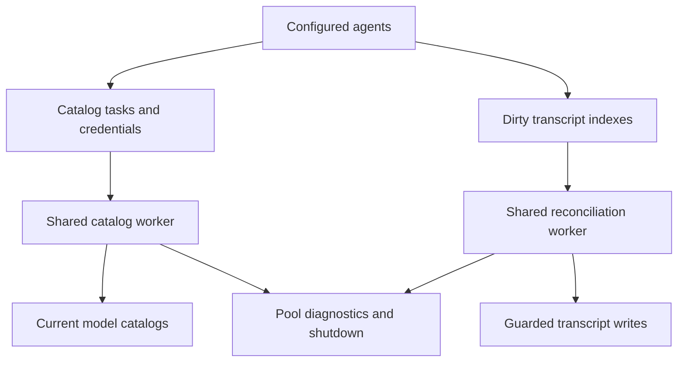

Codex review: needs maintainer review before merge. _Reviewed September 17, 2026, 1:00 AM ET / 05:00 UTC (Revision 6)._

# ClawSweeper review

## What this changes

Shares model-catalog and transcript-reconciliation workers across Gateway agents, preserves task-specific state and cleanup, and exposes worker-pool diagnostics.

## Merge readiness

✅ **Ready for maintainer review**

This remains a useful, distinct fix for fleet-wide worker retention. No actionable introduced defect was found; the recorded lifecycle corrections address the latest failures, and the documented validation exception does not warrant another proof blocker.

**Priority:** P1
**Reviewed head:** `40cdb969512cdf299e0d11f0a8caba91e6d6f8c5`

## Review scores

| Measure | Result | What it means |
|---|---|---|
| **Overall readiness** | 🐚 platinum hermit **(4/6)** | A focused ownership repair with convincing fleet measurements and lifecycle coverage; no blocking correctness finding remains. |
| **Proof confidence** | 🦞 diamond lobster **(5/6)** | Sufficient (live_output): The matching captured body documents real Gateway execution with 200 agents, constructor attribution, reduced post-ready RSS growth, preserved searchable rows, and clean shutdown. Later scheduler and retirement corrections have targeted failure/recovery evidence; the RSS figures remain prior-head measurements, and the published-updater transition has an explicit candidate-specific maintainer exception. |
| **Patch quality** | 🐚 platinum hermit **(4/6)** | No actionable review findings were identified. |

## Verification

| Check | Result | Evidence |
|---|---|---|
| **Real behavior** | Verified | Sufficient (live_output): The matching captured body documents real Gateway execution with 200 agents, constructor attribution, reduced post-ready RSS growth, preserved searchable rows, and clean shutdown. Later scheduler and retirement corrections have targeted failure/recovery evidence; the RSS figures remain prior-head measurements, and the published-updater transition has an explicit candidate-specific maintainer exception. |
| **Evidence reviewed** | 9 items | Pinned patch and merge ownership: The verified test merge records main 68663e6c648a958067343b5a68ea410c8c736bc0 followed by head 40cdb969512cdf299e0d11f0a8caba91e6d6f8c5. Its comparison against main contains the introduced worker-pooling changes, without the unrelated main-only Codex, CI, and Gateway maintenance changes. Current main still retains separate catalog workers: Current main creates a pool inside each catalog-worker owner, with idle retirement disabled. The branch introduces the shared Gateway inventory owner; the related merged scheduling and auth fixes do not supply this pooling behavior. Complete captured proof body inspected: The retrieved body matches the supplied snapshot exactly: 22,324 UTF-16 units, SHA-256 0bc0ca4e89232ea8114aa7c91a68ee7a5ee5ff39f452022d4abb95b54623d6f7. Its real 200-agent Node 24.21 Gateway comparison reports post-ready RSS growth falling from 2,144.7 to 250.5 MiB, preservation of 1,600 searchable rows, and clean shutdown. Measurements belong to 03f9ef225b3ee0272ceb5b9058c0f99ec294d733, not the final head. |
| **Findings** | None | None. |
| **Security** | None | None. |

## How this fits together

The Gateway prepares model catalogs and repairs searchable transcript indexes for configured agents. These background workers consume agent-specific credentials or transcript data and return catalog results or projection changes to their existing owners.

## Before merge

None.

<strong>Agent review details</strong>

### Security

None.

### PR surface

Source +512, Tests +981, Docs +31. Total +1524 across 35 files.

View PR surface stats

| Area | Files | Added | Removed | Net |
|---|---:|---:|---:|---:|
| Source | 13 | 712 | 200 | +512 |
| Tests | 19 | 1319 | 338 | +981 |
| Docs | 3 | 33 | 2 | +31 |
| Config | 0 | 0 | 0 | 0 |
| Generated | 0 | 0 | 0 | 0 |
| Other | 0 | 0 | 0 | 0 |
| **Total** | **35** | **2064** | **540** | **+1524** |

### Review metrics

| Metric | Value | Why it matters |
|---|---|---|
| **Worker retention** | 200-agent proof: catalog workers 7 → 1; reconciliation workers 200 → 1 | Constructor-attributed prior-head measurements directly support the intended fleet-memory improvement. |
| **Production versus test growth** | Production net +512 lines; tests/support net +981 lines | Production growth implements shared recovery and shutdown ownership, with regressions covering isolation and settlement. |

### Technical review

Best possible solution:

Keep fleet-wide worker ownership bounded while preserving per-agent catalog facts, guarded transcript writes, and complete shutdown settlement.

Do we have a high-confidence way to reproduce the issue?

Yes: current main retains a catalog-worker pool per agent, and the recorded real Gateway fleet comparison demonstrates the resulting worker and RSS growth. This read-only review did not rerun that workload.

Is this the best way to solve the issue?

Yes: moving worker lifetime ownership to the fleet level directly addresses the measured retention while reusing existing publication, write, and lease owners.

AGENTS.md: found and applied where relevant.

Codex review notes: model internal, reasoning medium; reviewed against [68663e6c648a](https://github.com/openclaw/openclaw/commit/68663e6c648a958067343b5a68ea410c8c736bc0).

### Labels

Label justifications:

- `P1`: The linked fleet incident reports post-ready memory growth and loss of Gateway responsiveness affecting an existing deployment.
- `rating: 🐚 platinum hermit`: Overall readiness is 🐚 platinum hermit; proof is 🦞 diamond lobster and patch quality is 🐚 platinum hermit.
- `status: 👀 ready for maintainer look`: ClawSweeper has no concrete contributor-facing blocker left for this PR. Sufficient (live_output): The matching captured body documents real Gateway execution with 200 agents, constructor attribution, reduced post-ready RSS growth, preserved searchable rows, and clean shutdown. Later scheduler and retirement corrections have targeted failure/recovery evidence; the RSS figures remain prior-head measurements, and the published-updater transition has an explicit candidate-specific maintainer exception.
- `proof: sufficient`: Contributor real behavior proof is sufficient. The matching captured body documents real Gateway execution with 200 agents, constructor attribution, reduced post-ready RSS growth, preserved searchable rows, and clean shutdown. Later scheduler and retirement corrections have targeted failure/recovery evidence; the RSS figures remain prior-head measurements, and the published-updater transition has an explicit candidate-specific maintainer exception.

### Evidence

What I checked:

- **Pinned patch and merge ownership:** The verified test merge records main 68663e6c648a958067343b5a68ea410c8c736bc0 followed by head 40cdb969512cdf299e0d11f0a8caba91e6d6f8c5. Its comparison against main contains the introduced worker-pooling changes, without the unrelated main-only Codex, CI, and Gateway maintenance changes. ([a157dd4ba297](https://github.com/openclaw/openclaw/commit/a157dd4ba29768bcfab21c898346abe4de52ce0e))
- **Current main still retains separate catalog workers:** Current main creates a pool inside each catalog-worker owner, with idle retirement disabled. The branch introduces the shared Gateway inventory owner; the related merged scheduling and auth fixes do not supply this pooling behavior. ([`src/agents/prepared-model-catalog-worker.ts:280`](https://github.com/openclaw/openclaw/blob/68663e6c648a958067343b5a68ea410c8c736bc0/src/agents/prepared-model-catalog-worker.ts#L280), [68663e6c648a](https://github.com/openclaw/openclaw/commit/68663e6c648a958067343b5a68ea410c8c736bc0))
- **Complete captured proof body inspected:** The retrieved body matches the supplied snapshot exactly: 22,324 UTF-16 units, SHA-256 0bc0ca4e89232ea8114aa7c91a68ee7a5ee5ff39f452022d4abb95b54623d6f7. Its real 200-agent Node 24.21 Gateway comparison reports post-ready RSS growth falling from 2,144.7 to 250.5 MiB, preservation of 1,600 searchable rows, and clean shutdown. Measurements belong to 03f9ef225b3ee0272ceb5b9058c0f99ec294d733, not the final head. ([03f9ef225b3e](https://github.com/openclaw/openclaw/commit/03f9ef225b3ee0272ceb5b9058c0f99ec294d733))
- **Re-review dispositions and validation limits:** The matching full body explicitly records a candidate-specific maintainer exception for the published v2026.9.4 updater transition. It also reports failing-before/passing-after scheduler and retirement regressions, including native termination during shutdown. The reporter's 632-agent Linux outcome and final-head RSS remain outside the measured claim; these historical limitations are not newly discovered findings. ([40cdb969512c](https://github.com/openclaw/openclaw/commit/40cdb969512cdf299e0d11f0a8caba91e6d6f8c5))
- **Catalog isolation and retirement:** The shared pool retains inventory-owned source captures while task envelopes carry agent/auth facts. Dispatch checks publication currency, queued stale borrowers reject without poisoning siblings, and process-close registration precedes cache-retirement subscription. The new integration coverage exercises separate agent credentials, queued retirement, source replacement, deadlines, and shutdown during native termination. ([`src/agents/prepared-model-catalog-worker.ts:159`](https://github.com/openclaw/openclaw/blob/40cdb969512cdf299e0d11f0a8caba91e6d6f8c5/src/agents/prepared-model-catalog-worker.ts#L159), [40cdb969512c](https://github.com/openclaw/openclaw/commit/40cdb969512cdf299e0d11f0a8caba91e6d6f8c5))
- **Transcript write and lease settlement:** Reconciliation tracks complete accepted operations, closes admission before drainage, and permits their exact lease-recovery tasks to finish. Parent handlers retain the existing guarded SQLite writer path; worker failure settlement precedes recovery and Gateway resource retirement. ([`src/config/sessions/session-transcript-reconcile.ts:451`](https://github.com/openclaw/openclaw/blob/40cdb969512cdf299e0d11f0a8caba91e6d6f8c5/src/config/sessions/session-transcript-reconcile.ts#L451), [40cdb969512c](https://github.com/openclaw/openclaw/commit/40cdb969512cdf299e0d11f0a8caba91e6d6f8c5))

Likely related people:

- **unknown:** The claimed source-line change could not be verified from bounded local history. (role: source history unknown; confidence: low)
- **obviyus:** Suggested for follow-up; no historical authorship or introduction is verified. (role: unverified routing candidate; confidence: low)

### Rating scale

| Score | Internal tier | Crab rank | Meaning |
|---:|:---:|---|---|
| **6/6** | S | 🦀 challenger crab | Exceptional readiness |
| **5/6** | A | 🦞 diamond lobster | Very strong readiness |
| **4/6** | B | 🐚 platinum hermit | Good normal PR; ordinary maintainer review |
| **3/6** | C | 🦐 gold shrimp | Useful, but confidence is limited |
| **2/6** | D | 🦪 silver shellfish | Proof or implementation needs work |
| **1/6** | F | 🧂 unranked krab | Not merge-ready |
| N/A | NA | 🌊 off-meta tidepool | Rating does not apply |

Overall follows the weaker of proof and patch quality.
Shiny media proof means a screenshot, video, or linked artifact directly shows the changed behavior. Runtime, network, CSP, and security claims still need visible diagnostics.

### Workflow

- ClawSweeper keeps one durable marker-backed review comment per issue or PR.
- Re-runs edit this comment so the latest verdict, findings, and automation markers stay together instead of adding duplicate bot comments.
- A fresh review can be triggered by eligible `@clawsweeper re-review` comments, exact-item GitHub events, scheduled/background review runs, or manual workflow dispatch.
- PR/issue authors and users with repository write access can comment `@clawsweeper re-review` or `@clawsweeper re-run` on an open PR or issue to request a fresh review only.
- Maintainers can also comment `@clawsweeper review` to request a fresh review only.
- Fresh-review commands do not start repair, autofix, rebase, CI repair, or automerge.
- Maintainer-only repair and merge flows require explicit commands such as `@clawsweeper autofix`, `@clawsweeper automerge`, `@clawsweeper fix ci`, or `@clawsweeper address review`.
- Maintainers can comment `@clawsweeper explain` to ask for more context, or `@clawsweeper stop` to stop active automation.

### History

Review history (5 earlier review cycles)

<!-- clawsweeper-review-history v=1 total=5 -->
- reviewed 2026-09-16T22:48:57.211Z sha 03f9ef225b3ee0272ceb5b9058c0f99ec294d733 :: blocked before merge. :: none
- reviewed 2026-09-17T00:06:46.000Z sha a7eb51d79a4429edbbc7fafd74258176a550204d :: blocked before merge. :: none
- reviewed 2026-09-17T00:18:09.213Z sha a7eb51d79a4429edbbc7fafd74258176a550204d :: blocked before merge. :: none
- reviewed 2026-09-17T03:12:17.134Z sha 92589e36bfa06d5e6f34a4a17b450b334e8d8dc6 :: needs maintainer review before merge. :: none
- reviewed 2026-09-17T03:59:47.472Z sha 683cb4b09343c950e89e19573a9acba83f66b637 :: blocked before merge. :: none

<!-- clawsweeper-verdict:needs-human item=150354 sha=40cdb969512cdf299e0d11f0a8caba91e6d6f8c5 confidence=high updated_at=2026-09-17T04:56:12Z reviewed_at=2026-09-17T05:00:24.657Z lease_owner=github-run-35183631803-1 lease_comment_id=5708862295 source_revision=84451dd34624c81ff3ad22211fd0a246a6d50f86b40757762681711cb7e80548 live_verification=absent -->
<!-- clawsweeper-review-state:ready item=150354 sha=40cdb969512cdf299e0d11f0a8caba91e6d6f8c5 v=1 -->

<!-- clawsweeper-review-version item=150354 reviewed_at=2026-09-17T05:00:24.657Z sha=40cdb969512cdf299e0d11f0a8caba91e6d6f8c5 source_revision=84451dd34624c81ff3ad22211fd0a246a6d50f86b40757762681711cb7e80548 lease_owner=github-run-35183631803-1 lease_comment_id=5708862295 v=1 -->

<!-- clawsweeper-review item=150354 -->