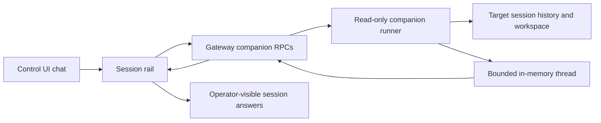

Codex review: found issues before merge. _Reviewed July 25, 2026, 9:50 AM ET / 13:50 UTC._

# ClawSweeper review

## What this changes

The branch replaces the Control UI observer HUD and detached `/btw` side chat with a dockable session rail backed by an ephemeral, read-only gateway companion thread, while adding OpenAI long-session cache-key clamps.

## Merge readiness

⚠️ **Needs maintainer review before merge - 6 items remain**

Keep this PR open for maintainer review. It adds a substantial new Control UI and gateway capability with real behavior evidence, but the PR itself documents a remaining companion-answer leak into the main chat view that should be fixed before merge; the `maintainer` label and assignment also require explicit human handling.

**Priority:** P2
**Reviewed head:** `a4f67acb4a10c11a224699d74555a09df5fc14b5`
**Owner decision:** Required. See [Decision needed](#decision-needed).

## Review scores

| Measure | Result | What it means |
|---|---|---|
| **Overall readiness** | 🦐 gold shrimp **(3/6)** | Strong user-path evidence supports a useful cross-layer implementation, but the acknowledged main-chat event leak blocks a higher correctness rating. |
| **Proof confidence** | 🦞 diamond lobster **(5/6)** ✨ media proof bonus | Sufficient (screenshot): The PR supplies a concrete isolated live-Gateway scenario with observed timings and outcomes, sanitized wide/narrow/collapsed rail screenshots, and a successful repository real-behavior-proof check; the remaining merge blocker is the acknowledged event-isolation defect, not absent proof. |
| **Patch quality** | 🦐 gold shrimp **(3/6)** | 1 actionable review finding remain. |

## Verification

| Check | Result | Evidence |
|---|---|---|
| **Real behavior** | Verified | Sufficient (screenshot): The PR supplies a concrete isolated live-Gateway scenario with observed timings and outcomes, sanitized wide/narrow/collapsed rail screenshots, and a successful repository real-behavior-proof check; the remaining merge blocker is the acknowledged event-isolation defect, not absent proof. |
| **Evidence reviewed** | 5 items | Changed product boundary: The branch adds three public Gateway methods for companion asks, state retrieval, and reset, all scoped through the core gateway method registry; the Control UI then routes `/btw` and `/side` into the new rail instead of the detached side-chat path.<br>Documented remaining regression: The PR body explicitly records that a companion final answer can briefly flash in an open main chat view through an unkeyed live-event broadcast. That is a current, user-visible isolation defect in the submitted behavior, not a completed follow-up.<br>Real behavior evidence: The PR body reports isolated live Gateway runs for mid-run and idle questions, per-session switching, reload rehydration, and supplied sanitized rail screenshots; the provided checks list also shows the repository Real behavior proof check succeeded. |
| **Findings** | 1 actionable finding | [P2] Keep companion answers out of the main chat stream |
| **Security** | None | None. |

## How this fits together

The Control UI chat connects directly to the Gateway and renders live session observer data alongside the conversation. This change adds per-session companion RPCs in the Gateway, then uses them from the chat rail to show bounded question-and-answer state without interrupting the main agent run.



## Decision needed

| Question | Recommendation |
|---|---|
| Should OpenClaw permanently expose the three session-companion Gateway RPCs and make Control UI `/btw` and `/side` use the bounded session companion rather than the detached BTW path? | **Approve the session-companion contract:** Keep the additive RPCs and Control UI rail after the main-chat event leak is fixed and the exact head completes required validation. |

Why: This is a new cross-client Gateway contract and a deliberate Control UI command-semantics change; tests and proof can validate implementation quality but cannot choose the long-term product and compatibility boundary.

## Before merge

- [ ] **Keep companion answers out of the main chat stream (P2)** - The PR description confirms that a completed companion answer can briefly flash in an open main chat through an unkeyed live event. The general chat-event handler must reject or key that event before it can update the main-agent view; otherwise operators can see assistant text that did not belong to the active conversation.
- [ ] **Resolve merge risk (P1)** - The submitted PR acknowledges that an answer from the companion can briefly render in the main chat through an unkeyed live-event path; this can confuse operators about what the main agent actually said.
- [ ] **Resolve merge risk (P1)** - The PR changes Control UI `/btw` and `/side` semantics and introduces three public Gateway methods with bounded session-scoped state, so maintainers should explicitly accept the compatibility and lifecycle contract before merging.
- [ ] **Resolve merge risk (P1)** - The branch is large and its remaining Android/iOS and CI lanes were still running or queued in the supplied check state; merge should wait for the exact head's required checks rather than treating the partial green set as final.
- [ ] **Complete next step (P2)** - The protected `maintainer` label and the remaining cross-layer event-isolation defect require human review on this PR rather than an automated repair lane.

## Findings

- [P2] Keep companion answers out of the main chat stream — `ui/src/pages/chat/chat-gateway.ts:386-392`


<details>
<summary><strong>Agent review details</strong></summary>

### Security

None.

### PR surface

Source +749, Tests -102, Docs +10, Other +117. Total +774 across 73 files.

<details>
<summary>View PR surface stats</summary>

| Area | Files | Added | Removed | Net |
|---|---:|---:|---:|---:|
| Source | 49 | 2382 | 1633 | +749 |
| Tests | 19 | 951 | 1053 | -102 |
| Docs | 3 | 27 | 17 | +10 |
| Config | 0 | 0 | 0 | 0 |
| Generated | 0 | 0 | 0 | 0 |
| Other | 2 | 117 | 0 | +117 |
| **Total** | **73** | **3477** | **2703** | **+774** |

</details>

### Review metrics

| Metric | Value | Why it matters |
|---|---|---|
| **New Gateway API** | 3 additive methods | The public `sessions.companion.ask`, `.state`, and `.reset` methods create a new client compatibility contract beyond the Control UI implementation. |
| **Control UI command behavior** | 2 existing aliases rerouted | Both `/btw` and `/side` now use a bounded session companion instead of the previous detached BTW route, affecting established operator expectations. |

### Stored data model

Persistent data-model change detected: `persistent cache schema: packages/ai/src/providers.ts`, `persistent cache schema: packages/ai/src/transports/openai-transport-params.session-header.test.ts`, `persistent cache schema: packages/ai/src/transports/openai-transport-params.ts`, `serialized state: packages/gateway-protocol/src/schema/sessions.ts`, `serialized state: src/agents/embedded-agent-runner/run/session-boundary-prompt-cache-key.test.ts`, `serialized state: src/gateway/session-companion-ask.ts`, and 20 more. Confirm migration or upgrade compatibility proof before merge.

### Mantis proof suggestion

A redacted web UI chat transcript would directly demonstrate that companion completions remain confined to the session rail rather than flashing in the main conversation. A maintainer can ask Mantis to capture proof by posting this exact PR comment:

```text
@openclaw-mantis web UI chat proof: reproduce a session-companion answer while the main chat is open and capture a redacted transcript showing the completion stays only in the session rail.
```

### Merge-risk options

**Maintainer options:**
1. **Fix main-chat event isolation first (recommended)**  
   Ensure companion-run events are keyed and filtered so they cannot be rendered as a main-agent response, then revalidate the live rail flow.
2. **Accept the new Gateway and command contract**  
   A maintainer can explicitly accept the additive RPC surface and Control UI `/btw` behavior change once the isolation defect is resolved.
3. **Pause the feature boundary**  
   If a shared cross-client companion contract is not desired, pause this broad PR and retain the existing detached UI behavior.

<details>
<summary>Copy recommended automerge instruction</summary>

```text
@clawsweeper automerge

Special instructions:
Prevent session-companion live events from entering the selected main-chat stream; add a focused regression test covering an open main chat while a companion answer completes.
```

</details>

### Technical review

Best possible solution:

Keep the session rail and companion as the single Control UI path, first prevent companion-run events from reaching the main chat stream, then obtain explicit maintainer acceptance of the new Gateway API and `/btw` compatibility boundary before merging.

Do we have a high-confidence way to reproduce the issue?

Yes for the documented regression: keep a main chat view open, submit a companion question, and observe completion through the unkeyed live-event path; the PR body identifies this path and the changed chat gateway handler is the relevant receiving surface.

Is this the best way to solve the issue?

Unclear. Consolidating overlapping Control UI surfaces is coherent, but publishing new Gateway methods and changing `/btw` semantics is only the best solution if maintainers affirm that shared client contract after the main-chat event leak is fixed.

Full review comments:

- [P2] Keep companion answers out of the main chat stream — `ui/src/pages/chat/chat-gateway.ts:386-392`
  The PR description confirms that a completed companion answer can briefly flash in an open main chat through an unkeyed live event. The general chat-event handler must reject or key that event before it can update the main-agent view; otherwise operators can see assistant text that did not belong to the active conversation.
  Confidence: 0.95

Overall correctness: patch is incorrect
Overall confidence: 0.88

AGENTS.md: found and applied where relevant.

Codex review notes: model internal, reasoning high; reviewed against [47601cf5b41d](https://github.com/openclaw/openclaw/commit/47601cf5b41d97b0df351814b5e9a71d6ed66c6c).

### Labels

Label changes:

- add `P2`: This is a substantial user-facing feature with a concrete transient main-chat rendering defect, but it is not evidence of an emergency outage or data loss.
- add `merge-risk: 🚨 compatibility`: The PR adds public Gateway methods and intentionally changes existing Control UI `/btw` and `/side` behavior.
- add `merge-risk: 🚨 session-state`: The new per-session, bounded in-memory question thread introduces reset, TTL, reload, and session-association behavior that must remain correct across existing chat flows.
- add `proof: sufficient`: Contributor real behavior proof is sufficient. The PR supplies a concrete isolated live-Gateway scenario with observed timings and outcomes, sanitized wide/narrow/collapsed rail screenshots, and a successful repository real-behavior-proof check; the remaining merge blocker is the acknowledged event-isolation defect, not absent proof.
- add `proof: 📸 screenshot`: Contributor real behavior proof includes screenshot evidence. The PR supplies a concrete isolated live-Gateway scenario with observed timings and outcomes, sanitized wide/narrow/collapsed rail screenshots, and a successful repository real-behavior-proof check; the remaining merge blocker is the acknowledged event-isolation defect, not absent proof.
- add `rating: 🦐 gold shrimp`: Overall readiness is 🦐 gold shrimp; proof is 🦞 diamond lobster and patch quality is 🦐 gold shrimp.
- add `status: ⏳ waiting on author`: ClawSweeper has contributor-facing work open and is waiting for author action. Sufficient (screenshot): The PR supplies a concrete isolated live-Gateway scenario with observed timings and outcomes, sanitized wide/narrow/collapsed rail screenshots, and a successful repository real-behavior-proof check; the remaining merge blocker is the acknowledged event-isolation defect, not absent proof.

Label justifications:

- `P2`: This is a substantial user-facing feature with a concrete transient main-chat rendering defect, but it is not evidence of an emergency outage or data loss.
- `merge-risk: 🚨 compatibility`: The PR adds public Gateway methods and intentionally changes existing Control UI `/btw` and `/side` behavior.
- `merge-risk: 🚨 session-state`: The new per-session, bounded in-memory question thread introduces reset, TTL, reload, and session-association behavior that must remain correct across existing chat flows.
- `rating: 🦐 gold shrimp`: Overall readiness is 🦐 gold shrimp; proof is 🦞 diamond lobster and patch quality is 🦐 gold shrimp.
- `status: ⏳ waiting on author`: ClawSweeper has contributor-facing work open and is waiting for author action. Sufficient (screenshot): The PR supplies a concrete isolated live-Gateway scenario with observed timings and outcomes, sanitized wide/narrow/collapsed rail screenshots, and a successful repository real-behavior-proof check; the remaining merge blocker is the acknowledged event-isolation defect, not absent proof.
- `proof: sufficient`: Contributor real behavior proof is sufficient. The PR supplies a concrete isolated live-Gateway scenario with observed timings and outcomes, sanitized wide/narrow/collapsed rail screenshots, and a successful repository real-behavior-proof check; the remaining merge blocker is the acknowledged event-isolation defect, not absent proof.
- `proof: 📸 screenshot`: Contributor real behavior proof includes screenshot evidence. The PR supplies a concrete isolated live-Gateway scenario with observed timings and outcomes, sanitized wide/narrow/collapsed rail screenshots, and a successful repository real-behavior-proof check; the remaining merge blocker is the acknowledged event-isolation defect, not absent proof.

### Evidence

What I checked:

- **Changed product boundary:** The branch adds three public Gateway methods for companion asks, state retrieval, and reset, all scoped through the core gateway method registry; the Control UI then routes `/btw` and `/side` into the new rail instead of the detached side-chat path. ([`src/gateway/methods/core-descriptors.ts:469`](https://github.com/openclaw/openclaw/blob/a4f67acb4a10/src/gateway/methods/core-descriptors.ts#L469), [a4f67acb4a10](https://github.com/openclaw/openclaw/commit/a4f67acb4a10))
- **Documented remaining regression:** The PR body explicitly records that a companion final answer can briefly flash in an open main chat view through an unkeyed live-event broadcast. That is a current, user-visible isolation defect in the submitted behavior, not a completed follow-up. ([`ui/src/pages/chat/chat-gateway.ts:386`](https://github.com/openclaw/openclaw/blob/a4f67acb4a10/ui/src/pages/chat/chat-gateway.ts#L386), [a4f67acb4a10](https://github.com/openclaw/openclaw/commit/a4f67acb4a10))
- **Real behavior evidence:** The PR body reports isolated live Gateway runs for mid-run and idle questions, per-session switching, reload rehydration, and supplied sanitized rail screenshots; the provided checks list also shows the repository Real behavior proof check succeeded. ([a4f67acb4a10](https://github.com/openclaw/openclaw/commit/a4f67acb4a10))
- **Protocol and client coverage:** The patch adds bounded protocol schemas and validator coverage for the companion methods, plus focused Gateway and Control UI tests for companion state, reset, routing, and rail states. ([`packages/gateway-protocol/src/schema/sessions.ts:80`](https://github.com/openclaw/openclaw/blob/a4f67acb4a10/packages/gateway-protocol/src/schema/sessions.ts#L80), [a4f67acb4a10](https://github.com/openclaw/openclaw/commit/a4f67acb4a10))
- **Current-main and release status:** This is an open, unmerged PR at head a4f67acb4a10c11a224699d74555a09df5fc14b5; the supplied latest release is v2026.7.1 at 2d2ddc43d0dcf71f31283d780f9fe9ff4cc04fe4, so the requested capability is not established as shipped or implemented on current main. ([a4f67acb4a10](https://github.com/openclaw/openclaw/commit/a4f67acb4a10))

Likely related people:

- **steipete:** Authored all 16 commits in this focused branch, including the gateway protocol, companion runtime, Control UI rail, documentation, and follow-up fixes; the PR is also assigned to this person. (role: recent area contributor and proposed feature owner; confidence: medium; commits: [8e712b2d08b0](https://github.com/openclaw/openclaw/commit/8e712b2d08b0fbd310794e1948481dc52bb67a91), [9447d75a7d6f](https://github.com/openclaw/openclaw/commit/9447d75a7d6f43c9fef4c4754076e5149a42edb1), [945469e66b60](https://github.com/openclaw/openclaw/commit/945469e66b60ec3be2cf97465ce4924e4da6021b); files: `src/gateway/session-companion-ask.ts`, `src/gateway/session-companion-rpc.ts`, `ui/src/pages/chat/components/chat-session-rail.ts`)

### Rank-up moves

Optional improvements that raise the rating; they are not merge blockers.

- Prevent companion completion events from updating the main chat and add a focused regression test.
- Obtain explicit maintainer acceptance for the public companion RPC and Control UI `/btw` compatibility contract.
- Wait for required checks on the exact current head to finish successfully.

### Rating scale

| Score | Internal tier | Crab rank | Meaning |
|---:|:---:|---|---|
| **6/6** | S | 🦀 challenger crab | Exceptional readiness |
| **5/6** | A | 🦞 diamond lobster | Very strong readiness |
| **4/6** | B | 🐚 platinum hermit | Good normal PR; ordinary maintainer review |
| **3/6** | C | 🦐 gold shrimp | Useful, but confidence is limited |
| **2/6** | D | 🦪 silver shellfish | Proof or implementation needs work |
| **1/6** | F | 🧂 unranked krab | Not merge-ready |
| N/A | NA | 🌊 off-meta tidepool | Rating does not apply |

Overall follows the weaker of proof and patch quality.
Shiny media proof means a screenshot, video, or linked artifact directly shows the changed behavior. Runtime, network, CSP, and security claims still need visible diagnostics.

### Workflow

- ClawSweeper keeps one durable marker-backed review comment per issue or PR.
- Re-runs edit this comment so the latest verdict, findings, and automation markers stay together instead of adding duplicate bot comments.
- A fresh review can be triggered by eligible `@clawsweeper re-review` comments, exact-item GitHub events, scheduled/background review runs, or manual workflow dispatch.
- PR/issue authors and users with repository write access can comment `@clawsweeper re-review` or `@clawsweeper re-run` on an open PR or issue to request a fresh review only.
- Maintainers can also comment `@clawsweeper review` to request a fresh review only.
- Fresh-review commands do not start repair, autofix, rebase, CI repair, or automerge.
- Maintainer-only repair and merge flows require explicit commands such as `@clawsweeper autofix`, `@clawsweeper automerge`, `@clawsweeper fix ci`, or `@clawsweeper address review`.
- Maintainers can comment `@clawsweeper explain` to ask for more context, or `@clawsweeper stop` to stop active automation.

</details>

<!-- clawsweeper-verdict:needs-human item=113698 sha=a4f67acb4a10c11a224699d74555a09df5fc14b5 confidence=medium updated_at=2026-07-25T13:48:43Z reviewed_at=2026-07-25T13:50:15.949Z lease_owner=github-run-30160400342-1 lease_comment_id=5078723652 source_revision=1d50dec8e8a491a56891919069ad26bc6bfbd63ea74bf3ea4e9a4984bb435504 -->

<!-- clawsweeper-review-version item=113698 reviewed_at=2026-07-25T13:50:15.949Z sha=a4f67acb4a10c11a224699d74555a09df5fc14b5 source_revision=1d50dec8e8a491a56891919069ad26bc6bfbd63ea74bf3ea4e9a4984bb435504 lease_owner=github-run-30160400342-1 lease_comment_id=5078723652 v=1 -->

<!-- clawsweeper-review item=113698 -->