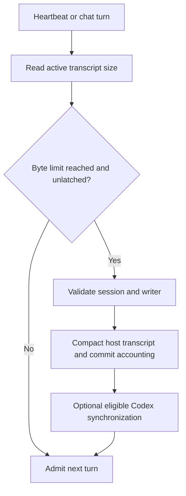

Codex review: needs real behavior proof before merge. _Reviewed September 5, 2026, 10:58 AM ET / 14:58 UTC._

# ClawSweeper review

## What this changes

Enforces the transcript byte limit during heartbeats and adds fenced Codex host compaction with atomic accounting, documentation, and Gateway regression coverage.

## Merge readiness

⛔ **Blocked before merge - 3 items remain**

This repair remains necessary on current main. The previous wording finding is resolved, and no new blocking code defect was found; the captured proof still does not cover the final atomic-persistence restart boundary.

**Priority:** P1
**Reviewed head:** `ec44630c4ecb4d2a2ab588fda5f490154a379ac8`

## Review scores

| Measure | Result | What it means |
|---|---|---|
| **Overall readiness** | 🦐 gold shrimp **(3/6)** | A coherent repair with useful regression coverage, pending proof for the final persistence boundary. |
| **Proof confidence** | 🦐 gold shrimp **(3/6)** | Needs stronger real behavior proof before merge: The captured AWS built-Gateway run at 4ee3a708 supports heartbeat compaction, restricted native rejection, and stale-writer fencing. The final SQLite transaction and pre-checkpoint restart case have no matching observed result in the supplied evidence; the earlier restart row records one native request where the current case requires zero. After adding proof, update the PR body; ClawSweeper should re-review automatically. If it does not, the PR author or someone with repository write access can comment `@clawsweeper re-review`. |
| **Patch quality** | 🐚 platinum hermit **(4/6)** | No actionable review findings were identified. |

## Verification

| Check | Result | Evidence |
|---|---|---|
| **Real behavior** | Needs proof | Needs stronger real behavior proof before merge: The captured AWS built-Gateway run at 4ee3a708 supports heartbeat compaction, restricted native rejection, and stale-writer fencing. The final SQLite transaction and pre-checkpoint restart case have no matching observed result in the supplied evidence; the earlier restart row records one native request where the current case requires zero. After adding proof, update the PR body; ClawSweeper should re-review automatically. If it does not, the PR author or someone with repository write access can comment `@clawsweeper re-review`. |
| **Evidence reviewed** | 10 items | Current main still contains the reported bypass: At the fetched main revision, runSessionCompactionIfNeeded returns for isHeartbeat before resolving maxActiveTranscriptBytes. The current documented byte guard promises semantic compaction before another run. Host persistence boundary: The admission owner supplies a persistence callback that commits the compaction event, count, and byte latch together. The SQLite owner validates the appended event and rechecks writer/lifecycle ownership before updating the session row. Entry points, authority, and sibling behavior: Read the direct-reply and follow-up admission callers, queued compaction, runtime delegate, direct compactor, transcript guard, and accounting owner. The private claim is one-shot and target-bound; transcript writes revalidate the captured writer. Heartbeats skip token maintenance, while CLI/native-transcript owners retain their existing exclusion. |
| **Findings** | None | None. |
| **Security** | None | None. |

## How this fits together

Heartbeat and chat admission check OpenClaw’s stored conversation before starting another turn. Host compaction summarizes that transcript, while the Codex plugin separately controls its native conversation.

## Before merge

- [ ] **Add real behavior proof** - Needs stronger real behavior proof before merge: The captured AWS built-Gateway run at 4ee3a708 supports heartbeat compaction, restricted native rejection, and stale-writer fencing. The final SQLite transaction and pre-checkpoint restart case have no matching observed result in the supplied evidence; the earlier restart row records one native request where the current case requires zero. After adding proof, update the PR body; ClawSweeper should re-review automatically. If it does not, the PR author or someone with repository write access can comment `@clawsweeper re-review`.
- [ ] **Resolve merge risk (P1)** - The final atomic persistence path lacks captured crash/restart results; an interruption could otherwise leave compaction accounting or retry suppression inconsistent with the committed transcript.
- [ ] **Complete next step (P2)** - Provide results from the existing Gateway restart scenario against the final atomic-persistence code and align the PR’s checkpoint/native-request evidence with those observations.

<strong>Agent review details</strong>

### Security

None.

### PR surface

Source +358, Tests +2789, Docs +9, Other +38. Total +3194 across 27 files.

View PR surface stats

| Area | Files | Added | Removed | Net |
|---|---:|---:|---:|---:|
| Source | 15 | 503 | 145 | +358 |
| Tests | 10 | 2839 | 50 | +2789 |
| Docs | 1 | 18 | 9 | +9 |
| Config | 0 | 0 | 0 | 0 |
| Generated | 0 | 0 | 0 | 0 |
| Other | 1 | 38 | 0 | +38 |
| **Total** | **27** | **3398** | **204** | **+3194** |

### Review metrics

| Metric | Value | Why it matters |
|---|---|---|
| **Production versus regression coverage** | Production net +358; tests and QA support net +2,789 | Growth adds private authority and atomic persistence boundaries; shared accounting was moved into one reusable projection rather than duplicated. |

### Root-cause cluster

Relationship: `fixed_by_candidate`
Canonical: https://github.com/openclaw/openclaw/issues/136452
Summary: This PR is the candidate repair for the heartbeat byte-cap bypass; related Codex work overlaps only part of the behavior.

Members:
- `canonical`: https://github.com/openclaw/openclaw/issues/136452 - The open report establishes the heartbeat bypass and is explicitly linked by this PR.
- `partial_overlap`: https://github.com/openclaw/openclaw/pull/137752 - Addresses rejected Codex turns through benign-decline classification, without the same host-transcript enforcement.
- `adjacent_distinct`: https://github.com/openclaw/openclaw/issues/137914 - The closed report concerns native binding continuity after host generation rotation.
- `adjacent_distinct`: https://github.com/openclaw/openclaw/pull/138184 - Closed unmerged generation-transition work is not a replacement landing path.

Proposal only: this assessment does not dispatch repair, suppress jobs, mutate sibling items, close, or merge anything.

### Merge-risk options

**Maintainer options:**
1. **Verify the final interruption boundary (recommended)**  
   Refresh the existing Gateway scenario evidence to demonstrate atomic persistence and successor continuity after interruption before checkpoint creation.

### Technical review

Best possible solution:

Keep one semantic compaction pipeline with atomic transcript/accounting commits and proven restart recovery; the private authority and transaction boundaries justify growth beyond a guard-only fix.

Do we have a high-confidence way to reproduce the issue?

Yes, from source: heartbeat admission returns before reading the configured byte cap on current main. The discussion supplies earlier before/after Gateway observations; this review executed no runtime reproduction.

Is this the best way to solve the issue?

Yes at the owner boundary: reusing semantic host compaction preserves the byte guard, whereas accepting native declines alone leaves host growth unresolved. Final persistence recovery still needs observed proof.

AGENTS.md: found and applied where relevant.

Codex review notes: model internal, reasoning high; reviewed against [0f54c8698228](https://github.com/openclaw/openclaw/commit/0f54c8698228fc1c7564db4e0a1a21819cba9be5).

### Labels

Label justifications:

- `P1`: The linked report describes heartbeat-driven transcript growth and Gateway OOM crashes, and current main still contains the bypass.
- `merge-risk: 🚨 session-state`: The new transcript/count/latch transaction needs observed recovery across its final pre-checkpoint crash boundary.
- `rating: 🦐 gold shrimp`: Overall readiness is 🦐 gold shrimp; proof is 🦐 gold shrimp and patch quality is 🐚 platinum hermit.
- `status: 📣 needs proof`: The PR needs real behavior proof before ClawSweeper can clear the contributor ask. Needs stronger real behavior proof before merge: The captured AWS built-Gateway run at 4ee3a708 supports heartbeat compaction, restricted native rejection, and stale-writer fencing. The final SQLite transaction and pre-checkpoint restart case have no matching observed result in the supplied evidence; the earlier restart row records one native request where the current case requires zero. After adding proof, update the PR body; ClawSweeper should re-review automatically. If it does not, the PR author or someone with repository write access can comment `@clawsweeper re-review`.

### Evidence

What I checked:

- **Current main still contains the reported bypass:** At the fetched main revision, runSessionCompactionIfNeeded returns for isHeartbeat before resolving maxActiveTranscriptBytes. The current documented byte guard promises semantic compaction before another run. ([`src/auto-reply/reply/agent-runner-memory.ts:721`](https://github.com/openclaw/openclaw/blob/0f54c8698228fc1c7564db4e0a1a21819cba9be5/src/auto-reply/reply/agent-runner-memory.ts#L721), [0f54c8698228](https://github.com/openclaw/openclaw/commit/0f54c8698228fc1c7564db4e0a1a21819cba9be5))
- **Host persistence boundary:** The admission owner supplies a persistence callback that commits the compaction event, count, and byte latch together. The SQLite owner validates the appended event and rechecks writer/lifecycle ownership before updating the session row. ([`src/config/sessions/session-accessor.sqlite-transcript-write.ts:353`](https://github.com/openclaw/openclaw/blob/ec44630c4ecb4d2a2ab588fda5f490154a379ac8/src/config/sessions/session-accessor.sqlite-transcript-write.ts#L353), [ec44630c4ecb](https://github.com/openclaw/openclaw/commit/ec44630c4ecb4d2a2ab588fda5f490154a379ac8))
- **Entry points, authority, and sibling behavior:** Read the direct-reply and follow-up admission callers, queued compaction, runtime delegate, direct compactor, transcript guard, and accounting owner. The private claim is one-shot and target-bound; transcript writes revalidate the captured writer. Heartbeats skip token maintenance, while CLI/native-transcript owners retain their existing exclusion. ([`src/agents/embedded-agent-runner/transcript-byte-preflight-authority.ts:61`](https://github.com/openclaw/openclaw/blob/ec44630c4ecb4d2a2ab588fda5f490154a379ac8/src/agents/embedded-agent-runner/transcript-byte-preflight-authority.ts#L61), [ec44630c4ecb](https://github.com/openclaw/openclaw/commit/ec44630c4ecb4d2a2ab588fda5f490154a379ac8))
- **Codex dependency signal and preserved restriction:** The changed docs explicitly describe secondary thread/compact/start synchronization. The actual Codex plugin rejects host-isolated and restricted bindings before client acquisition; host compaction does not remove that restriction. ([`extensions/codex/src/app-server/compact.ts:501`](https://github.com/openclaw/openclaw/blob/ec44630c4ecb4d2a2ab588fda5f490154a379ac8/extensions/codex/src/app-server/compact.ts#L501), [ec44630c4ecb](https://github.com/openclaw/openclaw/commit/ec44630c4ecb4d2a2ab588fda5f490154a379ac8))
- **Direct upstream contract inspection:** Verified repository ownership through the sibling checkout’s backing cache origin, https://github.com/openai/codex.git. Personally inspected thread.rs:1113-1120, thread_processor.rs:2347-2359, and session/handlers.rs:246-251,675-677: the request contains a thread ID, checks direct-input permission, submits Op::Compact, and returns an empty acknowledgement; the compaction task runs separately. ([`codex-rs/app-server/src/request_processors/thread_processor.rs:2347`](https://github.com/openai/codex/blob/3d2ee51ca2d5db578f328aa75e20aa22c0197c9a/codex-rs/app-server/src/request_processors/thread_processor.rs#L2347), [3d2ee51ca2d5](https://github.com/openai/codex/commit/3d2ee51ca2d5db578f328aa75e20aa22c0197c9a))
- **Captured proof retains useful earlier coverage:** The complete supplied body, captured under sourceRevision 5c3d446333593c07f4439d35da4f6a1fbc86357e72a5c67e510d4f291f82dcdc, identifies AWS built-Gateway proof at 4ee3a708. It reports fresh/restricted continuation, native rejection, and substituted/revoked writers rejected before provider traffic or transcript commits. Its restart row records one native compact request, unlike the current pre-checkpoint scenario. Maintainer confirmation appears at https://github.com/openclaw/openclaw/pull/136533#issuecomment-5551917282. ([4ee3a708e876](https://github.com/openclaw/openclaw/commit/4ee3a708e87636b6e53e37cab2075a3a0787e0f4))

Likely related people:

- **vincentkoc:** Suggested for follow-up; no historical authorship or introduction is verified. (role: unverified routing candidate; confidence: low)
- **Peter Steinberger:** Suggested for follow-up; no historical authorship or introduction is verified. (role: unverified routing candidate; confidence: low)

### Rank-up moves

Optional improvements that raise the rating; they are not merge blockers.

- Refresh the existing Gateway proof for the final persistence code, showing pre-checkpoint interruption, one durable compaction/count/latch, zero native compact requests, and successful successor continuation; update the evidence table accordingly.
- Attach redacted logs or terminal output; screenshots or recordings are welcome when they show the result. Remove credentials, IP addresses, private endpoints, and personal data. Updating the PR body should trigger review; otherwise ask a maintainer to comment @clawsweeper re-review.

### Rating scale

| Score | Internal tier | Crab rank | Meaning |
|---:|:---:|---|---|
| **6/6** | S | 🦀 challenger crab | Exceptional readiness |
| **5/6** | A | 🦞 diamond lobster | Very strong readiness |
| **4/6** | B | 🐚 platinum hermit | Good normal PR; ordinary maintainer review |
| **3/6** | C | 🦐 gold shrimp | Useful, but confidence is limited |
| **2/6** | D | 🦪 silver shellfish | Proof or implementation needs work |
| **1/6** | F | 🧂 unranked krab | Not merge-ready |
| N/A | NA | 🌊 off-meta tidepool | Rating does not apply |

Overall follows the weaker of proof and patch quality.
Shiny media proof means a screenshot, video, or linked artifact directly shows the changed behavior. Runtime, network, CSP, and security claims still need visible diagnostics.

### Workflow

- ClawSweeper keeps one durable marker-backed review comment per issue or PR.
- Re-runs edit this comment so the latest verdict, findings, and automation markers stay together instead of adding duplicate bot comments.
- A fresh review can be triggered by eligible `@clawsweeper re-review` comments, exact-item GitHub events, scheduled/background review runs, or manual workflow dispatch.
- PR/issue authors and users with repository write access can comment `@clawsweeper re-review` or `@clawsweeper re-run` on an open PR or issue to request a fresh review only.
- Maintainers can also comment `@clawsweeper review` to request a fresh review only.
- Fresh-review commands do not start repair, autofix, rebase, CI repair, or automerge.
- Maintainer-only repair and merge flows require explicit commands such as `@clawsweeper autofix`, `@clawsweeper automerge`, `@clawsweeper fix ci`, or `@clawsweeper address review`.
- Maintainers can comment `@clawsweeper explain` to ask for more context, or `@clawsweeper stop` to stop active automation.

### History

Review history (37 earlier review cycles; latest 8 shown)

<!-- clawsweeper-review-history v=1 total=37 -->
- reviewed 2026-09-05T05:54:38.912Z sha bf0d7d489021df6c594478101f2706a322e97103 :: needs real behavior proof before merge. :: none
- reviewed 2026-09-05T06:12:58.456Z sha bf0d7d489021df6c594478101f2706a322e97103 :: needs real behavior proof before merge. :: none
- reviewed 2026-09-05T09:51:05.033Z sha 8b39ab31fd7b6d6263a248af9b80947024d5e3d9 :: needs real behavior proof before merge. :: none
- reviewed 2026-09-05T10:03:19.414Z sha 3347970375bf448271164015a83f6c80570ceeba :: needs real behavior proof before merge. :: none
- reviewed 2026-09-05T10:15:59.624Z sha 48d7dd74db1d3dab65d3202065ada5da384bbad1 :: needs real behavior proof before merge. :: none
- reviewed 2026-09-05T10:47:39.404Z sha 4ee3a708e87636b6e53e37cab2075a3a0787e0f4 :: needs real behavior proof before merge. :: none
- reviewed 2026-09-05T12:57:16.721Z sha 4ee3a708e87636b6e53e37cab2075a3a0787e0f4 :: needs maintainer review before merge. :: none
- reviewed 2026-09-05T14:02:44.615Z sha 1db0b0830b823f861e803c7cb4e3b8f298730a7e :: needs real behavior proof before merge. :: [P3] Correct the restart criterion's persisted-checkpoint claim

<!-- clawsweeper-verdict:needs-human item=136533 sha=ec44630c4ecb4d2a2ab588fda5f490154a379ac8 confidence=high updated_at=2026-09-05T14:52:39Z reviewed_at=2026-09-05T14:58:00.791Z lease_owner=github-run-33973028465-1 lease_comment_id=5552612238 source_revision=5c3d446333593c07f4439d35da4f6a1fbc86357e72a5c67e510d4f291f82dcdc live_verification=absent -->
<!-- clawsweeper-review-state:blocked item=136533 sha=ec44630c4ecb4d2a2ab588fda5f490154a379ac8 v=1 -->

<!-- clawsweeper-review-version item=136533 reviewed_at=2026-09-05T14:58:00.791Z sha=ec44630c4ecb4d2a2ab588fda5f490154a379ac8 source_revision=5c3d446333593c07f4439d35da4f6a1fbc86357e72a5c67e510d4f291f82dcdc lease_owner=github-run-33973028465-1 lease_comment_id=5552612238 v=1 -->

<!-- clawsweeper-review item=136533 -->