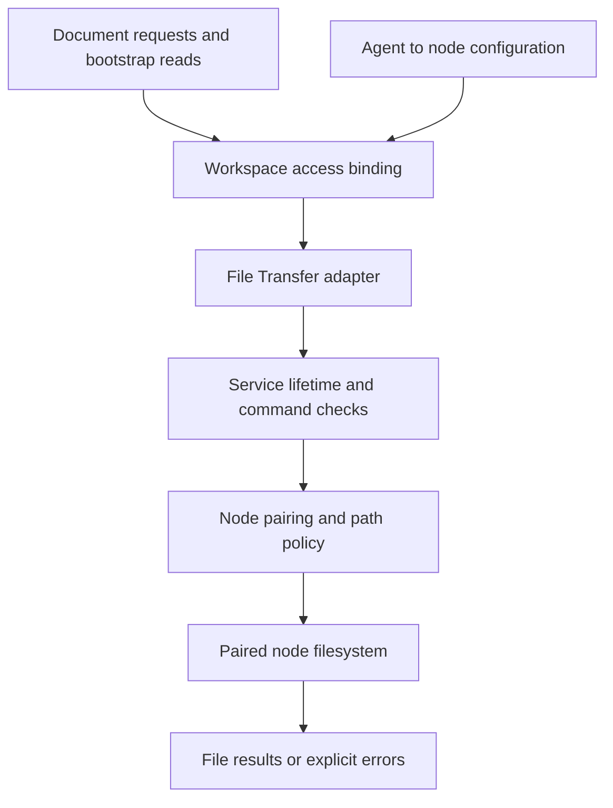

Codex review: blocked before merge. _Reviewed September 18, 2026, 8:28 PM ET / September 19, 2026, 00:28 UTC (Revision 14)._

# ClawSweeper review

## What this changes

The File Transfer plugin routes agent document and bootstrap access to paired-node workspaces, adds file metadata reads, and supports node restarts with saved pairing credentials.

## Merge readiness

⛔ **Blocked before merge - 6 items remain**

This PR remains useful beyond the merged workspace foundation. The earlier hardlink finding is fixed, and no remaining concrete correctness defect was found; the service-authority expansion still requires security-owner acceptance.

**Priority:** P2
**Reviewed head:** `6a6b65590484e98e13886438ae3f405266189ccb`
**Owner decision:** Required. See [Decision needed](#decision-needed).

## Review scores

| Measure | Result | What it means |
|---|---|---|
| **Overall readiness** | 🐚 platinum hermit **(4/6)** | A coherent adapter with meaningful production-path evidence and repaired hardlink protection; the remaining gate is explicit authority acceptance. |
| **Proof confidence** | 🐚 platinum hermit **(4/6)** | Sufficient (live_output): The captured body reports successful packaged Gateway/node CLI execution of document reads, reader denials, owner writes, missing-workspace creation, disconnects, and saved-token restarts; the inspected production-path scenario matches the adapter. Earlier-revision proof remains relevant to the unchanged reviewed behavior, without claiming Enterprise deployment or rollback of dispatched writes. |
| **Patch quality** | 🐚 platinum hermit **(4/6)** | Security review found an item that needs attention. |

## Verification

| Check | Result | Evidence |
|---|---|---|
| **Real behavior** | Verified | Sufficient (live_output): The captured body reports successful packaged Gateway/node CLI execution of document reads, reader denials, owner writes, missing-workspace creation, disconnects, and saved-token restarts; the inspected production-path scenario matches the adapter. Earlier-revision proof remains relevant to the unchanged reviewed behavior, without claiming Enterprise deployment or rollback of dispatched writes. |
| **Evidence reviewed** | 9 items | Introduced scope and review continuity: Reviewed the pinned base-to-head changes. Targeted comparisons against the previous reviewed head ef5c40bf7fcdc8bb6f133e4a07feb32414da1e5b showed no changes to service-nodes.ts, workspace-bridge.ts, or file-write.ts. The supplied test merge was not used to infer removals from main. Still necessary after the foundation merged: GitHub confirms https://github.com/openclaw/openclaw/pull/150584 merged as ce616b64177992b65009a93232143b407a7d396e. Fetched main contains the generic workspace binding but lacks this paired-node workspace service and service-owned invocation capability. Tree checks also found neither new module in v2026.9.4; the foundation does not supersede this adapter. Service authority boundary: The invoker checks plugin command ownership and service, plugin, and Gateway lifetimes, then dispatches with a synthetic system identity and operator.write. The normal node invocation owner still enforces pairing, command grants, plugin policy, and cancellation before transport dispatch. |
| **Findings** | None | None. |
| **Security** | Needs attention | Accept the service-owned authority boundary: The public service capability dispatches registered plugin commands with a system identity and operator.write independently of the requesting user's scopes. Command ownership, lifecycle checks, and node policies constrain it, but security-owner acceptance required by the SDK policy is not established. |

## How this fits together

Gateway document APIs and bootstrap loading consume workspace files through a shared access contract. This PR supplies a paired-node adapter that applies node command and path policies before reading or writing the remote filesystem.

## Decision needed

| Question | Recommendation |
|---|---|
| Should Gateway services receive plugin-owned system authority for their registered node commands, independently of incoming caller scopes? | **Accept the bounded service capability:** Have the security owner accept the documented command-ownership, lifecycle, public-operation authorization, and non-rollback contract. |

Why: The implementation and discussion intentionally select this boundary, but the scoped SDK policy requires security-owner acceptance that the available discussion explicitly does not establish.

## Before merge

- [ ] **Resolve security concern: Accept the service-owned authority boundary** - The public service capability dispatches registered plugin commands with a system identity and operator.write independently of the requesting user's scopes. Command ownership, lifecycle checks, and node policies constrain it, but security-owner acceptance required by the SDK policy is not established.
- [ ] **Resolve merge risk (P1)** - The public service capability deliberately uses system authority instead of incoming caller scopes; separate security-owner acceptance remains unrecorded.
- [ ] **Resolve merge risk (P2)** - Opting into remote placement makes document access depend on compatible, connected nodes, with no local fallback; older nodes cannot perform the constrained workspace writes.
- [ ] **Complete next step (P2)** - Obtain and record security-owner acceptance of the public service-owned node invocation capability.
- [ ] **Resolve maintainer decision** - Resolve the maintainer decision shown above before merge.
- [ ] **Add data-model compatibility proof** - Confirm migration or upgrade compatibility proof before merge.

## Findings

- [medium] Accept the service-owned authority boundary — `src/plugins/service-nodes.ts:82`

<strong>Agent review details</strong>

### Security

Needs attention: The intentional service-authority expansion needs security-owner acceptance; no separate concrete bypass or supply-chain regression was found.

### PR surface

Source +661, Tests +1240, Docs +71, Generated 0. Total +1972 across 44 files.

View PR surface stats

| Area | Files | Added | Removed | Net |
|---|---:|---:|---:|---:|
| Source | 21 | 718 | 57 | +661 |
| Tests | 18 | 1266 | 26 | +1240 |
| Docs | 3 | 71 | 0 | +71 |
| Config | 0 | 0 | 0 | 0 |
| Generated | 2 | 3 | 3 | 0 |
| Other | 0 | 0 | 0 | 0 |
| **Total** | **44** | **2058** | **86** | **+1972** |

### Review metrics

| Metric | Value | Why it matters |
|---|---|---|
| **Production versus test growth** | production +661 net lines; tests and test support +1,240 net lines | Production growth implements the node adapter, metadata operation, and lifecycle-bound service capability; docs are excluded. |
| **Operator configuration** | 1 workspace mapping section and 1 CLI flag added | Remote placement and resumable pairing are explicit opt-ins rather than changes to existing local defaults. |

### Stored data model

Persistent data-model change detected: `serialized state: src/gateway/server-methods/agents-files.ts`. Confirm migration or upgrade compatibility proof before merge.

### Merge-risk options

**Maintainer options:**
1. **Accept the documented capability and node requirements (recommended)**  
   Record security-owner acceptance and retain the explicit incompatible-node failures for opt-in remote workspaces.
2. **Pause for a narrower authority contract**  
   Hold this layer if the security owner does not accept services invoking their plugin's commands with system authority.

### Technical review

Best possible solution:

Retain the plugin-owned adapter and unchanged local defaults, with explicit security-owner acceptance of the bounded service capability and documented compatible-node requirements.

Do we have a high-confidence way to reproduce the issue?

Not applicable to the feature request; the inspected process-level scenario provides a concrete validation path for remote document access and its permission boundaries.

Is this the best way to solve the issue?

Yes, technically: adapting the existing workspace contract through File Transfer avoids a competing file-access owner, while the new service authority remains an explicit human acceptance decision.

AGENTS.md: found and applied where relevant.

Codex review notes: model internal, reasoning medium; reviewed against [2cbef434846a](https://github.com/openclaw/openclaw/commit/2cbef434846ad61129eb7076c994a6077e72b08f).

### Labels

Label justifications:

- `P2`: This is a bounded remote-workspace capability with no demonstrated urgent regression in existing installations.
- `merge-risk: 🚨 compatibility`: The PR expands the public service API and requires compatible node commands for opt-in remote workspace access.
- `merge-risk: 🚨 security-boundary`: Service-owned node invocation intentionally substitutes plugin system authority for incoming caller scopes.
- `rating: 🐚 platinum hermit`: Overall readiness is 🐚 platinum hermit; proof is 🐚 platinum hermit and patch quality is 🐚 platinum hermit.
- `status: 👀 ready for maintainer look`: ClawSweeper has no concrete contributor-facing blocker left for this PR. Sufficient (live_output): The captured body reports successful packaged Gateway/node CLI execution of document reads, reader denials, owner writes, missing-workspace creation, disconnects, and saved-token restarts; the inspected production-path scenario matches the adapter. Earlier-revision proof remains relevant to the unchanged reviewed behavior, without claiming Enterprise deployment or rollback of dispatched writes.
- `proof: sufficient`: Contributor real behavior proof is sufficient. The captured body reports successful packaged Gateway/node CLI execution of document reads, reader denials, owner writes, missing-workspace creation, disconnects, and saved-token restarts; the inspected production-path scenario matches the adapter. Earlier-revision proof remains relevant to the unchanged reviewed behavior, without claiming Enterprise deployment or rollback of dispatched writes.

### Evidence

Security concerns:

- [medium] Accept the service-owned authority boundary — `src/plugins/service-nodes.ts:82`
  The public service capability dispatches registered plugin commands with a system identity and operator.write independently of the requesting user's scopes. Command ownership, lifecycle checks, and node policies constrain it, but security-owner acceptance required by the SDK policy is not established.
  Confidence: 0.98

What I checked:

- **Introduced scope and review continuity:** Reviewed the pinned base-to-head changes. Targeted comparisons against the previous reviewed head ef5c40bf7fcdc8bb6f133e4a07feb32414da1e5b showed no changes to service-nodes.ts, workspace-bridge.ts, or file-write.ts. The supplied test merge was not used to infer removals from main. ([6a6b65590484](https://github.com/openclaw/openclaw/commit/6a6b65590484e98e13886438ae3f405266189ccb))
- **Still necessary after the foundation merged:** GitHub confirms https://github.com/openclaw/openclaw/pull/150584 merged as ce616b64177992b65009a93232143b407a7d396e. Fetched main contains the generic workspace binding but lacks this paired-node workspace service and service-owned invocation capability. Tree checks also found neither new module in v2026.9.4; the foundation does not supersede this adapter. ([`src/agents/workspace-access.ts:26`](https://github.com/openclaw/openclaw/blob/2cbef434846ad61129eb7076c994a6077e72b08f/src/agents/workspace-access.ts#L26), [2cbef434846a](https://github.com/openclaw/openclaw/commit/2cbef434846ad61129eb7076c994a6077e72b08f))
- **Service authority boundary:** The invoker checks plugin command ownership and service, plugin, and Gateway lifetimes, then dispatches with a synthetic system identity and operator.write. The normal node invocation owner still enforces pairing, command grants, plugin policy, and cancellation before transport dispatch. ([`src/plugins/service-nodes.ts:82`](https://github.com/openclaw/openclaw/blob/6a6b65590484e98e13886438ae3f405266189ccb/src/plugins/service-nodes.ts#L82), [6a6b65590484](https://github.com/openclaw/openclaw/commit/6a6b65590484e98e13886438ae3f405266189ccb))
- **Applicable SDK acceptance requirement:** The scoped SDK policy requires SDK and security-owner acceptance when widening a capability's authority boundary. The new public service capability materially changes whose authority reaches node operations. ([`src/plugin-sdk/AGENTS.md:75`](https://github.com/openclaw/openclaw/blob/6a6b65590484e98e13886438ae3f405266189ccb/src/plugin-sdk/AGENTS.md#L75), [6a6b65590484](https://github.com/openclaw/openclaw/commit/6a6b65590484e98e13886438ae3f405266189ccb))
- **Prior hardlink defect repaired:** Workspace writes request hardlink rejection; the node checks link count during preflight and on the opened write handle. The preflight policy requires an explicit support acknowledgment before sending the mutating request to older nodes. Regression coverage checks that both linked files remain unchanged. ([`extensions/file-transfer/src/node-host/file-write.ts:181`](https://github.com/openclaw/openclaw/blob/6a6b65590484e98e13886438ae3f405266189ccb/extensions/file-transfer/src/node-host/file-write.ts#L181), [6a6b65590484](https://github.com/openclaw/openclaw/commit/6a6b65590484e98e13886438ae3f405266189ccb))
- **Production-path proof:** The captured body at source revision 9d33a0a3837eeec552935bf9173cced7cae8ca7d49cd3dedd3f7eca4ac08fdd2 reports a successful packaged Gateway and real node CLI run on Node 24.19. The inspected scenario covers reader denial for writes and direct node invocation, owner saves, remote edits, missing-workspace creation, disconnect errors, and identity reuse across restarts while preserving the stale Gateway copy. These reported runs were on earlier revisions; this review did not execute them or claim deployed Enterprise coverage. ([`test/e2e/qa-lab/plugins/workspace-node-files.e2e.test.ts:24`](https://github.com/openclaw/openclaw/blob/6a6b65590484e98e13886438ae3f405266189ccb/test/e2e/qa-lab/plugins/workspace-node-files.e2e.test.ts#L24), [6a6b65590484](https://github.com/openclaw/openclaw/commit/6a6b65590484e98e13886438ae3f405266189ccb))

Likely related people:

- **unknown:** The claimed source-line change could not be verified from bounded local history. (role: source history unknown; confidence: low)
- **VACInc:** Suggested for follow-up; no historical authorship or introduction is verified. (role: unverified routing candidate; confidence: low)

### Rank-up moves

Optional improvements that raise the rating; they are not merge blockers.

- Record security-owner acceptance of the documented service-owned node capability.

### Rating scale

| Score | Internal tier | Crab rank | Meaning |
|---:|:---:|---|---|
| **6/6** | S | 🦀 challenger crab | Exceptional readiness |
| **5/6** | A | 🦞 diamond lobster | Very strong readiness |
| **4/6** | B | 🐚 platinum hermit | Good normal PR; ordinary maintainer review |
| **3/6** | C | 🦐 gold shrimp | Useful, but confidence is limited |
| **2/6** | D | 🦪 silver shellfish | Proof or implementation needs work |
| **1/6** | F | 🧂 unranked krab | Not merge-ready |
| N/A | NA | 🌊 off-meta tidepool | Rating does not apply |

Overall follows the weaker of proof and patch quality.
Shiny media proof means a screenshot, video, or linked artifact directly shows the changed behavior. Runtime, network, CSP, and security claims still need visible diagnostics.

### Workflow

- ClawSweeper keeps one durable marker-backed review comment per issue or PR.
- Re-runs edit this comment so the latest verdict, findings, and automation markers stay together instead of adding duplicate bot comments.
- A fresh review can be triggered by eligible `@clawsweeper re-review` comments, exact-item GitHub events, scheduled/background review runs, or manual workflow dispatch.
- PR/issue authors and users with repository write access can comment `@clawsweeper re-review` or `@clawsweeper re-run` on an open PR or issue to request a fresh review only.
- Maintainers can also comment `@clawsweeper review` to request a fresh review only.
- Fresh-review commands do not start repair, autofix, rebase, CI repair, or automerge.
- Maintainer-only repair and merge flows require explicit commands such as `@clawsweeper autofix`, `@clawsweeper automerge`, `@clawsweeper fix ci`, or `@clawsweeper address review`.
- Maintainers can comment `@clawsweeper explain` to ask for more context, or `@clawsweeper stop` to stop active automation.

### History

Review history (13 earlier review cycles; latest 8 shown)

<!-- clawsweeper-review-history v=1 total=13 -->
- reviewed 2026-09-17T09:41:52.458Z sha 6dcbd6aad89b6457dde6023dd3b6e0142eb85254 :: needs real behavior proof before merge. :: [P1] Fence and settle node writes before releasing the workspace binding | [P1] Preserve hardlink rejection for remote workspace saves
- reviewed 2026-09-18T00:15:05.041Z sha 596284a9b3759436f673ccb5b18f890f9fdcd650 :: needs real behavior proof before merge. :: [P1] Fence and settle node writes before releasing the workspace binding | [P1] Preserve hardlink rejection for remote workspace saves
- reviewed 2026-09-18T08:43:36.464Z sha 596284a9b3759436f673ccb5b18f890f9fdcd650 :: needs real behavior proof before merge. :: [P1] [P1] Fence and settle node writes before releasing the workspace binding | [P1] [P1] Preserve hardlink rejection for remote workspace saves
- reviewed 2026-09-18T20:32:47.707Z sha 596284a9b3759436f673ccb5b18f890f9fdcd650 :: needs real behavior proof before merge. :: [P1] [P1] Fence and settle node writes before releasing the workspace binding | [P1] [P1] Preserve hardlink rejection for remote workspace saves
- reviewed 2026-09-18T21:36:28.078Z sha c0b3a9d2f0052be963298c6b3c0be3b36d0b422b :: blocked before merge. :: none
- reviewed 2026-09-18T22:16:40.158Z sha 7121eaea9c92d7369a99c024c07d72a5a29fce9b :: blocked before merge. :: none
- reviewed 2026-09-18T22:25:44.878Z sha 052330916a59e68ef2339fdb90eded4afab0fcff :: blocked before merge. :: none
- reviewed 2026-09-18T22:57:10.237Z sha ef5c40bf7fcdc8bb6f133e4a07feb32414da1e5b :: blocked before merge. :: none

<!-- clawsweeper-security:security-sensitive item=150734 sha=6a6b65590484e98e13886438ae3f405266189ccb confidence=high updated_at=2026-09-19T00:24:14Z reviewed_at=2026-09-19T00:28:16.725Z lease_owner=github-run-35409153862-1 lease_comment_id=5737806505 source_revision=9d33a0a3837eeec552935bf9173cced7cae8ca7d49cd3dedd3f7eca4ac08fdd2 live_verification=absent -->
<!-- clawsweeper-verdict:needs-human item=150734 sha=6a6b65590484e98e13886438ae3f405266189ccb confidence=high updated_at=2026-09-19T00:24:14Z reviewed_at=2026-09-19T00:28:16.725Z lease_owner=github-run-35409153862-1 lease_comment_id=5737806505 source_revision=9d33a0a3837eeec552935bf9173cced7cae8ca7d49cd3dedd3f7eca4ac08fdd2 live_verification=absent -->
<!-- clawsweeper-review-state:blocked item=150734 sha=6a6b65590484e98e13886438ae3f405266189ccb v=1 -->

<!-- clawsweeper-review-version item=150734 reviewed_at=2026-09-19T00:28:16.725Z sha=6a6b65590484e98e13886438ae3f405266189ccb source_revision=9d33a0a3837eeec552935bf9173cced7cae8ca7d49cd3dedd3f7eca4ac08fdd2 lease_owner=github-run-35409153862-1 lease_comment_id=5737806505 v=1 -->

<!-- clawsweeper-review item=150734 -->