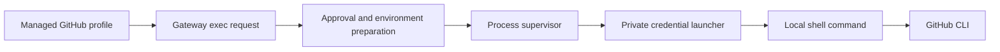

Codex review: needs maintainer review before merge. _Reviewed September 1, 2026, 12:34 AM ET / 04:34 UTC._

# ClawSweeper review

## What this changes

The PR binds a managed GitHub token at each Gateway-hosted exec launch, refuses missing or insecure profiles, and routes pipe and PTY launches through the same executable-and-arguments path.

## Merge readiness

⚠️ **Ready for maintainer review - 4 items remain**

No discrete blocking defect was found. This maintainer-authored, protected PR remains open for an owner decision on the intentional fail-closed credential boundary and its compatibility tradeoff.

**Priority:** P1
**Reviewed head:** `f0146bb2bc7a153d4210da74a833becf9eb930bf`
**Owner decision:** Required. See [Decision needed](#decision-needed).

## Review scores

| Measure | Result | What it means |
|---|---|---|
| **Overall readiness** | 🐚 platinum hermit **(4/6)** | The patch has focused boundary coverage and supplied real-run evidence, with an intentional compatibility/security decision still requiring owner acceptance. |
| **Proof confidence** | 🐚 platinum hermit **(4/6)** | Sufficient (live_output): The PR body records 14 post-fix Gateway-backed application cases, including missing/tokenless profiles, rotation, PTY, and service paths; the changed exec owner passes only the profile path through supervision and reads the token in the child bootstrap before the protected command runs. The direct source tests independently cover the same refusal-before-command invariant. |
| **Patch quality** | 🐚 platinum hermit **(4/6)** | No actionable review findings were identified. |

## Verification

| Check | Result | Evidence |
|---|---|---|
| **Real behavior** | Verified | Sufficient (live_output): The PR body records 14 post-fix Gateway-backed application cases, including missing/tokenless profiles, rotation, PTY, and service paths; the changed exec owner passes only the profile path through supervision and reads the token in the child bootstrap before the protected command runs. The direct source tests independently cover the same refusal-before-command invariant. |
| **Evidence reviewed** | 7 items | Current-main gap: Fetched main still calls the local exec runtime without a selected-profile launch argument, so it has the environment-only behavior this PR replaces. Gateway launch owner: The exec tool derives a profile directory only for managed Gateway execution and forwards it through both immediate and approval-delayed launch paths. Credential boundary and regression coverage: The resolver rejects unsafe, missing, malformed, or tokenless profiles before launch; focused tests cover pipe, PTY, fallback, rotation, deletion, and secretless supervisor inputs. |
| **Findings** | None | None. |
| **Security** | None | None. |

## How this fits together

Gateway-hosted exec prepares an environment and sends a shell command to the process supervisor. This PR inserts a private child-side credential read between that prepared context and the actual local shell launch.

## Decision needed

| Question | Recommendation |
|---|---|
| Should this PR make a configured managed GitHub profile fail closed at every Gateway-hosted exec launch when its profile is missing, malformed, or no longer private? | **Accept launch-bound fail-closed identity:** Land the documented behavior so managed Gateway exec either uses the selected credential snapshot or stops before the command. |

Why: The implementation is coherent and covered, but it deliberately trades native-keyring continuation for account-selection integrity on existing managed setups.

## Before merge

- [ ] **Resolve merge risk (P1)** - Existing managed local-exec profiles that fail the new ownership, hardlink, or YAML validation will now stop before command launch rather than falling through to native GitHub CLI state; that is intentional but needs explicit acceptance as an upgrade behavior.
- [ ] **Resolve merge risk (P1)** - The review could not independently inspect the installed fs-safe 0.5.6 implementation that supplies the secure-file and permission primitives, so maintainer review should confirm the asserted wrapper contract before landing.
- [ ] **Complete next step (P2)** - No mechanical repair is indicated; the remaining action is maintainer acceptance of the intentional credential-boundary and compatibility behavior.

<strong>Agent review details</strong>

### Security

None.

### PR surface

Source +144, Tests +1076, Docs +9, Other +2. Total +1231 across 34 files.

View PR surface stats

| Area | Files | Added | Removed | Net |
|---|---:|---:|---:|---:|
| Source | 12 | 192 | 48 | +144 |
| Tests | 17 | 1241 | 165 | +1076 |
| Docs | 4 | 17 | 8 | +9 |
| Config | 0 | 0 | 0 | 0 |
| Generated | 0 | 0 | 0 | 0 |
| Other | 1 | 2 | 0 | +2 |
| **Total** | **34** | **1452** | **221** | **+1231** |

### Review metrics

| Metric | Value | Why it matters |
|---|---|---|
| **Production and test delta** | production +192/-48 (net +144); tests +1241/-165 | The positive production growth implements a new private launch owner and is justified only if maintainers accept that security boundary over the former fallback. |

### Root-cause cluster

Relationship: `fixed_by_candidate`
Canonical: https://github.com/openclaw/openclaw/issues/134323
Summary: This PR is the candidate repair for the managed-profile fallback reported in the canonical issue.

Members:
- `canonical`: https://github.com/openclaw/openclaw/issues/134323 - Both items describe native GitHub authentication becoming eligible after managed-profile loss in Gateway-hosted exec.
- `adjacent_distinct`: https://github.com/openclaw/openclaw/pull/133799 - That open PR concerns personal GitHub connections and publication identity, not this local exec launch repair.

Proposal only: this assessment does not dispatch repair, suppress jobs, mutate sibling items, close, or merge anything.

### Merge-risk options

**Maintainer options:**
1. **Accept the managed-profile boundary (recommended)**  
   Accept the visible reconnect failure for invalid managed profiles in exchange for preventing native-account selection at local command launch.
2. **Pause for fs-safe contract confirmation**  
   Verify the installed secure-file and permission-wrapper guarantees before merging this credential-boundary change.

### Technical review

Best possible solution:

Retain the launch-time binding, with the documented reconnect path, once an owner accepts the deliberate fail-closed behavior and verifies the existing fs-safe primitive contract.

Do we have a high-confidence way to reproduce the issue?

Yes: current-main source passes only a non-secret managed profile overlay, while the focused test suite provides missing, tokenless, rotation, deletion, PTY, and approval-delayed launch scenarios. This read-only review did not rerun them.

Is this the best way to solve the issue?

Yes, subject to maintainer acceptance of fail-closed compatibility: direct inspection shows the final Gateway child-launch boundary is where the token can be supplied without placing it in approval, worker, or shared-run state; Codex native shell has a distinct environment contract.

AGENTS.md: found and applied where relevant.

Codex review notes: model internal, reasoning high; reviewed against [fed0215c58b3](https://github.com/openclaw/openclaw/commit/fed0215c58b36c43bab83515e9d7be06189a5e4c).

### Labels

Label justifications:

- `P1`: A configured managed identity can otherwise cause local agent commands to select the wrong GitHub account.
- `merge-risk: 🚨 compatibility`: Invalid existing managed profiles will change from native credential fallback to a visible pre-launch refusal.
- `merge-risk: 🚨 security-boundary`: The patch changes which credential reaches the final local command process and blocks unintended native identity selection.
- `rating: 🐚 platinum hermit`: Overall readiness is 🐚 platinum hermit; proof is 🐚 platinum hermit and patch quality is 🐚 platinum hermit.
- `status: 👀 ready for maintainer look`: ClawSweeper has no concrete contributor-facing blocker left for this PR. Sufficient (live_output): The PR body records 14 post-fix Gateway-backed application cases, including missing/tokenless profiles, rotation, PTY, and service paths; the changed exec owner passes only the profile path through supervision and reads the token in the child bootstrap before the protected command runs. The direct source tests independently cover the same refusal-before-command invariant.
- `proof: sufficient`: Contributor real behavior proof is sufficient. The PR body records 14 post-fix Gateway-backed application cases, including missing/tokenless profiles, rotation, PTY, and service paths; the changed exec owner passes only the profile path through supervision and reads the token in the child bootstrap before the protected command runs. The direct source tests independently cover the same refusal-before-command invariant.

### Evidence

What I checked:

- **Current-main gap:** Fetched main still calls the local exec runtime without a selected-profile launch argument, so it has the environment-only behavior this PR replaces. ([`src/agents/bash-tools.exec-run.ts:504`](https://github.com/openclaw/openclaw/blob/fed0215c58b3/src/agents/bash-tools.exec-run.ts#L504), [fed0215c58b3](https://github.com/openclaw/openclaw/commit/fed0215c58b3))
- **Gateway launch owner:** The exec tool derives a profile directory only for managed Gateway execution and forwards it through both immediate and approval-delayed launch paths. ([`src/agents/bash-tools.exec-run.ts:505`](https://github.com/openclaw/openclaw/blob/f0146bb2bc7a/src/agents/bash-tools.exec-run.ts#L505), [f0146bb2bc7a](https://github.com/openclaw/openclaw/commit/f0146bb2bc7a))
- **Credential boundary and regression coverage:** The resolver rejects unsafe, missing, malformed, or tokenless profiles before launch; focused tests cover pipe, PTY, fallback, rotation, deletion, and secretless supervisor inputs. ([`src/agents/github-exec-credential.ts:37`](https://github.com/openclaw/openclaw/blob/f0146bb2bc7a/src/agents/github-exec-credential.ts#L37), [f0146bb2bc7a](https://github.com/openclaw/openclaw/commit/f0146bb2bc7a))
- **PTY preserves the wrapped launch command:** The runtime builds one wrapped argv for pipe and PTY paths, and the supervisor now invokes that argv directly rather than rediscovering a shell. ([`src/agents/bash-tools.exec-runtime.ts:932`](https://github.com/openclaw/openclaw/blob/f0146bb2bc7a/src/agents/bash-tools.exec-runtime.ts#L932), [f0146bb2bc7a](https://github.com/openclaw/openclaw/commit/f0146bb2bc7a))
- **Codex contract checked directly:** OpenClaw excludes the local identity overlay for Codex sandbox and remote execution. Direct inspection of sibling Codex at 78c290807ce710180111df227df3b7a4fe845452 found that its local process builds the policy environment plus explicit values and then spawns it, without a private final-child credential hook. ([`extensions/codex/src/app-server/run-attempt-connection.ts:137`](https://github.com/openclaw/openclaw/blob/f0146bb2bc7a/extensions/codex/src/app-server/run-attempt-connection.ts#L137), [f0146bb2bc7a](https://github.com/openclaw/openclaw/commit/f0146bb2bc7a))
- **History and current ownership:** History shows the proposed launch binding and the prior cancellation/exec work are adjacent to the same current execution surface. ([`src/agents/bash-tools.exec-runtime.ts:932`](https://github.com/openclaw/openclaw/blob/7a312b26c756/src/agents/bash-tools.exec-runtime.ts#L932), [7a312b26c756](https://github.com/openclaw/openclaw/commit/7a312b26c756))

Likely related people:

- **steipete:** Suggested for follow-up; no historical authorship or introduction is verified. (role: unverified routing candidate; confidence: low)
- **Omar Shahine:** Suggested for follow-up; no historical authorship or introduction is verified. (role: unverified routing candidate; confidence: low)
- **Alix-007:** Suggested for follow-up; no historical authorship or introduction is verified. (role: unverified routing candidate; confidence: low)

### Rank-up moves

Optional improvements that raise the rating; they are not merge blockers.

- Record maintainer acceptance of the fail-closed managed-profile upgrade behavior and confirm the fs-safe wrapper contract.

### Rating scale

| Score | Internal tier | Crab rank | Meaning |
|---:|:---:|---|---|
| **6/6** | S | 🦀 challenger crab | Exceptional readiness |
| **5/6** | A | 🦞 diamond lobster | Very strong readiness |
| **4/6** | B | 🐚 platinum hermit | Good normal PR; ordinary maintainer review |
| **3/6** | C | 🦐 gold shrimp | Useful, but confidence is limited |
| **2/6** | D | 🦪 silver shellfish | Proof or implementation needs work |
| **1/6** | F | 🧂 unranked krab | Not merge-ready |
| N/A | NA | 🌊 off-meta tidepool | Rating does not apply |

Overall follows the weaker of proof and patch quality.
Shiny media proof means a screenshot, video, or linked artifact directly shows the changed behavior. Runtime, network, CSP, and security claims still need visible diagnostics.

### Workflow

- ClawSweeper keeps one durable marker-backed review comment per issue or PR.
- Re-runs edit this comment so the latest verdict, findings, and automation markers stay together instead of adding duplicate bot comments.
- A fresh review can be triggered by eligible `@clawsweeper re-review` comments, exact-item GitHub events, scheduled/background review runs, or manual workflow dispatch.
- PR/issue authors and users with repository write access can comment `@clawsweeper re-review` or `@clawsweeper re-run` on an open PR or issue to request a fresh review only.
- Maintainers can also comment `@clawsweeper review` to request a fresh review only.
- Fresh-review commands do not start repair, autofix, rebase, CI repair, or automerge.
- Maintainer-only repair and merge flows require explicit commands such as `@clawsweeper autofix`, `@clawsweeper automerge`, `@clawsweeper fix ci`, or `@clawsweeper address review`.
- Maintainers can comment `@clawsweeper explain` to ask for more context, or `@clawsweeper stop` to stop active automation.

### History

Review history (5 earlier review cycles)

<!-- clawsweeper-review-history v=1 total=5 -->
- reviewed 2026-08-31T18:07:10.147Z sha 48f0f7767937a099e33ec13537c9ec52ed882d99 :: needs maintainer review before merge. :: none
- reviewed 2026-08-31T18:31:15.652Z sha 967faeca9dedfb7751c34068f5f95da1a624f589 :: needs maintainer review before merge. :: none
- reviewed 2026-08-31T19:21:32.533Z sha d5a2742fef6b63ab1930a9fbbbf33be5f9a34b65 :: needs maintainer review before merge. :: none
- reviewed 2026-08-31T23:53:25.981Z sha d5a2742fef6b63ab1930a9fbbbf33be5f9a34b65 :: needs maintainer review before merge. :: none
- reviewed 2026-09-01T04:09:23.357Z sha f0146bb2bc7a153d4210da74a833becf9eb930bf :: needs maintainer review before merge. :: none

<!-- clawsweeper-verdict:needs-human item=134351 sha=f0146bb2bc7a153d4210da74a833becf9eb930bf confidence=high updated_at=2026-09-01T04:29:32Z reviewed_at=2026-09-01T04:34:05.294Z lease_owner=github-run-33469947609-1 lease_comment_id=5488901418 source_revision=f7100694eb5ce22146a0eca8970d5423fb74fbfc088e3af9569074426f2228e6 live_verification=absent -->

<!-- clawsweeper-review-version item=134351 reviewed_at=2026-09-01T04:34:05.294Z sha=f0146bb2bc7a153d4210da74a833becf9eb930bf source_revision=f7100694eb5ce22146a0eca8970d5423fb74fbfc088e3af9569074426f2228e6 lease_owner=github-run-33469947609-1 lease_comment_id=5488901418 v=1 -->

<!-- clawsweeper-review item=134351 -->