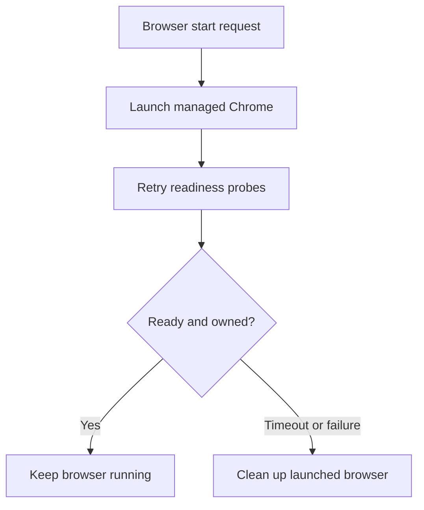

Codex review: needs maintainer review before merge. _Reviewed September 15, 2026, 1:17 PM ET / 17:17 UTC (Revision 2)._

# ClawSweeper review

## What this changes

Increase managed-browser startup probe timeouts to tolerate delayed responses, with a regression test and troubleshooting guidance.

## Merge readiness

✅ **Ready for maintainer review**

The prior documentation finding is resolved, and no actionable introduced defects remain. The fix is still absent from pinned main and the latest release.

**Priority:** P2
**Reviewed head:** `7a038e8ea352fd4111f7a596c04804af60b90b0b`

## Review scores

| Measure | Result | What it means |
|---|---|---|
| **Overall readiness** | 🐚 platinum hermit **(4/6)** | A focused repair with meaningful simulated regression coverage and the prior documentation issue resolved. |
| **Proof confidence** | 🌊 off-meta tidepool | Not applicable: The supplied maintainer classification exempts this PR from external-contributor live proof; the reported evidence exercises startup through a mocked readiness client and does not claim real overloaded-Gateway recovery. |
| **Patch quality** | 🐚 platinum hermit **(4/6)** | No actionable review findings were identified. |

## Verification

| Check | Result | Evidence |
|---|---|---|
| **Real behavior** | Not applicable | Not applicable: The supplied maintainer classification exempts this PR from external-contributor live proof; the reported evidence exercises startup through a mocked readiness client and does not claim real overloaded-Gateway recovery. |
| **Evidence reviewed** | 7 items | Prior finding resolved: The current troubleshooting sentence describes the eight-second retry window without recommending the retired browser.localCdpReadyTimeoutMs setting. This addresses the retained prior finding and the author's correction comment. The configuration owner still assigns the fixed default. Existing startup owner retained: The existing readiness loop consumes the increased timeout, verifies the spawned PID owns the endpoint, checks cancellation before adoption, and cleans up on failure. Remote and attach-only profiles take separate paths. The diff adds no authority-bearing value, public API, persisted setting, dependency, or security-policy change. Regression coverage and proof scope: The added test exercises ensureBrowserAvailable with simulated 750 ms readiness responses and asserts that the launched browser remains registered without cleanup. Existing sibling tests cover failed readiness, foreign endpoint ownership, cancellation, and remote profiles. The complete supplied PR body reports 60 focused tests passing and expressly disclaims a live overloaded-Gateway reproduction; tests were not executed during this read-only review. |
| **Findings** | None | None. |
| **Security** | None | None. |

## How this fits together

The browser plugin launches managed Chrome and checks its Chrome DevTools Protocol connection before reporting startup success. Failed readiness or ownership checks trigger cleanup of the launched process.

## Before merge

None.

<strong>Agent review details</strong>

### Security

None.

### PR surface

Source 0, Tests +19, Docs +1. Total +20 across 4 files.

View PR surface stats

| Area | Files | Added | Removed | Net |
|---|---:|---:|---:|---:|
| Source | 2 | 2 | 2 | 0 |
| Tests | 1 | 19 | 0 | +19 |
| Docs | 1 | 1 | 0 | +1 |
| Config | 0 | 0 | 0 | 0 |
| Generated | 0 | 0 | 0 | 0 |
| Other | 0 | 0 | 0 | 0 |
| **Total** | **4** | **22** | **2** | **+20** |

### Review metrics

| Metric | Value | Why it matters |
|---|---|---|
| **Startup probe allowance** | HTTP 250→1500 ms; derived WebSocket allowance 500→2000 ms | Longer individual probes tolerate delayed responses while retaining the existing eight-second retry window. |

### Technical review

Best possible solution:

Keep startup tolerance in the existing readiness owner while preserving endpoint ownership checks, cleanup, and separate remote-profile timing.

Do we have a high-confidence way to reproduce the issue?

Yes, at the source level: repeated post-launch responses taking 750 ms exceed main's 250 ms probe limit and exhaust readiness retries. The regression models that path; no live Gateway reproduction was performed.

Is this the best way to solve the issue?

Yes. Adjusting the existing per-probe allowance addresses repeated premature timeouts without introducing another retry mechanism or a configuration option.

AGENTS.md: found and applied where relevant.

Codex review notes: model internal, reasoning medium; reviewed against [ad6939104457](https://github.com/openclaw/openclaw/commit/ad693910445783e785673433a5056f6adaa5f477).

### Labels

Label justifications:

- `P2`: This is a bounded reliability fix for managed-browser startup under delayed readiness responses.
- `rating: 🐚 platinum hermit`: Overall readiness is 🐚 platinum hermit; proof is 🌊 off-meta tidepool and patch quality is 🐚 platinum hermit.
- `status: 👀 ready for maintainer look`: ClawSweeper has no concrete contributor-facing blocker left for this PR. Not applicable: The supplied maintainer classification exempts this PR from external-contributor live proof; the reported evidence exercises startup through a mocked readiness client and does not claim real overloaded-Gateway recovery.

### Evidence

What I checked:

- **Prior finding resolved:** The current troubleshooting sentence describes the eight-second retry window without recommending the retired browser.localCdpReadyTimeoutMs setting. This addresses the retained prior finding and the author's correction comment. The configuration owner still assigns the fixed default. Public docs: [`docs/tools/browser/troubleshooting.md`](https://docs.openclaw.ai/tools/browser/troubleshooting). ([`docs/tools/browser/troubleshooting.md:59`](https://docs.openclaw.ai/tools/browser/troubleshooting), [7a038e8ea352](https://github.com/openclaw/openclaw/commit/7a038e8ea352fd4111f7a596c04804af60b90b0b))
- **Existing startup owner retained:** The existing readiness loop consumes the increased timeout, verifies the spawned PID owns the endpoint, checks cancellation before adoption, and cleans up on failure. Remote and attach-only profiles take separate paths. The diff adds no authority-bearing value, public API, persisted setting, dependency, or security-policy change. ([`extensions/browser/src/browser/server-context.availability.ts:390`](https://github.com/openclaw/openclaw/blob/7a038e8ea352fd4111f7a596c04804af60b90b0b/extensions/browser/src/browser/server-context.availability.ts#L390), [7a038e8ea352](https://github.com/openclaw/openclaw/commit/7a038e8ea352fd4111f7a596c04804af60b90b0b))
- **Regression coverage and proof scope:** The added test exercises ensureBrowserAvailable with simulated 750 ms readiness responses and asserts that the launched browser remains registered without cleanup. Existing sibling tests cover failed readiness, foreign endpoint ownership, cancellation, and remote profiles. The complete supplied PR body reports 60 focused tests passing and expressly disclaims a live overloaded-Gateway reproduction; tests were not executed during this read-only review. ([`extensions/browser/src/browser/server-context.ensure-browser-available.waits-for-cdp-ready.test.ts:191`](https://github.com/openclaw/openclaw/blob/7a038e8ea352fd4111f7a596c04804af60b90b0b/extensions/browser/src/browser/server-context.ensure-browser-available.waits-for-cdp-ready.test.ts#L191), [7a038e8ea352](https://github.com/openclaw/openclaw/commit/7a038e8ea352fd4111f7a596c04804af60b90b0b))
- **Still needed on pinned main:** Pinned main retains the 250 ms post-launch maximum; it does not contain this PR's 1500 ms allowance. ([`extensions/browser/src/browser/server-context.constants.ts:15`](https://github.com/openclaw/openclaw/blob/ad693910445783e785673433a5056f6adaa5f477/extensions/browser/src/browser/server-context.constants.ts#L15), [ad6939104457](https://github.com/openclaw/openclaw/commit/ad693910445783e785673433a5056f6adaa5f477))
- **Latest release comparison:** The supplied latest release, v2026.9.4, also retains the 250 ms maximum. ([`extensions/browser/src/browser/server-context.constants.ts:15`](https://github.com/openclaw/openclaw/blob/3a9d69db306cd7f081e06254cb89c4bcc14a7107/extensions/browser/src/browser/server-context.constants.ts#L15), [3a9d69db306c](https://github.com/openclaw/openclaw/commit/3a9d69db306cd7f081e06254cb89c4bcc14a7107))
- **Area-history routing:** Current-main history identifies prior browser startup-timeout work by Peter Steinberger. GitHub commit metadata verifies steipete as its author and committer and exposes the constants patch. This supports routing beyond authorship of the proposed PR; it does not attribute the reported defect. ([`extensions/browser/src/browser/server-context.constants.ts:12`](https://github.com/openclaw/openclaw/blob/b2b898c2a8bce33a91f31403832eff1aa5f0b55e/extensions/browser/src/browser/server-context.constants.ts#L12), [b2b898c2a8bc](https://github.com/openclaw/openclaw/commit/b2b898c2a8bce33a91f31403832eff1aa5f0b55e))

Likely related people:

- **unknown:** The claimed source-line change could not be verified from bounded local history. (role: source history unknown; confidence: low)

### Rating scale

| Score | Internal tier | Crab rank | Meaning |
|---:|:---:|---|---|
| **6/6** | S | 🦀 challenger crab | Exceptional readiness |
| **5/6** | A | 🦞 diamond lobster | Very strong readiness |
| **4/6** | B | 🐚 platinum hermit | Good normal PR; ordinary maintainer review |
| **3/6** | C | 🦐 gold shrimp | Useful, but confidence is limited |
| **2/6** | D | 🦪 silver shellfish | Proof or implementation needs work |
| **1/6** | F | 🧂 unranked krab | Not merge-ready |
| N/A | NA | 🌊 off-meta tidepool | Rating does not apply |

Overall follows the weaker of proof and patch quality.
Shiny media proof means a screenshot, video, or linked artifact directly shows the changed behavior. Runtime, network, CSP, and security claims still need visible diagnostics.

### Workflow

- ClawSweeper keeps one durable marker-backed review comment per issue or PR.
- Re-runs edit this comment so the latest verdict, findings, and automation markers stay together instead of adding duplicate bot comments.
- A fresh review can be triggered by eligible `@clawsweeper re-review` comments, exact-item GitHub events, scheduled/background review runs, or manual workflow dispatch.
- PR/issue authors and users with repository write access can comment `@clawsweeper re-review` or `@clawsweeper re-run` on an open PR or issue to request a fresh review only.
- Maintainers can also comment `@clawsweeper review` to request a fresh review only.
- Fresh-review commands do not start repair, autofix, rebase, CI repair, or automerge.
- Maintainer-only repair and merge flows require explicit commands such as `@clawsweeper autofix`, `@clawsweeper automerge`, `@clawsweeper fix ci`, or `@clawsweeper address review`.
- Maintainers can comment `@clawsweeper explain` to ask for more context, or `@clawsweeper stop` to stop active automation.

### History

Review history (1 earlier review cycle)

<!-- clawsweeper-review-history v=1 total=1 -->
- reviewed 2026-09-15T17:05:33.387Z sha 78b43315a514442d7b6372b3c34ed761add37bf4 :: needs changes before merge. :: [P3] Remove the retired readiness configuration key from the docs

<!-- clawsweeper-verdict:needs-human item=149284 sha=7a038e8ea352fd4111f7a596c04804af60b90b0b confidence=high updated_at=2026-09-15T17:15:24Z reviewed_at=2026-09-15T17:17:45.244Z lease_owner=github-run-34999944590-1 lease_comment_id=5684709162 source_revision=0dfb31a04b971a953243a4f179e4cdbb559b39f4672f87e1a2be29c7fb768b47 live_verification=absent -->
<!-- clawsweeper-review-state:ready item=149284 sha=7a038e8ea352fd4111f7a596c04804af60b90b0b v=1 -->

<!-- clawsweeper-review-version item=149284 reviewed_at=2026-09-15T17:17:45.244Z sha=7a038e8ea352fd4111f7a596c04804af60b90b0b source_revision=0dfb31a04b971a953243a4f179e4cdbb559b39f4672f87e1a2be29c7fb768b47 lease_owner=github-run-34999944590-1 lease_comment_id=5684709162 v=1 -->

<!-- clawsweeper-review item=149284 -->