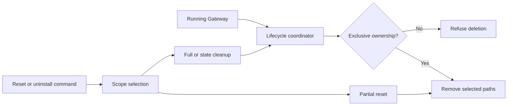

Codex review: found issues before merge. _Reviewed August 17, 2026, 12:11 PM ET / 16:11 UTC._

# ClawSweeper review

## What this changes

The PR adds cross-process lifecycle coordination so full reset and state-only uninstall refuse to delete selected SQLite state while a Gateway or another state operation owns it.

## Merge readiness

⚠️ **Needs maintainer review before merge - 4 items remain**

Keep this PR open: it materially protects full reset and state-only uninstall, but the default partial reset still deletes config, credentials, and session directories after only a managed-service check. The protected `maintainer` label also requires maintainer handling before merge.

**Priority:** P0
**Reviewed head:** `13a073f2b7196802155980080d39e082a6a4e595`

## Review scores

| Measure | Result | What it means |
|---|---|---|
| **Overall readiness** | 🦐 gold shrimp **(3/6)** | The evidence for the covered commands is strong, but a P1 unguarded reset scope prevents merge readiness. |
| **Proof confidence** | 🦞 diamond lobster **(5/6)** | Sufficient (terminal): The PR body supplies exact-head terminal evidence for the full-reset and state-only-uninstall paths; that proof does not cover the remaining partial-reset finding. |
| **Patch quality** | 🦐 gold shrimp **(3/6)** | 1 actionable review finding remain. |

## Verification

| Check | Result | Evidence |
|---|---|---|
| **Real behavior** | Verified | Sufficient (terminal): The PR body supplies exact-head terminal evidence for the full-reset and state-only-uninstall paths; that proof does not cover the remaining partial-reset finding. |
| **Evidence reviewed** | 5 items | Partial reset remains unfenced: The documented `config+creds+sessions` scope removes configuration, credentials, and per-agent session directories, but its branch deletes those paths directly after only the managed-service stop attempt. Lifecycle fence is full/state-only: Exclusive ownership is acquired inside `removeStateAndLinkedPaths`, which the reset command calls only from the `full` branch; the live-owner regression table likewise covers full reset and state-only uninstall only. Default onboarding reset shares the partial scope: `openclaw onboard --reset` defaults to `config+creds+sessions` and calls the separate reset helper, so the shared lifecycle invariant needs an explicit sibling-surface decision. |
| **Findings** | 1 actionable finding | [P1] Fence partial reset before deleting live state |
| **Security** | None | None. |

## How this fits together

CLI reset and uninstall remove local configuration, credentials, session directories, and/or SQLite state. A running Gateway may own those paths, so destructive commands must coordinate with Gateway lifecycle ownership before deletion.

## Before merge

- [ ] **Fence partial reset before deleting live state (P1)** - Late finding: the new lifecycle fence is acquired only by `removeStateAndLinkedPaths`, which this command reaches for `full` only. The default `config+creds+sessions` scope still deletes config, credentials, and per-agent session directories after an unmanaged/Nix Gateway passes the service check. Reuse the exclusive ownership boundary here and add a live-owner refusal regression.
- [ ] **Resolve merge risk (P1)** - The default `config+creds+sessions` reset can still delete live Gateway-owned credentials and session directories when an unmanaged or Nix-supervised Gateway is running.
- [ ] **Resolve merge risk (P1)** - Merging changes existing reset/uninstall recovery behavior to fail closed on lifecycle ownership; that compatibility and availability change needs the same invariant across all destructive reset paths.
- [ ] **Complete next step (P2)** - The repair is concrete, but the protected `maintainer` label requires maintainer handling before automated follow-up.

## Findings

- [P1] Fence partial reset before deleting live state — `src/commands/reset.ts:142-144`

<strong>Agent review details</strong>

### Security

None.

### PR surface

Source +438, Tests +550, Docs +4, Other +59. Total +1051 across 28 files.

View PR surface stats

| Area | Files | Added | Removed | Net |
|---|---:|---:|---:|---:|
| Source | 11 | 571 | 133 | +438 |
| Tests | 12 | 689 | 139 | +550 |
| Docs | 2 | 4 | 0 | +4 |
| Config | 0 | 0 | 0 | 0 |
| Generated | 0 | 0 | 0 | 0 |
| Other | 3 | 75 | 16 | +59 |
| **Total** | **28** | **1339** | **288** | **+1051** |

### Review metrics

| Metric | Value | Why it matters |
|---|---|---|
| **Production versus test delta** | production +614/-140 (net +474); tests/support +721/-148 (net +573); docs +4/-0 | The substantial production growth establishes a cross-process lifecycle boundary, so every destructive scope must reuse it rather than retain an unguarded sibling path. |

### Stored data model

Persistent data-model change detected: `migration/backfill/repair: src/infra/device-identity.test.ts`, `serialized state: src/commands/cleanup-utils.test.ts`, `serialized state: src/infra/gateway-lock.state-dir.test.ts`, `serialized state: src/infra/state-database-coordinator.test.ts`, `serialized state: src/infra/state-database-coordinator.ts`, `serialized state: src/state/openclaw-state-db.test.ts`, and 5 more. Confirm migration or upgrade compatibility proof before merge.

### Merge-risk options

**Maintainer options:**
1. **Fence partial reset before merge (recommended)**  
   Apply the existing lifecycle-owner guard to `config+creds+sessions` and prove unmanaged/Nix live-owner refusal plus offline cleanup.
2. **Accept live partial-reset deletion**  
   Merge with the documented full-reset-only guarantee, leaving unmanaged partial reset outside the ownership fence.

### Technical review

Best possible solution:

Use one shared exclusive lifecycle-ownership boundary for every reset path that deletes state-owned files, then add live-owner refusal and offline-success coverage for partial reset and its onboarding caller.

Do we have a high-confidence way to reproduce the issue?

Yes—source provides a high-confidence path: hold an unmanaged Gateway owner, then run `reset --scope config+creds+sessions`; the branch deletes the documented paths without acquiring the new lifecycle fence. This read-only review did not execute it.

Is this the best way to solve the issue?

No. The coordinator is the right owner boundary, but the proposed wiring is incomplete because the default partial reset bypasses it.

Full review comments:

- [P1] Fence partial reset before deleting live state — `src/commands/reset.ts:142-144`
  Late finding: the new lifecycle fence is acquired only by `removeStateAndLinkedPaths`, which this command reaches for `full` only. The default `config+creds+sessions` scope still deletes config, credentials, and per-agent session directories after an unmanaged/Nix Gateway passes the service check. Reuse the exclusive ownership boundary here and add a live-owner refusal regression.
  Confidence: 0.98
  Late finding: first raised on code an earlier review cycle already covered.

Overall correctness: patch is incorrect
Overall confidence: 0.97

AGENTS.md: found and applied where relevant.

Codex review notes: model internal, reasoning high; reviewed against [793669c8f6dd](https://github.com/openclaw/openclaw/commit/793669c8f6ddfad07b40009068f532832685b7d6).

### Labels

Label justifications:

- `P0`: The PR addresses destructive deletion of state owned by a live Gateway, a data-loss-class failure.
- `merge-risk: 🚨 compatibility`: Existing reset and uninstall flows now intentionally refuse when exclusive ownership cannot be established.
- `merge-risk: 🚨 availability`: The new coordinator participates in Gateway lifecycle admission and can block startup or cleanup when ownership is held.
- `rating: 🦐 gold shrimp`: Overall readiness is 🦐 gold shrimp; proof is 🦞 diamond lobster and patch quality is 🦐 gold shrimp.
- `status: ⏳ waiting on author`: ClawSweeper has contributor-facing work open and is waiting for author action. Sufficient (terminal): The PR body supplies exact-head terminal evidence for the full-reset and state-only-uninstall paths; that proof does not cover the remaining partial-reset finding.
- `proof: sufficient`: Contributor real behavior proof is sufficient. The PR body supplies exact-head terminal evidence for the full-reset and state-only-uninstall paths; that proof does not cover the remaining partial-reset finding.

### Evidence

What I checked:

- **Partial reset remains unfenced:** The documented `config+creds+sessions` scope removes configuration, credentials, and per-agent session directories, but its branch deletes those paths directly after only the managed-service stop attempt. ([`src/commands/reset.ts:142`](https://github.com/openclaw/openclaw/blob/13a073f2b719/src/commands/reset.ts#L142), [13a073f2b719](https://github.com/openclaw/openclaw/commit/13a073f2b719))
- **Lifecycle fence is full/state-only:** Exclusive ownership is acquired inside `removeStateAndLinkedPaths`, which the reset command calls only from the `full` branch; the live-owner regression table likewise covers full reset and state-only uninstall only. ([`src/commands/cleanup-utils.ts:362`](https://github.com/openclaw/openclaw/blob/13a073f2b719/src/commands/cleanup-utils.ts#L362), [13a073f2b719](https://github.com/openclaw/openclaw/commit/13a073f2b719))
- **Default onboarding reset shares the partial scope:** `openclaw onboard --reset` defaults to `config+creds+sessions` and calls the separate reset helper, so the shared lifecycle invariant needs an explicit sibling-surface decision. ([`src/commands/onboard.ts:573`](https://github.com/openclaw/openclaw/blob/13a073f2b719/src/commands/onboard.ts#L573), [13a073f2b719](https://github.com/openclaw/openclaw/commit/13a073f2b719))
- **Current main does not supersede the PR:** Current main still directly removes the partial reset paths and has no state-database coordinator module, so the central full-reset/state-uninstall repair remains necessary. ([`src/commands/reset.ts:127`](https://github.com/openclaw/openclaw/blob/793669c8f6dd/src/commands/reset.ts#L127), [793669c8f6dd](https://github.com/openclaw/openclaw/commit/793669c8f6dd))
- **Area provenance:** The existing reset path appears to date to Peter Steinberger's onboarding-recovery work, and the same contributor authored this PR head. ([`src/commands/reset.ts:151`](https://github.com/openclaw/openclaw/blob/890a5e895b4c/src/commands/reset.ts#L151), [890a5e895b4c](https://github.com/openclaw/openclaw/commit/890a5e895b4c))

Likely related people:

- **steipete:** Peter Steinberger authored the prior reset-path work and the current lifecycle-coordination branch. (role: recent CLI lifecycle contributor; confidence: high; commits: [890a5e895b4c](https://github.com/openclaw/openclaw/commit/890a5e895b4cbd16716ee303a6cc7beb2f794f41), [13a073f2b719](https://github.com/openclaw/openclaw/commit/13a073f2b7196802155980080d39e082a6a4e595); files: `src/commands/reset.ts`, `src/commands/cleanup-utils.ts`, `src/infra/state-database-coordinator.ts`)

### Rank-up moves

Optional improvements that raise the rating; they are not merge blockers.

- Apply the lifecycle fence to partial reset.
- Add live-owner refusal and offline-success coverage for that scope.

### Rating scale

| Score | Internal tier | Crab rank | Meaning |
|---:|:---:|---|---|
| **6/6** | S | 🦀 challenger crab | Exceptional readiness |
| **5/6** | A | 🦞 diamond lobster | Very strong readiness |
| **4/6** | B | 🐚 platinum hermit | Good normal PR; ordinary maintainer review |
| **3/6** | C | 🦐 gold shrimp | Useful, but confidence is limited |
| **2/6** | D | 🦪 silver shellfish | Proof or implementation needs work |
| **1/6** | F | 🧂 unranked krab | Not merge-ready |
| N/A | NA | 🌊 off-meta tidepool | Rating does not apply |

Overall follows the weaker of proof and patch quality.
Shiny media proof means a screenshot, video, or linked artifact directly shows the changed behavior. Runtime, network, CSP, and security claims still need visible diagnostics.

### Workflow

- ClawSweeper keeps one durable marker-backed review comment per issue or PR.
- Re-runs edit this comment so the latest verdict, findings, and automation markers stay together instead of adding duplicate bot comments.
- A fresh review can be triggered by eligible `@clawsweeper re-review` comments, exact-item GitHub events, scheduled/background review runs, or manual workflow dispatch.
- PR/issue authors and users with repository write access can comment `@clawsweeper re-review` or `@clawsweeper re-run` on an open PR or issue to request a fresh review only.
- Maintainers can also comment `@clawsweeper review` to request a fresh review only.
- Fresh-review commands do not start repair, autofix, rebase, CI repair, or automerge.
- Maintainer-only repair and merge flows require explicit commands such as `@clawsweeper autofix`, `@clawsweeper automerge`, `@clawsweeper fix ci`, or `@clawsweeper address review`.
- Maintainers can comment `@clawsweeper explain` to ask for more context, or `@clawsweeper stop` to stop active automation.

### History

Review history (4 earlier review cycles)

<!-- clawsweeper-review-history v=1 total=4 -->
- reviewed 2026-08-17T11:38:48.935Z sha 20f445f1eafaeb2fb79a7881bd230a693dfc839c :: found issues before merge. :: [P1] Preserve external paths until state cleanup succeeds
- reviewed 2026-08-17T11:46:58.724Z sha 20f445f1eafaeb2fb79a7881bd230a693dfc839c :: needs changes before merge. :: [P1] Preserve linked paths until state cleanup succeeds
- reviewed 2026-08-17T13:13:16.351Z sha 13a073f2b7196802155980080d39e082a6a4e595 :: needs maintainer review before merge. :: none
- reviewed 2026-08-17T14:01:58.188Z sha 13a073f2b7196802155980080d39e082a6a4e595 :: needs maintainer review before merge. :: none

<!-- clawsweeper-verdict:needs-human item=125253 sha=13a073f2b7196802155980080d39e082a6a4e595 confidence=high updated_at=2026-08-17T16:00:39Z reviewed_at=2026-08-17T16:11:04.603Z lease_owner=github-run-32043922170-1 lease_comment_id=5317471357 source_revision=ab9fc8e6ca5257d059129933529e23ad39c518672ebe5606f88287f21b9d02f0 -->

<!-- clawsweeper-review-version item=125253 reviewed_at=2026-08-17T16:11:04.603Z sha=13a073f2b7196802155980080d39e082a6a4e595 source_revision=ab9fc8e6ca5257d059129933529e23ad39c518672ebe5606f88287f21b9d02f0 lease_owner=github-run-32043922170-1 lease_comment_id=5317471357 v=1 -->

<!-- clawsweeper-review item=125253 -->