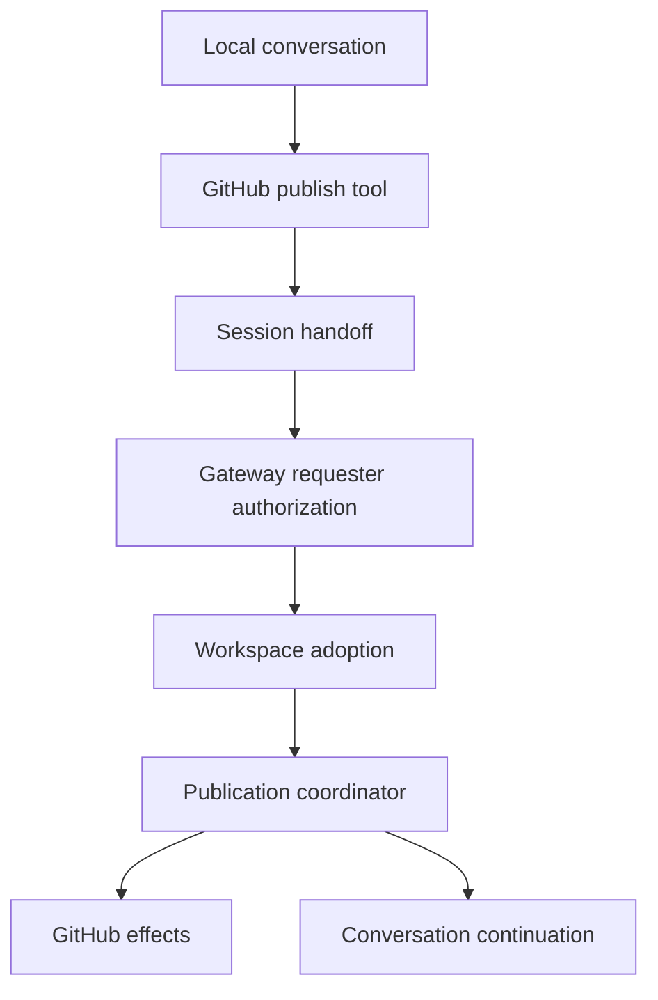

Codex review: needs maintainer review before merge.

## What this changes

This PR lets an authorized local conversation adopt a committed task checkout, publish it, and resume with the publication result.

**Example:** An unbound local conversation publishes committed work from /workspace/task using github_publish with workspacePath.
- **Before:** The publication path requires an already supported session workspace.
- **After:** OpenClaw prepares a session-owned checkout, preserves the original files, and resumes the conversation with the result.

## Review scores

| Measure | Result | What it means |
|---|---|---|
| **Overall readiness** | 🦐 gold shrimp **(3/6)** | The patch is focused and has meaningful boundary regressions; verification confidence remains at the in-process harness level. |
| **Proof confidence** | 🦐 gold shrimp **(3/6)** | The maintainer-authored PR is outside the ordinary media gate; its reported production-path harness runs cover real Git/SQLite adoption, continuation, allowed publication, and requester revocation before binding and subsequent GitHub effects. |
| **Patch quality** | 🐚 platinum hermit **(4/6)** | No actionable review findings were identified. |

## Product

**Kind:** Feature · **Worth it:** Yes · **Fix scope:** Complete
**User problem:** A local conversation cannot use brokered publication for committed task work that is not yet bound to its session.
**Reason:** The maintainer-authored direction extends brokered publication to a useful local workflow while preserving original files and established authorization boundaries.

## Merge readiness

✅ **Ready for maintainer review**

Keep open: this maintainer-authored PR adds useful local-checkout publication support, and no actionable defect was found in the pinned diff.

**Priority:** P2
**Reviewed head:** `3e3e811280640508f16868772861f5b32129e176`

## Before merge

None.

## Findings

None.

### Tests

- Missing end-to-end proof: The supplied verification uses registered-RPC and continuation harnesses with synthetic GitHub I/O rather than an installed Gateway with a live agent.

<strong>Agent review details</strong>

### How this fits together

The agent tool hands publication to the Gateway, which authorizes the requester, prepares session workspace ownership, and invokes the existing GitHub publication coordinator.

### Technical review

Best possible solution:

Land the existing-owner adoption and publication path once CI for the reviewed head passes.

Do we have a high-confidence way to reproduce the issue?

Current-main source lacks the workspacePath parameter and local adoption branch; the reported limitation is source-verifiable, although no target code was executed during this review.

Is this the best way to solve the issue?

Extending the existing adoption, requester, and handoff owners is a focused solution that avoids a competing workspace or publication implementation.

AGENTS.md: found and applied where relevant.

Codex review notes: model internal, reasoning medium; reviewed against [abce5b50c487](https://github.com/openclaw/openclaw/commit/abce5b50c48738f2d94a51cb06c046f24c42a613).

### Provenance checked

- `Workspace adoption and queued follow-ups` changes intended behavior with a stated reason (c1658c08f71cfc4c31f06f29e8e955cbea82d57b: Yield the active turn before changing workspace ownership and preserve earlier files; queued input originally caused refusal.)
- `Prepared workspace commit` keeps the original intent (3e5f7d43aaa1bc9704fc57955793cc1acaaaeb6e: Consolidate prepared workspace binding and recovery in the existing session lifecycle owner.)
- `Stable publication tool schemas` keeps the original intent (77d0f72273cb1aaeb21e8e84e6e0742d14de2c03: Derive tool listings from stable host and workspace capabilities while authorizing execution against current requester authority.)
- `Publication requester authority` keeps the original intent (65e49fa2008c2d77147f4604b6dd21333fee00bd: Retain the original requester across queued publication and reject further effects after revocation.)

### Testing

Proof path: in-process harness.

### Security

None.

### Evidence

What I checked:

- **Pinned introduction reviewed:** Reviewed the introduced hunks against the verified merge base, including production code, tests, documentation, schema, generated validator, and baseline removal; endpoint drift was excluded from PR ownership. ([3e3e81128064](https://github.com/openclaw/openclaw/commit/3e3e811280640508f16868772861f5b32129e176))
- **Current main still lacks this capability:** Current main sends publication directly to the coordinator without the new local-checkout adoption branch. ([`src/gateway/server-methods/sessions-github.ts`](https://github.com/openclaw/openclaw/blob/abce5b50c48738f2d94a51cb06c046f24c42a613/src/gateway/server-methods/sessions-github.ts), [abce5b50c487](https://github.com/openclaw/openclaw/commit/abce5b50c48738f2d94a51cb06c046f24c42a613))
- **Requester authority reaches adoption:** The new branch requires the matching session handoff, reuses path-containment admission, and composes live requester checks with workspace reservation ownership before binding. ([`src/gateway/server-methods/sessions-github.ts:328`](https://github.com/openclaw/openclaw/blob/3e3e811280640508f16868772861f5b32129e176/src/gateway/server-methods/sessions-github.ts#L328), [3e3e81128064](https://github.com/openclaw/openclaw/commit/3e3e811280640508f16868772861f5b32129e176))
- **Allowed and revoked requester coverage:** The inspected registered-RPC cases use real Git and persisted session owners; they cover successful publication and revocation before binding, push, and PR creation, asserting which effects occurred. GitHub transport is synthetic, and the PR body reports these cases passing. ([`src/gateway/github-publication-session-access.test.ts:164`](https://github.com/openclaw/openclaw/blob/3e3e811280640508f16868772861f5b32129e176/src/gateway/github-publication-session-access.test.ts#L164), [3e3e81128064](https://github.com/openclaw/openclaw/commit/3e3e811280640508f16868772861f5b32129e176))
- **Final transport authority:** The existing executor supplies its live action assertion immediately before push and PR creation, including after asynchronous effect recording. ([`src/gateway/github-publication-executor.ts:640`](https://github.com/openclaw/openclaw/blob/3e3e811280640508f16868772861f5b32129e176/src/gateway/github-publication-executor.ts#L640), [3e3e81128064](https://github.com/openclaw/openclaw/commit/3e3e811280640508f16868772861f5b32129e176))
- **Existing-state compatibility:** No persisted format or schema is added. The existing-session fixture includes inherited workspace fields, saved preferences, and selected skill libraries; adoption preserves source bytes and history routing while clearing the obsolete execution override. ([`src/gateway/github-publication-session-access.test.ts:70`](https://github.com/openclaw/openclaw/blob/3e3e811280640508f16868772861f5b32129e176/src/gateway/github-publication-session-access.test.ts#L70), [3e3e81128064](https://github.com/openclaw/openclaw/commit/3e3e811280640508f16868772861f5b32129e176))

### PR surface

Source +88, Tests +244, Docs +2, Other -1. Total +333 across 16 files. Added test files: 0.

View PR surface stats

| Area | Files | Added | Removed | Net |
|---|---:|---:|---:|---:|
| Source | 7 | 185 | 97 | +88 |
| Tests | 7 | 313 | 69 | +244 |
| Docs | 1 | 2 | 0 | +2 |
| Config | 0 | 0 | 0 | 0 |
| Generated | 0 | 0 | 0 | 0 |
| Other | 1 | 0 | 1 | -1 |
| **Total** | **16** | **500** | **167** | **+333** |

### Review metrics

| Metric | Value | Why it matters |
|---|---|---|
| **Protocol additions** | 1 optional parameter: workspacePath | The additive parameter selects local-checkout adoption; requests omitting it retain the existing publication path. |

### Labels

Label changes:

- remove `proof: sufficient`: Current real behavior proof status is not_applicable, not sufficient.

Label justifications:

- `P2`: This improves an authorized agent publication workflow with limited scope and no established urgent regression.
- `rating: 🦐 gold shrimp`: Overall readiness is 🦐 gold shrimp; proof is 🦐 gold shrimp and patch quality is 🐚 platinum hermit.
- `status: 👀 ready for maintainer look`: ClawSweeper has no concrete contributor-facing blocker left for this PR.

### Rating scale

6/6 🦀 challenger crab · 5/6 🦞 diamond lobster · 4/6 🐚 platinum hermit · 3/6 🦐 gold shrimp · 2/6 🦪 silver shellfish · 1/6 🧂 unranked krab. Overall follows the weaker of proof and patch quality; ✨ marks media proof (a screenshot, video, or linked artifact) that directly shows the changed behavior.

### Workflow

ClawSweeper edits this one comment on every review. Comment `@clawsweeper re-review` for a fresh review only. Repair and merge execution lanes are retired.

### History

Review history (7 earlier review cycles)

<!-- clawsweeper-review-history v=1 total=7 -->
- reviewed 2026-10-26T11:05:33.553Z sha 92761712a7e06fffb02c2da9eda7c71b092b4568 :: needs maintainer review before merge. :: none
- reviewed 2026-10-26T11:14:14.518Z sha 3e7490c478dff0b0f8e5b7f9a6baec5d3c138322 :: needs real behavior proof before merge. :: [P2] Replace the inherited workspace override when binding the checkout
- reviewed 2026-10-26T11:28:26.040Z sha c6f147c5ace4d1f944df148fd3c9c9a598420611 :: needs changes before merge. :: [P2] Include the saved skills snapshot before adopting the checkout
- reviewed 2026-10-26T11:42:49.196Z sha dfbbefab88cd49f67f5e2a2f28696a25fa36e74e :: needs changes before merge. :: [P2] Preserve publication recovery details in the handoff result
- reviewed 2026-10-26T11:58:31.184Z sha 0a1b134be92d90d886719c176a878e02e0e923a0 :: needs maintainer review before merge. :: none
- reviewed 2026-10-26T12:12:13.593Z sha 413484f1d59f1b949f2bf7a5717c76817ec5f7cc :: needs maintainer review before merge. :: none
- reviewed 2026-10-26T16:14:03.300Z sha a9f8612c3b64e16a1f26bcf938cee99082a22c67 :: needs maintainer review before merge. :: none

_Reviewed October 26, 2026, 3:59 PM ET / 19:59 UTC (Revision 8)._

<!-- clawsweeper-verdict:needs-human item=184531 sha=3e3e811280640508f16868772861f5b32129e176 confidence=high updated_at=2026-10-26T19:54:15Z reviewed_at=2026-10-26T19:59:26.365Z lease_owner=github-run-40390733025-1 lease_comment_id=6425851822 source_revision=8ff928edc2344e74e3ceff9e97bf8070d1002469b61b5d547555fcb3121c66d2 hold=not_opted_in findings=0 -->
<!-- clawsweeper-review-state:ready item=184531 sha=3e3e811280640508f16868772861f5b32129e176 v=1 -->

<!-- clawsweeper-review-version item=184531 reviewed_at=2026-10-26T19:59:26.365Z sha=3e3e811280640508f16868772861f5b32129e176 source_revision=8ff928edc2344e74e3ceff9e97bf8070d1002469b61b5d547555fcb3121c66d2 lease_owner=github-run-40390733025-1 lease_comment_id=6425851822 v=1 -->

<!-- clawsweeper-review item=184531 -->