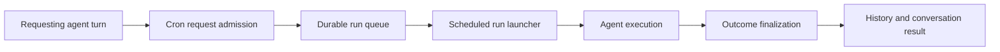

Codex review: needs real behavior proof before merge.

## What this changes

This PR hands accepted manual automation runs to scheduled execution authority and adds conversation notices when runs cannot start.

**Example:** A daily automation scheduled at 16:00 is force-run from its owning conversation at 15:41.
- **Before:** After the requesting turn ends, the accepted run is skipped because its tool caller authority has expired.
- **After:** The automation starts in a new turn after the requesting turn finishes.

## Review scores

| Measure | Result | What it means |
|---|---|---|
| **Overall readiness** | 🦪 silver shellfish **(2/6)** | The central repair has meaningful Gateway coverage, but two notification defects and an authority-boundary proof gap prevent a pass. |
| **Proof confidence** | 🦐 gold shrimp **(3/6)** | Real behavior proof is necessary before merge. See [Before merge](#before-merge). |
| **Patch quality** | 🦪 silver shellfish **(2/6)** | Security review found an item that needs attention. |

## Product

**Kind:** Bug fix · **Worth it:** Yes · **Fix scope:** Complete
**User problem:** An acknowledged run-now request silently disappears when its requesting conversation turn ends.
**Reason:** The reported failure is concrete, and the supplied maintainer-authored status establishes direction for handing accepted requests to scheduled authority.

## Merge readiness

⛔ **Blocked before merge - 5 items remain**

Keep open: this PR addresses a current automation failure, but two notification defects need repair.

**Priority:** P2
**Reviewed head:** `736e6a236c2e5255b5582a29b2150aab1fc46cd9`

## Before merge

- [ ] **Add real behavior proof** - Authority-chain proof required: the isolated Gateway harness demonstrates after-turn execution and a disabled-job refusal, but does not demonstrate rejection before privileged I/O when the job's stored operator authority is revoked during the accepted queue wait. After adding proof, update the PR body, then request a new review with `@clawsweeper re-review`. The PR author or someone with repository write access can request it.
- [ ] **Keep intentional scratch-empty skips silent (P2)** - This condition sends a warning for every skipped outcome, including scheduled jobs with payload.skipIfScratchEmpty. executeJobCore returns a normal skipped result when scratch is empty, and the default proactive job enables that policy with a default 30-minute cadence. An idle checklist therefore repeatedly appends a notice telling the user to resolve a cause and retry, although no action is needed. Exclude intentional policy skips using producer-owned classification, or restrict this notice to explicit run requests.
- [ ] **Propagate non-start metadata from preparation failures (P2)** - The new notice requires executionStarted to be explicitly false, but resolveCronRunPreparation returns model-selection errors without that field and runCronIsolatedAgentTurn preserves the omission. The setup watchdog also creates error outcomes without it. An accepted run that fails before execution consequently records an error without the promised conversation notice. Mark these outcomes authoritatively at their producers rather than treating every undefined value as an unstarted run.
- [ ] **Resolve security concern: Verify scheduled authority after removing the queued caller guard** - The manual commit guard is discarded at acceptance. Existing scheduled authority checks remain, but the supplied negative scenarios cover pre-commit refusal or withdrawal after preparation, rather than revocation of stored authority while this newly detached request waits.
- [ ] **Resolve merge risk** - Before merge, the PR owner should verify that withdrawing the job's stored authority during the queue wait prevents privileged I/O after the requesting turn ends.

## Findings

- [P2] Keep intentional scratch-empty skips silent — `src/gateway/server-cron-notifications.ts:581-584`
- [P2] Propagate non-start metadata from preparation failures — `src/cron/service/timer-outcome-finalization.ts:138-140`
- [medium] Verify scheduled authority after removing the queued caller guard — `src/cron/service/run-queue.ts:119`

### Tests

- Missing end-to-end proof: The supplied evidence does not demonstrate stored-authority revocation during the accepted queue wait being rejected before privileged I/O.

<strong>Agent review details</strong>

### How this fits together

The Gateway admits automation requests, the durable cron queue selects work, and the launcher executes under scheduled authority before recording history and publishing conversation results.

### Technical review

Best possible solution:

Keep the scheduler handoff, classify non-start outcomes at their producers, and send actionable notices through the existing conversation-result writer.

Do we have a high-confidence way to reproduce the issue?

The incident records an accepted request followed by an expired-caller skip, and current-main source shows the corresponding guard after the idle wait; the PR reports red-on-base and green-on-head Gateway coverage, which was inspected but not executed during this read-only review.

Is this the best way to solve the issue?

Moving the accepted request to the existing scheduler owner addresses the lifecycle mismatch without another queue or configuration option, but notice eligibility and producer metadata need correction.

Full review comments:

- [P2] Keep intentional scratch-empty skips silent — `src/gateway/server-cron-notifications.ts:581-584`
  This condition sends a warning for every skipped outcome, including scheduled jobs with payload.skipIfScratchEmpty. executeJobCore returns a normal skipped result when scratch is empty, and the default proactive job enables that policy with a default 30-minute cadence. An idle checklist therefore repeatedly appends a notice telling the user to resolve a cause and retry, although no action is needed. Exclude intentional policy skips using producer-owned classification, or restrict this notice to explicit run requests.
  Confidence: 0.99
- [P2] Propagate non-start metadata from preparation failures — `src/cron/service/timer-outcome-finalization.ts:138-140`
  The new notice requires executionStarted to be explicitly false, but resolveCronRunPreparation returns model-selection errors without that field and runCronIsolatedAgentTurn preserves the omission. The setup watchdog also creates error outcomes without it. An accepted run that fails before execution consequently records an error without the promised conversation notice. Mark these outcomes authoritatively at their producers rather than treating every undefined value as an unstarted run.
  Confidence: 0.98

Overall correctness: patch is incorrect
Overall confidence: 0.96

AGENTS.md: found and applied where relevant.

Codex review notes: model internal, reasoning medium; reviewed against [7861f59337f9](https://github.com/openclaw/openclaw/commit/7861f59337f9163040c9ccfb1c1f682ede689e27).

### Merge-risk options

**Maintainer options:**
1. **Verify stored authority across the queue handoff (recommended)**  
   Exercise an accepted same-session request whose stored operator authority is revoked while it waits, and demonstrate rejection before the final privileged effect.

### Provenance checked

- `Manual request authority lifetime` changes intended behavior with a stated reason (1125da02a0c26b6054f9a409cca66cd66e01a69a: Retain queued caller device authority through settlement so disconnect and actual revocation remain distinct; this PR explicitly changes acceptance to the handoff boundary.)
- `Worker queue and host launcher ownership` keeps the original intent (0973bef32bcca95b7f744a317147bab3c4c8bc1d: The worker owns durable queue order, capacity and activation; the host launcher consumes committed activations and invokes existing execution owners.)
- `Detached transcript-write lifecycle` keeps the original intent (510beb8d52bd6be9fea27513b9008a50c92a1d2d: Accepted runs must write results independently of the initiating turn's disposed transcript lifecycle; the production detachment remains and stronger Gateway coverage replaces its mocked regression.)

### Testing

Proof path: in-process harness.

### Security

Needs attention: The changed authority handoff needs queued-revocation proof; inspection established no concrete bypass.

### Evidence

Security concerns:

- [medium] Verify scheduled authority after removing the queued caller guard — `src/cron/service/run-queue.ts:119`
  The manual commit guard is discarded at acceptance. Existing scheduled authority checks remain, but the supplied negative scenarios cover pre-commit refusal or withdrawal after preparation, rather than revocation of stored authority while this newly detached request waits.
  Confidence: 0.87

What I checked:

- **Pinned introduction:** The introduced diff removes retained manual caller authority after queue acceptance, preserves event-ingress guards, and adds transient non-start metadata and conversation notices. ([`src/cron/service/run-queue.ts:119`](https://github.com/openclaw/openclaw/blob/736e6a236c2e5255b5582a29b2150aab1fc46cd9/src/cron/service/run-queue.ts#L119), [736e6a236c2e](https://github.com/openclaw/openclaw/commit/736e6a236c2e5255b5582a29b2150aab1fc46cd9))
- **Current-main failure boundary:** Current main waits for the requesting session to become idle and then invokes the requesting turn's commit guard, matching the reported expired-authority failure. ([`src/cron/service/run-queue-execution.ts:65`](https://github.com/openclaw/openclaw/blob/7861f59337f9163040c9ccfb1c1f682ede689e27/src/cron/service/run-queue-execution.ts#L65), [7861f59337f9](https://github.com/openclaw/openclaw/commit/7861f59337f9163040c9ccfb1c1f682ede689e27))
- **Intentional skip becomes a warning:** The new dispatcher accepts every skipped outcome; timer execution returns a normal scratch-empty skip, and the default proactive job enables that policy with a default 30-minute cadence. ([`src/gateway/server-cron-notifications.ts:584`](https://github.com/openclaw/openclaw/blob/736e6a236c2e5255b5582a29b2150aab1fc46cd9/src/gateway/server-cron-notifications.ts#L584), [736e6a236c2e](https://github.com/openclaw/openclaw/commit/736e6a236c2e5255b5582a29b2150aab1fc46cd9))
- **Preparation errors omit non-start metadata:** Model-selection rejection returns an error without executionStarted, while the new finalization branch requires an explicit false value; the setup-watchdog error outcome also omits that field. ([`src/cron/service/timer-outcome-finalization.ts:138`](https://github.com/openclaw/openclaw/blob/736e6a236c2e5255b5582a29b2150aab1fc46cd9/src/cron/service/timer-outcome-finalization.ts#L138), [736e6a236c2e](https://github.com/openclaw/openclaw/commit/736e6a236c2e5255b5582a29b2150aab1fc46cd9))
- **Discussion independently verified:** Both existing review comments identify the notification defects confirmed here: https://github.com/openclaw/openclaw/pull/188513#discussion_r4425907219 and https://github.com/openclaw/openclaw/pull/188513#discussion_r4425907227. ([736e6a236c2e](https://github.com/openclaw/openclaw/commit/736e6a236c2e5255b5582a29b2150aab1fc46cd9))
- **Authority provenance and accepted direction:** https://github.com/openclaw/openclaw/pull/150906 deliberately retained queued device-revocation checks; https://github.com/openclaw/openclaw/pull/168037 detached execution after activation. This maintainer-authored PR explicitly moves the manual handoff to enqueue while retaining scheduled-job authority. ([`src/cron/service/ops-run.ts:112`](https://github.com/openclaw/openclaw/blob/736e6a236c2e5255b5582a29b2150aab1fc46cd9/src/cron/service/ops-run.ts#L112), [736e6a236c2e](https://github.com/openclaw/openclaw/commit/736e6a236c2e5255b5582a29b2150aab1fc46cd9))

Likely related people:

- **Peter Steinberger:** Raw commit 718bd3d69d293d992212bf1c4cc685d9551ddfc2 adds src/cron/service/run-queue-execution.ts:53 relative to its recorded parents. This identifies author metadata, not feature responsibility or a PR merger. (role: source-line author; confidence: high; commits: [718bd3d69d29](https://github.com/openclaw/openclaw/commit/718bd3d69d293d992212bf1c4cc685d9551ddfc2); files: `src/cron/service/run-queue-execution.ts`)
- **Ayaan Zaidi:** Raw commit 8100c600886016a0a983cca20a2dde32ee859c21 adds src/gateway/server-cron-notifications.ts:82 relative to its recorded parents. This identifies author metadata, not feature responsibility or a PR merger. (role: source-line author; confidence: high; commits: [8100c6008860](https://github.com/openclaw/openclaw/commit/8100c600886016a0a983cca20a2dde32ee859c21); files: `src/gateway/server-cron-notifications.ts`)

### PR surface

Source +79, Tests +7, Docs +1. Total +87 across 12 files. Added test files: 1.

View PR surface stats

| Area | Files | Added | Removed | Net |
|---|---:|---:|---:|---:|
| Source | 7 | 104 | 25 | +79 |
| Tests | 4 | 134 | 127 | +7 |
| Docs | 1 | 1 | 0 | +1 |
| Config | 0 | 0 | 0 | 0 |
| Generated | 0 | 0 | 0 | 0 |
| Other | 0 | 0 | 0 | 0 |
| **Total** | **12** | **239** | **152** | **+87** |

### Review metrics

| Metric | Value | Why it matters |
|---|---|---|
| **Production versus test growth** | Production +104/-25; tests +134/-127 | Net production growth is 79 lines, mainly conversation notices; net test growth is 7 lines after replacing weaker lifecycle coverage with Gateway handoff scenarios. |

### Labels

Label changes:

- add `P2`: The change repairs a specific manual-automation workflow with limited blast radius.
- add `merge-risk: 🚨 message-delivery`: The new notice path repeatedly warns on intentional skips and suppresses notices for some genuine preparation failures.
- add `merge-risk: 🚨 security-boundary`: Manual requests stop carrying their caller guard after enqueue, changing the authority boundary for delayed execution.
- add `rating: 🦪 silver shellfish`: Overall readiness is 🦪 silver shellfish; proof is 🦐 gold shrimp and patch quality is 🦪 silver shellfish.
- add `status: 📣 needs proof`: The PR needs real behavior proof before ClawSweeper can clear the contributor ask.

Label justifications:

- `P2`: The change repairs a specific manual-automation workflow with limited blast radius.
- `merge-risk: 🚨 message-delivery`: The new notice path repeatedly warns on intentional skips and suppresses notices for some genuine preparation failures.
- `merge-risk: 🚨 security-boundary`: Manual requests stop carrying their caller guard after enqueue, changing the authority boundary for delayed execution.
- `rating: 🦪 silver shellfish`: Overall readiness is 🦪 silver shellfish; proof is 🦐 gold shrimp and patch quality is 🦪 silver shellfish.
- `status: 📣 needs proof`: The PR needs real behavior proof before ClawSweeper can clear the contributor ask.

### Rating scale

6/6 🦀 challenger crab · 5/6 🦞 diamond lobster · 4/6 🐚 platinum hermit · 3/6 🦐 gold shrimp · 2/6 🦪 silver shellfish · 1/6 🧂 unranked krab. Overall follows the weaker of proof and patch quality; ✨ marks media proof (a screenshot, video, or linked artifact) that directly shows the changed behavior.

### Workflow

ClawSweeper edits this one comment on every review. Comment `@clawsweeper re-review` for a fresh review only. Repair and merge execution lanes are retired.

_Reviewed October 30, 2026, 12:38 PM ET / 16:38 UTC._

<!-- clawsweeper-security:security-sensitive item=188513 sha=736e6a236c2e5255b5582a29b2150aab1fc46cd9 confidence=high updated_at=2026-10-30T16:34:25Z reviewed_at=2026-10-30T16:38:35.387Z lease_owner=github-run-41090919809-1 lease_comment_id=6527959667 source_revision=bafb66dfc392517624ddd2792b4d15e0c73a19dc74531aadcf19443fc5a5abe8 -->
<!-- clawsweeper-verdict:needs-human item=188513 sha=736e6a236c2e5255b5582a29b2150aab1fc46cd9 confidence=high updated_at=2026-10-30T16:34:25Z reviewed_at=2026-10-30T16:38:35.387Z lease_owner=github-run-41090919809-1 lease_comment_id=6527959667 source_revision=bafb66dfc392517624ddd2792b4d15e0c73a19dc74531aadcf19443fc5a5abe8 hold=security findings=2 -->
<!-- clawsweeper-review-state:blocked item=188513 sha=736e6a236c2e5255b5582a29b2150aab1fc46cd9 v=1 -->

<!-- clawsweeper-review-version item=188513 reviewed_at=2026-10-30T16:38:35.387Z sha=736e6a236c2e5255b5582a29b2150aab1fc46cd9 source_revision=bafb66dfc392517624ddd2792b4d15e0c73a19dc74531aadcf19443fc5a5abe8 lease_owner=github-run-41090919809-1 lease_comment_id=6527959667 v=1 -->

<!-- clawsweeper-review item=188513 -->