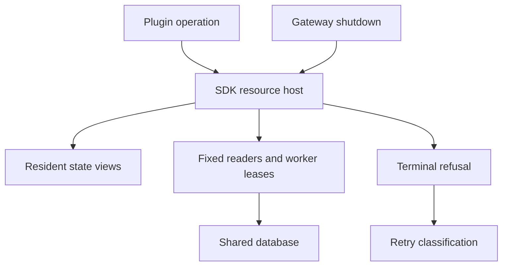

Codex review: needs changes before merge.

## What this changes

This PR rejects late plugin shared-state operations, drains accepted work, and stops retrying terminal shutdown errors.

**Example:** A plugin finalizer looks up the key ready after SIGTERM begins Gateway shutdown.
- **Before:** The lookup can enter retiring storage and terminal failures can consume three retry attempts.
- **After:** The lookup receives STATE_DATABASE_READ_ADMISSION_INVALIDATED once while previously accepted operations drain.

## Review scores

| Measure | Result | What it means |
|---|---|---|
| **Overall readiness** | 🦪 silver shellfish **(2/6)** | Useful lifecycle repair with focused reported regressions, blocked by an introduced static dependency cycle. |
| **Proof confidence** | 🦐 gold shrimp **(3/6)** | The maintainer-authored PR is outside the ordinary contributor proof gate; it reports Node and Bun process regressions exercising late plugin refusal and clean SIGTERM and managed-restart exits, supported by the inspected process fixture. |
| **Patch quality** | 🦪 silver shellfish **(2/6)** | 1 actionable review finding remain. |

## Product

**Kind:** Bug fix · **Worth it:** Yes · **Fix scope:** Complete
**User problem:** Plugin background state work can continue into Gateway worker retirement and repeatedly retry failures that cannot recover.
**Reason:** The linked repair explicitly reserved this follow-up, and the maintainer-authored PR preserves accepted work while refusing late operations.

## Merge readiness

⛔ **Needs changes before merge - 1 item remains**

Keep this PR: it addresses a distinct shutdown bug, but its new storage imports introduce a dependency cycle that blocks the architecture check.

**Priority:** P2
**Reviewed head:** `021cf2cab1cfebf15249e7bddd84573f430fb210`

## Before merge

- [ ] **Break the storage-to-SDK-host import cycle (P2)** - Importing the SDK host here closes a static dependency cycle: openclaw-state-worker-store → legacy-sdk-resource-host → runtime/gateway-request-scope → gateway/server-methods/types → shared-types → config-revision-token → openclaw-state-worker-store. The architecture scanner includes type imports, so the type-only Gateway edges still count. The exact-head architecture check reports madge-import-cycles failed. The analogous new reader and lease imports also enter this graph. Expose host-owned admission through a leaf contract without importing the Gateway-coupled host implementation into storage.

## Findings

- [P2] Break the storage-to-SDK-host import cycle — `src/state/openclaw-state-worker-store.ts:3`

<strong>Agent review details</strong>

### How this fits together

Plugin state APIs reach resident namespace views, fixed readers, or shared worker leases; the SDK resource host coordinates their admission and completion with Gateway shutdown.

### Technical review

Best possible solution:

Keep admission and drainage owned by the SDK host while exposing the storage-facing operation through an acyclic leaf contract.

Do we have a high-confidence way to reproduce the issue?

The base admits state operations without the new shutdown fence, and channel retry policy treats closed or unavailable errors as transient; linked repair evidence records matching red regressions.

Is this the best way to solve the issue?

The existing SDK host is the appropriate lifecycle owner, but importing its Gateway-coupled module from storage violates the repository's acyclic dependency gate.

Full review comments:

- [P2] Break the storage-to-SDK-host import cycle — `src/state/openclaw-state-worker-store.ts:3`
  Importing the SDK host here closes a static dependency cycle: openclaw-state-worker-store → legacy-sdk-resource-host → runtime/gateway-request-scope → gateway/server-methods/types → shared-types → config-revision-token → openclaw-state-worker-store. The architecture scanner includes type imports, so the type-only Gateway edges still count. The exact-head architecture check reports madge-import-cycles failed. The analogous new reader and lease imports also enter this graph. Expose host-owned admission through a leaf contract without importing the Gateway-coupled host implementation into storage.
  Confidence: 0.99

Overall correctness: patch is incorrect
Overall confidence: 0.95

AGENTS.md: found and applied where relevant.

Codex review notes: model internal, reasoning medium; reviewed against [ece4ca85af0e](https://github.com/openclaw/openclaw/commit/ece4ca85af0e0ffa7cc619522b9e8b7e40b08da9).

### Provenance checked

- `SDK resource retention and drainage` keeps the original intent (05a2844d39c267707fac5257136c1f80e1ef9b46: Accepted plugin work must retain its supplying resources through completion and cleanup.)
- `Retained shared-worker leases` keeps the original intent (19c6ef8d9e0260471b798615e8a1eaf42b9aada3: Worker-backed capture must drain admitted writes while retaining terminal cleanup ownership.)
- `Plugin publication ordering and namespace views` keeps the original intent (https://github.com/openclaw/openclaw/pull/183844: Committed namespace views avoid repeated SQL reads while publication and live-authority checks remain authoritative.)
- `Caller-controlled retry policy` changes intended behavior with a stated reason (d49acffa5e1a696a145eb71534fd7eee70a71412: The shared retry scheduler preserved caller-specific predicates and schedules; this PR explicitly makes terminal storage retirement override those predicates.)
- `Nostr durable cursor recovery` changes intended behavior with a stated reason (7a35e243c4df6566d9bc715dec111d4dd0b9620c: Cursor recovery prevents progress beyond undurable ingress; transient recovery remains, while documented terminal shutdown refusals now stop it.)
- `Gateway close entrypoints` keeps the original intent (b3260afd30a81054684634f3486fcd4c4e1f020c: Shutdown retains the actual SDK host through cleanup; the new wrapper preserves that host and removes only the initiating plugin invocation.)

### Testing

Proof path: in-process harness.

### Security

None.

### Evidence

Acceptance criteria:

- pnpm check:madge-import-cycles
- pnpm test src/plugin-state/plugin-state-worker.test.ts src/infra/retry-policy.test.ts src/llm/utils/retry.test.ts extensions/nostr/src/nostr-cursor.test.ts --maxWorkers=1
- pnpm test src/state/dreaming-startup-admission.test.ts src/gateway/server-startup-lifetime.test.ts --maxWorkers=1
- OPENCLAW_VITEST_RUNTIME=node node scripts/run-vitest.mjs test/gateway-restart-resume.e2e.test.ts --maxWorkers=1
- OPENCLAW_VITEST_RUNTIME=bun node scripts/run-vitest.mjs test/gateway-restart-resume.e2e.test.ts --maxWorkers=1

What I checked:

- **Introduced dependency cycle:** The added import closes this static cycle: state worker store → SDK resource host → Gateway request scope → server-method types → shared types → config revision projector → state worker store. ([`src/state/openclaw-state-worker-store.ts:3`](https://github.com/openclaw/openclaw/blob/021cf2cab1cfebf15249e7bddd84573f430fb210/src/state/openclaw-state-worker-store.ts#L3), [021cf2cab1cf](https://github.com/openclaw/openclaw/commit/021cf2cab1cfebf15249e7bddd84573f430fb210))
- **Architecture failure matches source:** The exact-head check-guards-architecture check failed with the annotation madge-import-cycles failed. Its source scanner includes static import and export declarations, including type imports. ([`scripts/check-madge-import-cycles.ts:25`](https://github.com/openclaw/openclaw/blob/021cf2cab1cfebf15249e7bddd84573f430fb210/scripts/check-madge-import-cycles.ts#L25), [021cf2cab1cf](https://github.com/openclaw/openclaw/commit/021cf2cab1cfebf15249e7bddd84573f430fb210))
- **Distinct deferred repair:** https://github.com/openclaw/openclaw/pull/188976 explicitly deferred plugin shared-state admission and terminal retry classification, identifying the late accepted lookup and repeated retry failures. ([c75a8a821e50](https://github.com/openclaw/openclaw/commit/c75a8a821e50ee3d4659a1b977f96d0ec9521574))
- **Accepted-work ownership:** The existing SDK host now tracks state operations and permits nested acquisition only while the admitted operation remains active; completion disables inherited admission. ([`src/plugins/legacy-sdk-resource-host.ts:68`](https://github.com/openclaw/openclaw/blob/021cf2cab1cfebf15249e7bddd84573f430fb210/src/plugins/legacy-sdk-resource-host.ts#L68), [021cf2cab1cf](https://github.com/openclaw/openclaw/commit/021cf2cab1cfebf15249e7bddd84573f430fb210))
- **Process regression coverage:** The existing isolated Gateway process scenario adds a plugin lookup during shutdown and asserts one terminal refusal, exit 0, and no worker-retirement or plugin-state-open diagnostics; the body reports Node and Bun passes. ([`test/gateway-restart-resume.e2e.test.ts:644`](https://github.com/openclaw/openclaw/blob/021cf2cab1cfebf15249e7bddd84573f430fb210/test/gateway-restart-resume.e2e.test.ts#L644), [021cf2cab1cf](https://github.com/openclaw/openclaw/commit/021cf2cab1cfebf15249e7bddd84573f430fb210))
- **Current main still lacks this repair:** Fetched main retains the unfenced SDK host and retry adapter without terminal state-admission classification. ([`src/infra/retry.ts`](https://github.com/openclaw/openclaw/blob/ece4ca85af0e0ffa7cc619522b9e8b7e40b08da9/src/infra/retry.ts), [ece4ca85af0e](https://github.com/openclaw/openclaw/commit/ece4ca85af0e0ffa7cc619522b9e8b7e40b08da9))

### PR surface

Source +128, Tests +27, Docs +7. Total +162 across 20 files. Added test files: 0.

View PR surface stats

| Area | Files | Added | Removed | Net |
|---|---:|---:|---:|---:|
| Source | 14 | 300 | 172 | +128 |
| Tests | 5 | 177 | 150 | +27 |
| Docs | 1 | 7 | 0 | +7 |
| Config | 0 | 0 | 0 | 0 |
| Generated | 0 | 0 | 0 | 0 |
| Other | 0 | 0 | 0 | 0 |
| **Total** | **20** | **484** | **322** | **+162** |

### Review metrics

| Metric | Value | Why it matters |
|---|---|---|
| **Production versus tests** | Production +300/-172; tests +177/-150 | Net production growth implements admission tracking and terminal classification; moved helpers preserve existing logic, and regressions extend existing suites. |

### Labels

Label changes:

- add `P2`: The repair addresses plugin state work and repeated terminal retries during Gateway shutdown.
- add `merge-risk: 🚨 compatibility`: Plugin state operations gain an intentional shutdown refusal boundary and the SDK gains a classifier export; the maintainer-authored direction and documented terminal behavior establish acceptance.
- add `rating: 🦪 silver shellfish`: Overall readiness is 🦪 silver shellfish; proof is 🦐 gold shrimp and patch quality is 🦪 silver shellfish.
- add `status: ⏳ waiting on author`: ClawSweeper has contributor-facing work open and is waiting for author action.

Label justifications:

- `P2`: The repair addresses plugin state work and repeated terminal retries during Gateway shutdown.
- `merge-risk: 🚨 compatibility`: Plugin state operations gain an intentional shutdown refusal boundary and the SDK gains a classifier export; the maintainer-authored direction and documented terminal behavior establish acceptance.
- `rating: 🦪 silver shellfish`: Overall readiness is 🦪 silver shellfish; proof is 🦐 gold shrimp and patch quality is 🦪 silver shellfish.
- `status: ⏳ waiting on author`: ClawSweeper has contributor-facing work open and is waiting for author action.

### Rating scale

6/6 🦀 challenger crab · 5/6 🦞 diamond lobster · 4/6 🐚 platinum hermit · 3/6 🦐 gold shrimp · 2/6 🦪 silver shellfish · 1/6 🧂 unranked krab. Overall follows the weaker of proof and patch quality; ✨ marks media proof (a screenshot, video, or linked artifact) that directly shows the changed behavior.

### Workflow

ClawSweeper edits this one comment on every review. Comment `@clawsweeper re-review` for a fresh review only. Repair and merge execution lanes are retired.

_Reviewed October 30, 2026, 11:40 PM ET / October 31, 2026, 03:40 UTC._

<!-- clawsweeper-verdict:needs-changes item=189008 sha=021cf2cab1cfebf15249e7bddd84573f430fb210 confidence=high updated_at=2026-10-31T03:35:53Z reviewed_at=2026-10-31T03:40:56.487Z lease_owner=github-run-41164972092-1 lease_comment_id=6538479085 source_revision=68573c0f48f83d09af35a435e22ee9476d59dafe2a902d18edfdb185bcb4b6d8 -->
<!-- clawsweeper-review-state:needs-changes item=189008 sha=021cf2cab1cfebf15249e7bddd84573f430fb210 v=1 -->

<!-- clawsweeper-review-version item=189008 reviewed_at=2026-10-31T03:40:56.487Z sha=021cf2cab1cfebf15249e7bddd84573f430fb210 source_revision=68573c0f48f83d09af35a435e22ee9476d59dafe2a902d18edfdb185bcb4b6d8 lease_owner=github-run-41164972092-1 lease_comment_id=6538479085 v=1 -->

<!-- clawsweeper-review item=189008 -->