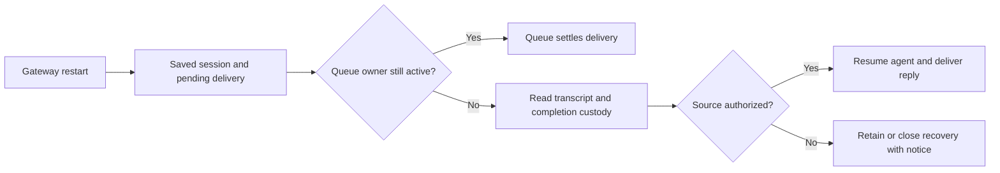

Codex review: needs maintainer review before merge. _Reviewed September 24, 2026, 10:58 PM ET / September 25, 2026, 02:58 UTC (Revision 8)._

# ClawSweeper review

## What this changes

The branch checks saved completion custody and transcript source before restart recovery dispatch, retains pending work after transcript-read failures, and adds recovery tests and documentation.

## Merge readiness

✅ **Ready for maintainer review**

Current main still permits recovery dispatch before checking the interrupted source and completion custody. This branch addresses that gap, and the documented delegated-continuity tradeoff has been explicitly accepted.

**Priority:** P1
**Reviewed head:** `71bebdd1a4090c88b2f5eb525a880d522529c0a5`

## Review scores

| Measure | Result | What it means |
|---|---|---|
| **Overall readiness** | 🐚 platinum hermit **(4/6)** | The recovery repair has focused regressions, exact-head final-effect proof, and no remaining actionable finding. |
| **Proof confidence** | 🦞 diamond lobster **(5/6)** | Sufficient (terminal): At the exact PR head, a controlled Gateway receiver exercised production recovery, admitted completion authority, and durable final delivery against reopened SQLite state and a real filesystem final-write adapter: allowed recovery wrote once, cancellation and reassignment wrote zero times, and an unowned delegated final did not dispatch. No stored-data format changes are introduced. |
| **Patch quality** | 🐚 platinum hermit **(4/6)** | No actionable review findings were identified. |

## Verification

| Check | Result | Evidence |
|---|---|---|
| **Real behavior** | Verified | Sufficient (terminal): At the exact PR head, a controlled Gateway receiver exercised production recovery, admitted completion authority, and durable final delivery against reopened SQLite state and a real filesystem final-write adapter: allowed recovery wrote once, cancellation and reassignment wrote zero times, and an unowned delegated final did not dispatch. No stored-data format changes are introduced. |
| **Evidence reviewed** | 8 items | Current main remains vulnerable: Current main resumes a replayable pending final after a transcript read error and checks completion custody only after an earlier pending-final dispatch path. The PR's central repair is therefore still needed. Introduced recovery ordering: The pinned base-to-head patch moves harness completion checks ahead of dispatch, reads source and checkpoint together, and refuses delegated replay without surviving authority. Source classification: The snapshot-bound visitor classifies the latest non-recovery user input while retaining the replay-safe checkpoint decision; the recovery store consumes both facts before starting another run. |
| **Findings** | None | None. |
| **Security** | None | None. |

## How this fits together

After a Gateway restart, main-session recovery reads saved session and transcript state to decide whether to resume an interrupted agent turn. That decision can start a new turn and ultimately deliver a final reply.

## Before merge

None.

<strong>Agent review details</strong>

### Security

None.

### PR surface

Source +36, Tests +230, Docs +7. Total +273 across 4 files.

View PR surface stats

| Area | Files | Added | Removed | Net |
|---|---:|---:|---:|---:|
| Source | 2 | 135 | 99 | +36 |
| Tests | 1 | 231 | 1 | +230 |
| Docs | 1 | 7 | 0 | +7 |
| Config | 0 | 0 | 0 | 0 |
| Generated | 0 | 0 | 0 | 0 |
| Other | 0 | 0 | 0 | 0 |
| **Total** | **4** | **373** | **100** | **+273** |

### Review metrics

| Metric | Value | Why it matters |
|---|---|---|
| **Code versus regression coverage** | production +36 net lines; tests +230 net lines | The added production logic is concentrated in recovery eligibility and snapshot inspection, with larger boundary regression coverage. |
| **Owning test cost** | 7 added cases: 16.591 s reported; full file: 423.27 s wall | The full file is costly in CI, and the PR records both the added-case time and the one-worker file measurement. |

### Technical review

Best possible solution:

Keep recovery eligibility with the main-session recovery owner, preserving independent queue delivery and giving denied delegated turns clear replacement-session guidance.

Do we have a high-confidence way to reproduce the issue?

Yes, from source: current main can dispatch a replayable pending final before reading the full transcript and checking completion custody. This read-only review did not execute the reported pre-fix failure.

Is this the best way to solve the issue?

Yes. Checking source and custody in the recovery owner before dispatch is a narrow repair, and the exact-head proof covers allowed delivery and post-dispatch revocation.

AGENTS.md: found and applied where relevant.

Codex review notes: model internal, reasoning high; reviewed against [ac52478247ca](https://github.com/openclaw/openclaw/commit/ac52478247cab82e982268bcf044e482d9001558).

### Labels

Label changes:

- add `proof: sufficient`: Contributor real behavior proof is sufficient. At the exact PR head, a controlled Gateway receiver exercised production recovery, admitted completion authority, and durable final delivery against reopened SQLite state and a real filesystem final-write adapter: allowed recovery wrote once, cancellation and reassignment wrote zero times, and an unowned delegated final did not dispatch. No stored-data format changes are introduced.
- add `rating: 🐚 platinum hermit`: Overall readiness is 🐚 platinum hermit; proof is 🦞 diamond lobster and patch quality is 🐚 platinum hermit.
- add `status: 👀 ready for maintainer look`: ClawSweeper has no concrete contributor-facing blocker left for this PR. Sufficient (terminal): At the exact PR head, a controlled Gateway receiver exercised production recovery, admitted completion authority, and durable final delivery against reopened SQLite state and a real filesystem final-write adapter: allowed recovery wrote once, cancellation and reassignment wrote zero times, and an unowned delegated final did not dispatch. No stored-data format changes are introduced.
- remove `rating: 🦐 gold shrimp`: Current PR rating is `rating: 🐚 platinum hermit`, so this older rating label is no longer current.
- remove `status: 📣 needs proof`: Current PR status label is `status: 👀 ready for maintainer look`.

Label justifications:

- `P1`: A Gateway restart can otherwise resume delegated work after its sender authority is gone.
- `merge-risk: 🚨 compatibility`: Previously recoverable delegated turns now stop with replacement-session guidance; that intentional continuity change was explicitly accepted in the linked maintainer disposition.
- `merge-risk: 🚨 message-delivery`: Recovery eligibility affects pending final replies, while the proof and existing queue checks show queue-owned delivery remains with its owner.
- `merge-risk: 🚨 security-boundary`: The change decides whether a restarted turn may regain execution authority; allowed and revoked final effects were exercised in the exact-head proof.
- `rating: 🐚 platinum hermit`: Overall readiness is 🐚 platinum hermit; proof is 🦞 diamond lobster and patch quality is 🐚 platinum hermit.
- `status: 👀 ready for maintainer look`: ClawSweeper has no concrete contributor-facing blocker left for this PR. Sufficient (terminal): At the exact PR head, a controlled Gateway receiver exercised production recovery, admitted completion authority, and durable final delivery against reopened SQLite state and a real filesystem final-write adapter: allowed recovery wrote once, cancellation and reassignment wrote zero times, and an unowned delegated final did not dispatch. No stored-data format changes are introduced.
- `proof: sufficient`: Contributor real behavior proof is sufficient. At the exact PR head, a controlled Gateway receiver exercised production recovery, admitted completion authority, and durable final delivery against reopened SQLite state and a real filesystem final-write adapter: allowed recovery wrote once, cancellation and reassignment wrote zero times, and an unowned delegated final did not dispatch. No stored-data format changes are introduced.

### Evidence

What I checked:

- **Current main remains vulnerable:** Current main resumes a replayable pending final after a transcript read error and checks completion custody only after an earlier pending-final dispatch path. The PR's central repair is therefore still needed. ([`src/agents/main-session-recovery/main-session-restart-recovery-store.ts:418`](https://github.com/openclaw/openclaw/blob/ac52478247cab82e982268bcf044e482d9001558/src/agents/main-session-recovery/main-session-restart-recovery-store.ts#L418), [ac52478247ca](https://github.com/openclaw/openclaw/commit/ac52478247cab82e982268bcf044e482d9001558))
- **Introduced recovery ordering:** The pinned base-to-head patch moves harness completion checks ahead of dispatch, reads source and checkpoint together, and refuses delegated replay without surviving authority. ([`src/agents/main-session-recovery/main-session-restart-recovery-store.ts:418`](https://github.com/openclaw/openclaw/blob/71bebdd1a4090c88b2f5eb525a880d522529c0a5/src/agents/main-session-recovery/main-session-restart-recovery-store.ts#L418), [71bebdd1a409](https://github.com/openclaw/openclaw/commit/71bebdd1a4090c88b2f5eb525a880d522529c0a5))
- **Source classification:** The snapshot-bound visitor classifies the latest non-recovery user input while retaining the replay-safe checkpoint decision; the recovery store consumes both facts before starting another run. ([`src/agents/main-session-recovery/main-session-restart-recovery-replay-safety.ts:21`](https://github.com/openclaw/openclaw/blob/71bebdd1a4090c88b2f5eb525a880d522529c0a5/src/agents/main-session-recovery/main-session-restart-recovery-replay-safety.ts#L21), [71bebdd1a409](https://github.com/openclaw/openclaw/commit/71bebdd1a4090c88b2f5eb525a880d522529c0a5))
- **Owning regression coverage:** Added cases cover failed transcript reads, retained pending finals, missing completion claims, and denied delegated or unverified internal recovery through the registered recovery entry point. ([`src/agents/main-session-recovery/main-session-harness-completion.test-harness.ts:369`](https://github.com/openclaw/openclaw/blob/71bebdd1a4090c88b2f5eb525a880d522529c0a5/src/agents/main-session-recovery/main-session-harness-completion.test-harness.ts#L369), [71bebdd1a409](https://github.com/openclaw/openclaw/commit/71bebdd1a4090c88b2f5eb525a880d522529c0a5))
- **Final-effect and saved-state proof:** The exact-head proof at https://github.com/openclaw/openclaw/pull/150702#issuecomment-5825868055 shows cold-reopened SQLite state, one physical final write for allowed completion, zero writes after cancellation or requester reassignment, and zero dispatches for an unowned saved delegated final. Its controlled in-process Gateway receiver uses synthetic model output and a task-local filesystem transport; no external channel or model run is claimed. ([71bebdd1a409](https://github.com/openclaw/openclaw/commit/71bebdd1a4090c88b2f5eb525a880d522529c0a5))
- **Accepted continuity tradeoff:** The maintainer disposition in https://github.com/openclaw/openclaw/pull/150702#issuecomment-5825868055 explicitly accepts ending automatic replay when delegated sender authority is lost, including an unowned pending final; queue-owned delivery remains independent.

Likely related people:

- **Peter Steinberger:** Raw commit 45ae22e03daaaeeb0ffa4ab537fa5d2d411014d9 adds src/agents/main-session-recovery/main-session-restart-recovery-replay-safety.ts:8 relative to its recorded parents. This identifies author metadata, not feature responsibility or a PR merger. (role: source-line author; confidence: high; commits: [45ae22e03daa](https://github.com/openclaw/openclaw/commit/45ae22e03daaaeeb0ffa4ab537fa5d2d411014d9); files: `src/agents/main-session-recovery/main-session-restart-recovery-replay-safety.ts`)
- **Jason (Json):** Suggested for follow-up; no historical authorship or introduction is verified. (role: unverified routing candidate; confidence: low)
- **Galin Iliev:** Suggested for follow-up; no historical authorship or introduction is verified. (role: unverified routing candidate; confidence: low)

### Rating scale

| Score | Internal tier | Crab rank | Meaning |
|---:|:---:|---|---|
| **6/6** | S | 🦀 challenger crab | Exceptional readiness |
| **5/6** | A | 🦞 diamond lobster | Very strong readiness |
| **4/6** | B | 🐚 platinum hermit | Good normal PR; ordinary maintainer review |
| **3/6** | C | 🦐 gold shrimp | Useful, but confidence is limited |
| **2/6** | D | 🦪 silver shellfish | Proof or implementation needs work |
| **1/6** | F | 🧂 unranked krab | Not merge-ready |
| N/A | NA | 🌊 off-meta tidepool | Rating does not apply |

Overall follows the weaker of proof and patch quality.
Shiny media proof means a screenshot, video, or linked artifact directly shows the changed behavior. Runtime, network, CSP, and security claims still need visible diagnostics.

### Workflow

- ClawSweeper keeps one durable marker-backed review comment per issue or PR.
- Re-runs edit this comment so the latest verdict, findings, and automation markers stay together instead of adding duplicate bot comments.
- A fresh review can be triggered by eligible `@clawsweeper re-review` comments, exact-item GitHub events, scheduled/background review runs, or manual workflow dispatch.
- PR/issue authors and users with repository write access can comment `@clawsweeper re-review` or `@clawsweeper re-run` on an open PR or issue to request a fresh review only.
- Maintainers can also comment `@clawsweeper review` to request a fresh review only.
- Fresh-review commands do not start repair, autofix, rebase, CI repair, or automerge.
- Maintainer-only repair and merge flows require explicit commands such as `@clawsweeper autofix`, `@clawsweeper automerge`, `@clawsweeper fix ci`, or `@clawsweeper address review`.
- Maintainers can comment `@clawsweeper explain` to ask for more context, or `@clawsweeper stop` to stop active automation.

### History

Review history (7 earlier review cycles)

<!-- clawsweeper-review-history v=1 total=7 -->
- reviewed 2026-09-17T07:15:04.065Z sha 330a2baf9b3a4ec077d62f96a93deaab653c164a :: needs real behavior proof before merge. :: [P1] Preserve owed completion custody before tombstoning
- reviewed 2026-09-17T07:36:14.081Z sha e8ca7f43cf56eaa119e0f4903971c1ff2056baca :: needs real behavior proof before merge. :: [P1] Retain owed completions when the later transcript read fails
- reviewed 2026-09-17T07:42:00.831Z sha e8ca7f43cf56eaa119e0f4903971c1ff2056baca :: needs real behavior proof before merge. :: [P1] Retain owed completions when the later transcript read fails
- reviewed 2026-09-17T08:10:15.587Z sha 6e60f5f607d2a7470c5dc3b1fb2ccb509ca987ff :: needs real behavior proof before merge. :: [P1] Retain owed completions when the later transcript read fails
- reviewed 2026-09-17T08:25:17.986Z sha 59ce1c6b2fdb2bf113458ffa5af90bb0566d27d0 :: needs real behavior proof before merge. :: none
- reviewed 2026-09-17T09:01:40.047Z sha b4a5b8ce25eac0dd08ef6e092665a61cac1995dc :: needs real behavior proof before merge. :: none
- reviewed 2026-09-25T02:18:05.247Z sha 71bebdd1a4090c88b2f5eb525a880d522529c0a5 :: needs real behavior proof before merge. :: none

<!-- clawsweeper-verdict:needs-human item=150702 sha=71bebdd1a4090c88b2f5eb525a880d522529c0a5 confidence=high updated_at=2026-09-25T02:55:19Z reviewed_at=2026-09-25T02:58:03.588Z lease_owner=github-run-36088118201-1 lease_comment_id=5825910913 source_revision=d9eab091a4d07a243c4c23da9e3fa802b3346c91aa9747dbdc337b86275ce7d4 live_verification=absent -->
<!-- clawsweeper-review-state:ready item=150702 sha=71bebdd1a4090c88b2f5eb525a880d522529c0a5 v=1 -->

<!-- clawsweeper-review-version item=150702 reviewed_at=2026-09-25T02:58:03.588Z sha=71bebdd1a4090c88b2f5eb525a880d522529c0a5 source_revision=d9eab091a4d07a243c4c23da9e3fa802b3346c91aa9747dbdc337b86275ce7d4 lease_owner=github-run-36088118201-1 lease_comment_id=5825910913 v=1 -->

<!-- clawsweeper-review item=150702 -->